# FeelMyRythm 소스 읽기 가이드

**사용자 동작에서 프론트·서버·DB·오디오까지 — 16개 실습으로 읽는 전체 흐름**

> 파일을 처음부터 끝까지 외우기보다 **버튼 하나 → 호출 함수 → 저장·계산 → 화면 반영**을 따라간다. 각 장은 실제 코드, 값의 의미, 실패 경로, 리뷰할 질문과 관련 테스트를 함께 제공한다.

처음 리뷰한다면 01 → 02 → 03 → 04로 저장과 재생의 기본 구조를 잡고, 05–09에서 악보 기능을 읽는다. 이어서 10–11의 협업 데이터, 12–13의 인증·오프라인 경계, 14–15의 기기 기능을 본 뒤 16에서 실행과 검증을 연결하면 된다. 이미 아는 부분은 아래 목차로 바로 이동한다.

| 묶음        | 시작할 기능                                                                    | 이 장에서 따라갈 것                              |
| ----------- | ------------------------------------------------------------------------------ | ------------------------------------------------ |
| 핵심 저장   | [01. DashboardPage.createGroup](#실습-01-그룹-만들기)                          | 입력 → REST → 그룹·owner 저장 → 재조회           |
| 핵심 저장   | [02. EditorPage.save](#실습-02-템포맵-저장과-revision-충돌)                    | 로컬/원격 분기 · revision 충돌과 재기준 초안     |
| 재생·합주   | [03. MetronomePage.play](#실습-03-재생-버튼에서-실제-소리까지)                 | 타임라인 → 오디오 예약 → 실제 소리               |
| 재생·합주   | [04. SessionPage.sendStart](#실습-04-합주-시작과-시계-동기화)                  | 서버·WS·시계 동기화 · 고정 revision              |
| 악보        | [05. ScoresPage.upload](#실습-05-악보-업로드와-파일-정리)                      | 임시 전송 → 완료 확정 · 파일 실패 정리           |
| 악보        | [06. ScoresPage.saveMetadata](#실습-06-악보-정보와-마디-맵의-원자적-저장)      | 악보 정보 + MeasureMap의 원자적 저장             |
| 악보        | [07. ScoresPage.saveAnnotation](#실습-07-필기-저장과-실시간-동기화)            | REST 저장 → WS 전파 · 공개 범위·재연결           |
| 악보        | [08. requestOmrDraft / applyOmrDraft](#실습-08-omr-초안-생성과-마디-맵-적용)   | 비동기 분석 → 미리보기 → revision 확인·적용      |
| 편집 확장   | [09. finishSystem / MusicXML / JSON](#실습-09-수동-마디-매핑과-편집-초안-연결) | 수동 좌표 · 초안 검토 · 정확한 맵 연결           |
| 협업 데이터 | [10. DashboardPage의 관리 동작](#실습-10-프로젝트멤버권한과-하위-데이터-삭제)  | 프로젝트·곡·멤버 · 권한 · 하위 데이터 삭제       |
| 협업 데이터 | [11. PracticePage의 기록 동작](#실습-11-연습일지할-일과-악보의-마디-앵커)      | 일지·할 일·앵커 · 합주 세션 기록의 구분          |
| 공통 경계   | [12. 로그인·갱신·SSO·탈퇴](#실습-12-로그인토큰-갱신sso와-계정-삭제)            | 인증 증명 · 토큰 세대 · 계정·파일 정리           |
| 공통 경계   | [13. localDb / PWA bootstrap](#실습-13-오프라인-사본과-pwa-시작-경계)          | 사용자별 사본 · 읽기 전용 fallback · worker 교체 |
| 기기 기능   | [14. 튜너·보정·설정](#실습-14-튜너출력-지연-보정과-기기-설정)                  | 마이크 → 음높이 · 탭 → 보정값 · 테마             |
| 기기 기능   | [15. 모바일 플랫폼 연결](#실습-15-모바일-오디오보안-저장소와-딥링크)           | native 오디오 큐 · secure storage · 딥링크       |
| 실행·검증   | [16. 앱 시작·타입·테스트](#실습-16-앱-시작공용-uiapi-계약과-검증-순서)         | Router · 서버 자원 · DB · protocol · 실행 순서   |

**폴더부터 보고 싶다면:** [전체 구성](#참고-1-전체-구성) · [프론트엔드 지도](#참고-2-프론트엔드-지도) · [백엔드 지도](#참고-3-백엔드-지도) · [화면별 시작점](#참고-4-화면별-시작점과-전체-읽기-순서).

**실패 상황부터 찾는다면:** [오류별 확인 경로](#참고-5-오류별-확인-경로와-리뷰-상황) · [혼자 리뷰하는 순서](#참고-6-혼자-리뷰할-때의-순서).

**읽는 방법.** 기본 순서는 `원본 파일 → 실제 코드 발췌 → 동작 설명 → 확인할 질문`이다. 긴 함수는 해당 단계에 필요한 부분만 발췌한다. 코드 발췌는 2026-11-12의 `codex` 작업 폴더와 대조했으며 예시 이름·ID·계산값은 설명용이다. 이후 소스가 바뀌면 링크한 원본의 현재 내용을 우선한다. 소스의 구현, 테스트에 적힌 기대 동작, 실제 실행 결과는 구분해서 읽는다.

---

## 실습 01. 그룹 만들기

| 구간            | 단계별 바로가기                                                                                                                                                                                                                                                                            |
| --------------- | ------------------------------------------------------------------------------------------------------------------------------------------------------------------------------------------------------------------------------------------------------------------------------------------ |
| 프론트에서 출발 | [1. 입력](#1단계-입력을-react-상태에-저장한다) → [2. 제출](#2단계-creategroup이-제출을-받고-중복-실행을-막는다) → [3. 요청 전송](#3단계-apiclient가-자바스크립트-값을-http-요청으로-바꾼다)                                                                                                |
| 서버와 DB       | [4. 주소·검증](#4단계-요청-주소가-서버-라우트와-연결되고-입력을-검증한다) → [5. 사용자·DB 세션](#5단계-fastapi가-현재-사용자와-db-작업-세션을-준비한다) → [6. 저장](#6단계-그룹과-소유자-멤버십을-같은-트랜잭션으로-저장한다) → [7. 응답](#7단계-db-객체를-응답으로-바꾸고-201을-돌려준다) |
| 화면으로 복귀   | [8. 성공 처리](#8단계-브라우저가-성공을-처리하고-목록-재조회를-예약한다) → [9. 목록 표시](#9단계-내-그룹과-하위-정보를-다시-읽어-화면을-완성한다)                                                                                                                                          |

### 먼저 도착점을 확인한다

이번에 설명할 성공 경로는 다음 두 가지를 모두 끝낸다.

1. **저장:** `groups`에 새 그룹을, `group_members`에 생성자의 `owner` 멤버십을 함께 저장한다.
2. **표시:** 성공 응답을 받은 화면이 목록을 다시 조회하고 새 그룹을 표시한다.

`createGroup`은 브라우저의 이벤트 처리 함수이고, `create_group`은 서버의 요청 처리 함수다. 이름은 비슷하지만 **HTTP 요청을 사이에 둔 서로 다른 프로그램의 함수**다.

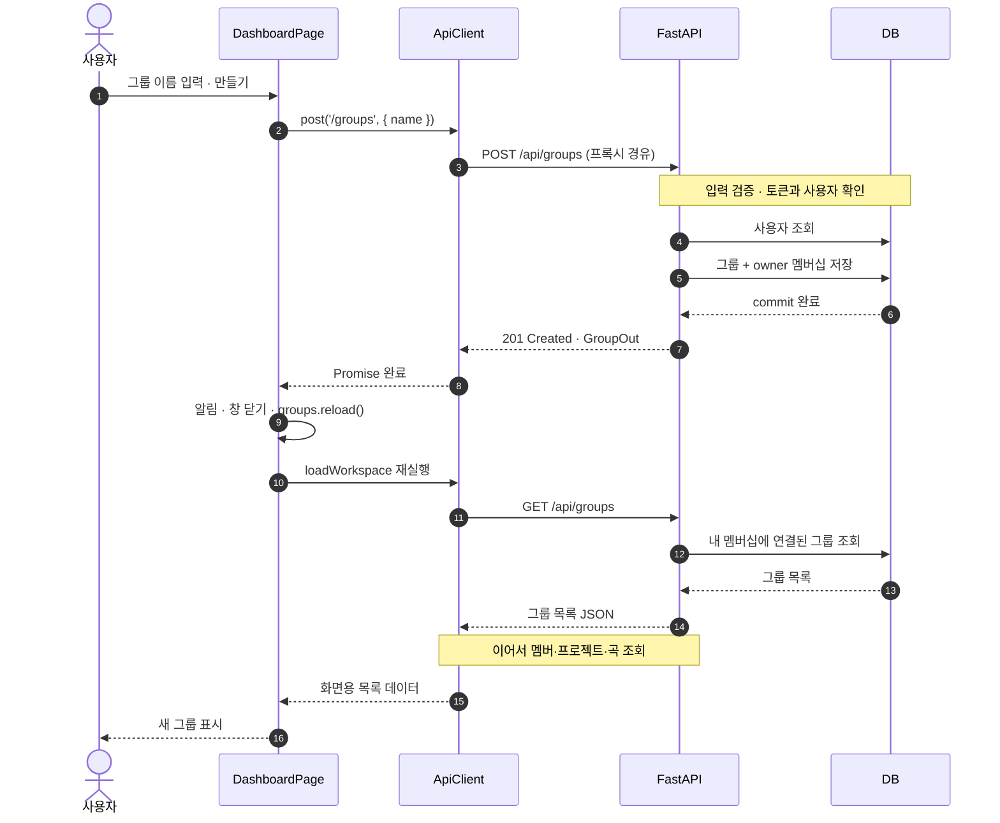

도식의 서버 주소는 `/api/groups`다. 브라우저가 실제로 요청하는 `/feelmyrythm/api/groups`가 이 주소로 바뀌는 과정은 4단계에서 확인한다.

### 1단계. 입력을 React 상태에 저장한다

**원본** [DashboardPage.tsx](../apps/web/src/pages/DashboardPage.tsx) · 찾을 이름: `groupName`, `setCreateOpen`, `onSubmit`

페이지는 다음 상태로 입력값을 기억한다.

```tsx
const [groupName, setGroupName] = useState('');
```

로그인한 사용자가 **새 그룹** 버튼을 누르면 `setCreateOpen(true)`가 입력창을 연다. 입력창 안의 실제 코드는 다음과 같다.

```tsx
<form className="stack" onSubmit={(event) => void createGroup(event)}>
  <Field
    label="그룹 이름"
    value={groupName}
    onChange={(event) => setGroupName(event.target.value)}
    autoFocus
    required
  />
  <Button variant="primary" type="submit" disabled={creatingGroup}>
    {creatingGroup ? '만드는 중…' : '만들기'}
  </Button>
</form>
```

`Field`는 공용 입력 컴포넌트이며 내부에서 HTML의 `<input>`을 사용한다. 구현은 [primitives.tsx](../packages/ui/src/primitives.tsx)에 있다.

- `value={groupName}`: 현재 React 상태를 입력창에 표시한다.
- `onChange`: 글자를 입력할 때마다 새 값을 `groupName`에 저장한다.
- `type="submit"`: 버튼을 누르면 폼의 `onSubmit`이 실행된다. 입력 중 Enter로 제출해도 같은 경로로 들어간다.
- `required`: 브라우저가 빈 입력을 검사한다. 서버의 입력 검증은 별도로 존재한다.
- `disabled={creatingGroup}`: 생성 요청 중에는 제출 버튼을 비활성화한다.

`void createGroup(event)`의 `void`는 Promise를 이벤트 함수의 반환값으로 사용하지 않는다는 표시다. 요청의 실패 처리는 다음 단계의 `try/catch` 안에서 한다.

> **여기까지의 상태:** 화면에는 이름이 입력됐지만 DB에 그룹을 저장한 단계는 아니다.

**확인할 질문:** 입력값을 가지고 있는 곳은 HTML 요소인가, React 상태인가? 이 코드에서는 `groupName`이 화면에 표시할 값을 관리한다.

### 2단계. createGroup이 제출을 받고 중복 실행을 막는다

**원본** [DashboardPage.tsx](../apps/web/src/pages/DashboardPage.tsx) · 찾을 함수: `createGroup`

```tsx
async function createGroup(event: FormEvent) {
  event.preventDefault();
  if (createGroupInFlight.current) return;
  createGroupInFlight.current = true;
  setCreatingGroup(true);
  try {
    await client.post<GroupSummary>('/groups', { name: groupName });
    notify({ title: '그룹을 만들었습니다.', tone: 'success' });
    setCreateOpen(false);
    setGroupName('');
    groups.reload();
  } catch (error) {
    notify({
      title: '그룹을 만들지 못했습니다.',
      description: error instanceof Error ? error.message : String(error),
      tone: 'danger',
    });
  } finally {
    createGroupInFlight.current = false;
    setCreatingGroup(false);
  }
}
```

처음에는 위 함수 전체를 하나의 지도처럼 보고, 아래 순서로 나누어 읽으면 된다.

| 코드                          | 하는 일                                                                         |
| ----------------------------- | ------------------------------------------------------------------------------- |
| `event.preventDefault()`      | HTML 폼의 기본 제출 동작을 막고 JavaScript로 요청을 처리한다.                   |
| `createGroupInFlight.current` | 같은 페이지에서 이미 실행 중인 생성 요청이 있으면 바로 돌아간다.                |
| `setCreatingGroup(true)`      | 화면을 다시 그려 버튼을 잠그고 `만드는 중…`을 표시한다.                         |
| `await client.post(...)`      | 서버 요청의 성공 또는 실패 결과를 기다린다. 브라우저 전체를 멈추는 것은 아니다. |
| `try`의 나머지 부분           | 성공 알림, 입력창 닫기, 입력값 초기화, 목록 재조회를 처리한다.                  |
| `catch` / `finally`           | 실패를 알리고, 성공·실패와 관계없이 생성 중 상태를 해제한다.                    |

**왜 `useRef`와 `useState`를 둘 다 쓸까?** `useRef`의 `.current`는 바로 바꿀 수 있고 렌더링을 일으키지 않는다. 재렌더링 전에 두 번째 제출이 들어와도 이 값으로 막는다. `useState`는 버튼 표시와 비활성화를 화면에 반영하는 역할이다.

이 잠금은 **현재 페이지의 진행 중인 요청**을 위한 것이다. 다른 탭이나 이미 끝난 요청의 재시도까지 서버에서 중복 제거한다는 뜻은 아니다.

**확인할 질문:** 성공했을 때만 실행해야 하는 코드는 `try`의 어디에 있고, 항상 실행해야 하는 코드는 왜 `finally`에 있는가?

### 3단계. ApiClient가 자바스크립트 값을 HTTP 요청으로 바꾼다

**원본** [api.ts](../apps/web/src/lib/api.ts) · 찾을 함수: `post`, `request`\
**연결** [auth.tsx](../apps/web/src/lib/auth.tsx)의 `AuthProvider`, `useAuth`

페이지의 `const { user, client } = useAuth()`는 공통 인증 상태에서 사용자와 API 클라이언트를 가져온다. `AuthProvider`는 토큰을 읽는 함수와 갱신하는 함수를 `ApiClient`에 연결해 둔다.

먼저 `post`가 실행된다.

```ts
post<T>(path: string, body?: unknown): Promise<T> {
  return this.request<T>(path, {
    method: 'POST',
    ...(body === undefined ? {} : { body: JSON.stringify(body) }),
  });
}
```

`JSON.stringify`가 `{ name: groupName }`이라는 자바스크립트 객체를 HTTP 본문에 실을 JSON 문자열로 바꾼다. 이어서 `request`가 URL과 헤더를 조립한다.

```ts
const authenticated = options.authenticated ?? true;
const tokens = this.readTokens();
const headers = new Headers(init.headers);
if (!(init.body instanceof FormData) && !headers.has('Content-Type')) {
  headers.set('Content-Type', 'application/json');
}
headers.set('Accept', 'application/json');
if (authenticated && tokens) headers.set('Authorization', `Bearer ${tokens.accessToken}`);

const response = await fetch(`${API_BASE}${path.startsWith('/') ? path : `/${path}`}`, {
  ...init,
  headers,
});
```

`readTokens()`는 현재 인증 토큰을 읽는다. 토큰이 있으면 `Authorization` 헤더에 넣고, `fetch`가 실제 네트워크 요청을 시작한다. 아래는 **요청 형태를 설명하는 예시**다. 실제 토큰을 기록한 것이 아니다.

```http
POST /feelmyrythm/api/groups
Content-Type: application/json
Accept: application/json
Authorization: Bearer <access-token>

{"name":"봄빛 앙상블"}
```

프론트는 생성할 그룹의 이름만 보낸다. 그룹 ID, 생성자 ID, 소유자 역할을 이 요청의 본문에서 지정하지 않는다.

`client.post<GroupSummary>`의 꺾쇠 안은 TypeScript 타입 표시다. 런타임 JSON 검증을 실행하는 코드는 아니다. 이 요청의 실제 서버 응답은 `GroupOut`이고, `GroupSummary`에는 목록 조회 후 붙이는 멤버·프로젝트 정보도 있다. 현재 `createGroup`은 생성 응답을 변수에 받지 않고 성공 여부만 기다린다.

**확인할 질문:** `client.post`는 어떤 데이터를 만들고, 실제 통신을 시작하는 줄은 어디인가?

### 4단계. 요청 주소가 서버 라우트와 연결되고 입력을 검증한다

**원본** [paths.ts](../apps/web/src/lib/paths.ts), [routers/groups.py](../apps/server/app/routers/groups.py), [schemas.py](../apps/server/app/schemas.py)

주소는 아래처럼 연결된다. 프록시는 브라우저의 요청을 실제 서버로 전달하는 중간 프로그램이다.

| 위치                          | 주소·설정                                        |
| ----------------------------- | ------------------------------------------------ |
| 페이지가 넘기는 경로          | `/groups`                                        |
| 브라우저의 API 기본 경로      | `/feelmyrythm/api`                               |
| 브라우저가 요청하는 전체 경로 | `/feelmyrythm/api/groups`                        |
| 프록시를 거친 서버 경로       | `/api/groups`                                    |
| FastAPI 라우터 설정           | `prefix="/api"`와 `@router.post("/groups", ...)` |

개발에서는 [Vite의 proxy 설정](../apps/web/vite.config.ts), 운영 이미지에서는 [nginx.conf](../nginx/nginx.conf)가 `/feelmyrythm` 접두사를 처리한다. 서버 라우터는 [main.py](../apps/server/app/main.py)의 `include_router`로 앱에 등록된다.

서버 함수가 받는 `body: GroupCreate`는 다음 입력 규칙을 가리킨다.

```python
class GroupCreate(ApiModel):
    name: NonEmpty
    description: str = ""
```

이름에 적용되는 `NonEmpty`의 실제 정의는 다음과 같다.

```python
NonEmpty = Annotated[str, StringConstraints(strip_whitespace=True, min_length=1)]
```

따라서 `"  봄빛 앙상블  "`은 앞뒤 공백이 제거된 이름이 되고, `"   "`은 유효한 이름이 아니므로 검증에서 거부된다. 생략한 `description`은 빈 문자열이 된다. 공통 `ApiModel`은 선언하지 않은 필드도 거부하므로 클라이언트가 임의의 `role`을 추가한다고 소유자 역할을 지정할 수 없다.

> **서버 함수 본문에 들어오기 위한 조건:** 입력 검증과 필요한 의존성 처리가 성공해야 한다. 아래 설명의 단계 번호가 FastAPI 내부에서 본문 검증과 인증이 실행되는 고정 순서를 뜻하는 것은 아니다.

**확인할 질문:** HTML의 `required`를 우회한 직접 API 요청도 서버가 검사하는가?

### 5단계. FastAPI가 현재 사용자와 DB 작업 세션을 준비한다

**원본** [dependencies.py](../apps/server/app/dependencies.py), [security.py](../apps/server/app/security.py), [db.py](../apps/server/app/db.py)

서버 함수의 세 인자는 각각 다른 곳에서 온다.

| 인자                | 어디서 오는가               | 의미                                           |
| ------------------- | --------------------------- | ---------------------------------------------- |
| `body: GroupCreate` | 요청 본문                   | 검증된 그룹 이름과 설명                        |
| `db: DbSession`     | `Depends(get_db)`           | 이번 요청에서 DB 작업에 사용할 SQLAlchemy 세션 |
| `user: CurrentUser` | `Depends(get_current_user)` | 인증을 통과한 실제 사용자 DB 객체              |

`Depends`는 FastAPI가 필요한 값을 준비해 함수에 넣어주는 장치다. DB의 `Session`은 로그인 세션이 아니라 **조회·저장 작업을 묶는 객체**다.

현재 사용자를 얻는 실제 코드는 다음과 같다.

```python
def get_current_user(
    request: Request,
    credentials: Annotated[HTTPAuthorizationCredentials | None, Depends(bearer)],
    db: DbSession,
    settings: AppSettings,
) -> User:
    if credentials is None or credentials.scheme.casefold() != "bearer":
        raise HTTPException(status_code=status.HTTP_401_UNAUTHORIZED, detail="Bearer token required")
    user = authenticate_access_token(db, settings, credentials.credentials)
    request_subject = trusted_sso_subject(request, settings)
    require_matching_sso_subject(user.sso_subject, request_subject)
    return user
```

`authenticate_access_token`은 토큰의 서명·만료·용도를 검사하고, 토큰 안의 사용자 식별자로 `User`를 조회한다. 사용자의 활성 상태, 이메일 검증, 인증 세대도 확인한다. 이후 SSO 모드에서는 중앙 인증 정보와 사용자가 일치하는지도 검사한다.

여기서 중요한 점은 `user.id`가 **폼에서 제출한 생성자 이름이나 ID가 아니라 서버가 인증한 사용자 정보**라는 것이다. 이 생성 API는 기존 그룹의 리더 역할을 요구하지 않는다. 인증된 사용자가 새 그룹을 만들면 그 그룹의 소유자가 된다.

DB 작업 세션의 수명은 다음 코드로 관리된다.

```python
def sessions(self) -> Iterator[Session]:
    session = self.session_factory()
    try:
        yield session
    finally:
        session.close()
```

서버 시작 시 만든 `Database`가 세션을 제공하고, 요청 처리가 끝나면 `finally`에서 닫는다. 실제 연결 대상은 서버 설정의 `database_url`로 정해진다. 운영은 PostgreSQL이고 로컬 설정에서는 SQLite도 사용할 수 있다.

**확인할 질문:** 생성자의 ID를 누가 결정하는가? `user.id`까지 거슬러 올라가 인증된 값임을 확인한다.

### 6단계. 그룹과 소유자 멤버십을 같은 트랜잭션으로 저장한다

**원본** [routers/groups.py](../apps/server/app/routers/groups.py) · 찾을 함수: `create_group`

```python
@router.post("/groups", response_model=GroupOut, status_code=status.HTTP_201_CREATED)
def create_group(body: GroupCreate, db: DbSession, user: CurrentUser) -> GroupOut:
    group = Group(name=body.name, description=body.description)
    membership = GroupMember(group=group, user_id=user.id, role="owner")
    db.add_all([group, membership])
    db.commit()
    db.refresh(group)
    db.refresh(membership)
    return group_out(group, membership)
```

트랜잭션은 **관련 DB 변경을 한 묶음으로 확정하는 단위**다. 이 함수에서는 그룹과 소유자 멤버십을 같은 묶음으로 저장한다.

1. `Group(...)`으로 메모리 안에 그룹 객체를 만든다.
2. `GroupMember(group=group, user_id=user.id, role="owner")`로 그 그룹에 연결된 소유자 멤버십을 만든다.
3. `db.add_all(...)`로 두 객체를 저장 대상으로 등록한다. 이 줄만으로 DB 저장이 확정되지는 않는다.
4. `db.commit()`이 대기 중인 변경을 DB에 반영하고 트랜잭션을 확정한다. 두 객체의 삽입 중 하나가 실패하면 이 트랜잭션의 일부만 성공한 상태로 확정하지 않는다.
5. `db.refresh(...)`로 저장된 값을 다시 읽는다. `refresh`는 추가 그룹을 만드는 동작이 아니다.
6. 마지막에 API 응답 객체를 만든다.

**왜 `group_id`를 먼저 직접 구하지 않아도 될까?** `GroupMember(group=group, ...)`가 SQLAlchemy의 관계 설정을 이용해 두 객체를 연결하기 때문이다. SQLAlchemy는 실제 저장 과정에서 그룹의 키를 멤버십의 외래키에 연결한다. 외래키는 다른 테이블의 행을 가리키는 값이다.

[models.py](../apps/server/app/models.py)의 실제 정의를 함께 읽는다.

```python
class Group(TimestampMixin, Base):
    __tablename__ = "groups"

    id: Mapped[str] = mapped_column(String(36), primary_key=True, default=new_id)
    name: Mapped[str] = mapped_column(String(160))
    description: Mapped[str] = mapped_column(Text, default="")
    members: Mapped[list[GroupMember]] = relationship(back_populates="group", cascade="all, delete-orphan")
```

```python
class GroupMember(Base):
    __tablename__ = "group_members"
    __table_args__ = (UniqueConstraint("group_id", "user_id", name="uq_group_member"),)

    id: Mapped[str] = mapped_column(String(36), primary_key=True, default=new_id)
    group_id: Mapped[str] = mapped_column(ForeignKey("groups.id", ondelete="CASCADE"), index=True)
    user_id: Mapped[str] = mapped_column(ForeignKey("users.id", ondelete="CASCADE"), index=True)
    role: Mapped[str] = mapped_column(String(16))
    joined_at: Mapped[datetime] = mapped_column(DateTime(timezone=True), default=utcnow)
    group: Mapped[Group] = relationship(back_populates="members")
    user: Mapped[User] = relationship()
```

`default=new_id`는 저장 과정에서 UUID 형식의 식별자를 생성한다. `UniqueConstraint("group_id", "user_id", ...)`는 같은 사용자가 같은 그룹에 중복으로 가입하는 것을 막는 DB 제약이다.

성공 후 DB에는 다음과 같은 관계가 생긴다. 아래 ID는 관계를 설명하기 위해 줄인 **가상 값**이다.

| 테이블          | 핵심 값                                                | 뜻                                      |
| --------------- | ------------------------------------------------------ | --------------------------------------- |
| `groups`        | `id=group-001`, `name=봄빛 앙상블`, `description=""`   | 새 그룹 한 개                           |
| `group_members` | `group_id=group-001`, `user_id=user-001`, `role=owner` | 현재 사용자가 그 그룹의 소유자라는 연결 |

> **리뷰 기준:** 그룹에 사용자 ID 하나를 직접 붙이는 구조가 아니다. 그룹과 사용자의 관계·역할을 `group_members`라는 별도 테이블에 보관한다.

**확인할 질문:** 두 행의 저장을 확정하는 줄은 어디인가? `add_all`, `commit`, `refresh`를 서로 구분할 수 있는가?

### 7단계. DB 객체를 응답으로 바꾸고 201을 돌려준다

**원본** [serializers.py](../apps/server/app/serializers.py) · 찾을 함수: `group_out`\
**응답 규칙** [schemas.py](../apps/server/app/schemas.py)의 `GroupOut`, `ApiModel`

```python
def group_out(group: Group, membership: GroupMember) -> GroupOut:
    return GroupOut(
        id=group.id,
        name=group.name,
        description=group.description,
        my_role=cast(Role, membership.role),
        created_at=group.created_at,
        updated_at=group.updated_at,
    )
```

서버는 DB 객체 전체를 그대로 내보내지 않고, 공개할 필드를 `GroupOut`으로 구성한다. `my_role`은 방금 만든 멤버십의 `owner`다.

공통 `ApiModel`의 `alias_generator=to_camel` 설정에 따라 Python 필드 이름이 API의 camelCase 이름으로 직렬화된다. 직렬화란 객체를 전송 가능한 JSON 형태로 바꾸는 과정이다.

| Python 필드  | JSON 필드   |
| ------------ | ----------- |
| `my_role`    | `myRole`    |
| `created_at` | `createdAt` |
| `updated_at` | `updatedAt` |

라우트 선언의 `status_code=201`은 새 리소스를 만들었다는 응답 상태다. 아래는 **응답 형식 예시**다. 실제 실행 결과를 캡처한 것은 아니다.

```json
{
  "id": "group-001",
  "name": "봄빛 앙상블",
  "description": "",
  "myRole": "owner",
  "createdAt": "2026-11-10T00:00:00Z",
  "updatedAt": "2026-11-10T00:00:00Z"
}
```

**확인할 질문:** 생성 응답에 멤버 목록과 프로젝트 목록까지 포함되는가? 여기서는 그룹의 기본 정보와 내 역할만 반환한다.

### 8단계. 브라우저가 성공을 처리하고 목록 재조회를 예약한다

**원본** [api.ts](../apps/web/src/lib/api.ts), [DashboardPage.tsx](../apps/web/src/pages/DashboardPage.tsx), [useAsync.ts](../apps/web/src/lib/useAsync.ts)

`ApiClient.request`는 응답의 성공 여부를 확인하고 JSON을 읽는다. 오류 상태면 `ApiError`를 던지고, 성공하면 페이지의 `await client.post(...)` 다음으로 실행이 이어진다.

2단계에서 보았던 성공 처리 부분이 이제 실행된다.

```tsx
notify({ title: '그룹을 만들었습니다.', tone: 'success' });
setCreateOpen(false);
setGroupName('');
groups.reload();
```

이 코드는 생성 응답을 목록에 직접 끼워 넣지 않는다. **서버에서 작업 공간을 다시 읽도록 요청한다.** 그룹뿐 아니라 멤버 수와 프로젝트 등 화면에 필요한 정보를 다시 구성하기 위해서다.

`groups`는 처음에 다음과 같이 만들어졌다.

```tsx
const groups = useAsync(async () => {
  if (!user) return { groups: [], failures: [] };
  return loadWorkspace(client);
}, [client, user?.id]);
```

그리고 `reload`의 실제 구현은 다음과 같다.

```ts
const [revision, setRevision] = useState(0);
const reload = useCallback(() => setRevision((current) => current + 1), []);
// The caller owns dependency stability, mirroring useEffect's contract.
// eslint-disable-next-line react-hooks/use-memo, react-hooks/exhaustive-deps
const requestKey = useMemo(() => ({}), [...dependencies, revision]);
```

`reload()`는 내부 `revision`을 증가시킨다. 이 변경으로 `requestKey`가 바뀌고, `useEffect`가 로더인 `loadWorkspace(client)`를 다시 실행한다.

여기서의 `revision`은 **조회 재실행을 위한 훅 내부 숫자**다. 템포맵의 저장 버전과는 다른 값이다. 또한 `groups.reload()`는 조회 완료를 기다리는 Promise를 반환하지 않는다. 생성 요청의 성공과 이어지는 목록 조회의 성공은 별도의 결과다.

`finally`에서 `creatingGroup`이 해제되어도 목록 조회는 아직 진행 중일 수 있다. 이때 페이지는 `groups.loading`으로 별도의 목록 로딩 상태를 표시한다.

**확인할 질문:** 성공 알림이 나타난 순간과 새 그룹 목록이 화면에 나타나는 순간은 반드시 같은가?

### 9단계. 내 그룹과 하위 정보를 다시 읽어 화면을 완성한다

**원본** [workspace.ts](../apps/web/src/lib/workspace.ts) · 찾을 함수: `loadWorkspace`\
**서버** [routers/groups.py](../apps/server/app/routers/groups.py)의 `list_groups`

```ts
export async function loadWorkspace(client: ApiClient): Promise<WorkspaceLoadResult> {
  // The root request remains authoritative: without it there is no safe workspace shape to show.
  const groups = await client.get<GroupResponse[]>('/groups');
  const limit = createRequestLimiter(WORKSPACE_REQUEST_CONCURRENCY);

  const groupLeafResults = await Promise.allSettled(
    groups.flatMap((group) => [
      limit(() => client.get<GroupMemberSummary[]>(`/groups/${group.id}/members`)),
      limit(() => client.get<ProjectResponse[]>(`/groups/${group.id}/projects`)),
    ]),
  );
```

첫 요청은 `GET /groups`다. 서버는 아래 코드로 **현재 사용자의 멤버십에 연결된 그룹**을 조회한다.

```python
@router.get("/groups", response_model=list[GroupOut])
def list_groups(db: DbSession, user: CurrentUser) -> list[GroupOut]:
    rows = db.execute(
        select(Group, GroupMember)
        .join(GroupMember, GroupMember.group_id == Group.id)
        .where(GroupMember.user_id == user.id)
        .order_by(Group.name)
    ).all()
    return [group_out(group, membership) for group, membership in rows]
```

`join`은 그룹과 멤버십을 연결하고, `where(GroupMember.user_id == user.id)`는 현재 사용자의 행만 선택한다. 6단계에서 소유자 멤버십을 함께 만들었기 때문에 새 그룹이 이 목록에 들어온다.

프론트는 그다음 각 그룹의 멤버·프로젝트, 각 프로젝트의 곡을 가져와 `GroupSummary`를 구성한다. 하위 요청의 동시 실행 수는 `WORKSPACE_REQUEST_CONCURRENCY = 6`으로 제한한다.

`useAsync`가 결과를 상태에 넣으면 React가 화면을 다시 그린다. `DashboardPage`의 `groups.data?.groups.map(...)`이 각 그룹의 이름, 내 역할, 멤버 수, 프로젝트를 표시한다.

- 그룹 목록 자체를 못 읽으면 `groups.error`로 오류와 재시도 버튼을 표시한다.
- 하위 정보 일부만 못 읽으면 성공한 데이터는 유지하고 `failures`로 누락 영역을 안내한다.

**확인할 질문:** 새 그룹이 목록에 보이는 이유를 `POST` 응답 대신 `GET /groups`의 조회 조건으로 설명할 수 있는가?

---

### 예외 흐름. 어디서 실패했는지 구분하기

성공 경로를 한 번 읽은 뒤 아래 경우만 추가로 추적한다.

| 상황                           | 처리하는 곳                        | 화면·데이터 관점의 의미                                                                                                  |
| ------------------------------ | ---------------------------------- | ------------------------------------------------------------------------------------------------------------------------ |
| 요청 중 다시 제출              | `createGroupInFlight`              | 현재 페이지에서 동시에 두 번째 생성 요청을 보내지 않는다.                                                                |
| 공백뿐인 이름                  | `GroupCreate` 입력 검증            | `422` 오류가 반환되면 생성 함수 본문의 저장 작업에 도달하지 않는다.                                                      |
| 만료되거나 거부된 토큰         | `CurrentUser`, `ApiClient.request` | 클라이언트는 조건에 따라 토큰을 갱신하거나 이미 갱신된 토큰으로 요청을 한 번 재시도한다. 최종 실패는 `catch`로 전달된다. |
| 그룹·멤버십 저장 실패          | `db.commit()`                      | 두 삽입을 한 트랜잭션으로 확정하지 못한다. 성공 응답을 만드는 경로로 계속 진행하지 않는다.                               |
| 응답을 받기 전에 네트워크 단절 | `fetch` / 페이지의 `catch`         | 오류만으로 DB 미저장을 단정할 수 없다. 서버가 이미 저장했을 가능성이 있다.                                               |
| 생성 후 목록 조회 실패         | `loadWorkspace` / `useAsync`       | 그룹 생성과 별도로 목록 오류를 표시한다. 목록 재시도는 새 그룹을 만드는 요청이 아니다.                                   |

페이지의 `catch`는 생성 실패 알림을 표시하고, `finally`는 요청 잠금을 해제한다. 성공 경로에 있는 입력값 초기화와 창 닫기는 실패 경로에서 실행하지 않는다.

> **구분해서 읽기:** 화면의 중복 클릭 방지는 서버가 같은 요청을 여러 번 받아도 결과를 하나만 만든다는 보장과 다르다. 응답을 잃은 뒤 재시도하는 경우까지 리뷰하려면 서버의 중복 처리 계약을 별도로 확인해야 한다.

### 리뷰 포인트와 테스트

이 절은 **읽어볼 테스트의 위치**를 안내한다. 이번 문서 작업에서 앱 테스트를 실행한 결과는 아니다.

| 파일                                                                              | 무엇을 확인할 때 읽는가                                                                   |
| --------------------------------------------------------------------------------- | ----------------------------------------------------------------------------------------- |
| [api.test.ts](../apps/web/src/lib/api.test.ts)                                    | 요청 JSON 형식, 동시 `401`의 토큰 갱신 공유, 한 번의 인증 재시도, 갱신 실패 처리          |
| [workspace.test.ts](../apps/web/src/lib/workspace.test.ts)                        | 그룹·멤버·프로젝트·곡을 합치는 과정, 하위 요청 수 제한, 부분 실패와 그룹 목록 실패의 차이 |
| [DashboardPage.test.tsx](../apps/web/src/pages/DashboardPage.test.tsx)            | 로컬 데이터 상태, 작업 공간의 부분 실패, 멤버 수정 중복 방지와 권한 실패 후 화면 처리     |
| [서버 conftest.py](../apps/server/tests/conftest.py)의 `ensemble`                 | `POST /api/groups`로 테스트용 그룹을 만들고 멤버·프로젝트를 준비하는 실제 API 호출 예시   |
| [test_permissions_revision.py](../apps/server/tests/test_permissions_revision.py) | 그룹 외부 사용자의 접근 거부, 멤버와 리더·소유자의 권한 차이                              |

`DashboardPage.test.tsx`에 있는 멤버 수정 중복 방지 테스트를 그룹 생성 중복 제출 테스트와 혼동하지 않는다. **이번에 읽은 파일에는 `createGroup`의 제출 전체를 직접 검증하는 전용 테스트가 보이지 않는다.** 이것은 테스트 위치를 확인한 범위의 설명이며, 전체 저장소에 해당 검증이 전혀 없다는 결론은 아니다.

직접 리뷰하며 다음 질문에 답을 적어보면 된다.

- [ ] `groupName`은 어디서 갱신되고, 요청 본문에는 어떻게 들어가는가?
- [ ] `useRef`와 `useState`는 각각 어떤 문제를 해결하는가?
- [ ] 브라우저 주소와 서버 라우트 주소가 다른 이유는 무엇인가?
- [ ] `body`, `db`, `user`는 각각 어디서 오는가?
- [ ] DB에 저장되는 두 행은 무엇이며, 누가 소유자 역할을 결정하는가?
- [ ] 생성 성공과 목록 갱신 성공을 별도로 설명할 수 있는가?

### 한 번 더 따라 읽는 데이터의 변화

| 지점        | 지금 가지고 있는 값                               |
| ----------- | ------------------------------------------------- |
| 입력창      | React 상태 `groupName = '봄빛 앙상블'`            |
| 요청 본문   | JSON `{"name":"봄빛 앙상블"}`                     |
| 서버 입력   | `GroupCreate(name='봄빛 앙상블', description='')` |
| 서버 인증   | 실제 `User` 객체의 `id`                           |
| DB 저장     | 그룹 행 + `role='owner'`인 멤버십 행              |
| 생성 응답   | 상태 `201`, `GroupOut`의 JSON                     |
| 목록 재조회 | 그룹별 멤버·프로젝트 정보를 합친 `GroupSummary[]` |
| 화면        | 새 그룹 이름, 내 역할, 멤버 수, 프로젝트          |

**여기까지 읽었다면:** `createGroup` 한 함수에서 시작해 브라우저 상태, HTTP 요청, 서버 의존성, DB 트랜잭션, 화면 재조회까지 한 바퀴를 연결한 것이다.

---

## 실습 02. 템포맵 저장과 revision 충돌

**이번 출발점** [EditorPage.tsx](../apps/web/src/pages/EditorPage.tsx)의 `save`\
**따라갈 순서** 저장 대상 결정 → 검증 → 로컬 또는 서버 저장 → 충돌 확인 → 사용자 선택 → 재저장

첫 실습에서는 그룹을 새로 만들었다. 이번에는 **이미 읽어온 템포맵을 수정해 저장한다.** 다른 사람도 같은 곡을 수정할 수 있으므로, 서버에 보낼 때는 “내가 어떤 버전을 바탕으로 편집했는지”도 함께 전달한다.

| 구간         | 단계별 바로가기                                                                                                                                                                                                                                                                                   |
| ------------ | ------------------------------------------------------------------------------------------------------------------------------------------------------------------------------------------------------------------------------------------------------------------------------------------------- |
| 저장 전      | [1. 대상 결정](#1단계-isremote로-저장-대상을-결정한다) → [2. 저장 가능 여부](#2단계-읽기-권한과-템포맵-유효성을-확인한다)                                                                                                                                                                         |
| 두 저장 경로 | [3. 로컬 저장](#3단계-로컬-저장은-같은-맵을-indexeddb에-갱신한다) · [4. 서버 요청](#4단계-서버에는-초안과-expectedrevision을-함께-보낸다) → [5. 버전 검증과-db-저장](#5단계-서버가-권한과-버전을-검사하고-새-행을-저장한다) → [6. 성공 반영](#6단계-서버가-확정한-맵을-화면과-캐시에-반영한다)    |
| 충돌 이후    | [7. 409 처리](#7단계-409가-오면-최신본을-조회하고-세-개의-맵을-준비한다) → [8. 재기준의 의미](#8단계-rebase가-보존하는-내용과-바꾸는-필드를-구분한다) → [9. 사용자 선택](#9단계-충돌-창에서-사용할-버전을-선택한다) → [10. 다시 저장](#10단계-재기준-초안을-다시-저장하고-화면-이동을-마무리한다) |

### 저장 경로를 먼저 나눈다

`revision`은 저장 버전을 나타내는 정수다. 다만 로컬과 서버에서 그 숫자를 다루는 방식은 다르다.

| 구분                | 저장 장소                              | revision과 데이터의 처리                                                                                       |
| ------------------- | -------------------------------------- | -------------------------------------------------------------------------------------------------------------- |
| 로컬 맵의 본 저장   | 브라우저 IndexedDB의 `tempoMaps`       | 프론트가 `+1`하고 같은 맵 ID의 값을 갱신한다. 이 저장 함수에는 서버식 버전 충돌 비교가 없다.                   |
| 공유 맵의 본 저장   | 서버 DB의 `tempo_map_revisions`        | 서버가 최신 버전을 비교한 뒤 `+1`한 새 행을 추가한다. 이전 버전 행을 보존한다.                                 |
| 공유 맵의 기기 사본 | 브라우저 IndexedDB의 `remoteTempoMaps` | 현재 사용자별로 보관한다. 서버 저장 성공 후 사본을 갱신하며, 충돌 처리 중에는 재기준한 초안도 이곳에 기록한다. |

> **구분할 것:** 원격 맵의 사본이 브라우저에 저장됐다는 사실만으로 서버 저장이 끝난 것은 아니다. 특히 충돌 후 재기준한 초안은 아직 서버가 받아들인 새 버전이 아니다.

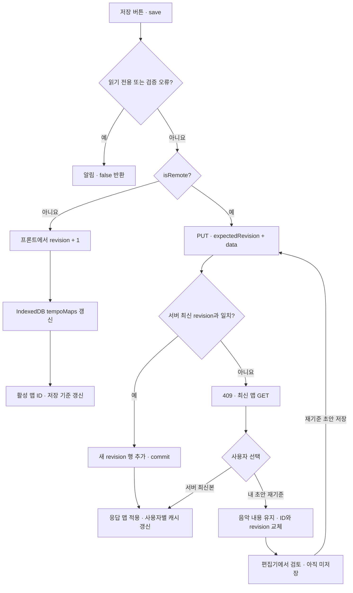

도식은 정상 저장과 revision 충돌의 핵심 경로다. 권한 오류·입력 오류·네트워크 실패는 뒤의 [저장 실패 구분](#editor-저장의-실패를-구분하기)에서 따로 읽는다.

### 1단계. isRemote로 저장 대상을 결정한다

**원본** [EditorPage.tsx](../apps/web/src/pages/EditorPage.tsx) · 찾을 값: `localSource`, `isRemote`

URL의 쿼리 문자열부터 읽는다.

```ts
const localSource = searchParams.get('source') === 'local';
```

그다음 로그인 상태와 맵의 소속을 함께 판단한다.

```ts
const isRemote = Boolean(user && !localSource && map.repertoireItemId !== 'local');
```

`isRemote`가 `true`가 되려면 **로그인한 사용자**, **`source=local`이 아님**, **`repertoireItemId`가 `'local'`이 아님**이라는 세 조건을 모두 만족해야 한다.

| 현재 상황                                           | 선택되는 저장 경로 |
| --------------------------------------------------- | ------------------ |
| 로그인했고 공유 곡을 편집하며 `source=local`이 없음 | 서버 저장          |
| 로그인했어도 `?source=local`로 연 맵                | 로컬 저장          |
| 로그인하지 않은 상태에서 편집                       | 로컬 저장          |
| 로그인했어도 맵의 `repertoireItemId`가 `'local'`    | 로컬 저장          |

예를 들어 `/editor/map-A?source=local`은 로그인 여부와 관계없이 로컬 맵을 편집한다. 원격 경로인 `/editor/piece-A`에서는 URL 매개변수 이름이 `tempoMapId`여도 실제 조회 대상은 **곡의 ID인 `repertoireItemId`**다. 원격 API 주소는 `/repertoire/piece-A/tempomap`으로 만들어진다.

이 경로의 차이는 [TempoMapJourney.test.tsx](../apps/web/src/pages/TempoMapJourney.test.tsx)의 `opens remote editing by repertoire identity when the map has a different id`에서도 확인할 수 있다.

**확인할 질문:** “로그인했으니 저장은 모두 서버로 간다”라고 설명해도 되는가? `source=local`과 맵의 소속까지 읽어야 한다.

### 2단계. 읽기 권한과 템포맵 유효성을 확인한다

**원본** [EditorPage.tsx](../apps/web/src/pages/EditorPage.tsx) · 찾을 값: `isReadOnly`, `validation`, `preview`, `save`

저장 버튼은 다음과 같이 연결된다. 하단 저장 바도 같은 `save` 함수를 호출한다.

```tsx
<Button variant="primary" onClick={() => void save()} disabled={isSaving || isReadOnly}>
  <Save size={17} aria-hidden /> {saveLabel}
</Button>
```

읽기 전용 상태는 원격 캐시를 오프라인으로 열었거나 현재 역할이 일반 멤버인 경우다.

```ts
const isOfflineReadOnly =
  offlineReadOnlyFor !== undefined &&
  offlineReadOnlyFor.tempoMapId === tempoMapId &&
  offlineReadOnlyFor.userId === user?.id;
const isReadOnly = isOfflineReadOnly || remoteRole === 'member';
```

프론트는 편집할 때마다 맵의 구조를 검증하고, 실제 연주 순서로 펼칠 수 있는지도 미리 계산한다.

```tsx
const validation = useMemo(() => validateTempoMap(map), [map]);
const preview = useMemo(() => {
  if (!validation.valid) {
    return {
      timeline: null,
      error: `검증 오류 ${validation.issues.length}개를 먼저 해결하세요.`,
    };
  }
  try {
    return { timeline: expandTimeline(map), error: null };
  } catch (error) {
    return {
      timeline: null,
      error: error instanceof Error ? error.message : String(error),
    };
  }
}, [map, validation]);
```

`validateTempoMap`은 필드와 도메인 규칙을 검사하고, `expandTimeline`은 반복·이동까지 반영한 연주 타임라인을 만든다. 단순히 입력란이 비어 있지 않은지만 확인하는 것이 아니다.

`save`의 첫 부분은 다음과 같다.

```tsx
const save = async (): Promise<boolean> => {
  if (isReadOnly) {
    notify({
      title: isOfflineReadOnly
        ? '오프라인 읽기 전용 상태에서는 저장할 수 없습니다.'
        : '프로젝트 리더만 템포맵을 저장할 수 있습니다.',
      tone: 'info',
    });
    return false;
  }
  if (!validation.valid || preview.error) {
    notify({
      title: '템포맵 오류를 먼저 고쳐 주세요.',
      description: preview.error ?? '필드 아래의 해결 방법을 확인하세요.',
      tone: 'danger',
    });
    return false;
  }
```

버튼 비활성화와 별도로 함수 내부에서도 저장 불가 상태를 검사한다. 통과하면 `setIsSaving(true)`로 저장 중 표시를 켜고, `const draft = map`으로 이번 요청에 사용할 맵을 잡는다.

`isSaving`은 버튼과 화면 상태를 위한 값이다. 앞선 그룹 생성 실습의 `createGroupInFlight`처럼 별도의 `useRef` 잠금을 이 함수가 사용하는 것은 아니다.

> **오프라인 원격 맵의 경계:** 서버 조회가 네트워크 오류로 실패해 현재 사용자의 캐시를 열면 읽기 전용이 된다. 이 상태를 로컬 편집 모드로 자동 전환해 저장하지 않는다. `403` 같은 HTTP 오류도 오래된 사본으로 숨기지 않는다.

**확인할 질문:** 저장을 막는 이유가 권한 때문인지, 오프라인 읽기 전용 때문인지, 맵 검증 실패 때문인지 구분할 수 있는가?

### 3단계. 로컬 저장은 같은 맵을 IndexedDB에 갱신한다

**원본** [EditorPage.tsx](../apps/web/src/pages/EditorPage.tsx)의 `save` 중 `else` 분기\
**저장 구현** [localDb.ts](../apps/web/src/lib/localDb.ts)의 `putTempoMap`

```tsx
const saved = { ...draft, revision: draft.revision + 1 };
await localDb.putTempoMap(saved);
localStorage.setItem('fmr.activeTempoMap', saved.id);
setMap(saved);
setSavedFingerprint(fingerprint(saved));
setUndoDelete(undefined);
```

이 분기는 API를 호출하지 않는다. 다음 순서로 로컬 상태를 확정한다.

1. 편집 중인 `draft`의 내용을 유지하면서 `revision`만 1 증가시킨다.
2. `localDb.putTempoMap(saved)`로 맵 전체를 IndexedDB에 저장한다.
3. `fmr.activeTempoMap`에는 맵의 내용 대신 **활성 맵의 ID**를 `localStorage`에 기록한다.
4. `setMap(saved)`로 화면의 맵도 새 revision으로 바꾼다.
5. `savedFingerprint`를 갱신해 현재 내용이 저장된 상태임을 기록하고, 삭제 취소 기록을 지운다.

`fingerprint(map)`의 실제 구현은 `JSON.stringify(map)`이다. 저장된 내용과 편집 중인 내용을 비교하기 위한 문자열이며, 암호학적 해시가 아니다.

로컬 DB 함수는 두 저장소를 구분한다.

```ts
async putTempoMap(map: TempoMap, scope?: RemoteCacheScope): Promise<void> {
  if (scope) {
    await (
      await database()
    ).put('remoteTempoMaps', {
      ...map,
      cacheOwnerId: cacheOwner(scope),
      updatedAt: new Date().toISOString(),
    });
    return;
  }
  await (
    await database()
  ).put('tempoMaps', {
    ...map,
    updatedAt: new Date().toISOString(),
  });
},
```

로컬 저장 분기에서는 두 번째 인자인 `scope`를 전달하지 않으므로 `tempoMaps`에 쓴다. 이 저장소의 키는 `id`다. 같은 ID를 다시 `put`하면 현재 값이 갱신되며, 서버처럼 revision마다 별도 이력 행을 쌓지 않는다.

반대로 `scope`를 전달하면 사용자 식별자인 `cacheOwnerId`를 붙여 `remoteTempoMaps`에 쓴다. 이때 키는 `[cacheOwnerId, id]`다. 원격 저장의 캐시 처리에서 다시 등장한다.

| 로컬 저장 전                                    | 로컬 저장 후                                      |
| ----------------------------------------------- | ------------------------------------------------- |
| `id=map-A`, `revision=5`, 변경한 템포           | 같은 `id=map-A`, `revision=6`, 변경한 템포        |
| `savedFingerprint`와 현재 내용이 다름           | 성공 경로가 끝나면 저장 기준이 현재 내용과 같아짐 |
| `fmr.activeTempoMap`이 다른 맵을 가리킬 수 있음 | `map-A`를 가리킴                                  |

로컬 기본 초안은 [defaultTempoMap.ts](../apps/web/src/lib/defaultTempoMap.ts)에서 기본 `revision=1`로 생성된다. 따라서 새 기본 로컬 초안의 첫 저장은 보통 `1 → 2`다. 뒤에서 다룰 서버의 첫 저장 `0 → 1`과 출발점이 다르다.

**확인할 질문:** IndexedDB의 맵 본문과 `localStorage`의 활성 ID는 각각 무엇을 저장하는가? 로컬 revision 증가만으로 여러 탭의 동시 편집 충돌이 검출되는가?

### 4단계. 서버에는 초안과 expectedRevision을 함께 보낸다

**원본** [EditorPage.tsx](../apps/web/src/pages/EditorPage.tsx)의 원격 저장 분기\
**통신** [api.ts](../apps/web/src/lib/api.ts)의 `put`

```tsx
const prepared =
  serverSnapshot && draft.revision !== serverSnapshot.revision
    ? rebaseTempoMapDraft(draft, serverSnapshot)
    : draft;
const response = await client.put<ServerTempoMap>(
  `/repertoire/${prepared.repertoireItemId}/tempomap`,
  { expectedRevision: prepared.revision, data: prepared },
);
const saved = tempoMapFromServer(response, prepared.repertoireItemId);
await applyServerMap(saved);
```

`serverSnapshot`은 화면이 알고 있는 서버본이다. 초안과 이 서버본의 revision이 다르면 `rebaseTempoMapDraft`로 보낼 초안의 기준을 맞춘다. 이 함수의 정확한 동작은 8단계에서 읽는다. **이 검사 자체가 매번 서버 최신본을 새로 가져오는 것은 아니다.** 최종 최신 여부는 서버가 판단한다.

`client.put`은 첫 실습의 `post`와 같은 `ApiClient.request`를 사용하며, HTTP 메서드만 `PUT`으로 설정한다. 웹 요청 주소는 `/feelmyrythm/api/repertoire/{곡 ID}/tempomap`이고 서버에서는 `/api/repertoire/{곡 ID}/tempomap`으로 받는다.

요청의 두 값은 서로 다른 의미를 갖는다.

| 필드               | 의미                                        | revision 5를 바탕으로 편집한 예 |
| ------------------ | ------------------------------------------- | ------------------------------- |
| `expectedRevision` | “서버 최신본이 아직 이 버전이라고 기대한다” | `5`                             |
| `data.revision`    | 이번 초안이 기준으로 삼는 버전              | `5`                             |
| `data.sections` 등 | 사용자가 수정한 실제 음악 내용              | 예: 첫 구간을 95 BPM으로 수정   |

프론트는 서버 저장을 요청할 때 이 값을 미리 6으로 올리지 않는다. **기준 버전 5를 보내고, 서버가 저장에 성공하면 6을 확정한다.**

서버 요청 모델은 [schemas.py](../apps/server/app/schemas.py)에 있다.

```python
class TempoMapWrite(ApiModel):
    expected_revision: int = Field(ge=0)
    data: TempoMapData
```

`expected_revision`은 0 이상이고, `data`는 `TempoMapData` 규칙으로 검증된다. 이 규칙은 마디 범위·구간 연결·템포·표현 등의 서버 검증을 포함한다. Python의 `expected_revision`은 API JSON에서는 공통 camelCase 규칙에 따라 `expectedRevision`이 된다.

**확인할 질문:** 사용자가 다음 버전 번호를 정해 보내는가, 자신이 편집한 기준 버전을 보내는가?

### 5단계. 서버가 권한과 버전을 검사하고 새 행을 저장한다

**원본** [routers/repertoire.py](../apps/server/app/routers/repertoire.py)의 `put_tempo_map`\
**연결** [access.py](../apps/server/app/access.py), [models.py](../apps/server/app/models.py)의 `TempoMapRevision`

요청자와 DB 작업 세션은 첫 실습처럼 `CurrentUser`, `DbSession` 의존성으로 준비된다. 함수 본문은 먼저 권한과 요청 내부의 일관성을 검사한다.

```python
require_repertoire(db, user, repertoire_id, "leader")
if body.data.repertoire_item_id != repertoire_id:
    raise HTTPException(status_code=422, detail="tempo map repertoireItemId must match the URL")
if body.data.revision != body.expected_revision:
    raise HTTPException(status_code=422, detail="tempo map revision must match expectedRevision")
```

`require_repertoire(..., "leader")`는 그룹 역할이 리더 이상인지 검사하므로 `leader`와 `owner`가 저장할 수 있다. 일반 `member`는 화면에서 버튼을 우회해 직접 요청해도 서버에서 거부된다.

또한 URL의 곡 ID와 데이터의 곡 ID가 같아야 하고, `data.revision`과 `expectedRevision`도 같아야 한다. 이 두 불일치는 요청 자체의 문제이므로 `422`다.

이제 서버에 저장된 최신 revision을 찾는다.

```python
latest = db.scalar(
    select(TempoMapRevision)
    .where(TempoMapRevision.repertoire_id == repertoire_id)
    .order_by(desc(TempoMapRevision.revision))
    .limit(1)
    .with_for_update()
)
actual = latest.revision if latest else 0
if body.expected_revision != actual:
    raise HTTPException(
        status_code=409,
        detail={
            "message": "tempo map revision conflict",
            "expectedRevision": body.expected_revision,
            "actualRevision": actual,
        },
    )
```

`revision` 내림차순의 첫 행이 최신본이다. `with_for_update()`는 PostgreSQL에서 조회한 행을 트랜잭션 동안 잠그는 요청이다. 아직 맵이 없으면 `actual`을 0으로 본다.

- `expectedRevision == actual`: 사용자가 읽은 버전을 기준으로 새 저장을 진행한다.
- `expectedRevision != actual`: 다른 저장이 먼저 반영됐으므로 `409` 충돌을 반환한다.

성공 경로는 기존 행을 수정하지 않고 새 행을 만든다.

```python
revision = actual + 1
data = body.data.model_dump(by_alias=True, exclude_none=True)
data["repertoireItemId"] = repertoire_id
data["revision"] = revision
row = TempoMapRevision(
    repertoire_id=repertoire_id,
    revision=revision,
    data=data,
    created_by_id=user.id,
)
db.add(row)
try:
    db.commit()
except IntegrityError as exc:
    db.rollback()
    raise HTTPException(status_code=409, detail="tempo map was concurrently updated") from exc
db.refresh(row)
return tempo_map_out(row)
```

`actual + 1`을 실제 새 버전으로 정한 뒤, 저장할 JSON 안의 `revision`도 그 값으로 맞춘다. `exclude_none=True`는 값이 없는 선택 필드를 생략한다. `false`나 `0`을 전부 없애는 옵션은 아니다.

DB 모델에는 다음 고유 제약도 있다.

```python
class TempoMapRevision(Base):
    __tablename__ = "tempo_map_revisions"
    __table_args__ = (
        UniqueConstraint("repertoire_id", "revision", name="uq_tempo_map_revision"),
        Index("ix_tempo_map_latest", "repertoire_id", "revision"),
    )
```

같은 곡의 같은 revision은 두 번 저장될 수 없다. 최신 행 조회의 잠금만으로 모든 경합을 설명해서는 안 된다. **특히 최초 저장에는 잠글 최신 행이 없다.** 겹친 저장이 DB 제약에 걸리면 `IntegrityError`를 잡아 rollback한 뒤 `409`로 반환하는 경로도 함께 읽어야 한다.

| 서버가 저장하기 전                     | 서버가 저장한 뒤                        |
| -------------------------------------- | --------------------------------------- |
| 같은 곡의 revision 1, 2, 3, 4, 5       | 1, 2, 3, 4, 5를 유지하고 6 추가         |
| 클라이언트는 `expectedRevision=5` 제출 | 응답의 `revision`과 `data.revision`은 6 |
| 과거 버전 5의 음악 내용                | 버전 5에 그대로 남음                    |

이 `PUT`의 성공 응답은 `200`이며, [serializers.py](../apps/server/app/serializers.py)의 `tempo_map_out`이 `TempoMapOut` 형식으로 응답을 만든다.

첫 서버 저장은 조금 다르다. 화면은 곡 접근 권한을 확인하고, 최신 맵의 `404`와 **빈 revision 목록**을 함께 확인한 경우에만 리더·소유자에게 revision 0의 초안을 제공한다. 서버도 이력이 없으면 `actual=0`으로 판단하므로 첫 저장은 `0 → 1`이다. 모든 `404`를 새 맵 생성으로 해석하는 것은 아니다.

**확인할 질문:** `422`, 최신 버전 비교의 `409`, DB 제약 위반의 `409`는 각각 어느 조건에서 발생하는가?

### 6단계. 서버가 확정한 맵을 화면과 캐시에 반영한다

**원본** [EditorPage.tsx](../apps/web/src/pages/EditorPage.tsx)의 `tempoMapFromServer`, `applyServerMap`, `cacheMap`

서버 응답은 버전 메타데이터와 `data`를 가진 바깥 객체다. 화면은 이를 다시 `TempoMap`으로 정리한다.

```ts
function tempoMapFromServer(response: ServerTempoMap, repertoireItemId: string): TempoMap {
  const candidate: unknown = {
    ...response.data,
    id: response.data.id || response.id,
    repertoireItemId,
    revision: response.revision,
  };
  assertValidTempoMap(candidate);
  return candidate;
}
```

`revision`은 서버 응답의 값을 사용하고, 다시 `assertValidTempoMap`을 통과시킨다. `response.id`는 버전 행의 ID이고 맵 데이터 안의 `response.data.id`와는 별개다. 위 함수는 데이터 안의 맵 ID를 우선 사용한다.

그다음 서버가 확인한 맵을 화면에 적용한다.

```tsx
const applyServerMap = useCallback(
  async (next: TempoMap) => {
    setMap(next);
    setSelectedId((current) =>
      next.sections.some((section) => section.id === current)
        ? current
        : (next.sections[0]?.id ?? ''),
    );
    setServerSnapshot(next);
    setSavedFingerprint(fingerprint(next));
    setRebasedPending(false);
    setUndoDelete(undefined);
    await cacheMap(next);
  },
  [cacheMap],
);
```

| 바뀌는 값               | 바꾸는 이유                                       |
| ----------------------- | ------------------------------------------------- |
| `map`                   | 서버가 확정한 데이터와 revision을 화면에 표시     |
| `selectedId`            | 편집하던 구간이 남아 있으면 선택을 유지           |
| `serverSnapshot`        | 이후 비교에 사용할 서버 기준본 갱신               |
| `savedFingerprint`      | 현재 내용을 저장 완료 기준으로 기록               |
| `rebasedPending`        | 재기준 초안의 저장 대기 표시 해제                 |
| 사용자별 IndexedDB 사본 | 다음 조회와 오프라인 읽기를 위한 기기 데이터 갱신 |

`cacheMap`은 `localDb.putTempoMap(next, remoteCacheScope)`를 호출한다. 원격 모드의 범위는 `{ userId: user.id }`이므로 사본은 사용자별로 분리된다.

**서버 저장과 캐시 저장의 성공은 구분된다.** `cacheMap`이 IndexedDB 오류를 잡으면 안내를 띄우고 `false`를 반환한다. `applyServerMap`은 그 반환값 때문에 서버 성공을 취소하지 않는다. 따라서 서버 저장이 성공하고 기기 사본만 실패한 경우에는 캐시 안내와 저장 성공 알림이 함께 나타날 수 있다.

첫 실습의 `groups.reload()`와도 차이가 있다. 이 경로는 별도의 최신 맵 `GET`을 기다려 성공을 확인하는 대신, **이번 저장 응답의 맵을 바로 화면에 적용한다.**

**확인할 질문:** 서버는 성공했는데 IndexedDB에 쓸 수 없다면, 서버 저장까지 실패했다고 표시하는가?

### 7단계. 409가 오면 최신본을 조회하고 세 개의 맵을 준비한다

**원본** [EditorPage.tsx](../apps/web/src/pages/EditorPage.tsx)의 `save` 중 `catch`\
**오류 전달** [api.ts](../apps/web/src/lib/api.ts)의 `ApiError`

서버가 버전 불일치로 보낼 수 있는 JSON은 다음과 같다. **설명용 예시**이며 실제 실행 로그가 아니다.

```json
{
  "detail": {
    "message": "tempo map revision conflict",
    "expectedRevision": 5,
    "actualRevision": 6
  }
}
```

`ApiClient.request`가 성공이 아닌 HTTP 상태를 `ApiError`로 바꿔 던진다. `save`는 **`ApiError`이고 상태가 `409`이며 원격 모드인 경우**에 충돌 처리로 들어간다.

```tsx
const latest = await fetchServerMap(draft.repertoireItemId);
if (!latest) {
  throw new Error('서버 최신 revision을 찾지 못했습니다.', { cause: error });
}
const rebased = rebaseTempoMapDraft(draft, latest);
await cacheMap(rebased);
setServerSnapshot(latest);
setSaveConflict({ draft, latest, rebased });
```

`fetchServerMap`은 `/repertoire/{곡 ID}/tempomap`을 다시 조회한다. 충돌 응답의 숫자만 바꿔 쓰는 것이 아니라 **서버의 현재 음악 내용도 함께 읽는 과정**이다. DB 제약 위반으로 반환된 `409`에는 같은 상세 숫자 필드가 없을 수 있지만, 이 경로 역시 최신 맵을 다시 읽어 처리한다.

| 이름      | 담긴 내용                                                   |
| --------- | ----------------------------------------------------------- |
| `draft`   | 저장을 시도했던 내 편집 내용과 기준 revision                |
| `latest`  | 충돌 뒤 다시 조회한 서버 최신 맵                            |
| `rebased` | 내 음악 내용을 유지하되 최신 서버의 ID·revision을 붙인 초안 |

`setSaveConflict({ draft, latest, rebased })`가 비교 창을 열게 한다. 이 시점에는 `setMap(rebased)`를 호출하지 않으므로, 편집기의 맵을 재기준 초안으로 바꾸는 선택은 아직 남아 있다.

다만 `cacheMap(rebased)`는 이미 실행된다. **현재 구현의 이 경로는 서버 미확정 초안도 사용자별 기기 사본에 기록한다.** 캐시 기록을 서버 저장 성공으로 읽으면 안 되는 이유다. 온라인으로 다시 열 때는 서버 응답을 우선 사용하므로, 캐시에 썼다는 사실이 미저장 초안의 자동 복원을 보장하지도 않는다.

최신본 조회나 재기준 준비가 실패하면 별도 오류 알림을 표시한다. `save`의 실패 경로는 `false`를 반환하고, `finally`에서 `isSaving`을 해제한다. **`409`를 받았다는 이유만으로 곧바로 두 번째 `PUT`을 보내지는 않는다.**

**확인할 질문:** 충돌 직후 서버에 다시 보내는 요청은 `PUT`인가, 최신본을 읽는 `GET`인가?

### 8단계. rebase가 보존하는 내용과 바꾸는 필드를 구분한다

**원본** [tempoMapMerge.ts](../apps/web/src/lib/tempoMapMerge.ts)의 `rebaseTempoMapDraft`

```ts
export function rebaseTempoMapDraft(draft: TempoMap, latestServer: TempoMap): TempoMap {
  assertValidTempoMap(draft);
  assertValidTempoMap(latestServer);
  if (draft.repertoireItemId !== latestServer.repertoireItemId) {
    throw new Error('서로 다른 레퍼토리의 템포맵은 덮어쓸 수 없습니다.');
  }
  return {
    ...draft,
    id: latestServer.id,
    repertoireItemId: latestServer.repertoireItemId,
    revision: latestServer.revision,
  };
}
```

여기서 *재기준*은 **내 초안의 저장 기준을 최신 서버 버전으로 옮기는 것**을 뜻한다. `...draft`로 내 초안을 먼저 펼친 뒤 아래 세 필드만 최신 서버 값으로 교체한다.

| 내 초안에서 유지                                                                   | 서버 최신본에서 가져옴               |
| ---------------------------------------------------------------------------------- | ------------------------------------ |
| `sections`, `jumps`, `measureExpressions`, `countIn`, `totalMeasures` 등 음악 내용 | `id`, `repertoireItemId`, `revision` |

예를 들어 내 초안이 revision 5·95 BPM이고 서버 최신본이 revision 6·140 BPM이라면, 재기준 결과는 **revision 6·95 BPM**이다.

> **중요한 의미:** 이 함수는 양쪽에서 바뀐 마디를 비교해 자동 병합하는 기능이 아니다. 서버에서 바뀐 음악 내용까지 자동으로 합쳐 주지 않는다. 재기준 초안을 다시 저장하면 내 음악 내용 전체가 다음 서버 버전의 기준이 된다.

서로 다른 곡의 맵을 섞지 않도록 `repertoireItemId` 일치도 검사한다. 두 맵 자체의 유효성도 확인하지만, `rebaseTempoMapDraft`는 네트워크 요청이나 서버 저장을 수행하지 않는다.

[tempoMapMerge.test.ts](../apps/web/src/lib/tempoMapMerge.test.ts)의 `rebases a local draft without replacing its musical data`가 이 함수의 핵심 의도를 직접 보여준다. 같은 파일의 `resolveTempoMaps`와 그 테스트는 별도 함수다. 현재 `EditorPage`의 저장 흐름이 호출하는 것은 `rebaseTempoMapDraft`다.

**확인할 질문:** 서버 최신본에서 다른 사람이 고친 마디가 내 초안에 자동으로 합쳐지는가? `...draft` 뒤에서 덮어쓰는 필드를 확인한다.

### 9단계. 충돌 창에서 사용할 버전을 선택한다

**원본** [EditorPage.tsx](../apps/web/src/pages/EditorPage.tsx) · 찾을 문구: `저장 충돌을 해결하세요`

충돌 창은 내 초안과 서버 최신본의 revision, 첫 구간 BPM을 비교해 보여준다. 모든 마디의 차이를 표시하는 상세 비교기는 아니다. 현재 창은 `onOpenChange={() => undefined}`로 일반적인 닫기 요청을 상태 변경으로 처리하지 않고, 다음 두 선택으로 해결하도록 되어 있다.

**선택 A · 서버 최신본 불러오기**

```tsx
const latest = saveConflict.latest;
setSaveConflict(undefined);
void applyServerMap(latest);
```

편집기의 내용과 저장 기준을 `latest`로 바꾼다. 새 버전을 서버에 쓰는 요청은 없다. 내 초안 대신 이미 서버에 저장된 버전을 사용한다.

**선택 B · 내 초안을 최신 revision에 재기준**

```tsx
const { rebased, latest } = saveConflict;
setMap(rebased);
setSelectedId(rebased.sections[0]?.id ?? '');
setServerSnapshot(latest);
setSavedFingerprint(fingerprint(latest));
setRebasedPending(true);
setSaveConflict(undefined);
void cacheMap(rebased);
```

내 음악 내용을 가진 `rebased`를 편집기에 넣되, 저장 완료 기준인 `savedFingerprint`에는 **서버 최신본의 내용**을 기록한다. 둘의 내용이 다르면 `isDirty`가 계속 참이므로 미저장 상태다.

또한 `rebasedPending=true`가 되면서 안내와 **재기준 초안 저장** 버튼 문구가 나타난다. 이 선택 자체에서는 `client.put`을 호출하지 않는다. 사용자가 내용을 검토하고 저장 버튼을 다시 눌러야 한다.

| 선택                 | 편집기에서 볼 음악 내용 | 즉시 서버에 새 버전을 쓰는가? |
| -------------------- | ----------------------- | ----------------------------- |
| 서버 최신본 불러오기 | 서버의 최신 내용        | 아니요                        |
| 내 초안 재기준       | 내가 편집한 내용        | 아니요. 검토 뒤 다시 저장     |

**확인할 질문:** 내 초안을 선택한 뒤 왜 `savedFingerprint`에 초안이 아닌 서버 최신본을 넣는가?

### 10단계. 재기준 초안을 다시 저장하고 화면 이동을 마무리한다

**원본** [EditorPage.tsx](../apps/web/src/pages/EditorPage.tsx)의 `saveLabel`, `save`, 이동 차단 효과

이제 **재기준 초안 저장**을 누르면 같은 `save`가 다시 실행된다. 앞서 revision 6으로 기준을 맞췄으므로 다음 요청은 `expectedRevision=6`, `data.revision=6`이다.

서버 최신본이 여전히 6이면 새 revision 7을 저장한다. 그사이에 누군가 7을 먼저 저장했다면 다시 `409`다. 재기준은 잠금이나 우선권을 획득하는 동작이 아니다.

아래는 [브라우저 시나리오 테스트](../e2e/editor.spec.ts)의 숫자와 같은 예다. BPM은 분당 박 수를 뜻한다.

| 시점                     | 내 편집기·요청                           | 서버 최신본                               |
| ------------------------ | ---------------------------------------- | ----------------------------------------- |
| 처음 열기                | revision 5 · 120 BPM                     | revision 5 · 120 BPM                      |
| 내가 수정                | revision 5 · **95 BPM**                  | 다른 사람이 revision 6 · **140 BPM** 저장 |
| 첫 저장                  | `expectedRevision=5` → **409**           | revision 6 유지                           |
| 최신본 조회·내 초안 선택 | revision **6** · **95 BPM**, 아직 미저장 | revision 6 · 140 BPM 유지                 |
| 명시적으로 다시 저장     | `expectedRevision=6`, 음악 내용은 95 BPM | 새 revision **7** · **95 BPM**            |
| 성공 응답 적용           | revision 7 · 95 BPM, 저장 기준 갱신      | revision 6은 과거 이력으로 유지           |

저장이 성공하면 `applyServerMap`이 `rebasedPending`을 해제하고 새 기준을 기록한다. `save`는 성공 시 `true`, 읽기 전용·검증 실패·저장 오류·충돌 처리 시 `false`를 반환한다.

**저장 후 이동**도 같은 함수를 사용하지만, 반환값만 보고 바로 화면을 옮기는 구조는 아니다. `saveAndContinueNavigation`은 `await save()`를 호출하고, 아래 효과가 실제로 이동을 재개한다.

```tsx
useEffect(() => {
  if (
    blocker.state === 'blocked' &&
    !shouldWarnAboutUnsavedChanges &&
    !isSaving &&
    !saveConflict
  ) {
    blocker.proceed();
  }
}, [blocker, isSaving, saveConflict, shouldWarnAboutUnsavedChanges]);
```

저장되지 않은 변경이 없고, 저장 중도 아니며, 해결할 충돌 창도 없을 때에만 `blocker.proceed()`가 실행된다. 따라서 오류나 충돌이 남아 있는 동안에는 저장 후 이동을 완료했다고 처리하지 않는다.

**확인할 질문:** 재기준 선택만 한 상태와 서버 저장을 끝낸 상태를 `map.revision` 숫자만으로 구분할 수 있는가? 음악 내용과 저장 기준, `rebasedPending`까지 함께 읽어야 한다.

### Editor 저장의 실패를 구분하기

| 상황                                | 실제로 일어나는 일                                         | 저장 성공으로 보면 안 되는 것                         |
| ----------------------------------- | ---------------------------------------------------------- | ----------------------------------------------------- |
| 원격 캐시를 오프라인으로 열었음     | 읽기 전용으로 표시하고 편집·가져오기·저장을 막음           | 로컬 원본 맵처럼 자유롭게 수정·저장 가능하다고 해석   |
| 프론트의 맵 검증 실패               | `save`가 알림 후 `false` 반환                              | 서버에 요청을 보냈다고 해석                           |
| 로컬 IndexedDB 쓰기 실패            | `catch`의 저장 실패 알림으로 이동                          | 다음 활성 ID·화면 갱신도 끝났다고 해석                |
| 로컬 DB 쓰기 후 `localStorage` 오류 | 앞선 DB 쓰기는 이미 끝났을 수 있음                         | 로컬 전체 흐름이 하나의 원자적 DB 트랜잭션이라고 해석 |
| 서버의 권한·입력 오류               | `403`·`422` 등의 오류를 표시                               | 오래된 캐시로 서버 거부를 우회                        |
| 서버 `409`                          | 최신본 조회와 재기준 초안 준비, 사용자 선택                | 자동 병합이나 자동 재저장                             |
| `409` 뒤 최신본 조회 실패           | 최신본을 못 불러왔다는 오류를 표시                         | 기존 초안이 서버에 반영됐다고 해석                    |
| 서버 저장 성공·캐시 쓰기 실패       | 서버 성공은 유지하고 기기 사본 오류 안내                   | 서버 저장까지 rollback됐다고 해석                     |
| 저장 응답 전에 네트워크 단절        | 실패 알림이 나타나도 서버 저장 여부는 응답만으로 확정 불가 | 무조건 미저장이라고 해석                              |

### Editor 저장의 리뷰 포인트와 테스트

아래는 **이번 설명을 소스와 대조할 때 읽은 테스트의 위치**다. 이번 문서 작업에서 앱 테스트를 실행했다는 뜻은 아니다.

| 파일                                                                              | 직접 확인할 동작                                                                      |
| --------------------------------------------------------------------------------- | ------------------------------------------------------------------------------------- |
| [EditorPage.test.tsx](../apps/web/src/pages/EditorPage.test.tsx)                  | 로컬 표현 저장, 원격 요청과 캐시, 읽기 전용, 첫 맵 revision 0, 저장 후 이동 성공·실패 |
| [TempoMapJourney.test.tsx](../apps/web/src/pages/TempoMapJourney.test.tsx)        | 곡 ID로 원격 편집 열기, 로컬 악보 맵 저장 후 복귀, 가져올 때 대상 맵 identity 유지    |
| [tempoMapMerge.test.ts](../apps/web/src/lib/tempoMapMerge.test.ts)                | 재기준이 서버 ID·revision을 가져오면서 내 음악 내용을 유지하는지                      |
| [localDb.test.ts](../apps/web/src/test/localDb.test.ts)                           | IndexedDB 왕복 저장, 사용자별 원격 사본 경계                                          |
| [test_permissions_revision.py](../apps/server/tests/test_permissions_revision.py) | 저장 권한, 오래된 revision의 409, 새 버전과 기존 이력 보존, 입력 검증                 |
| [e2e/editor.spec.ts](../e2e/editor.spec.ts)                                       | 브라우저에서 409 비교 창 → 내 초안 재기준 → 명시적 재저장으로 이어지는 흐름           |

브라우저 테스트의 `keeps the server authoritative online and requires an explicit save after a 409 rebase`는 API 응답을 `page.route`로 가짜 서버 응답으로 제공한다. **브라우저 조작 흐름의 검증**이고, 실제 서버 DB의 동시 저장을 재현하는 테스트는 아니다. 서버 권한·이력 검증 파일과 구분해서 읽는다.

그 테스트의 마지막 부분은 두 번째 저장의 기준 버전과 음악 내용, 캐시 결과를 다음처럼 확인한다.

```ts
expect(putBodies).toHaveLength(2);
expect(putBodies[1]).toMatchObject({ expectedRevision: 6, data: { revision: 6 } });
expect(putBodies[1]?.data.sections[0]?.bpm).toBe(95);
const cached = await readCachedTempoMaps(page, authState.user.id);
expect(cached).toContainEqual(
  expect.objectContaining({ id: 'server-map', revision: 7, repertoireItemId: repertoireId }),
);
```

직접 리뷰하며 다음 질문에 답을 적어본다.

- [ ] 로그인한 상태에서도 로컬 저장이 선택되는 조건은 무엇인가?
- [ ] `tempoMaps`, `remoteTempoMaps`, 서버의 `tempo_map_revisions`는 무엇이 다른가?
- [ ] 로컬 revision 증가와 서버 revision 증가를 누가 결정하는가?
- [ ] 요청의 `expectedRevision`과 `data.revision`은 왜 같아야 하는가?
- [ ] 최신 행 비교와 DB 고유 제약은 각각 어떤 충돌을 다루는가?
- [ ] `draft`, `latest`, `rebased` 중 내 음악 내용이 들어 있는 것은 무엇인가?
- [ ] 재기준은 다른 사람의 변경을 자동으로 합치는가?
- [ ] 충돌 창에서 내 초안을 선택한 뒤 실제 서버 저장은 언제 발생하는가?
- [ ] 캐시 기록·재기준 완료·서버 저장 완료를 서로 구분할 수 있는가?

**다음으로 연결할 흐름:** [실습 03. 재생 버튼에서 실제 소리까지](#실습-03-재생-버튼에서-실제-소리까지)에서 저장한 맵이 연주 시간표와 실제 클릭 소리로 바뀌는 과정을 이어 읽는다.

---

## 실습 03. 재생 버튼에서 실제 소리까지

**이번 출발점** [MetronomePage.tsx](../apps/web/src/pages/MetronomePage.tsx)의 `play`\
**따라갈 순서** 재생 가능 여부 → 타임라인 준비 → 오디오 준비 → 시작 시각 결정 → 클릭 예약 → 소리 출력 → 화면 갱신 → 정지

이번에는 실습 02에서 저장한 템포맵이 **몇 번째 마디를 언제, 어떤 소리로 연주할지**로 바뀌는 과정을 읽는다. 설명의 중심은 브라우저의 `WebAudioEngine` 경로다. 모바일 네이티브 엔진을 고르는 분기는 4단계에서 구분한다.

| 구간               | 단계별 바로가기                                                                                                                                                                                                                                                                              |
| ------------------ | -------------------------------------------------------------------------------------------------------------------------------------------------------------------------------------------------------------------------------------------------------------------------------------------- |
| 버튼과 연주 데이터 | [1. 버튼](#1단계-재생-버튼이-현재-맵과-시작-마디를-넘긴다) → [2. 연주 순서](#2단계-usemetronome이-템포맵을-실제-연주-순서로-펼친다) → [3. 박별 시간](#3단계-각-박을-곡의-시작부터-몇-초인지로-계산한다)                                                                                      |
| 소리 준비와 예약   | [4. 엔진 준비](#4단계-start가-오디오-엔진과-클릭-샘플을-준비한다) → [5. 시작 시각](#5단계-선택한-마디와-예비박을-오디오-시계에-연결한다) → [6. 예약 목록](#6단계-transport가-박들을-오디오-예약-목록으로-바꾼다) → [7. 미리 예약](#7단계-worker가-깨울-때마다-가까운-미래의-클릭을-예약한다) |
| 출력과 종료        | [8. 실제 출력](#8단계-webaudioengine이-클릭-샘플을-출력-장치에-연결한다) → [9. 화면 표시](#9단계-화면도-같은-오디오-시계에서-현재-박을-읽는다) → [10. 정지](#10단계-정지와-자연-종료가-예약과-화면-상태를-정리한다)                                                                          |
| 리뷰에 활용        | [시간 계산 예시](#숫자로-따라가기-120-bpm에서-예비박과-본박) · [예외와 경계](#메트로놈-재생의-예외와-경계) · [테스트와 질문](#메트로놈-재생의-리뷰-포인트와-테스트)                                                                                                                          |

### 이번 흐름의 파일과 역할

| 읽을 파일                                                                                                        | 맡는 일                                                                                 | 다음에 넘기는 것                    |
| ---------------------------------------------------------------------------------------------------------------- | --------------------------------------------------------------------------------------- | ----------------------------------- |
| [MetronomePage.tsx](../apps/web/src/pages/MetronomePage.tsx)                                                     | 맵을 선택하고 재생·정지 버튼을 연결한다.                                                | 현재 `map`, 시작 마디, 예비박 여부  |
| [useMetronome.ts](../apps/web/src/lib/useMetronome.ts)                                                           | React 상태와 연주 기능을 연결하는 훅이다. 타임라인·엔진·시작 시각·화면 상태를 관리한다. | 타임라인과 두 기준 시각             |
| [core/timeline.ts](../packages/core/src/timeline.ts) · [measure-tempo.ts](../packages/core/src/measure-tempo.ts) | 악보의 반복과 템포 지시를 실제 방문 순서와 초 단위 시간으로 계산한다.                   | `PerformanceTimeline`               |
| [audioEngine.ts](../apps/web/src/lib/audioEngine.ts)                                                             | 현재 플랫폼에 맞는 엔진을 고른다.                                                       | 브라우저 또는 네이티브 오디오 엔진  |
| [audio/transport.ts](../packages/audio/src/transport.ts)                                                         | 재생·정지와 재생 위치의 기준을 관리한다.                                                | 스케줄러에 전달할 시작 옵션         |
| [audio/scheduler.ts](../packages/audio/src/scheduler.ts)                                                         | 박을 오디오 시각으로 바꾸고 가까운 미래의 클릭을 미리 예약한다.                         | `scheduleClick(audioTime, kind)`    |
| [audio/webAudioEngine.ts](../packages/audio/src/webAudioEngine.ts)                                               | 짧은 클릭 샘플을 준비하고 Web Audio에 출력 시각을 지정한다.                             | `AudioBufferSourceNode.start(시각)` |
| [ui/BeatVisualizer.tsx](../packages/ui/src/BeatVisualizer.tsx)                                                   | 같은 오디오 시계를 읽어 숫자·원·진행률을 그린다.                                        | 화면의 현재 박 표시                 |

**서버와 DB는 어디에 있는가?** `MetronomePage`의 맵 조회 effect를 먼저 보면 된다. 로컬 맵은 IndexedDB에서, 공유 곡은 `GET /repertoire/{id}/tempomap`으로 읽어 `map`에 넣는다. 이후 이 실습의 `play → start → scheduleClick` 경로는 그 데이터를 기기 안에서 재생한다. 이 경로에는 박마다 서버에 요청하거나 DB에 재생 시각을 기록하는 호출이 없다. 합주용 `startSynchronized`는 뒤의 [앙상블 세션](#참고-4-화면별-시작점과-전체-읽기-순서)에서 이어 읽는다.

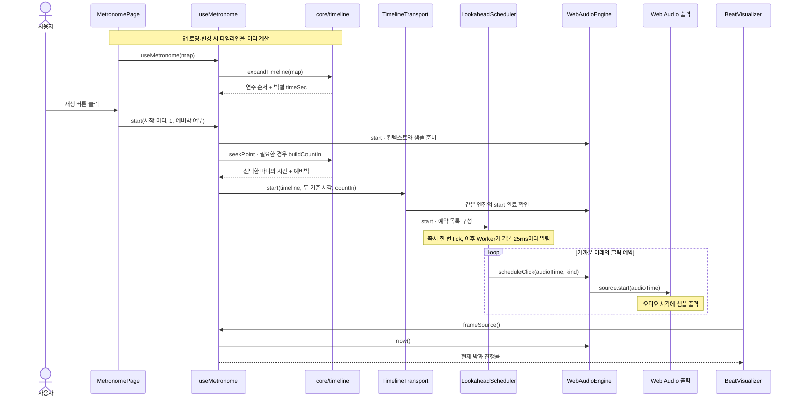

> **읽는 순서와 실행 시점을 구분한다.** 1단계에서 버튼의 입구를 찾은 뒤, 2·3단계에서 이미 준비되는 데이터를 살펴본다. `expandTimeline`의 기본 호출은 클릭 직후가 아니라 `useMemo`가 실행되는 맵 초기화·변경 시점이다. 예비박을 만들 때 `buildCountIn` 안에서도 타임라인을 다시 펼친다.

### 1단계. 재생 버튼이 현재 맵과 시작 마디를 넘긴다

**원본** [MetronomePage.tsx](../apps/web/src/pages/MetronomePage.tsx) · 찾을 값: `metronome`, `play`, `playControl`

페이지가 현재 맵을 훅에 연결한다.

```ts
const metronome = useMetronome(map);
const stopMetronome = metronome.stop;
const validStartMeasure = Math.min(map.totalMeasures, Math.max(1, startMeasure));
```

`validStartMeasure`는 입력된 시작 마디를 `1`부터 `map.totalMeasures` 사이로 제한한 값이다. 버튼의 핵심 속성은 다음과 같다. 여는 태그만 발췌했다.

```tsx
<button
  type="button"
  className={metronome.playing ? 'play-button play-button--playing' : 'play-button'}
  aria-label={metronome.playing ? '메트로놈 정지' : '메트로놈 재생'}
  aria-describedby={!mapReadyForPlayback ? 'metronome-map-status' : undefined}
  disabled={!mapReadyForPlayback}
  onClick={() => (metronome.playing ? metronome.stop() : void play())}
>
```

정지 상태에서는 `play()`로 들어가고, 재생 중이면 `metronome.stop()`으로 들어간다. `void play()`는 클릭 핸들러에서 비동기 작업을 시작한다는 뜻이며, 실패 알림은 아래 `play`의 `catch`가 맡는다.

```ts
const play = async () => {
  if (!mapReadyForPlayback) {
    notify({
      title: '템포맵을 준비한 뒤 재생할 수 있습니다.',
      tone: 'danger',
    });
    return;
  }
  try {
    await metronome.start(validStartMeasure, 1, withCountIn);
  } catch (error) {
    notify({
      title: '오디오를 시작하지 못했습니다.',
      description: error instanceof Error ? error.message : String(error),
      tone: 'danger',
    });
  }
};
```

전달되는 세 인자를 읽는다.

| 인자          | 이 화면이 넘기는 값 | 의미                                        |
| ------------- | ------------------- | ------------------------------------------- |
| `measure`     | `validStartMeasure` | 선택한 악보 마디 번호                       |
| `pass`        | `1`                 | 반복을 펼친 연주 순서에서 그 마디의 첫 방문 |
| `withCountIn` | 화면의 예비박 설정  | 선택한 시작점 앞에 예비박을 넣을지 여부     |

`mapReadyForPlayback`은 단순히 `map` 객체가 있는지만 보지 않는다. 로딩 상태와 요청한 로컬 맵 ID 또는 공유 곡 ID가 맞는지도 확인한다. 버튼 비활성화와 `play` 내부 검사에 같은 조건을 사용한다.

**확인할 질문:** 편집기에서 특정 로컬 맵을 지정해 돌아왔는데 그 맵이 없다면, 다른 맵으로 재생해도 되는가? → 이 코드의 명시적인 맵 선택 경로는 재생을 막는다.

### 2단계. useMetronome이 템포맵을 실제 연주 순서로 펼친다

**원본** [useMetronome.ts](../apps/web/src/lib/useMetronome.ts)의 `useMetronome` → [timeline.ts](../packages/core/src/timeline.ts)의 `expandTimeline`

```ts
export function useMetronome(map: TempoMap): MetronomeController {
  const timeline = useMemo(() => expandTimeline(map), [map]);
  const timelineRef = useRef(timeline);
  const engineRef = useRef<ManagedAudioEngine | null>(null);
```

`useMemo`는 현재 `map`으로 계산한 결과를 보관하고, 의존하는 `map`이 바뀌면 다시 계산한다. `timelineRef`는 이후 비동기 재생 함수에서 사용할 타임라인을 보관한다. 맵 변경 effect가 이 ref를 갱신하는 부분도 함께 찾는다.

`expandTimeline`의 입구에서는 `assertValidTempoMap`으로 음악 데이터의 유효성을 검사하고, 기본 최대 100,000개 연주 항목이라는 전개 한도를 확인한다. 이어서 연주 순서와 템포 계산 자료를 만든다.

```ts
const repeatRoute = buildRepeatRoute(map, maxEntries);
const route = applyNavigation(map, repeatRoute, maxEntries);
if (route.length === 0) {
  throw new TimelineExpansionError('TempoMap expands to an empty performance timeline');
}

const sectionTimings = createSectionTimings(map);
const tempoPlan = compileMeasureTempos(map, beatsPerMeasure);
const expressions = new Map((map.measureExpressions ?? []).map((item) => [item.measure, item]));
const passes = new Map<number, number>();
const entries: TimelineMeasure[] = [];
let timelineTime = 0;
```

- `buildRepeatRoute`: 반복과 1·2번 괄호 같은 반복별 연주 구간을 펼친다.
- `applyNavigation`: D.C.·D.S.·코다·Fine 같은 이동 지시를 반영한다.
- `createSectionTimings`: 구간별 박 수와 각 마디의 시작 박 위치를 계산한다.
- `compileMeasureTempos`: 마디별 템포 지시와 이후에 유지되는 템포를 정리한다.

그 순서를 순회하면서 각 마디의 방문 횟수인 `pass`를 붙이고 시간을 누적한다.

```ts
for (const [routeIndex, measureNumber] of route.entries()) {
  const pass = (passes.get(measureNumber) ?? 0) + 1;
  passes.set(measureNumber, pass);
  const { entry, durationSec } = createTimelineMeasure(
    map,
    measureNumber,
    pass,
    timelineTime,
    sectionTimings,
    tempoPlan,
    expressions.get(measureNumber),
  );
  entries.push(entry);
  timelineTime += durationSec;
```

예를 들어 1–2마디를 두 번 연주한다면, 연주 항목은 `1마디/pass 1 → 2마디/pass 1 → 1마디/pass 2 → 2마디/pass 2`가 된다. 악보 번호가 같아도 실제 연주 시각은 다르므로, 시작점을 찾을 때 `measure`와 `pass`가 함께 필요하다.

**확인할 질문:** `entries[2]`는 항상 악보의 3마디인가? → 반복과 이동을 펼친 뒤 세 번째로 방문하는 마디다.

### 3단계. 각 박을 곡의 시작부터 몇 초인지로 계산한다

**원본** [timeline.ts](../packages/core/src/timeline.ts) · 찾을 함수: `createTimelineMeasure`, `durationBetween`

각 마디 안에서는 본박과 분할박을 차례로 계산한다. `timeSec`는 **펼쳐진 연주 전체의 시작을 0초로 둔 시간**이다.

```ts
for (let localBeat = 0; localBeat < measureTiming.beatCount; localBeat += 1) {
  const nominalBeat = measureTiming.nominalBeatStart + localBeat;
  const scoreBeat = measureTiming.beatOffset + localBeat;
  for (let sub = 0; sub < subdivision; sub += 1) {
    if (fermata && localBeat === heldBeat && sub > 0) continue;
    const fraction = sub / subdivision;
    beats.push({
      timeSec:
        startTimeSec +
        durationBetween(sectionTiming, measureTiming.beatOffset, scoreBeat + fraction) +
        (localBeat > heldBeat ? extraDuration : 0),
      accent: sub === 0 ? (accents[nominalBeat] ?? 0) : 0,
      isSubdivision: sub !== 0,
      beatIndex: nominalBeat,
      subdivisionIndex: sub,
      bpm: tempoAt(sectionTiming, scoreBeat + fraction),
    });
  }
}
```

`subdivision`이 1이면 본박만 만들고, 2이면 한 본박을 둘로 나눈 클릭을 만든다. `beatIndex`는 본박 번호를 0부터 센 값이며, `subdivisionIndex`는 그 본박 안에서 몇 번째 클릭인지 나타낸다. 페르마타로 늘이는 본박에서는 `sub > 0`인 분할 클릭을 건너뛴다.

박의 길이는 다음 함수로 계산한다.

```ts
/** Integrates 60 / BPM over score-beat position for continuous linear BPM changes. */
function durationBetween(sectionTiming: SectionTiming, startBeat: number, endBeat: number): number {
  const { section, totalBeats } = sectionTiming;
  if (section.tempoChange?.type === 'aTempo') {
    return (60 * (endBeat - startBeat)) / section.tempoChange.targetBpm;
  }
  const targetBpm = section.tempoChange?.targetBpm ?? section.bpm;
  const slope = (targetBpm - section.bpm) / totalBeats;
  if (Math.abs(slope) < Number.EPSILON) return (60 * (endBeat - startBeat)) / section.bpm;

  const startBpm = section.bpm + slope * startBeat;
  const endBpm = section.bpm + slope * endBeat;
  return (60 / slope) * Math.log(endBpm / startBpm);
}
```

BPM은 분당 본박 수다. 일정한 120 BPM에서는 한 본박이 `60 / 120 = 0.5초`다. 4/4, 4분음표 기준, 분할 없음, 반복·표현 없음이라면 첫 마디의 클릭 시각은 `0, 0.5, 1.0, 1.5초`, 다음 마디 시작은 `2.0초`다.

rit.·accel.처럼 속도가 계속 변하면 박의 길이도 계속 달라진다. 위 로그 식은 **박 위치에 따라 선형으로 변하는 BPM을 초 단위 경과 시간으로 환산**한다. 마디별 템포 지시는 `tempoPlan.timingAt`을 통해 이 계산에 들어온다. `60 / 최초 BPM`을 곡 전체에 반복해서 더하는 방식으로 읽으면 안 된다.

| 음악 정보         | 시간표에서 달라지는 것                                                                                     |
| ----------------- | ---------------------------------------------------------------------------------------------------------- |
| 박자와 `beatUnit` | 한 마디의 본박 수. 예를 들어 6/8에 점4분음표 기준이면 본박은 2개다.                                        |
| `subdivision`     | 각 본박 사이에 분할 클릭 시각을 추가한다.                                                                  |
| 페르마타          | 지정한 본박의 길이에 `원래 길이 × extraBeats`를 더하고 뒤의 클릭을 늦춘다. 그 본박의 분할 클릭은 생략한다. |
| 쉼표 `breath`     | 마디 뒤에 클릭 없는 시간을 넣고 이후 마디의 시작을 늦춘다.                                                 |
| 쉼표 뒤 예비박    | 다음 연주 마디가 있고 `breath.countIn`이 켜져 있으면 `resumeCountIn`을 넣는다.                             |
| 못갖춘마디        | 첫 마디에 실제 연주하는 박만 남기고 원래 마디의 뒤쪽 박 번호를 유지한다.                                   |

최종 반환값은 이 세 필드다.

```ts
return {
  tempoMapRevision: map.revision,
  entries,
  totalDurationSec: timelineTime,
};
```

`tempoMapRevision`은 사용한 맵의 버전, `entries`는 연주 순서와 박별 시각, `totalDurationSec`는 쉼표·페르마타·곡 중간 재진입 예비박까지 반영한 전체 길이다. **재생 버튼의 시작 예비박**은 이후에 따로 붙이므로 이 본 연주 길이에 포함되지 않는다.

**확인할 질문:** 마지막 클릭이 끝났다는 이유로 즉시 재생을 종료하면 무엇을 놓치는가? → 마지막 박의 남은 길이, 페르마타, 마지막 쉼표의 무음 시간이 남아 있을 수 있다.

### 4단계. start가 오디오 엔진과 클릭 샘플을 준비한다

**원본** [useMetronome.ts](../apps/web/src/lib/useMetronome.ts)의 `start`, `getAudioEngine`, `startAudioEngine`

이제 1단계에서 호출한 `start`로 돌아온다. 함수 앞부분의 발췌다.

```ts
async (measure = 1, pass = 1, withCountIn = true) => {
  const request = ++startRequestRef.current;
  audioRequestedRef.current = true;
  visualOffsetMsRef.current = readVisualOffsetMs();
  transportRef.current?.stop();
  const engine = getAudioEngine();
  let transport: TimelineTransport | null = null;
  try {
    await startAudioEngine(engine);
    if (request !== startRequestRef.current) {
      if (engineRef.current !== engine || !audioRequestedRef.current) engine.stop();
      return;
    }
    audioClockRef.current.clear();
    audioClockRef.current.sampleNow(engine, performance.now());
    transport = new TimelineTransport(engine);
    transportRef.current = transport;
```

`startRequestRef`는 시작 요청의 번호다. 오디오 준비를 기다리는 동안 정지나 다른 시작 요청이 들어오면 번호가 달라진다. `await` 뒤에 이 번호를 확인해, 취소된 시작 작업이 뒤늦게 재생을 켜지 않게 한다.

`getAudioEngine`은 기존 엔진을 재사용하고, 없으면 저장된 볼륨으로 하나 만든다. `startAudioEngine`은 같은 엔진의 준비 작업이 진행 중일 때 그 Promise를 공유한다.

**엔진 선택 원본** [audioEngine.ts](../apps/web/src/lib/audioEngine.ts)

```ts
export function createPlatformAudioEngine(volume = 0.8): ManagedAudioEngine {
  const nativeEngine = nativeBridge.createAudioEngine?.({ volume });
  return nativeEngine ?? new WebAudioEngine({ volume });
}
```

네이티브 엔진이 반환되면 그것을 사용하고, 그렇지 않으면 `WebAudioEngine`을 사용한다. 네이티브 경로는 [nativeAudio.ts](../apps/mobile/src/nativeAudio.ts)의 `schedulingStrategy = 'entireTimeline'`으로 전체 예약을 전달할 수 있다. 이 문서의 **120ms씩 미리 예약하는 설명은 웹 엔진 경로**다.

**웹 엔진 준비 원본** [webAudioEngine.ts](../packages/audio/src/webAudioEngine.ts)의 `startInternal`

```ts
private async startInternal(): Promise<void> {
  const context = this.ensureContext();
  if (context.state === 'closed') {
    throw new AudioEnvironmentError('audio-context-closed', 'The Web Audio context is closed.');
  }

  if (context.state === 'suspended') await context.resume();
  this.ensureGain(context);

  this.preparePromise ??= this.prepareBuffers(context).catch((error: unknown) => {
    this.preparePromise = null;
    throw error;
  });
  await this.preparePromise;
  this.started = true;
}
```

`AudioContext`는 브라우저의 오디오 처리 환경이며, 자체 시계인 `currentTime`을 제공한다. `ensureContext`가 처음 필요할 때 만들고, 중단된 상태면 `resume()`으로 재개한다. `ensureGain`은 볼륨을 조절할 노드를 연결하고, `prepareBuffers`는 네 종류의 클릭 샘플을 준비한다.

| `kind`     | 용도                       | 기본 샘플 길이 |
| ---------- | -------------------------- | -------------- |
| `downbeat` | `accent === 2`인 강한 본박 | 55ms           |
| `beat`     | 그 밖의 본박               | 45ms           |
| `sub`      | 분할 클릭                  | 28ms           |
| `countIn`  | 시작·재진입 예비박         | 60ms           |

현재 팩토리는 별도 샘플 파일을 넘기지 않는다. 따라서 `createDefaultClickBuffer`가 파형의 진폭을 숫자로 저장한 **PCM 샘플**을 메모리에 만든다. 다음 코드는 길이와 1채널 버퍼를 준비하는 부분이다.

```ts
const definition = definitions[kind];
const length = Math.max(1, Math.ceil(definition.duration * context.sampleRate));
const buffer = context.createBuffer(1, length, context.sampleRate);
const channel = buffer.getChannelData(0);
```

이후 반복문이 사인파·배음·짧은 잡음과 감쇠를 섞어 `channel[index]`를 채운다. 이 샘플은 한 번 준비해 보관하고 각 클릭에 재사용한다. 아직 출력 시각을 지정한 것은 아니다. 실제 예약은 8단계의 `source.start()`에서 한다.

**확인할 질문:** `engine.start()`가 끝났다는 것과 첫 박 소리가 났다는 것은 같은가? → 엔진과 샘플 준비가 끝났다는 뜻이며, 클릭 시각의 예약은 뒤에 이어진다.

### 5단계. 선택한 마디와 예비박을 오디오 시계에 연결한다

**원본** [useMetronome.ts](../apps/web/src/lib/useMetronome.ts)의 `start` → [timeline.ts](../packages/core/src/timeline.ts)의 `seekPoint`, `buildCountIn`

```ts
const anchorTimelineTimeSec = seekPoint(timelineRef.current, measure, pass);
const storedCountIn = localStorage.getItem('fmr.countInMeasures');
const preferredCountInMeasures: 1 | 2 =
  storedCountIn === '1' || storedCountIn === '2'
    ? (Number(storedCountIn) as 1 | 2)
    : map.countIn.measures;
const localPlaybackMap = {
  ...map,
  countIn: { ...map.countIn, measures: preferredCountInMeasures },
};
const rawCountIn = withCountIn ? buildCountIn(localPlaybackMap, anchorTimelineTimeSec) : [];
```

`seekPoint(timeline, measure, pass)`는 해당 마디의 해당 방문을 찾아 `entry.startTimeSec`를 반환한다. 이를 `anchorTimelineTimeSec`에 넣는다. 찾을 수 없는 조합이면 `RangeError`를 던진다.

예비박 마디 수는 `localStorage`의 `fmr.countInMeasures`가 `'1'` 또는 `'2'`이면 그 설정을 우선하고, 아니면 `map.countIn.measures`를 쓴다. 복사한 `localPlaybackMap`으로 **시작 예비박**을 만든다. 이미 펼쳐 둔 본 타임라인의 `resumeCountIn`까지 이 설정으로 다시 바꾸는 코드는 아니다.

`buildCountIn`에서는 시작할 마디의 본박 수와 템포로 예비박 길이를 계산한다.

```ts
const section = sectionForMeasure(map, anchor.measureNumber);
const fullBeatCount = Math.round(beatsPerMeasure(section));
const bpm = compileMeasureTempos(map, beatsPerMeasure).bpmAt(anchor.measureNumber);
const beatDurationSec = 60 / bpm;
const count = map.countIn.measures * fullBeatCount;
const startTimeSec = fromTimeSec - count * beatDurationSec;
```

따라서 선택한 마디 앞에 충분한 예비박 시간이 생긴다. 훅에서는 이 시각을 본박 시작점에 대한 상대 시간으로 바꾸고, 오디오 시계의 시작 기준을 정한다.

```ts
const countInBeatCount = Math.max(1, ...rawCountIn.map((beat) => beat.beatIndex + 1));
const countIn = rawCountIn.map((beat) => ({
  timeSec: beat.timeSec - anchorTimelineTimeSec,
  accent: beat.accent,
  countdown: countInBeatCount - beat.beatIndex,
}));
const firstRelative = countIn[0]?.timeSec ?? 0;
const anchorAudioTime = engine.now() + 0.12 - Math.min(0, firstRelative);
setDisplayAnchor(timelineRef.current, anchorTimelineTimeSec, anchorAudioTime, countIn);
await transport.start({
  timeline: timelineRef.current,
  anchorTimelineTimeSec,
  anchorAudioTime,
  countIn,
});
```

| 값                      | 뜻                                                         | 단위             |
| ----------------------- | ---------------------------------------------------------- | ---------------- |
| `anchorTimelineTimeSec` | 선택한 시작 마디가 곡의 시간표에서 시작하는 위치           | 타임라인의 초    |
| `countIn[].timeSec`     | 그 시작점에 비해 예비박이 얼마나 앞에 있는가. 보통 음수다. | 상대 초          |
| `engine.now()`          | 웹 엔진에서는 `AudioContext.currentTime`                   | 오디오 시계의 초 |
| `anchorAudioTime`       | 선택한 시작 마디의 첫 본박을 오디오 시계에서 울릴 시각     | 오디오 시계의 초 |

`0.12`는 첫 소리를 준비할 **120ms의 시작 여유**다. 예비박이 있으면 그 길이만큼 본박의 기준 시각을 뒤로 옮긴다. 예비박이 없으면 본박이 `engine.now() + 0.12`에 시작한다. 뒤의 스케줄러도 기본 120ms를 쓰지만, 여기의 값은 **시작점 결정**, 스케줄러의 값은 **예약할 미래 범위**라는 역할 차이가 있다.

**확인할 질문:** `anchorAudioTime`은 항상 첫 소리의 시각인가? → 예비박이 있으면 첫 소리는 그보다 앞이며, 이 값은 선택한 마디의 본박 시작을 가리킨다.

### 6단계. transport가 박들을 오디오 예약 목록으로 바꾼다

**원본** [transport.ts](../packages/audio/src/transport.ts)의 `TimelineTransport.start`

`TimelineTransport`는 엔진의 재생·정지와 타임라인의 기준 시각을 함께 관리하는 객체다. 생성자에서 `LookaheadScheduler`를 만들고, 시작할 때 아래 작업을 한다. 함수 앞부분의 발췌다.

```ts
async start(options: SchedulerStartOptions): Promise<void> {
  this.scheduler.stop();
  this.binding = null;
  this.pendingBinding = null;
  await this.engine.start();
  try {
    this.scheduler.start(options);
  } catch (error) {
    this.engine.stop();
    throw error;
  }
  this.binding = {
    timeline: options.timeline,
    anchorTimelineTimeSec: options.anchorTimelineTimeSec,
    anchorAudioTime: options.anchorAudioTime,
  };
```

여기서 `engine.start()`가 한 번 더 보이지만 같은 엔진의 준비 완료를 확인하는 호출이다. 웹 엔진은 기존 컨텍스트와 준비된 버퍼를 재사용한다. 훅과 transport가 별개의 오디오 엔진을 하나씩 생성하는 구조가 아니다.

스케줄러의 `start`는 `flattenSchedule(options)`로 박을 시간순 예약 목록으로 만든다. 본박 처리의 앞부분을 보면 두 시계의 연결 공식이 나온다.

**예약 목록 원본** [scheduler.ts](../packages/audio/src/scheduler.ts)의 `flattenSchedule`

```ts
options.timeline.entries.forEach((entry, entryIndex) => {
  entry.beats.forEach((beat, beatIndex) => {
    if (beat.timeSec + Number.EPSILON < options.anchorTimelineTimeSec) return;
    assertFiniteNumber(
      beat.timeSec,
      `timeline.entries[${entryIndex}].beats[${beatIndex}].timeSec`,
    );
    const audioTime = options.anchorAudioTime + beat.timeSec - options.anchorTimelineTimeSec;
    result.push({
      scheduled: {
        id: `timeline:${entryIndex}:${beatIndex}:${audioTime}`,
        audioTime,
        timelineTimeSec: beat.timeSec,
        kind: clickKindFor(beat),
```

계산식은 `audioTime = anchorAudioTime + beat.timeSec - anchorTimelineTimeSec`다. 선택한 마디 이전의 박은 건너뛰고, 이후 박은 본박 기준에서 얼마나 떨어져 있는지에 따라 예약 시각이 정해진다. 시작 예비박은 이미 상대 시간이므로 `anchorAudioTime + countIn.timeSec`만 계산한다.

본박·분할박의 소리 종류도 여기에서 고른다.

```ts
function clickKindFor(beat: TimelineBeatLike): ClickKind {
  if (beat.isSubdivision) return 'sub';
  return beat.accent === 2 ? 'downbeat' : 'beat';
}
```

`downbeat`라는 이름만 보고 무조건 마디의 첫 박이라고 단정하지 않는다. 실제 조건은 `accent === 2`다. `accent`가 0인 본박도 `beat` 소리를 예약한다. 현재 이 함수에서 0은 무음 지시가 아니다. 예비박은 별도로 `countIn` 종류를 사용한다.

**확인할 질문:** 곡의 5마디부터 재생할 때 이전 4마디만큼 기다려야 하는가? → `anchorTimelineTimeSec`를 빼므로 선택한 마디를 시작 기준에 바로 연결한다.

### 7단계. Worker가 깨울 때마다 가까운 미래의 클릭을 예약한다

**원본** [scheduler.ts](../packages/audio/src/scheduler.ts) · 찾을 클래스: `WorkerSchedulerTimer`, `LookaheadScheduler`

```ts
export const SCHEDULER_TICK_MS = 25;
export const LOOKAHEAD_SEC = 0.12;
```

`WorkerSchedulerTimer`는 Web Worker 안의 `setInterval`로 기본 25ms마다 메시지를 보낸다. 메인 스레드의 `worker.onmessage`가 그 메시지를 받아 스케줄러의 `tick()`을 호출한다. `LookaheadScheduler.start`는 타이머를 시작한 직후에도 `tick()`을 한 번 호출한다.

`tick()`은 현재 오디오 시각부터 어디까지 미리 예약할지 정한다.

```ts
tick(): void {
  if (!this.running) return;
  const now = this.engine.now();
  const horizon =
    this.engine.schedulingStrategy === 'entireTimeline'
      ? Number.POSITIVE_INFINITY
      : now + this.lookaheadSec;
  let consumed = 0;
  const due: ScheduledBeat[] = [];
  for (const pending of this.pending) {
    const beat = pending.scheduled;
    if (beat.audioTime > horizon + Number.EPSILON) break;
    consumed += 1;
    if (beat.audioTime < now - this.lateToleranceSec) continue;
    due.push(beat);
  }
```

웹 엔진에서는 `horizon = now + 0.12`다. 예약 목록에서 그 범위에 들어오는 박을 고르며, 현재보다 기본 20ms를 넘게 늦은 박은 건너뛴다. 놓친 박들을 뒤늦게 한꺼번에 몰아 재생하지 않기 위한 처리다. 이 값은 생성자의 `lateToleranceSec`에서 확인할 수 있다.

선택한 박은 엔진에 전달하고, 화면·진동 등이 참고할 수 있게 `BeatQueue`에도 기록한다.

```ts
if (canScheduleAudioBatch(this.engine) && due.length > 0) {
  this.engine.scheduleClicks(
    due.map((beat) => ({ atAudioTime: beat.audioTime, kind: beat.kind })),
  );
} else {
  for (const beat of due) this.engine.scheduleClick(beat.audioTime, beat.kind);
}
for (const beat of due) {
  this.beatQueue.push(beat);
  this.onScheduledBeat?.(beat);
}
if (consumed > 0) this.pending = this.pending.slice(consumed);
```

`WebAudioEngine`에는 일괄 전송 함수 `scheduleClicks`가 없으므로 각 박마다 `scheduleClick`을 호출하는 경로를 탄다. `pending`에서는 처리한 항목을 제거한다. 늦어서 건너뛴 항목도 소비한 것으로 처리한다.

> **25ms는 소리를 내는 간격이 아니다.** 다음 예약을 채워 넣는 점검 주기다. 예를 들어 다음 박의 오디오 시각이 `10.50초`라면, `10.39초`에 점검하면서 그 시각을 미리 Web Audio에 전달할 수 있다. 소리는 예약한 오디오 시각을 따른다. 다만 Worker 메시지도 메인 스레드에서 처리되므로, 메인 스레드가 예약 범위를 넘게 오래 막히면 이후 박 예약이 늦어질 수 있다.

**확인할 질문:** Worker가 `tick`을 보낸 바로 그 순간에 클릭을 재생하는가? → 엔진에는 미래의 `beat.audioTime`을 전달한다. 아주 늦은 박은 건너뛰고, 허용 범위 안에서 조금 늦은 예약은 다음 단계에서 현재 시각으로 보정된다.

### 8단계. WebAudioEngine이 클릭 샘플을 출력 장치에 연결한다

**원본** [webAudioEngine.ts](../packages/audio/src/webAudioEngine.ts)의 `ensureGain`, `scheduleClick`

먼저 4단계의 준비 과정에서 연결한 출력 경로를 본다.

```ts
private ensureGain(context: AudioContext): void {
  if (this.gain !== null) return;
  this.gain = context.createGain();
  this.gain.gain.value = this.volume;
  this.gain.connect(context.destination);
}
```

`GainNode`는 볼륨 조절 지점이다. 그 출력이 `context.destination`, 즉 오디오 컨텍스트의 최종 출력 지점에 연결된다.

`WebAudioEngine.scheduleClick`은 엔진 준비와 샘플 존재를 검사한 뒤 다음을 실행한다.

```ts
  const source = context.createBufferSource();
  source.buffer = buffer;
  source.connect(gain);
  const actualStartTime = Math.max(atAudioTime, context.currentTime);
  const scheduled: ScheduledSource = { source, atAudioTime: actualStartTime };
  this.scheduled.add(scheduled);
  source.onended = () => this.scheduled.delete(scheduled);
  source.start(actualStartTime);
}
```

각 클릭마다 새 `AudioBufferSourceNode`를 만들고, 미리 준비한 `buffer`를 붙여 볼륨 노드에 연결한다. **소리가 나도록 실제 예약하는 줄은 `source.start(actualStartTime)`이다.** 호출 순간 곧바로 소리를 내라는 뜻이 아니라, 컨텍스트의 시계가 지정한 시각에 도달하면 그 샘플을 재생하라는 뜻이다. 이미 지난 시각을 받으면 `Math.max`로 현재 시각에 맞춘다.

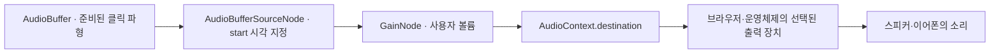

`source.onended`는 끝난 소스를 예약 추적 목록에서 제거한다. 같은 샘플 데이터는 재사용하지만, 소리 한 번을 재생하는 source 객체는 각 클릭마다 새로 만든다.

**시간의 경계도 구분한다.** `engine.now()`는 `context.currentTime`을 읽는다. 코드가 예약하는 시각은 이 오디오 시계 기준이다. 물리적인 스피커에서 듣는 순간에는 브라우저·장치의 출력 지연이 더해질 수 있다. 엔진은 `baseLatency + outputLatency`를 조회하는 함수를 제공하지만, 이번 개인 재생 `start`의 기준 시각 식에서 그 값을 빼지는 않는다. 이 문서의 시간 예시는 기기에서 측정한 발음 시각이 아니다.

**확인할 질문:** `scheduleClick`이 성공했는데 소리가 들리지 않으면 타임라인 오류라고 바로 결론 내릴 수 있는가? → 볼륨 0, 기기 음소거, 출력 장치도 별개로 확인해야 한다.

### 숫자로 따라가기. 120 BPM에서 예비박과 본박

다음은 **4/4·4분음표 기준·120 BPM·분할 없음·1마디 시작·예비박 한 마디**, 그리고 기준 시각을 계산하는 순간 `engine.now() = 10.00초`라고 가정한 계산 예시다. 실제 실행 로그가 아니다.

1. 한 본박은 `60 / 120 = 0.5초`, 한 마디는 `4 × 0.5 = 2초`다.
2. `anchorTimelineTimeSec = 0`이며, 예비박의 상대 시각은 `-2, -1.5, -1, -0.5초`다.
3. `firstRelative = -2`이므로 `anchorAudioTime = 10 + 0.12 - (-2) = 12.12초`다.
4. 첫 예비박은 `12.12 + (-2) = 10.12초`, 첫 본박은 `12.12 + 0 - 0 = 12.12초`에 예약한다.

| 이벤트             | 본박 시작 기준 상대 시간 | 예약할 오디오 시각 | 예비박 화면 값 |
| ------------------ | ------------------------ | ------------------ | -------------- |
| 첫 예비박          | -2.00초                  | 10.12초            | 3              |
| 두 번째 예비박     | -1.50초                  | 10.62초            | 2              |
| 세 번째 예비박     | -1.00초                  | 11.12초            | 1              |
| 네 번째 예비박     | -0.50초                  | 11.62초            | 0              |
| 1마디 첫 본박      | 0.00초                   | 12.12초            | 예비박 종료    |
| 1마디 두 번째 본박 | +0.50초                  | 12.62초            | —              |

내부 `countdown`은 한 마디에서 `4 → 3 → 2 → 1`이다. [BeatVisualizer](../packages/ui/src/BeatVisualizer.tsx)는 표시할 때 1을 빼므로 `3 → 2 → 1 → 0`이 되고, 마지막 `0`의 한 박이 지난 뒤 본박으로 들어간다. 표는 시각 보정값이 0인 경우다.

같은 조건에서 예비박을 끄면 `firstRelative = 0`이고 첫 본박은 `10.12초`다. 5마디부터 시작한다면 곡 시간표의 시작 기준은 `8초`가 되지만, 첫 본박 계산에서 그 `8초`를 빼므로 이전 네 마디를 기다리지 않는다.

### 9단계. 화면도 같은 오디오 시계에서 현재 박을 읽는다

**원본** [useMetronome.ts](../apps/web/src/lib/useMetronome.ts)의 `frameSource`, `frameFor` → [BeatVisualizer.tsx](../packages/ui/src/BeatVisualizer.tsx)

페이지는 `BeatVisualizer`에 `running={metronome.playing}`과 `frameSource={metronome.frameSource}`를 전달한다. 이 함수가 화면의 다음 프레임에 필요한 박 정보를 준다.

```ts
const frameSource = useCallback(
  () =>
    frameFor(
      engineRef.current,
      transportRef.current,
      timelineRef.current,
      positionRef.current,
      visualOffsetMsRef.current,
      displayAnchorRef.current,
    ),
  [],
);
```

`frameFor`는 현재 오디오 시각을 읽고 시각 보정값을 적용한다.

```ts
const audioNow = engine.now();
const visualAudioTime = visualFrameAudioTimeSec(audioNow, visualOffsetMs);
```

`visualFrameAudioTimeSec`의 식은 `audioTimeSec + visualOffsetMs / 1_000`이다. 양수 보정은 같은 양만큼 미래의 상태를 읽어 화면을 앞당긴다. 클릭의 예약 시각을 바꾸는 값은 아니다.

본 연주 상태에서는 그 시각을 곡의 시간표에 다시 대응시킨다.

```ts
const binding =
  anchor?.timelines.findLast((candidate) => candidate.anchorAudioTime <= visualAudioTime) ??
  anchor?.timelines[0];
const activeTimeline = binding?.timeline ?? timeline;
const timelinePosition = binding
  ? binding.anchorTimelineTimeSec + visualAudioTime - binding.anchorAudioTime
  : (transport.position() ?? 0) + (visualAudioTime - audioNow);
const located = locate(activeTimeline, timelinePosition);
const entry = activeTimeline.entries[located.entryIndex]!;
const beat = entry.beats[located.beatIndex]!;
const nextEntry = activeTimeline.entries[located.entryIndex + 1];
```

이 식은 6단계의 예약 공식을 거꾸로 읽는 셈이다. `locate`는 먼저 현재 마디를, 그 안에서 현재 클릭을 이진 탐색으로 찾는다. 이후 다음 박의 시각과 비교해 현재 박의 진행률을 계산한다. 예비박·시작 대기·쉼표·페르마타에는 별도 표시 분기가 있다.

`BeatVisualizer`의 `render`는 `sourceRef.current()`로 이 프레임을 얻고, `requestAnimationFrame`으로 다음 화면 갱신을 요청한다. 화면은 오디오 시계의 현재 위치를 계속 읽는다. 별도의 화면 타이머로 박 수를 하나씩 늘리지 않는다.

훅 안에도 `requestAnimationFrame`이 있다. 그쪽은 마디·BPM 같은 React `position` 상태와 네이티브 진동을 갱신하며, `frameFor`에 보정값 **0**을 넘긴다. 시각 보정된 캔버스와 기본 상태·진동이 어디에서 갈리는지 읽을 수 있다.

**확인할 질문:** 다음 박이 아직 120ms 예약 범위에 들어오지 않아 `BeatQueue`에 없어도 화면은 박 진행률을 계산할 수 있는가? → 전체 타임라인의 박별 시각을 이미 알고 있으므로 가능하다. [useMetronome.test.ts](../apps/web/src/lib/useMetronome.test.ts)의 `shows half-beat progress before the next click enters the lookahead queue`가 이 경우를 다룬다.

### 10단계. 정지와 자연 종료가 예약과 화면 상태를 정리한다

**원본** [useMetronome.ts](../apps/web/src/lib/useMetronome.ts)의 `stop`

재생 중 같은 버튼을 누르면 다음 경로로 들어간다.

```ts
const stop = useCallback(() => {
  startRequestRef.current += 1;
  audioRequestedRef.current = false;
  if (transportRef.current) transportRef.current.stop();
  else if (!engineStartRef.current) engineRef.current?.stop();
  clearDisplayPhase();
  setPlaying(false);
  releasePlaybackPower();
}, [clearDisplayPhase, releasePlaybackPower]);
```

시작 요청 번호를 바꾸어 아직 준비 중인 이전 요청도 무효화한다. transport가 있으면 아래 정지로 이어지고, 표시 상태를 초기화하며 화면 잠금 방지 요청도 해제한다.

**정지 전달 원본** [transport.ts](../packages/audio/src/transport.ts)

```ts
stop(): void {
  this.scheduler.stop();
  this.engine.stop();
  this.binding = null;
  this.pendingBinding = null;
}
```

| 정리하는 곳               | 실제 처리                                                                                                                            |
| ------------------------- | ------------------------------------------------------------------------------------------------------------------------------------ |
| `LookaheadScheduler.stop` | 취소 가능한 엔진의 현재 이후 예약을 취소하고, Worker를 종료하며, `pending`과 `BeatQueue`를 비운다.                                   |
| `WebAudioEngine.stop`     | 추적 중인 모든 source에 정지를 요청하고, 오디오 컨텍스트를 `suspend()`한다. 중단·재시작 작업은 `lifecyclePromise`로 순서를 유지한다. |
| `useMetronome.stop`       | 대기·예비박 표시와 `playing` 상태를 정리하고 화면 잠금 방지를 해제한다.                                                              |
| 훅의 unmount 정리         | 화면을 떠나면 transport를 멈추고 `engine.dispose()`로 버퍼·참조와 직접 소유한 컨텍스트를 정리한다.                                   |

**자동으로 곡 끝에 도달한 경우**는 별도다. 스케줄러의 `tick`은 예약할 박이 없어졌는지뿐 아니라 전체 연주 종료 시각도 확인한다.

```ts
if (
  this.pending.length === 0 &&
  (this.endAudioTime === null || now >= this.endAudioTime + this.endTailSec)
) {
  this.finish();
}
```

`endAudioTime`에는 `totalDurationSec`가 반영되고 기본 `endTailSec`는 0.1초다. 이 조건을 만족하는 점검에서 `finish()`가 Worker를 멈추고 `onEnded`를 호출한다. 훅은 그 콜백에서 표시와 `playing`, 화면 잠금 방지를 정리한다. **현재 자연 종료 콜백 자체에는 `engine.stop()`이 없다.** 수동 정지와 완전히 같은 정리 경로라고 읽으면 안 된다.

**확인할 질문:** 정지 버튼에서 `setPlaying(false)`만 실행하면 충분한가? → 이미 Web Audio에 넘긴 미래의 source가 남을 수 있으므로 실제 예약과 엔진도 멈춰야 한다.

### 메트로놈 재생의 예외와 경계

| 상황                                              | 실제 처리                                                                                                                                                                 | 확인할 원본                                                                                                                                                                         |
| ------------------------------------------------- | ------------------------------------------------------------------------------------------------------------------------------------------------------------------------- | ----------------------------------------------------------------------------------------------------------------------------------------------------------------------------------- |
| 공유 맵 로딩 중 또는 로딩 실패                    | 해당 맵이 재생 준비 상태가 아니면 버튼을 막는다. 사용자별 캐시는 네트워크 실패일 때만 재생에 사용할 수 있다.                                                              | [MetronomePage.tsx](../apps/web/src/pages/MetronomePage.tsx)의 맵 조회 effect, `mapReadyForPlayback`                                                                                |
| 지정한 로컬 맵이 없음                             | 다른 로컬 맵으로 대신 재생하지 않고 오류 상태를 표시한다. ID를 지정하지 않은 기본 로컬 화면의 fallback과 구분한다.                                                        | 같은 파일의 `requestedLocalMapId`, `local-error` 처리                                                                                                                               |
| 유효하지 않은 맵·지나친 반복 전개                 | core가 검증 오류 또는 전개 오류를 던진다. 기본 타임라인 계산은 렌더링 과정이므로 이 실패가 모두 `play`의 `catch`로 간다고 단정할 수 없다.                                 | [timeline.ts](../packages/core/src/timeline.ts)의 `expandTimeline`                                                                                                                  |
| 선택한 `measure/pass`가 연주 순서에 없음          | `seekPoint`가 실패하고, `start`가 준비한 오디오를 정리한 뒤 페이지의 시작 실패 알림으로 전달한다.                                                                         | [useMetronome.ts](../apps/web/src/lib/useMetronome.ts)의 `start`                                                                                                                    |
| Web Audio·Worker를 지원하지 않거나 준비 작업 실패 | 지원 여부 검사 또는 준비 호출이 실패한다. 시작 과정의 오류는 훅이 정리한 뒤 페이지에 전달한다.                                                                            | [webAudioEngine.ts](../packages/audio/src/webAudioEngine.ts), [scheduler.ts](../packages/audio/src/scheduler.ts), [environment.test.ts](../packages/audio/test/environment.test.ts) |
| 준비 중 정지·화면 이동                            | 요청 번호가 달라져 늦게 완료된 시작을 무효화하고 필요한 엔진을 멈춘다.                                                                                                    | [useMetronome.ts](../apps/web/src/lib/useMetronome.ts)의 `startRequestRef`                                                                                                          |
| Worker 알림이 오래 지연됨                         | 현재보다 기본 20ms 넘게 늦은 클릭은 건너뛴다. 모든 브라우저·백그라운드 상황에서 무중단 재생을 보장하는 코드는 아니다.                                                     | [scheduler.ts](../packages/audio/src/scheduler.ts)의 `tick`                                                                                                                         |
| 재생 중 BPM 등 맵을 변경함                        | 훅이 새 타임라인을 계산하고 `queueTimelineTransition`으로 다음 마디 경계의 교체를 시도한다. 이후 예약을 취소·교체하며, 다음 경계가 없으면 새 맵은 다음 시작에서 사용한다. | [useMetronome.ts](../apps/web/src/lib/useMetronome.ts)의 타임라인 effect, [transport.ts](../packages/audio/src/transport.ts)                                                        |

첫 번째 버튼의 `try/catch`는 시작 Promise의 실패를 다룬다. 이미 재생을 시작한 뒤 Worker 메시지에서 발생하는 임의의 오류까지 그 `catch`가 자동으로 잡는 것은 아니다. 리뷰할 때 **준비·시작의 실패**, **실행 중 예약 지연**, **출력 장치 문제**를 구분한다.

### 메트로놈 재생의 리뷰 포인트와 테스트

아래 테스트는 이번 흐름의 기대 동작을 읽기 위한 근거다. **이 문서 작업에서는 테스트를 새로 실행하거나 실제 기기의 소리를 측정하지 않았다.** 특히 가짜 오디오 시계·컨텍스트를 사용하는 테스트는 예약값과 상태 처리를 검증하며, 스피커의 실제 지연까지 증명하지 않는다.

| 읽을 테스트                                                                      | 찾아볼 테스트 이름 또는 내용                                                                            | 확인할 계약                                     |
| -------------------------------------------------------------------------------- | ------------------------------------------------------------------------------------------------------- | ----------------------------------------------- |
| [MetronomePage.test.tsx](../apps/web/src/pages/MetronomePage.test.tsx)           | `blocks playback while a remote map loads...`, `uses a validated cache only for a network failure...`   | 맵 준비와 캐시 사용 경계                        |
| [timeline.test.ts](../packages/core/test/timeline.test.ts)                       | 반복별 방문, 선형 accel./rit., 6/8 분할박, 예비박 생성                                                  | 연주 순서와 박별 시간 계산                      |
| [measure-expressions.test.ts](../packages/core/test/measure-expressions.test.ts) | 반복 중 페르마타·쉼표·재진입, 못갖춘마디의 분할 클릭                                                    | 표현을 포함한 결정적인 시간표                   |
| [scheduler.test.ts](../packages/audio/test/scheduler.test.ts)                    | `only schedules beats inside the audio-clock lookahead...`, `schedules count-in beats relative...`      | 미래 범위 예약과 기준 시각 변환                 |
| [같은 scheduler 테스트](../packages/audio/test/scheduler.test.ts)                | `leaves breath silence empty...`, `cancels an old click already inside lookahead...`                    | 무음·마지막 잔여 시간과 이미 예약한 클릭의 교체 |
| [webAudioEngine.test.ts](../packages/audio/test/webAudioEngine.test.ts)          | `prepares four buffers and schedules only AudioBufferSource nodes`, `waits for an in-flight suspend...` | 샘플·출력 시각과 빠른 정지 후 재시작            |
| [useMetronome.test.ts](../apps/web/src/lib/useMetronome.test.ts)                 | `shows half-beat progress...`, `stops an audio session that finishes starting...`                       | 표시 시계와 취소된 시작 처리                    |
| [environment.test.ts](../packages/audio/test/environment.test.ts)                | Web Audio·Worker 미지원                                                                                 | 명시적인 시작 실패                              |

우선 예약 테스트 하나를 직접 읽는다. 가짜 엔진의 시계를 움직여 **함수를 호출한 시각**과 **소리를 예약한 시각**이 다름을 확인할 수 있다.

```ts
it('only schedules beats inside the audio-clock lookahead and mirrors them to BeatQueue', () => {
  const engine = new FakeEngine();
  const timer = new ManualTimer();
  const queue = new BeatQueue();
  engine.time = 10;
  const scheduler = new LookaheadScheduler(engine, { timer, beatQueue: queue });

  scheduler.start({
    timeline: timeline(),
    anchorTimelineTimeSec: 0,
    anchorAudioTime: 10,
  });

  expect(engine.scheduled).toEqual([{ at: 10, kind: 'downbeat' }]);
  expect(queue.snapshot().map((beat) => beat.audioTime)).toEqual([10]);

  engine.time = 10.39;
  timer.fire();
  expect(engine.scheduled.at(-1)).toEqual({ at: 10.5, kind: 'beat' });
  expect(queue.snapshot().map((beat) => beat.audioTime)).toEqual([10, 10.5]);
});
```

`10.39초`에 검사하면 `10.50초`의 박이 미래 120ms 안에 들어오므로 예약된다. 그 박을 `10.39초`에 재생하도록 바꾼 것이 아니다.

다음은 웹 엔진 테스트의 준비 이후 부분이다. 이 테스트는 네 종류 중 `beat`에만 외부 샘플 데이터를 주입하므로, 위쪽의 준비 코드와 함께 읽는다.

```ts
await engine.start();

expect(context.decodedBuffers).toBe(1);
expect(context.createdBuffers).toBe(3);
for (const [index, kind] of CLICK_KINDS.entries()) engine.scheduleClick(5 + index, kind);
expect(context.sources.map(({ startedAt }) => startedAt)).toEqual([5, 6, 7, 8]);
expect(engine.outputLatency()).toBeCloseTo(0.03, 8);

engine.stop();
expect(context.sources.every(({ stopped }) => stopped)).toBe(true);
```

소스의 시작 시각이 `[5, 6, 7, 8]`로 전달되고, 정지 후 추적하던 source가 모두 멈추는지 확인한다.

직접 리뷰하며 다음 질문에 답을 적어본다.

- [ ] 타임라인은 버튼을 누를 때만 계산되는가? `buildCountIn` 안에서는 어떤 추가 계산을 하는가?
- [ ] 반복한 같은 마디를 `measureNumber`만으로 구분할 수 있는가?
- [ ] `timeSec`, `anchorTimelineTimeSec`, `anchorAudioTime`은 각각 어느 시계 기준인가?
- [ ] 120 BPM에서 예비박을 켰을 때 첫 예비박과 첫 본박은 언제 예약되는가?
- [ ] Worker의 25ms 주기와 스케줄러의 120ms 범위는 무엇이 다른가?
- [ ] `accent === 0`이면 클릭을 생략하는가?
- [ ] 어느 줄에서 실제 Web Audio 출력이 예약되는가?
- [ ] 다음 박이 아직 `BeatQueue`에 없어도 화면 진행률을 계산할 수 있는 이유는 무엇인가?
- [ ] 수동 정지와 자연 종료가 엔진에 하는 일은 어떻게 다른가?
- [ ] 로컬 계산으로 확인할 수 있는 예약 정확도와 실제 출력 장치의 지연을 구분할 수 있는가?

**다음으로 연결할 흐름:** [실습 04. 합주 시작과 시계 동기화](#실습-04-합주-시작과-시계-동기화)에서 이번의 기기별 오디오 시계에 서버가 정한 공통 시각과 고정 revision이 어떻게 연결되는지 이어 읽는다.

---

## 실습 04. 합주 시작과 시계 동기화

**이번 출발점** [SessionPage.tsx](../apps/web/src/pages/SessionPage.tsx)의 `sendStart`\
**따라갈 순서** 시작 버튼 → 고정 revision과 입장 준비 → 시계 차이 추정 → 서버의 시작 확정 → 모든 참가자에게 전송 → 기기별 오디오 예약

실습 03에서는 한 기기에서 곡을 재생했다. 이번에는 **여러 기기가 같은 곡의 같은 버전을, 같은 서버 시각에 맞춰 시작하는 과정**을 읽는다. 리더도 서버가 돌려준 상태를 받아 `startSynchronized`를 호출한다.

여기서 WebSocket은 연결을 유지하며 작은 제어 메시지를 주고받는 통로다. 서버는 시작점·시각·revision을 알리고, 각 참가자는 이미 내려받은 맵으로 자기 기기에서 타임라인과 소리를 만든다.

| 구간               | 단계별 바로가기                                                                                                                                                                                                                                                                                                      |
| ------------------ | -------------------------------------------------------------------------------------------------------------------------------------------------------------------------------------------------------------------------------------------------------------------------------------------------------------------- |
| 입구와 사전 준비   | [1. 시작 버튼](#1단계-리더의-시작-버튼이-cmd_start를-보낸다) → [2. 같은 revision](#2단계-방이-정한-revision을-먼저-내려받는다) → [3. 입장과 오디오 준비](#3단계-websocket에-입장하고-각-기기의-소리를-준비한다) → [4. 시계 추정](#4단계-ping과-pong으로-서버와-기기의-시각-차이를-추정한다)                          |
| 서버의 시작 확정   | [5. 권한과 시작 시각](#5단계-서버가-권한과-시작점을-검사하고-미래-시각을-정한다) → [6. DB·Redis·전송](#6단계-서버가-재생-상태를-저장하고-모든-참가자에게-보낸다)                                                                                                                                                     |
| 참가자의 동기 재생 | [7. 수신 조건](#7단계-각-참가자가-transport를-받아-startsynchronized로-들어간다) → [8. 시계 변환](#8단계-서버-시각을-각-기기의-오디오-시각으로-바꾼다) → [9. 예비박과 출력](#9단계-예비박과-본박을-공통-시작-시각에-맞춰-예약한다) → [10. 늦은 합류](#10단계-늦게-합류하면-아직-예약할-수-있는-마디-경계로-들어간다) |
| 직접 리뷰          | [두 기기 계산 예시](#두-기기로-계산하기-서로-다른-오디오-시각으로-같은-순간을-예약한다) · [정지와 연결 복구](#합주-정지와-연결-복구를-따라가기) · [동기화의 실제 범위](#같은-revision과-같은-시각을-보장하는-범위를-구분하기) · [테스트와 질문](#합주-시작의-리뷰-포인트와-테스트)                                   |

### 합주에서 새로 연결되는 파일

| 영역                     | 원본                                                                                                                        | 맡는 일                                                               |
| ------------------------ | --------------------------------------------------------------------------------------------------------------------------- | --------------------------------------------------------------------- |
| 화면                     | [SessionPage.tsx](../apps/web/src/pages/SessionPage.tsx)                                                                    | 방과 고정 맵 조회, 오디오 준비, 시작 요청, 수신 상태에 따른 동기 재생 |
| WebSocket 클라이언트     | [roomClient.ts](../apps/web/src/lib/roomClient.ts)                                                                          | 입장·명령 전송, PING/PONG, 상태 구독과 재연결                         |
| REST API                 | [routers/rooms.py](../apps/server/app/routers/rooms.py) · [routers/repertoire.py](../apps/server/app/routers/repertoire.py) | 방 생성·조회와 특정 revision 조회                                     |
| WebSocket 서버           | [ws.py](../apps/server/app/ws.py) · [schemas.py](../apps/server/app/schemas.py)                                             | 첫 메시지 인증, 메시지 형식 검사와 명령 분기                          |
| 방 상태 관리             | [rooms.py](../apps/server/app/rooms.py)                                                                                     | 권한 재확인, 시작점 검증, 서버 시작 시각 결정, 저장과 방송            |
| DB·여러 서버의 공유 상태 | [models.py](../apps/server/app/models.py)의 `PracticeSession` · [redis_rooms.py](../apps/server/app/redis_rooms.py)         | DB 재생 상태, Redis 방 상태·참가자·서버 간 이벤트                     |
| 시각 차이 추정           | [core/clock-sync.ts](../packages/core/src/clock-sync.ts)                                                                    | 왕복 시간으로 서버와 기기의 시각 차이를 추정                          |
| 오디오 시각 변환         | [audio/clockMapping.ts](../packages/audio/src/clockMapping.ts)                                                              | 서버 시각 → 기기 시각 → 오디오 시각, 출력 지연 보정                   |
| 기기의 재생              | [useMetronome.ts](../apps/web/src/lib/useMetronome.ts)의 `startSynchronized`                                                | 선택 마디·예비박·늦은 합류를 계산한 뒤 실습 03의 오디오 경로로 연결   |

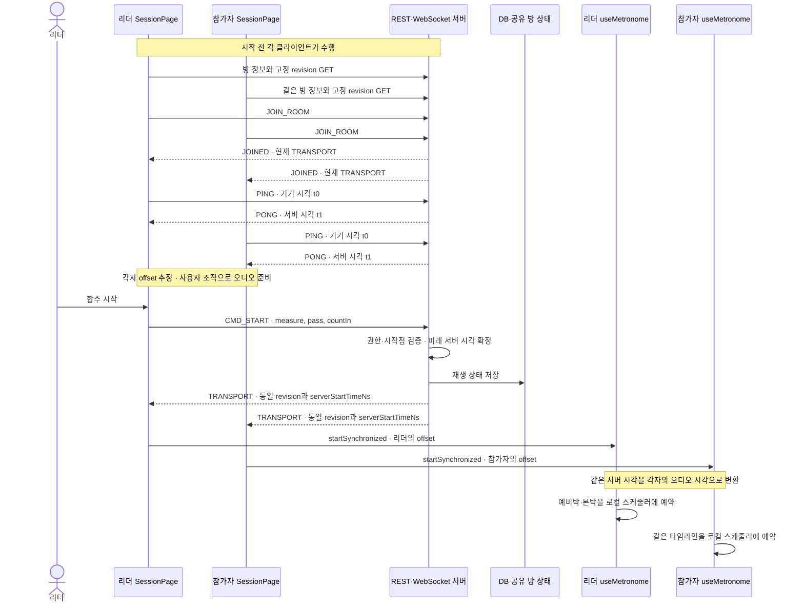

도식의 PING/PONG은 여러 번 실행된다. 1단계에서 버튼의 입구를 찾은 뒤, 2–4단계에서 **클릭 전에 준비되는 데이터와 연결**을 확인하고, 5단계부터 시작 요청을 받은 서버를 따라간다.

### 1단계. 리더의 시작 버튼이 CMD_START를 보낸다

**원본** [SessionPage.tsx](../apps/web/src/pages/SessionPage.tsx) · 찾을 값: `canControl`, `controlsEnabled`, `sendStart`

데스크톱 버튼의 여는 부분이다. 모바일의 `SessionMobileControls.onStart`도 같은 `sendStart`로 연결된다.

```tsx
{canControl ? (
  <Button
    className="session-controls__desktop-transport"
    variant="primary"
    disabled={!controlsEnabled}
    onClick={transportActive ? sendStop : () => void sendStart()}
  >
```

표시 권한과 조작 가능 여부는 다음 값으로 정한다.

```ts
const me = snapshot.roster.find((participant) => participant.userId === user?.id);
const canControl = me?.role === 'owner' || me?.role === 'leader';
const controlsEnabled =
  snapshot.connectionState === 'joined' && !pendingCommand && !preparingAudio;
```

참가자 목록에서 내 역할이 `owner` 또는 `leader`여야 시작·정지 버튼을 보여준다. 연결이 입장 완료 상태이고, 대기 중인 명령이나 오디오 준비가 없을 때 조작을 허용한다. 실제 명령 처리 함수는 다음과 같다. 의존성 배열 앞까지 발췌했다.

```ts
const sendStart = useCallback(async () => {
  if (pendingCommandRef.current || snapshot.connectionState !== 'joined') return;
  if (
    !timeline.entries.some(
      (entry) => entry.measureNumber === anchorMeasure && entry.pass === anchorPass,
    )
  ) {
    setSettingsOpen(true);
    notify({ title: '곡에 있는 시작 마디와 반복 차수를 선택해 주세요.', tone: 'danger' });
    return;
  }
  if (!(await prepareLocalAudio())) return;
  const sent = roomClientRef.current?.start(
    { measure: anchorMeasure, pass: anchorPass },
    withCountIn,
  );
  if (sent) beginPendingCommand({ kind: 'transport', baseline: snapshot.transport });
```

1. 아직 응답을 기다리는 명령이 있거나 입장 전이면 반환한다.
2. 현재 타임라인에 선택한 `(마디, 방문 횟수)`가 있는지 확인한다.
3. `prepareLocalAudio()`로 리더 기기의 오디오를 준비한다.
4. `RoomClient.start`로 시작 명령을 전송한다.
5. 전송했다면 서버 상태 반영을 기다리는 `pending` 상태로 들어간다.

**메시지 작성 원본** [roomClient.ts](../apps/web/src/lib/roomClient.ts)

```ts
start(anchor: TransportAnchor, countIn = true): boolean {
  return this.sendControl('CMD_START', {
    measure: anchor.measure,
    pass: anchor.pass,
    countIn,
  });
}
```

`sendControl`은 `connectionState === 'joined'`인지 다시 검사한다. 실제 전송은 아래 `send`가 맡는다.

```ts
private send(type: string, payload: Record<string, unknown>): boolean {
  if (this.socket?.readyState !== WebSocket.OPEN) return false;
  const envelope: Envelope = {
    type,
    requestId: crypto.randomUUID(),
    payload,
  };
  this.socket.send(JSON.stringify(envelope));
  return true;
}
```

전송할 JSON의 형태를 예시로 보면 다음과 같다. 이름과 ID는 설명용 값이다.

```json
{
  "type": "CMD_START",
  "requestId": "example-start-request",
  "payload": { "measure": 1, "pass": 1, "countIn": true }
}
```

리더가 보낸 것은 **시작할 위치와 예비박 여부**다. 시작 시각이나 적용할 revision을 이 메시지로 새로 지정하지 않는다. 시각은 서버가 정하고 revision은 방에 이미 고정돼 있다. 여기서는 아직 `startSynchronized`를 직접 호출하지 않는다.

`beginPendingCommand`의 기본 대기 한도는 5초다. `acknowledgePendingCommand`는 새로운 transport 객체를 관찰하거나 오류·연결 상태 변경을 받으면 대기를 해제한다. 현재 화면은 응답의 `requestId` 일치를 대조하는 방식이 아니라 **구독한 상태의 변화**로 처리 완료를 판단한다. 5초 초과는 서버 명령을 취소하는 동작이 아니라 UI 잠금 해제와 지연 알림이다.

**확인할 질문:** 리더가 `CMD_START`를 보내자마자 로컬 재생을 시작하면 어떤 문제가 생기는가? → 다른 참가자는 아직 시작 시각을 받지 못했을 수 있다. 리더도 아래의 `TRANSPORT` 수신 경로를 따른다.

### 2단계. 방이 정한 revision을 먼저 내려받는다

**원본** [routers/rooms.py](../apps/server/app/routers/rooms.py)의 `create_room`

이 준비는 시작 버튼보다 먼저, 방을 만들고 입장할 때 실행된다. 프론트의 `createRoom`이 `POST /rooms`에 `repertoireId`를 보내면 서버는 다음을 실행한다.

```python
require_repertoire(db, user, body.repertoire_id, "leader")
latest = db.scalar(
    select(TempoMapRevision)
    .where(TempoMapRevision.repertoire_id == body.repertoire_id)
    .order_by(desc(TempoMapRevision.revision))
    .limit(1)
)
if latest is None:
    raise HTTPException(status_code=409, detail="a tempo map is required before opening a room")
room = request.app.state.rooms.create_room(
    repertoire_id=body.repertoire_id,
    leader_id=user.id,
    tempo_map_revision=latest.revision,
    total_measures=int(latest.data["totalMeasures"]),
)
```

방 생성 시점의 최신 `TempoMapRevision`을 조회하고 그 번호를 `RoomManager.create_room`에 전달한다. 맵이 하나도 없으면 409다. 매번 시작할 때 최신 revision을 다시 고르는 코드가 아니다.

[rooms.py](../apps/server/app/rooms.py)의 `create_room`은 그 revision의 실제 데이터를 검증하고, `practice_sessions`에 `PracticeSession` 행을 만든다. 같은 번호를 메모리의 `Room.tempo_map_revision`에도 넣고, 해당 맵에서 가능한 `(measure, pass)` 집합인 `valid_anchors`를 계산한다. Redis를 사용하면 방의 공유 상태도 기록한다.

**참가자 조회 원본** [SessionPage.tsx](../apps/web/src/pages/SessionPage.tsx)의 방 로딩 effect

```ts
void api
  .get<CreatedRoom>(`/rooms/${roomId}`)
  .then(async (room) => {
    const response = await api.get<ServerTempoMap>(
      `/repertoire/${room.repertoireId}/tempomap/revisions/${room.tempoMapRevision}`,
    );
    if (cancelled) return;
    const data: unknown = response.data;
    assertValidTempoMap(data);
    setRoomLoadError(undefined);
    setRoomMetadata(room);
    setTempoMap({
      ...data,
      repertoireItemId: room.repertoireId,
      revision: response.revision,
    });
```

먼저 방 정보를 읽고, 응답의 `tempoMapRevision`을 URL에 넣어 **특정 버전**을 읽는다. `/tempomap` 최신본 조회와 경로가 다르다.

서버도 곡 ID와 revision을 함께 조건으로 사용한다.

**DB 조회 원본** [routers/repertoire.py](../apps/server/app/routers/repertoire.py)의 `get_tempo_map_revision`

```python
require_repertoire(db, user, repertoire_id)
row = db.scalar(
    select(TempoMapRevision).where(
        TempoMapRevision.repertoire_id == repertoire_id,
        TempoMapRevision.revision == revision,
    )
)
if row is None:
    raise HTTPException(status_code=404, detail="tempo map revision not found")
return tempo_map_out(row)
```

각 참가자는 이 응답으로 `tempoMap`을 설정하고 `useMetronome(tempoMap)`으로 타임라인을 만든다. 방 번호와 revision이 맞기 전에는 다음 WebSocket 연결 effect도 진행하지 않는다.

```ts
useEffect(() => {
  if (
    !roomId ||
    !tokens ||
    roomMetadata?.roomId !== roomId ||
    tempoMap.revision !== roomMetadata.tempoMapRevision
  ) {
    return;
  }
```

예를 들어 방을 revision 7로 만들고 편집기에서 revision 8을 저장해도, 기존 방은 계속 7을 조회·재생한다. 새 내용을 합주하려면 그 내용을 저장한 뒤 새 방을 만든다. 특정 버전 조회가 실패하면 오류와 재시도를 표시하며, 이 세션 로딩 경로에 오래된 로컬 맵으로 대체하는 fallback은 없다.

**확인할 질문:** 모든 참가자가 “각자 최신 맵”을 받으면 같은 데이터라고 할 수 있는가? → 조회 사이에 새 저장이 생길 수 있으므로 방이 고정한 번호로 조회해야 한다.

### 3단계. WebSocket에 입장하고 각 기기의 소리를 준비한다

**원본** [roomClient.ts](../apps/web/src/lib/roomClient.ts)의 `openSocket` → [ws.py](../apps/server/app/ws.py)의 `room_socket`

브라우저 URL은 [paths.ts](../apps/web/src/lib/paths.ts)의 `websocketUrl`이 만든다. 웹 경로는 `/feelmyrythm/ws/rooms/{roomId}`이며 HTTPS에서는 `wss:`를 사용한다. 서버 라우트는 `/ws/rooms/{room_id}`다.

소켓이 열리면 첫 메시지로 `JOIN_ROOM`을 전송한다.

```ts
socket.addEventListener('open', () => {
  if (this.socket !== socket) return;
  this.pingSamples = [];
  this.pendingPings.clear();
  this.clockEstimator.reset();
  this.patch({ connected: false, error: undefined });
  this.send('JOIN_ROOM', {
    roomId: this.roomId,
    accessToken: this.token,
    calibrationId: this.participant.calibrationId ?? null,
    bluetooth: this.participant.bluetooth,
  });
});
```

연결을 열었다는 사실만으로 명령 전송을 허용하지 않는다. 서버는 첫 frame이 올바른 `JOIN_ROOM`이며 URL의 방 ID와 일치하는지 검사하고, 토큰과 곡의 멤버십을 확인한다.

```python
with websocket.app.state.database.session_factory() as db:
    try:
        user = authenticate_access_token(
            db,
            websocket.app.state.settings,
            first.payload.access_token,
        )
        request_subject = trusted_sso_subject(websocket, websocket.app.state.settings)
        require_matching_sso_subject(user.sso_subject, request_subject)
        _, membership = require_repertoire(db, user, room.repertoire_id)
    except HTTPException:
        await _error(websocket, "authentication or room membership failed", "UNAUTHORIZED")
        await websocket.close(code=4401)
        return
```

SSO 모드의 요청 주체 확인도 이 경로에 포함된다. 이후 참가자를 등록하고 아래 메시지를 보낸다.

```python
room.participants[participant.user_id] = participant
await self.send(
    participant.websocket,
    "JOINED",
    {"userId": participant.user_id, "role": participant.role},
    request_id,
)
await self.send_transport(room, participant.websocket, late_join=True)
await self.broadcast_roster(room)
```

| 메시지        | 알려주는 내용                                 |
| ------------- | --------------------------------------------- |
| `JOINED`      | 인증 후 확인한 내 사용자 ID와 역할            |
| `TRANSPORT`   | 방의 현재 revision·시작점·시작 시각·재생 상태 |
| `ROOM_ROSTER` | 참가자 목록, 준비 상태, 역할, 보고된 RTT 등   |

클라이언트는 `JOINED`를 받으면 `joined` 상태가 되고, 원하는 준비 상태를 전송한 뒤 시계 측정을 시작한다. 첫 참가 당시 `rttMs`는 무한대이며, 입장 완료와 시계 측정 완료는 별개다.

참가자가 `준비`를 누르는 경로도 확인한다.

```ts
const toggleReady = useCallback(async () => {
  if (pendingCommandRef.current || snapshot.connectionState !== 'joined') return;
  const targetReady = !me?.ready;
  if (targetReady && !(await prepareLocalAudio())) return;
  const sent = roomClientRef.current?.setReady(targetReady);
  if (sent) beginPendingCommand({ kind: 'ready', targetReady });
}, [beginPendingCommand, me?.ready, prepareLocalAudio, snapshot.connectionState]);
```

`prepareLocalAudio`는 `useMetronome.prepareAudio()`를 기다린 뒤 `audioPrepared`를 켠다. 오디오 컨텍스트와 샘플을 준비하는 단계이며 아직 타임라인을 재생하지 않는다. 리더는 1단계의 시작 버튼에서, 참가자는 준비 버튼 또는 진행 중의 `소리 켜고 합류` 버튼에서 자기 기기의 오디오를 준비할 수 있다.

> **준비 표시의 실제 역할:** `READY`는 서버 명단에 반영되는 상태다. 현재 `start_transport`에는 “참가자 전원이 ready여야 시작한다”는 검사가 없다. `audioPrepared`는 각 기기의 별도 재생 조건이며, 준비되지 않은 기기는 시작 메시지를 받아도 자동으로 소리를 예약하지 않는다.

**확인할 질문:** `준비 완료` 표시만으로 시계 오차가 충분히 작거나 소리가 실제로 들린다고 증명되는가? → 준비 상태, 시계 추정값, 출력 장치는 따로 확인하는 정보다.

### 4단계. PING과 PONG으로 서버와 기기의 시각 차이를 추정한다

**원본** [roomClient.ts](../apps/web/src/lib/roomClient.ts)의 `pingBurst`, `handle` → [core/clock-sync.ts](../packages/core/src/clock-sync.ts)

기기마다 `performance.now()`의 시작점이 다르다. 서버는 `time.time_ns()`라는 epoch 기준 시각을 사용한다. **OS의 시계를 직접 고치지 않고, 두 시계 사이의 차이를 계산해 변환**한다.

```ts
private pingBurst(index: number): void {
  if (this.snapshot.connectionState !== 'joined') return;
  if (index >= 10) {
    this.pingTimer = setTimeout(() => this.pingBurst(0), 10_000);
    return;
  }
  const t0 = Math.round(clientMonotonicNow());
  this.pendingPings.add(t0);
  this.send('PING', { t0 });
  this.pingTimer = setTimeout(() => this.pingBurst(index + 1), 80);
}
```

처음에는 기본 80ms 간격으로 10개 PING을 보낸다. 한 묶음을 보낸 뒤 10초를 기다렸다가 다음 묶음을 시작한다. `clientMonotonicNow()`는 `performance.now()`이며, 보내는 `t0`는 반올림한 밀리초다.

서버는 메시지를 받은 직후 `server_receive_time_ns = time.time_ns()`를 기록한다. 참가자 상태를 확인한 뒤 다음 PONG을 돌려준다.

```python
await websocket.app.state.rooms.send(
    websocket,
    "PONG",
    {
        "t0": message.payload.t0,
        "serverReceiveTimeNs": server_receive_time_ns,
    },
    message.request_id,
)
```

프론트는 실제로 기다리던 PING의 응답인지 확인하고 시간 단위를 맞춘다.

```ts
case 'PONG': {
  const t2 = clientMonotonicNow();
  const t0 = Number(payload.t0);
  const t1 = Number(payload.serverReceiveTimeNs) / 1_000_000;
  if (!Number.isFinite(t0) || !Number.isFinite(t1) || !this.pendingPings.delete(t0)) {
    this.patch({ error: '잘못된 시계 동기 응답입니다.' });
    return;
  }
  const sample = {
    clientSendTimeMs: t0,
    serverTimeMs: t1,
    clientReceiveTimeMs: t2,
  };
```

| 값   | 누가 언제 읽는가              | 단위                                |
| ---- | ----------------------------- | ----------------------------------- |
| `t0` | 클라이언트가 PING을 보낼 때   | 기기 `performance.now()` 기준 ms    |
| `t1` | 서버가 메시지를 받을 때       | 전송은 ns, 클라이언트에서 ms로 변환 |
| `t2` | 클라이언트가 PONG을 처리할 때 | 기기 `performance.now()` 기준 ms    |

추정식은 다음 코드에 있다. RTT는 **요청이 왕복하는 데 걸린 시간**이다.

```ts
const rttMs = sample.clientReceiveTimeMs - sample.clientSendTimeMs;
if (rttMs < 0) throw new RangeError('clientReceiveTimeMs must not precede clientSendTimeMs');
const clientMidpointTimeMs = (sample.clientSendTimeMs + sample.clientReceiveTimeMs) / 2;
return {
  offsetMs: sample.serverTimeMs - clientMidpointTimeMs,
  rttMs,
  clientMidpointTimeMs,
  sample: { ...sample },
};
```

- `RTT = t2 - t0`
- `기기의 중간 시각 = (t0 + t2) / 2`
- `offsetMs = t1 - 기기의 중간 시각`
- 따라서 `추정 서버 시각 = performance.now() + offsetMs`

초기 유효 응답 10개가 모이면 `ClockSyncEstimator.initialize`를 호출한다.

```ts
if (this.pingSamples.length < this.clockEstimator.initialBurstSize) {
  this.pingSamples.push(sample);
  if (this.pingSamples.length === this.clockEstimator.initialBurstSize) {
    const state = this.clockEstimator.initialize(this.pingSamples);
    this.patch({ offsetMs: state.offsetMs, rttMs: state.latestRttMs });
    this.send('REPORT_RTT', { rttMs: state.latestRttMs });
  }
  return;
```

초기 추정에는 10개의 평균이 아니라 **RTT가 가장 짧은 표본의 offset**을 사용한다. 이후 표본은 최소 RTT의 2.5배와 `최소 RTT + 10ms` 중 큰 값보다 RTT가 크면 버리고, 받아들인 offset에는 `기존 값 × 0.8 + 새 값 × 0.2`를 적용한다. 새 측정값을 조금씩 반영하는 가중 평균 방식이다.

예를 들어 `t0 = 1,000ms`, `t2 = 1,040ms`, 축약한 서버 시각 `t1 = 100,020ms`라면 RTT는 40ms, offset은 `100,020 - 1,020 = 99,000ms`다. 기기의 `performance.now()`가 4,000ms인 순간을 서버 시각 103,000ms로 대응시킬 수 있다. 설명용 숫자이며 실제 측정 기록은 아니다.

**확인할 질문:** 왕복 시간이 짧으면 시각 차이를 완벽하게 아는가? → 이 추정은 왕복 경로의 중간을 기준으로 하므로 편도 지연의 비대칭과 서버 처리 지연에 따른 오차가 남을 수 있다. 최소 RTT 선택과 이상치 제외는 이를 줄이는 방법이다.

### 5단계. 서버가 권한과 시작점을 검사하고 미래 시각을 정한다

**원본** [ws.py](../apps/server/app/ws.py)의 메시지 루프 → [rooms.py](../apps/server/app/rooms.py)의 `start_transport`

이제 1단계의 `CMD_START`가 서버에 도착한 지점으로 돌아온다. 서버는 `TypeAdapter(WsClientMessage)`로 메시지 종류와 payload를 검사한다. 시작 payload의 원본은 다음과 같다.

```python
class StartPayload(ApiModel):
    measure: int = Field(ge=1)
    pass_number: int = Field(default=1, alias="pass", ge=1)
    count_in: bool = True
```

`pass`라는 JSON 이름은 Python의 `pass_number`에 연결된다. 파싱이 끝난 `StartMessage`는 방 관리자에 전달한다.

```python
if isinstance(message, StartMessage):
    await websocket.app.state.rooms.start_transport(
        room,
        participant,
        message.payload.measure,
        message.payload.pass_number,
        message.payload.count_in,
        message.request_id,
    )
```

서버가 검사하는 권한과 시작점은 다음과 같다.

```python
def require_transport_role(self, room: Room, participant: Participant) -> None:
    self.refresh_participant_role(room, participant)
    if participant.role not in {"owner", "leader"}:
        raise TransportPermissionError("leader role required for transport commands")

@staticmethod
def require_anchor(room: Room, measure: int, pass_number: int) -> None:
    if (measure, pass_number) not in room.valid_anchors:
        raise ValueError("anchor measure/pass is not in the pinned tempo map timeline")
```

`refresh_participant_role`은 DB의 현재 그룹 멤버십을 다시 읽는다. 입장 당시 리더였더라도 이후 member로 바뀌었다면 시작 명령이 거부된다. `valid_anchors`는 방 생성 때 고정한 맵의 반복·이동을 펼쳐 만든 집합이므로, 존재하지 않는 반복 방문 번호도 거부한다.

검사를 통과한 시작 처리의 본문이다.

```python
await self.synchronize_participant(room, participant)
async with room.lock:
    async with self._shared_room_lock(room, participant):
        self.require_transport_role(room, participant)
        self.require_anchor(room, measure, pass_number)
        room.anchor_measure = measure
        room.anchor_pass = pass_number
        room.count_in = count_in
        room.server_start_time_ns = time.time_ns() + self.settings.room_lead_time_ms * 1_000_000
        room.status = "armed"
        room.touch()
        self._persist(room)
        self._save_shared(room)
        await self.broadcast_transport(room, request_id)
```

`room.lock`은 같은 서버 프로세스의 방 변경을 직렬화한다. Redis가 설정돼 있으면 `_shared_room_lock`도 잡아 다른 서버 인스턴스와 방 상태를 맞춘다. 그 안에서 시작 위치와 예비박 여부를 저장하고, **서버의 현재 시각에 시작 여유를 더한 시각**을 정한다.

[config.py](../apps/server/app/config.py)의 `room_lead_time_ms` 기본값은 3000이다. UI의 `3초 뒤 시작`은 이 기본값을 나타낸다. 실제 예약은 버튼 클릭 후 고정 3초가 아니라 **서버가 이 줄을 실행한 시각 + 설정값**이다.

`armed`는 미래 시각으로 시작을 예약해 둔 상태다. 이 시점의 리더 명령은 참가자들에게 같은 미래 시각을 알려줄 여유를 만든다. 권한이나 시작점 오류는 각각 `FORBIDDEN`, `INVALID_ANCHOR`의 `ERROR` 메시지로 전달된다.

**확인할 질문:** 클라이언트가 자기 시계로 “3초 뒤”를 계산해 보내면 충분한가? → 참가자마다 기기의 시계 기준과 메시지 도착 시간이 다르므로 서버가 하나의 목표 시각을 정한다.

### 6단계. 서버가 재생 상태를 저장하고 모든 참가자에게 보낸다

**원본** [rooms.py](../apps/server/app/rooms.py)의 `_persist`, `_save_shared`, `broadcast_transport`

5단계의 마지막 세 호출은 **DB 저장 → 공유 상태 저장 → 참가자에게 전송** 순서다. DB에는 방 생성 때 만든 `PracticeSession` 행을 갱신한다.

```python
def _persist(self, room: Room, *, ended: bool = False) -> None:
    with self.database.session_factory() as db:
        row = db.get(PracticeSession, room.session_id)
        if row is None:
            return
        row.status = "stopped" if ended else room.status
        row.anchor_measure = room.anchor_measure
        row.anchor_pass = room.anchor_pass
        row.server_start_time_ns = room.server_start_time_ns
        row.tempo_map_revision = room.tempo_map_revision
        if ended:
            row.ended_at = utcnow()
        db.commit()
```

[models.py](../apps/server/app/models.py)의 실제 테이블 이름은 `practice_sessions`다. 주요 저장 경계를 나누면 다음과 같다.

| 장소                                  | 보관하는 값                                                                                | 역할                                        |
| ------------------------------------- | ------------------------------------------------------------------------------------------ | ------------------------------------------- |
| DB의 `tempo_map_revisions`            | 특정 revision의 음악 데이터                                                                | 모든 참가자가 같은 타임라인을 만들 원본     |
| DB의 `practice_sessions`              | `status`, `anchor_measure`, `anchor_pass`, `server_start_time_ns`, `tempo_map_revision` 등 | 방의 재생 상태 기록                         |
| 메모리 `Room`·설정 시 Redis 방 상태   | 위 재생 정보, `count_in`, 유효 시작점, 만료 시각 등                                        | 현재 방의 제어 상태와 여러 서버의 공유 상태 |
| 참가자 상태·설정 시 Redis 참가자 정보 | ready, 역할, RTT, 연결 ID 등                                                               | 명단과 연결 관리                            |

현재 `PracticeSession` 모델에 `count_in` 열은 없다. 모든 방 상태가 DB 행 하나에 그대로 들어간다고 읽지 않는다. Redis 저장과 WebSocket 전송은 위 DB transaction의 일부가 아니라 뒤따르는 작업이다.

전송 함수는 다음과 같다.

```python
async def broadcast_transport(self, room: Room, request_id: str | None = None) -> None:
    payload = self.transport_payload(room, late_join=False)
    raw_payload = payload.model_dump(by_alias=True)
    await self.broadcast(
        room,
        "TRANSPORT",
        raw_payload,
        request_id,
    )
    if self.redis is not None:
        await self.redis.publish(
            room.room_id,
            "transport",
            {"message": raw_payload, "requestId": request_id},
        )
```

`broadcast`는 현재 서버에 연결된 참가자들을 순회해 WebSocket으로 전송한다. **명령을 보낸 리더도 포함**된다. Redis를 사용하면 `transport` 이벤트를 발행하고, 다른 인스턴스의 `_handle_redis_event`도 자기 참가자들에게 같은 payload를 보낸다.

전송되는 `TRANSPORT`의 예시다. 서버 시각은 계산을 쉽게 읽기 위한 축약값이다.

```json
{
  "type": "TRANSPORT",
  "requestId": "example-start-request",
  "payload": {
    "roomId": "example-room",
    "repertoireId": "example-piece",
    "tempoMapRevision": 7,
    "status": "armed",
    "anchor": { "measure": 1, "pass": 1 },
    "serverStartTimeNs": 103000000000,
    "countIn": true,
    "lateJoin": null
  }
}
```

`transport_payload`는 호출 시 현재 서버 시간이 시작 시각에 도달했으면 `armed`를 `playing`으로 바꿔 저장한다. 이 상태 갱신이 별도의 “이제 소리를 내라” 신호가 되는 것은 아니다. 참가자는 이미 `armed` 메시지를 받아 오디오를 예약할 수 있다. PING 응답 경로에서도 최신 `TRANSPORT`를 다시 보내므로 현재 상태를 갱신할 수 있다.

**확인할 질문:** 각 참가자가 이 메시지를 같은 순간에 받아야만 맞춰 재생할 수 있는가? → 시작 전 예약할 시간이 남아 있다면 도착 시각이 달라도 같은 목표 시각으로 예약할 수 있다.

### 7단계. 각 참가자가 TRANSPORT를 받아 startSynchronized로 들어간다

**원본** [roomClient.ts](../apps/web/src/lib/roomClient.ts)의 `handle` → [SessionPage.tsx](../apps/web/src/pages/SessionPage.tsx)의 구독과 재생 effect

클라이언트는 `TRANSPORT`의 필수 필드와 상태값을 확인하고 snapshot에 넣는다. 아래는 상태 반영 앞부분이다.

```ts
this.patch({
  transport: {
    roomId: payload.roomId,
    repertoireId: payload.repertoireId,
    revision: payload.tempoMapRevision,
    status,
    countIn: payload.countIn !== false,
    ...(anchor ? { anchor } : {}),
    ...(Number.isFinite(serverStartTimeNs)
      ? { serverStartTime: serverStartTimeNs / 1_000_000 }
      : {}),
```

서버의 `tempoMapRevision`은 프론트의 `transport.revision`으로 이름을 바꿔 보관한다. `serverStartTimeNs`는 **1,000,000으로 나눠 ms**로 바꾸고 `transport.serverStartTime`에 넣는다. `null`인 시작 시각은 숫자 0으로 변환하지 않고 속성을 생략한다.

페이지는 snapshot을 구독한다.

```ts
roomClientRef.current = roomClient;
const unsubscribe = roomClient.subscribe((nextSnapshot) => {
  if (nextSnapshot.connectionState === 'joined') {
    roomAuthRefreshRef.current = { roomId, attempted: false };
  }
  acknowledgePendingCommand(nextSnapshot);
  setSnapshot(nextSnapshot);
});
roomClient.connect();
```

새 상태가 들어와 React가 갱신되면 다음 조건을 검사한다. `catch`의 입구까지 발췌했다.

```ts
useEffect(() => {
  if (
    audioPrepared &&
    (transport?.status === 'armed' || transport?.status === 'playing') &&
    transport.serverStartTime &&
    transport.anchor &&
    Number.isFinite(snapshot.rttMs) &&
    Number.isFinite(snapshot.offsetMs) &&
    transport.revision === tempoMap.revision &&
    scheduledStartRef.current !== transport.serverStartTime
  ) {
    scheduledStartRef.current = transport.serverStartTime;
    void startSynchronized({
      measure: transport.anchor.measure,
      pass: transport.anchor.pass,
      serverStartTimeMs: transport.serverStartTime,
      serverOffsetMs: snapshot.offsetMs,
      withCountIn: transport.countIn,
    }).catch((error: unknown) => {
```

| 조건                                       | 필요한 이유                                               |
| ------------------------------------------ | --------------------------------------------------------- |
| `audioPrepared`                            | 이 기기의 사용자 조작으로 오디오가 준비됐는지 확인        |
| `armed` 또는 `playing`                     | 시작을 예약했거나 이미 진행 중인 방인지 확인              |
| 시작 시각과 `anchor` 존재                  | 공통 목표 시각과 시작 위치 확보                           |
| 유한한 `rttMs`, `offsetMs`                 | 사용할 수 있는 시계 추정 상태인지 확인                    |
| `transport.revision === tempoMap.revision` | 로딩한 음악 데이터와 서버가 지정한 버전이 같은지 확인     |
| 아직 처리하지 않은 `serverStartTime`       | 같은 상태를 여러 번 받아도 같은 시작을 반복 예약하지 않기 |

리더와 일반 참가자 모두 이 effect를 실행한다. `startSynchronized`에는 공통 서버 시각과 함께 **자기 기기가 추정한 `snapshot.offsetMs`**를 전달한다. 훅 호출이 실패하면 시작 기록과 `audioPrepared`를 지우고 동기 재생 예약 실패를 알린다.

현재 조건은 RTT가 유한한지를 확인하며 “RTT가 몇 ms 이하일 때만 허용”하는 품질 한도는 두지 않는다. revision이 다르면 이 effect는 재생하지 않으며, 여기서 최신 맵으로 임의 교체하지도 않는다.

**확인할 질문:** 같은 `TRANSPORT`를 받은 두 기기의 `serverOffsetMs`도 같아야 하는가? → 각 기기의 `performance.now()` 시작점이 다르므로 offset은 달라도 된다.

### 8단계. 서버 시각을 각 기기의 오디오 시각으로 바꾼다

**원본** [audio/clockMapping.ts](../packages/audio/src/clockMapping.ts)의 세 mapper

이 단계는 **시계의 기준과 단위를 바꾸는 과정**이다. 실제로 `startSynchronized`가 사용하는 것은 아래 세 클래스다. `core/clock-sync.ts`에 있는 별도 `ClockMapper` 클래스와 혼동하지 않는다.

| 클래스                          | 바꾸는 대상                                      |
| ------------------------------- | ------------------------------------------------ |
| `OffsetServerPerformanceMapper` | 서버 epoch ms ↔ 이 기기의 `performance.now()` ms |
| `AudioPerformanceMapper`        | 이 기기의 performance ms ↔ 오디오 컨텍스트의 초  |
| `ServerAudioMapper`             | 위 두 변환을 연결하고 출력 지연·수동 보정 적용   |

서버 목표 시각에서 기기의 offset을 빼면 그 기기의 performance 목표 시각이 된다.

```ts
serverToPerformance(serverTimeMs: number): number {
  assertFiniteNumber(serverTimeMs, 'serverTimeMs');
  return serverTimeMs - this.offsetMs;
}
```

오디오 시계도 별도의 시작점을 가진다. `AudioPerformanceMapper`는 거의 같은 순간의 `performance.now()`와 `engine.now()`를 표본으로 읽어 그 차이를 보관한다.

```ts
addSample(performanceTimeMs: number, audioTimeSec: number): void {
  assertFiniteNumber(performanceTimeMs, 'performanceTimeMs');
  assertFiniteNumber(audioTimeSec, 'audioTimeSec');
  this.offsetsSec.push(audioTimeSec - performanceTimeMs / 1_000);
  if (this.offsetsSec.length > this.maxSamples) this.offsetsSec.shift();
}

sampleNow(engine: AudioEngine, performanceTimeMs = currentPerformanceTime()): void {
  this.addSample(performanceTimeMs, engine.now());
}

performanceToAudio(performanceTimeMs: number): number {
  assertFiniteNumber(performanceTimeMs, 'performanceTimeMs');
  return performanceTimeMs / 1_000 + this.offset();
```

`sampleNow`가 이 두 값을 읽어 `addSample`에 넘긴다. `offset()`은 보관된 표본의 중앙값을 사용하며 기본 최대 표본 수는 9개다. 훅은 동기 재생을 시작할 때 표본을 지우고 새 엔진 시각을 읽고, 재생 중에도 표본을 추가한다.

서버에서 오디오까지의 변환은 두 함수를 순서대로 합친다.

```ts
serverToAudio(serverTimeMs: number): number {
  return this.audioPerformance.performanceToAudio(
    this.serverPerformance.serverToPerformance(serverTimeMs),
  );
}
```

마지막으로 실제 출력에 필요한 지연을 보정한다.

```ts
/** Positive calibration means additional audible delay and therefore earlier scheduling. */
serverToScheduledAudio(serverTimeMs: number, calibrationOffsetSec = 0): number {
  assertFiniteNumber(calibrationOffsetSec, 'calibrationOffsetSec');
  const outputLatency = this.outputLatencyProvider();
  assertFiniteNumber(outputLatency, 'outputLatency');
  if (outputLatency < 0) throw new RangeError('outputLatency must not be negative');
  return this.serverToAudio(serverTimeMs) - outputLatency - calibrationOffsetSec;
}
```

출력 지연이 양수라면 목표로 듣고 싶은 시각보다 그만큼 먼저 예약한다. `fmr.calibrationOffsetMs`의 수동 보정도 ms에서 초로 바꿔 뺀다. 웹 엔진의 `outputLatency()`는 `baseLatency + outputLatency`를 반환하며, 네이티브 엔진이면 해당 엔진의 값을 사용한다.

하나의 식으로 적으면 다음과 같다. `audioOffsetSec`는 `AudioPerformanceMapper`가 보관한 차이의 중앙값이다.

```text
기기 performance 목표 ms = 서버 목표 ms - serverOffsetMs
보정 전 오디오 목표 초 = 기기 performance 목표 ms / 1000 + audioOffsetSec
실제 예약 초 = 보정 전 오디오 목표 초 - 출력 지연 초 - 수동 보정 초
```

`fmr.visualOffsetMs`는 실습 03의 화면 표시 보정이며 위 소리 예약 식에 합치지 않는다. 서로 다른 종류의 보정을 같은 값으로 읽지 않는 것이 중요하다.

**확인할 질문:** 두 기기에 같은 `AudioContext.currentTime` 숫자를 보내면 되는가? → 컨텍스트마다 시계의 시작점이 다르므로 각 기기에서 변환해야 한다.

### 두 기기로 계산하기. 서로 다른 오디오 시각으로 같은 순간을 예약한다

다음은 **시계 추정과 출력 지연이 정확하다고 가정한 계산 예시**다. 실제 동기화 성능을 측정한 값은 아니다. 서버 시각은 읽기 쉬운 축약값을 사용한다.

같은 순간을 다음과 같이 읽었다고 가정한다.

| 값                       | 참가자 A       | 참가자 B        |
| ------------------------ | -------------- | --------------- |
| 공통 서버 시각           | 100,000ms      | 100,000ms       |
| 기기 `performance.now()` | 1,000ms        | 5,000ms         |
| `serverOffsetMs`         | 99,000ms       | 95,000ms        |
| `engine.now()`           | 10.00초        | 20.00초         |
| `audioOffsetSec`         | `10 - 1 = 9초` | `20 - 5 = 15초` |
| 출력 지연                | 0.02초         | 0.05초          |
| 수동 보정                | 0.01초         | 0초             |

서버가 목표 시각을 **103,000ms**로 정해 모두에게 보냈다면 다음처럼 바뀐다.

| 계산                | 참가자 A                     | 참가자 B                     |
| ------------------- | ---------------------------- | ---------------------------- |
| performance 목표    | `103,000 - 99,000 = 4,000ms` | `103,000 - 95,000 = 8,000ms` |
| 보정 전 오디오 목표 | `4 + 9 = 13.00초`            | `8 + 15 = 23.00초`           |
| 실제 클릭 예약      | `13 - 0.02 - 0.01 = 12.97초` | `23 - 0.05 = 22.95초`        |

각 기기에 예약한 숫자는 **12.97초와 22.95초로 다르다.** 각자의 출력 지연을 고려해 같은 서버 목표 시각에 소리가 도달하도록 계산한 결과다. 스피커에서 실제로 일치하는 정도는 추정 오차와 장치 지연의 정확성에 달려 있다.

예비박이 꺼져 있으면 이 예약이 첫 본박이다. 4/4·120 BPM·예비박 한 마디라면 **이 예약은 첫 예비박**이고, 본박은 2초 뒤다. 따라서 본박의 오디오 기준은 A가 14.97초, B가 24.95초이며, 둘 다 서버 목표 **105,000ms**에 본박이 들리도록 계산한다.

### 9단계. 예비박과 본박을 공통 시작 시각에 맞춰 예약한다

**원본** [useMetronome.ts](../apps/web/src/lib/useMetronome.ts)의 `startSynchronized`

훅은 기존 재생을 멈추고 엔진 준비를 기다린 다음, 취소된 시작 요청인지 확인한다. 그 뒤 오디오 시각 표본과 선택한 시작점을 준비한다.

```ts
audioClockRef.current.clear();
audioClockRef.current.sampleNow(engine, performance.now());
transport = new TimelineTransport(engine);
transportRef.current = transport;
const timeline = timelineRef.current;
let anchorTimelineTimeSec = seekPoint(timeline, measure, pass);
const rawCountIn = withCountIn ? buildCountIn(map, anchorTimelineTimeSec) : [];
let countIn = rawCountIn.map((beat, index) => ({
  timeSec: beat.timeSec - anchorTimelineTimeSec,
  accent: beat.accent,
  countdown:
    Math.max(...rawCountIn.map((candidate) => candidate.beatIndex)) + 1 - beat.beatIndex,
  index,
}));
const firstRelative = countIn[0]?.timeSec ?? 0;
```

`seekPoint`는 고정 revision의 타임라인에서 선택한 `(measure, pass)`를 찾는다. 예비박이 켜져 있으면 **고정된 `map` 자체의 설정**으로 `buildCountIn`을 호출한다. 개인 재생의 `start`와 달리 여기서는 `fmr.countInMeasures`로 각 기기의 예비박 마디 수를 덮어쓰지 않는다. 참가자마다 예비박 길이가 달라지는 것을 피하는 연결이다.

이제 8단계의 mapper를 구성하고 본박의 기준 시각을 정한다.

```ts
const mapper = new ServerAudioMapper(
  new OffsetServerPerformanceMapper(serverOffsetMs),
  audioClockRef.current,
  () => engine.outputLatency(),
);
const manualOffsetSec =
  Number(localStorage.getItem('fmr.calibrationOffsetMs') ?? 0) / 1_000;
let anchorAudioTime =
  mapper.serverToScheduledAudio(serverStartTimeMs, manualOffsetSec) - firstRelative;
```

> **`serverStartTimeMs`의 의미:** 현재 구현에서는 예비박이 있으면 첫 예비박의 목표 시각, 없으면 첫 본박의 목표 시각이다. `anchorAudioTime`은 선택한 마디의 **본박 시작 시각**이다. 두 값을 같은 사건의 시각이라고 읽지 않는다.

예비박 한 마디의 상대 시작이 `-2초`라면, `anchorAudioTime = 첫 예비박 예약 시각 - (-2)`다. 이후 스케줄러가 예비박 상대 시각을 더하면 다시 첫 예비박 예약 시각이 나온다. 실습 03에서 사용한 타임라인→오디오 공식과 같은 구조다.

늦지 않은 정상 경로에서는 아래처럼 전달한다.

```ts
setDisplayAnchor(timeline, anchorTimelineTimeSec, anchorAudioTime, countIn);
await transport.start({
  timeline,
  anchorTimelineTimeSec,
  anchorAudioTime,
  countIn,
});
```

그다음은 [실습 03의 예약과 출력](#6단계-transport가-박들을-오디오-예약-목록으로-바꾼다)과 연결된다.

```text
TimelineTransport.start
  → LookaheadScheduler.start / tick
  → engine.scheduleClick(각 박의 오디오 시각, 소리 종류)
  → WebAudioEngine의 source.start(예약 시각)
  → 출력 장치
```

이후 각 박의 예약에는 서버와 다시 왕복할 필요가 없다. 공통 revision으로 펼친 타임라인과 공통 시작 시각을 각자의 오디오 시계에 대응시켰기 때문이다. 화면도 같은 `frameSource`를 사용한다. 세션 안에서 악보를 열 때는 `synchronizedPlayback`에 고정 `tempoMap`, `playing`, `metronome.position`, `metronome.frameSource`를 함께 넘겨 같은 재생 상태를 표시한다.

**확인할 질문:** 각 기기의 개인 예비박 설정이 서로 달라도 합주 시작이 같은가? → 이 동기 경로는 방의 `countIn` 여부와 고정 맵의 예비박 길이를 사용한다.

### 10단계. 늦게 합류하면 아직 예약할 수 있는 마디 경계로 들어간다

**원본** [useMetronome.ts](../apps/web/src/lib/useMetronome.ts)의 `startSynchronized`, `lateJoinEntry`

입장이나 오디오 준비가 늦으면 첫 소리의 목표 시각이 이미 지나 있을 수 있다. 다음 분기는 **첫 소리 예약 시각이 현재 오디오 시각보다 20ms 넘게 과거인지** 확인한다.

```ts
if (anchorAudioTime + firstRelative < engine.now() - 0.02) {
  const mainServerTime = serverStartTimeMs - firstRelative * 1000;
  const serverNow = performance.now() + serverOffsetMs;
  const anchorStillSchedulable = anchorAudioTime >= engine.now() - 0.02;
  const currentTimelineTime = anchorStillSchedulable
    ? anchorTimelineTimeSec
    : anchorTimelineTimeSec + Math.max(0, serverNow - mainServerTime) / 1000;
  const nextEntry = lateJoinEntry(timeline, currentTimelineTime, anchorStillSchedulable);
  if (!nextEntry) throw new Error('동기 타임라인의 다음 마디 경계가 없습니다.');
  anchorTimelineTimeSec = nextEntry.startTimeSec;
  const nextBoundaryServerTime =
    mainServerTime + (nextEntry.startTimeSec - seekPoint(timeline, measure, pass)) * 1000;
  anchorAudioTime = mapper.serverToScheduledAudio(nextBoundaryServerTime, manualOffsetSec);
  countIn = [];
}
```

1. `mainServerTime`으로 원래 본박 시작의 서버 시각을 계산한다.
2. 본박 시작이 아직 예약 가능한지 확인한다.
3. 가능하면 선택한 시작 마디를 유지한다. 이미 지났으면 추정 서버 현재 시각으로 곡이 얼마나 진행됐는지 계산한다.
4. 그 위치에서 들어갈 수 있는 마디 경계를 찾고 해당 서버 시각을 다시 오디오 시각으로 바꾼다.
5. 시작 예비박은 비운다. 이미 진행된 예비박을 처음부터 다시 재생하지 않는다.

어떤 경계를 고르는지는 짧은 helper에서 확인할 수 있다.

```ts
export function lateJoinEntry(
  timeline: PerformanceTimeline,
  currentTimelineTimeSec: number,
  includeCurrentBoundary: boolean,
) {
  const epsilon = 1e-9;
  return timeline.entries.find((entry) =>
    includeCurrentBoundary
      ? entry.startTimeSec >= currentTimelineTimeSec - epsilon
      : entry.startTimeSec > currentTimelineTimeSec + epsilon,
  );
```

| 합류 시점                                 | 선택하는 동작                                      |
| ----------------------------------------- | -------------------------------------------------- |
| 첫 예비박 또는 첫 본박이 아직 미래        | 정상 예약 경로를 따른다.                           |
| 예비박은 이미 시작됐지만 본박은 예약 가능 | 원래 시작 마디를 유지하고 시작 예비박을 생략한다.  |
| 본박이 이미 진행 중                       | 현재 연주 위치보다 뒤의 다음 마디 경계로 들어간다. |
| 이후에 들어갈 마디가 없음                 | 오류를 던지고 화면에 동기 재생 예약 실패를 알린다. |

서버도 입장 시 `lateJoin`에 현재 서버 시각·경과 시간·`next-measure-boundary` 전략을 담아 보낸다. 다만 현재 `SessionPage`는 그 `elapsedNs`를 훅 인자로 넘기지 않는다. **실제 합류 계산은 훅이 원래 시작 시각, 자기 offset, 고정 타임라인으로 수행한다.**

**확인할 질문:** 시작 메시지를 늦게 받았다고 지금부터 같은 곡을 처음부터 틀면 되는가? → 진행 중인 참가자와 다른 위치가 되므로 공통 타임라인의 합류 경계를 찾아야 한다.

### 합주 정지와 연결 복구를 따라가기

**정지 경로**는 `sendStop → RoomClient.stop → CMD_STOP → RoomManager.stop_transport`다. 서버는 권한을 검사한 뒤 `status = 'stopped'`, `server_start_time_ns = None`을 저장하고 새 `TRANSPORT`를 방송한다.

각 참가자는 다음 코드에서 로컬 재생을 멈춘다.

```ts
if ((transport?.status === 'idle' || transport?.status === 'stopped') && playing) {
  stopMetronome();
  scheduledStartRef.current = undefined;
}
```

실제 예약과 엔진의 취소는 실습 03의 `stop` 경로를 따른다. 합주 정지 payload에는 모든 기기가 맞춰 멈출 미래 정지 시각이 없으므로, 정지는 각 기기가 상태를 처리할 때 적용된다.

자연 종료 때는 `shouldStopRoomAfterLocalEnd`를 읽는다. **로컬 재생 중 → 종료**로 바뀌었고, 현재 owner/leader이며, 연결돼 있고, 서버가 아직 `armed/playing`이면 `sendStop`을 보낸다. 리더의 종료를 방의 재생 상태에 반영하는 경로다.

| 연결 상황                                      | 현재 처리                                                                                                                                           | 읽을 원본                                                                                       |
| ---------------------------------------------- | --------------------------------------------------------------------------------------------------------------------------------------------------- | ----------------------------------------------------------------------------------------------- |
| 일시적인 소켓 종료                             | 재연결을 시도한다. 기존 로컬 재생은 연결 상태만으로 즉시 멈추지 않는다.                                                                             | [roomClient.ts](../apps/web/src/lib/roomClient.ts)의 close 처리, `scheduleReconnect`            |
| 기기가 오프라인                                | 온라인 이벤트가 올 때까지 연결 시도를 기다린다.                                                                                                     | 같은 파일의 `onOnline`, `onOffline`                                                             |
| 재연결 성공                                    | 다시 `JOIN_ROOM`으로 입장하고 현재 `TRANSPORT`와 명단을 받으며 시계 추정기를 초기화한다. 같은 시작 시각의 중복 예약은 `scheduledStartRef`로 막는다. | `openSocket`, `JOINED` 처리, [SessionPage](../apps/web/src/pages/SessionPage.tsx)의 재생 effect |
| 새로 페이지를 열거나 아직 소리를 준비하지 않음 | 사용자가 `소리 켜고 합류`로 준비하면 현재 transport에 맞춰 정상 시작 또는 늦은 합류 계산을 한다.                                                    | `prepareLocalAudio`, `startSynchronized`                                                        |
| 방 만료·잘못된 첫 메시지·다른 연결로 대체      | `closed`로 바꾸고 페이지가 로컬 재생을 멈춘다.                                                                                                      | `terminalCloseMessage`, 페이지의 `connectionState === 'closed'` effect                          |
| 인증 거부                                      | 토큰 갱신을 한 번 시도하고 반복 거부나 갱신 실패면 연결 종료 상태로 간다.                                                                           | `refreshAuthorization`                                                                          |
| 로그아웃·방 이동·화면 해제                     | 훅과 페이지의 정리 함수에서 로컬 재생을 멈춘다.                                                                                                     | 페이지의 인증·방 정리 effect, `useMetronome`의 unmount 처리                                     |

일시 단절 중에도 기기에 예약된 타임라인은 진행할 수 있다. 다만 그동안 서버에서 정지·재시작했다면 메시지를 받을 수 없으므로 재연결 후 상태를 맞춰야 한다. 브라우저의 백그라운드 제한이나 오디오 중단까지 무중단이라고 보장하는 설명은 아니다.

### 같은 revision과 같은 시각을 보장하는 범위를 구분하기

이번 경로를 리뷰할 때는 다음 세 층을 구분하면 좋다.

| 층          | 코드가 맞추는 것                                                                           | 실제 한계·조건                                                                                                   |
| ----------- | ------------------------------------------------------------------------------------------ | ---------------------------------------------------------------------------------------------------------------- |
| 음악 데이터 | 방이 고정한 revision을 REST로 조회하고, WebSocket 연결·재생 전에 revision 일치를 검사한다. | 일치하지 않거나 조회에 실패하면 동기 재생으로 들어가지 않는다. 기존 방을 최신 맵으로 자동 교체하지 않는다.       |
| 시작 계획   | 서버가 한 번 정한 시작 시각과 `(measure, pass, countIn)`을 모든 참가자에게 보낸다.         | 각 기기에 시계 추정값과 준비된 오디오가 필요하다. 늦으면 마디 경계 합류 분기를 탄다.                             |
| 실제 발음   | 서버→기기→오디오 시계 변환과 출력 지연·수동 보정으로 예약한다.                             | 네트워크 비대칭, 출력 지연 추정, 장치별 시계 변화에 따른 오차는 남는다. 물리적 동시 발음은 별도 측정이 필요하다. |

**주기적인 PING이 진행 중인 소리를 계속 다시 맞추는가?** `RoomClient`는 offset 추정을 갱신하지만, 페이지는 같은 `serverStartTime`을 이미 처리했다면 `startSynchronized`를 다시 호출하지 않는다. 훅이 시작 시 계산한 `anchorAudioTime`을 이후 PONG마다 자동으로 다시 계산해 transport에 적용하는 경로도 없다. 현재 코드를 **같은 시작점을 맞추고 기기별 타임라인을 전개하는 구조**로 읽어야 하며, 연주 중 모든 기기의 장기 드리프트까지 계속 교정한다고 설명하면 안 된다.

또한 여러 서버 인스턴스를 쓰면 Redis가 방 상태와 메시지를 공유하지만, 그것이 각 호스트의 `time.time_ns()` 자체를 맞춰주는 것은 아니다. 여러 서버의 호스트 시계 정합성은 이 애플리케이션의 offset 계산과 별개의 운영 조건이다.

### 합주 시작의 리뷰 포인트와 테스트

아래는 현재 구현의 기대 동작을 찾아 읽을 테스트다. **이번 문서 작업에서는 앱 테스트를 실행하거나 실제 두 기기의 소리를 측정하지 않았다.** 브라우저 테스트의 모의 WebSocket, 서버 테스트의 연결, 순수 계산 테스트가 각각 무엇을 검증하는지 구분한다.

| 읽을 테스트                                                        | 확인할 내용                                                                                                                   |
| ------------------------------------------------------------------ | ----------------------------------------------------------------------------------------------------------------------------- |
| [test_websocket.py](../apps/server/tests/test_websocket.py)        | member의 시작 거부, 유효한 반복 시작점, 리더·참가자에게 같은 시각 전달, 늦은 참가 메타데이터, 새 저장 후에도 방 revision 유지 |
| [test_redis_rooms.py](../apps/server/tests/test_redis_rooms.py)    | 두 서버 인스턴스 사이의 명단·재생 상태 공유와 복구                                                                            |
| [roomClient.test.ts](../apps/web/src/lib/roomClient.test.ts)       | 입장 전 명령 차단, 요청한 PING에 해당하는 PONG만 수락, 최소 RTT 선택, 재연결·인증 갱신                                        |
| [clock-sync.test.ts](../packages/core/test/clock-sync.test.ts)     | 시각 차이 추정, 최소 RTT 표본, 가중 평균과 RTT 이상치 제외                                                                    |
| [mapping.test.ts](../packages/audio/test/mapping.test.ts)          | 실제 사용하는 mapper의 시계 변환과 출력·수동 보정                                                                             |
| [useMetronome.test.ts](../apps/web/src/lib/useMetronome.test.ts)   | 미래 시작 전 대기, 예비박·본박의 문맥, 늦은 합류 경계와 취소된 시작                                                           |
| [SessionPage.test.tsx](../apps/web/src/pages/SessionPage.test.tsx) | 역할별 조작, 인증 상실 시 정지, 준비 명단 표시, 악보를 열어도 고정 revision 유지                                              |
| [session.spec.ts](../e2e/session.spec.ts)                          | 브라우저에서 고정 맵 조회와 시작 조작이 모의 WebSocket의 `CMD_START`로 이어지는지                                             |

먼저 서버 테스트의 다음 부분을 읽는다. 바로 앞에서 리더가 시작 명령을 보냈다.

```python
leader_transport = _recv_until(leader_ws, "TRANSPORT")
member_transport = _recv_until(member_ws, "TRANSPORT")
for transport in (leader_transport, member_transport):
    assert transport["requestId"] == "leader-start"
    assert transport["payload"]["anchor"] == {"measure": 26, "pass": 2}
    assert transport["payload"]["status"] == "armed"
    assert transport["payload"]["serverStartTimeNs"] > before_start
assert (
    leader_transport["payload"]["serverStartTimeNs"]
    == member_transport["payload"]["serverStartTimeNs"]
)
```

단순히 메시지가 도착하는지만 보지 않고, 양쪽이 같은 `serverStartTimeNs`를 받는지 확인한다. 같은 테스트의 뒤쪽에서는 맵을 새 revision으로 저장해도 기존 방의 revision이 유지되는지 확인한다.

그다음 오디오 시각 변환 테스트를 읽는다.

```ts
const audioPerformance = new AudioPerformanceMapper();
audioPerformance.addSample(1_000, 5);
audioPerformance.addSample(1_010, 5.01);
audioPerformance.addSample(990, 4.99);
const serverPerformance = new OffsetServerPerformanceMapper(1_700_000_000_000);
const mapper = new ServerAudioMapper(serverPerformance, audioPerformance, () => 0.03);
const serverTime = 1_700_000_002_000;

expect(mapper.serverToAudio(serverTime)).toBeCloseTo(6, 8);
expect(mapper.audioToServer(6)).toBeCloseTo(serverTime, 8);
expect(mapper.serverToScheduledAudio(serverTime, 0.01)).toBeCloseTo(5.96, 8);
```

서버 목표가 오디오 6초에 해당해도, 출력 지연 0.03초와 수동 보정 0.01초를 빼면 예약은 5.96초가 된다. 이 검증은 **변환 계산**의 근거이며, 실제 스피커에서 오차 없이 들렸다는 측정은 아니다.

직접 리뷰하며 다음 질문에 답을 적어본다.

- [ ] `CMD_START`를 보낸 리더도 왜 `TRANSPORT`를 기다리는가?
- [ ] 방의 revision은 언제 결정되며, 기존 방에서 최신 맵을 다시 조회하는가?
- [ ] WebSocket 연결 완료, `JOINED`, 오디오 준비, 시계 추정 완료는 어떻게 다른가?
- [ ] 준비 완료 인원이 부족하면 서버가 시작을 거부하는가?
- [ ] `t0`, `t1`, `t2`는 어느 시계와 단위를 사용하는가?
- [ ] 시각 차이를 계산할 때 처음 10개 응답 중 어떤 표본을 사용하는가?
- [ ] 참가자별 offset과 `AudioContext.currentTime`이 달라도 같은 목표를 예약할 수 있는 이유는 무엇인가?
- [ ] 예비박이 켜져 있을 때 `serverStartTime`과 `anchorAudioTime`은 각각 무엇의 시작인가?
- [ ] DB·Redis·WebSocket에 보관되거나 전송되는 정보는 무엇이며 순서는 어떻게 되는가?
- [ ] 예비박 도중 늦게 참가한 경우와 본박 도중 참가한 경우는 어떻게 다른가?
- [ ] 새 PONG이 오면 이미 시작한 오디오 타임라인을 다시 예약하는가?
- [ ] 같은 시작 계획의 검증과 실제 두 기기의 발음 오차 측정은 무엇이 다른가?

**다음으로 연결할 흐름:** [실습 05. 악보 업로드와 파일 정리](#실습-05-악보-업로드와-파일-정리)에서 파일의 임시 전송과 완료 확정, 실패 후 DB·저장소 정리를 이어 읽는다.

---

## 실습 05. 악보 업로드와 파일 정리

**이번 출발점** [ScoresPage.tsx](../apps/web/src/pages/ScoresPage.tsx)의 `upload`\
**따라갈 순서** 파일 선택 → 업로드 준비 요청 → 임시 파일 전송 → 완료 확정 → 목록·본문 표시 → 실패 시 삭제 등록 → 백그라운드 정리

이번에는 **파일의 바이트와 DB의 악보 정보가 서로 다른 곳에 저장되는 기능**을 읽는다. 설명의 중심은 공유 곡에 PDF·이미지를 업로드하는 경로다. 브라우저에만 저장하는 로컬 악보와 MusicXML의 추가 초안 처리도 구분한다.

먼저 세 요청을 나누어 기억한다.

| 단계      | 요청                                   | 끝난 뒤의 의미                                                                   |
| --------- | -------------------------------------- | -------------------------------------------------------------------------------- |
| 준비      | `POST /repertoire/{id}/scores/presign` | DB에 `pending` 악보를 만들고, 임시 저장 위치에 업로드할 주소를 받았다.           |
| 파일 전송 | 응답의 `uploadUrl`로 `PUT` 또는 `POST` | 저장소의 **staging 위치**에 파일을 보냈다. 아직 완성된 악보로 공개되지 않는다.   |
| 완료 확정 | `POST /scores/{id}/complete`           | 최종 위치의 파일을 확인하고, DB에 `ready`와 임시 파일 삭제 작업을 함께 확정했다. |

`presign`은 특정 위치와 조건에 대해 **기한이 있는 업로드 권한을 발급하는 과정**이다. `staging`은 완료 확인 전 파일을 받는 임시 저장 영역이다. 파일 전송의 성공과 악보 등록의 완료는 서로 다른 상태다.

| 구간        | 단계별 바로가기                                                                                                                                                                                                                                               |
| ----------- | ------------------------------------------------------------------------------------------------------------------------------------------------------------------------------------------------------------------------------------------------------------- |
| 프론트 입구 | [1. 파일 선택](#1단계-파일-선택이-upload로-이어지고-입력을-검사한다) → [2. 저장 경로](#2단계-로컬-저장과-서버-업로드를-나누고-세-요청을-연결한다)                                                                                                             |
| 임시 업로드 | [3. pending 행](#3단계-서버가-pending-악보와-서로-다른-두-저장-키를-만든다) → [4. 저장소별 주소](#4단계-저장소에-맞는-주소로-파일을-직접-전송한다) → [5. 임시 파일 수신](#5단계-로컬-저장소는-전송-중인-파일과-staging도-분리한다)                            |
| 완료와 표시 | [6. 최종 위치 확정](#6단계-complete가-악보-행을-잠그고-파일을-최종-위치로-복사한다) → [7. ready와 삭제 작업](#7단계-ready와-staging-삭제-작업을-함께-확정하고-악보를-연다)                                                                                    |
| 실패와 회수 | [8. 클라이언트 정리](#8단계-프론트의-실패-처리가-악보-삭제와-파일-정리-작업을-요청한다) → [9. 방치된 업로드](#9단계-서버가-만료된-pending과-남은-임시-파일을-회수한다) → [10. 삭제 재시도](#10단계-삭제-worker가-작업을-맡아-재시도하고-늦은-파일도-정리한다) |
| 직접 리뷰   | [저장 위치 비교](#db와-파일의-상태를-함께-놓고-읽기) · [만료 시간 예시](#시간으로-따라가기-업로드-만료와-정리-완료는-다르다) · [실패별 결과](#악보-업로드의-실패를-위치별로-구분하기) · [테스트와 질문](#악보-업로드의-리뷰-포인트와-테스트)                  |

### 악보 업로드에서 읽을 파일

| 영역          | 원본                                                                                                                                          | 맡는 일                                                        |
| ------------- | --------------------------------------------------------------------------------------------------------------------------------------------- | -------------------------------------------------------------- |
| 화면          | [ScoresPage.tsx](../apps/web/src/pages/ScoresPage.tsx)                                                                                        | 파일 선택, 형식 검사, 로컬·원격 분기, 성공 알림과 악보 열기    |
| 프론트 API    | [scoreApi.ts](../apps/web/src/lib/scoreApi.ts)                                                                                                | presign → 파일 전송 → complete를 연결하고 실패 시 DELETE 시도  |
| 브라우저 저장 | [localDb.ts](../apps/web/src/lib/localDb.ts)                                                                                                  | 로컬 악보의 본 저장과 사용자별 원격 사본 저장                  |
| 업로드 API    | [routers/scores.py](../apps/server/app/routers/scores.py)                                                                                     | 권한·크기 검사, pending 생성, 로컬 파일 수신, 완료·조회·삭제   |
| 요청·응답·DB  | [schemas.py](../apps/server/app/schemas.py) · [models.py](../apps/server/app/models.py)                                                       | 입력 조건, `Score`와 `StorageDeletionJob`의 필드               |
| 파일 저장소   | [storage.py](../apps/server/app/storage.py)                                                                                                   | 로컬 파일 또는 S3의 업로드 주소, 최종 위치 복사, 다운로드·삭제 |
| 업로드용 권한 | [security.py](../apps/server/app/security.py)의 `make_upload_token`, `verify_upload_token`                                                    | 로컬 업로드 URL의 만료와 대상 키 검증                          |
| 정리 작업     | [routers/storage_cleanup.py](../apps/server/app/routers/storage_cleanup.py) · [storage_lifecycle.py](../apps/server/app/storage_lifecycle.py) | 삭제 작업 등록, 만료된 pending 회수, 실제 삭제·재시도          |
| 실행 연결     | [main.py](../apps/server/app/main.py) · [config.py](../apps/server/app/config.py)                                                             | 저장소 선택, worker 시작·종료, 만료·재시도 설정                |

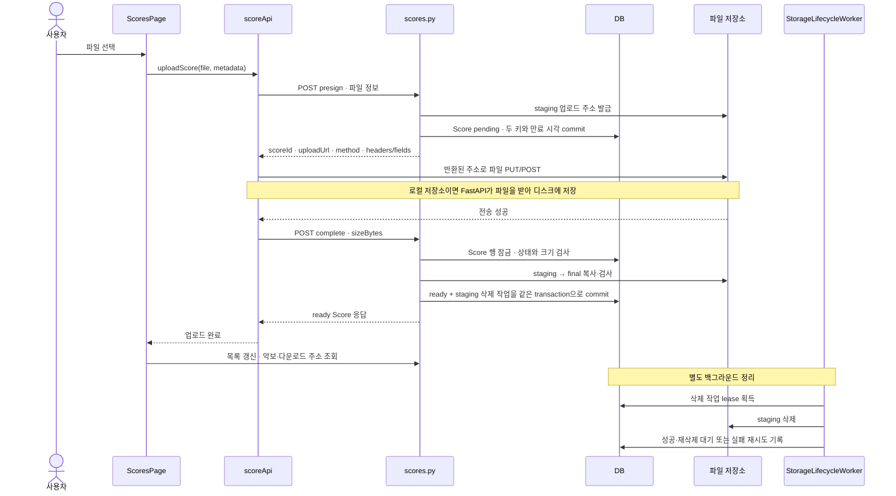

### 1단계. 파일 선택이 upload로 이어지고 입력을 검사한다

**원본** [ScoresPage.tsx](../apps/web/src/pages/ScoresPage.tsx) · 찾을 값: `inputRef`, `upload`

`악보 가져오기` 버튼은 숨겨진 파일 input을 연다. 아래는 합주 화면 안의 버튼이며, 일반 악보 화면의 버튼도 같은 input을 사용한다.

```tsx
<Button
  disabled={uploading || scores.loading || !canManageScores}
  onClick={() => inputRef.current?.click()}
>
  <Upload size={18} aria-hidden /> {uploading ? '업로드 중…' : '악보 가져오기'}
</Button>
```

파일을 고르면 input의 `onChange`가 실행된다.

```tsx
<input
  ref={inputRef}
  type="file"
  accept=".pdf,image/*,.musicxml,.mxl,.xml"
  hidden
  onChange={(event) => void upload(event)}
/>
```

`accept`는 파일 선택기에 주는 형식 안내다. 함수 안에서도 권한과 파일을 확인한다.

```ts
async function upload(event: ChangeEvent<HTMLInputElement>) {
  const file = event.target.files?.[0];
  if (!file) return;
  setUploading(true);
  try {
    if (remoteMode && !canManageScores) {
      throw new Error('리더 이상만 프로젝트 악보를 업로드할 수 있습니다.');
    }
    if (file.size <= 0) throw new Error('빈 파일은 올릴 수 없습니다.');
    let mimeType = scoreContentType(file);
    let storedBlob: Blob = file;
    let localTempoMapId: string | undefined;
    let remoteTempoDraft: PendingTempoDraft | undefined;
    if (!supportsScore(file, mimeType)) {
      throw new Error('PDF, 이미지, MusicXML(.musicxml/.mxl)만 올릴 수 있습니다.');
    }
```

`scoreContentType`은 브라우저의 MIME 형식 정보를 우선하고, 정보가 없거나 일반 바이너리 형식이면 확장자로 PDF·이미지·MusicXML 형식을 보완한다. `supportsScore`가 지원하는 형식인지 확인한다. 서버의 최대 크기와 실제 전송 크기 검사는 뒤에서 다시 실행한다.

원격 모드의 업로드 UI는 `/repertoire/{id}/access`로 받은 `owner/leader` 역할을 사용한다. 서버에서도 별도로 권한을 검사하므로 버튼 숨김이 권한 검사의 전부는 아니다.

함수의 `finally`는 성공·실패·중간 반환 모두에서 `setUploading(false)`와 `event.target.value = ''`를 실행한다. 같은 파일을 다시 선택해 재시도할 수 있도록 input을 비우는 처리다.

**확인할 질문:** input의 `accept`에 PDF만 허용하면 서버 검증을 생략해도 되는가? → 파일 선택 UI의 조건과 서버의 저장 허용 조건은 별개다.

### 2단계. 로컬 저장과 서버 업로드를 나누고 세 요청을 연결한다

**원본** [ScoresPage.tsx](../apps/web/src/pages/ScoresPage.tsx)의 `remoteMode`, `upload` → [scoreApi.ts](../apps/web/src/lib/scoreApi.ts)의 `uploadScore`

원격 여부를 결정하는 값은 다음과 같다.

```ts
const remoteMode = Boolean(user && repertoireItemId);
```

| 상황                                                | 파일이 가는 곳                              |
| --------------------------------------------------- | ------------------------------------------- |
| 로그인 사용자와 대상 `repertoireItemId`가 모두 있음 | 서버의 악보 API와 서버가 선택한 파일 저장소 |
| 둘 중 하나가 없음                                   | 브라우저 IndexedDB의 로컬 악보 저장소       |

**브라우저의 로컬 저장**과 뒤에서 나오는 **서버의 `LocalObjectStorage`**는 다른 장소다. 전자는 사용자 브라우저, 후자는 서버 디스크 또는 서버에 연결한 볼륨이다.

로컬 분기는 파일 Blob을 악보 데이터에 넣어 저장한다.

```ts
const score: LocalScore = {
  id: crypto.randomUUID(),
  repertoireItemId: 'local',
  name: file.name,
  kind,
  mimeType,
  blob: storedBlob,
  ...(localTempoMapId ? { tempoMapId: localTempoMapId } : {}),
  updatedAt: new Date().toISOString(),
};
await localDb.putScore(score);
scores.reload();
openScore(score.id);
```

`localDb.putScore(score)`는 scope가 없으므로 IndexedDB의 `scores` store를 쓴다. 이 분기에는 presign·complete 요청이 없다.

원격 분기는 `uploadScore(client, repertoireItemId, file, { contentType, kind })`를 호출한다. 현재 화면은 목록이 비어 있으면 `kind = 'full'`, 기존 악보가 있으면 `'part'`를 기본값으로 정한다. `instrument`를 넘기지 않아 이 요청에서는 빈 문자열이 사용된다.

세 요청을 이어 놓은 함수 전체를 먼저 읽는다.

```ts
export async function uploadScore(
  client: ApiClient,
  repertoireId: string,
  file: File,
  options: { contentType: string; kind: 'full' | 'part'; instrument?: string },
): Promise<ScoreRecord> {
  const target = await client.post<UploadTarget>(
    `/repertoire/${segment(repertoireId)}/scores/presign`,
    {
      filename: file.name,
      contentType: options.contentType,
      sizeBytes: file.size,
      kind: options.kind,
      instrument: options.instrument ?? '',
    },
  );
  try {
    await uploadToTarget(target, file, file.name);
    return await client.post<ScoreRecord>(`/scores/${segment(target.scoreId)}/complete`, {
      sizeBytes: file.size,
    });
  } catch (error) {
    await client.delete(`/scores/${segment(target.scoreId)}`).catch(() => undefined);
    throw error;
  }
}
```

`presign` 요청은 파일 바이트가 아닌 이름·형식·크기·종류를 보낸다. 응답으로 대상 ID와 업로드 주소를 받은 뒤 파일을 전송하고, 마지막으로 같은 `scoreId`의 완료를 요청한다. **`uploadScore`가 반환하는 것은 raw 업로드 응답이 아니라 complete가 돌려준 악보 정보**다.

**MusicXML의 추가 경로.** 원격 일반 악보 화면에서는 이 세 요청 전에 `createMusicXmlDraft`로 파일을 서버의 `/repertoire/{id}/musicxml/draft`에 보내 초안을 받는다. 초안은 파일 업로드 성공 후 검토 UI에 올리며, 이 업로드 함수가 곧바로 새 템포맵 revision을 저장하지는 않는다. 합주 안의 embedded 화면에서는 그 초안 생성 단계를 생략한다. 로컬 MusicXML은 먼저 템포맵 초안을 IndexedDB에 저장하고, XML Blob과 그 맵 ID를 악보에 연결한다. 이 로컬 두 저장은 별도 호출이다.

**확인할 질문:** 로그인한 사용자가 `/scores`에서 대상 곡 없이 파일을 가져오면 항상 서버에 저장되는가? → 현재 분기에서는 곡 ID도 있어야 원격 저장이다.

### 3단계. 서버가 pending 악보와 서로 다른 두 저장 키를 만든다

**원본** [routers/scores.py](../apps/server/app/routers/scores.py)의 `presign_score` · [schemas.py](../apps/server/app/schemas.py)의 `ScorePresignIn`

서버 라우트의 전체 경로는 `POST /api/repertoire/{repertoire_id}/scores/presign`이다. 입력 모델은 `sizeBytes > 0` 등을 검사한다. 그다음 실제 함수에서 권한·설정된 최대 크기·형식을 검사하고 두 저장 키를 만든다.

```python
require_repertoire(db, user, repertoire_id, "leader")
if body.size_bytes > request.app.state.settings.max_upload_bytes:
    raise HTTPException(status_code=413, detail="score exceeds configured upload limit")
filename = safe_filename(body.filename)
content_type = content_type_for(filename, body.content_type)
if not _allowed_score_content_type(content_type, filename):
    raise HTTPException(status_code=415, detail="unsupported score content type")
score_id = new_id()
storage_key = f"scores/{repertoire_id}/{score_id}/{filename}"
staging_key = f"staging/scores/{score_id}/{uuid.uuid4()}/{filename}"
target = request.app.state.storage.create_upload_target(staging_key, content_type, body.size_bytes)
```

[config.py](../apps/server/app/config.py)의 최대 크기 기본값은 `50 × 1024 × 1024바이트`, 즉 50MiB다. 초과하면 413, 허용하지 않은 형식이면 415다. `safe_filename`은 경로의 파일명 부분을 취하고 공백·NUL을 정리하며 길이를 제한한다.

| 키            | 예시 구조                                     | 용도                                     |
| ------------- | --------------------------------------------- | ---------------------------------------- |
| `storage_key` | `scores/{곡 ID}/{악보 ID}/{파일명}`           | 완료 후 읽을 **최종 파일 위치**          |
| `staging_key` | `staging/scores/{악보 ID}/{임의 ID}/{파일명}` | 클라이언트가 업로드할 **임시 파일 위치** |

이 값들은 저장소 안의 식별 경로다. DB에 서버의 절대 파일 경로를 저장하는 방식이 아니다. 로컬 저장소는 root 아래의 경로로, S3는 bucket 안의 key로 해석한다.

서버는 임시 key로 업로드 주소를 만들고, 다음 악보 행을 저장한다.

```python
score = Score(
    id=score_id,
    repertoire_id=repertoire_id,
    kind=body.kind,
    instrument=body.instrument,
    filename=filename,
    content_type=content_type,
    storage_key=storage_key,
    staging_key=staging_key,
    upload_expires_at=target.expires_at,
    size_bytes=body.size_bytes,
    created_by_id=user.id,
)
db.add(score)
db.commit()
db.refresh(score)
```

`upload_status`를 명시하지 않았지만 [models.py](../apps/server/app/models.py)의 `Score` 기본값이 `'pending'`이다. 예상 크기와 업로드 만료 시각도 함께 기록한다. 이 시점에는 **DB 행만 준비됐고, 파일은 아직 전송되지 않았다.**

응답의 필드 이름도 확인한다.

```python
return UploadTargetOut(
    score_id=score.id,
    storage_key=staging_key,
    upload_url=target.url,
    method=target.method,
    headers=target.headers,
    fields=target.fields,
    expires_at=target.expires_at,
)
```

> **같은 이름을 주의해서 읽는다.** presign 응답의 `storageKey`에는 **staging key**가 들어간다. DB의 `Score.storage_key`는 최종 key다. 프론트는 응답의 key로 경로를 새로 조합하지 않고, 반환된 `uploadUrl`과 조건을 사용한다.

`create_upload_target`은 DB `add/commit`보다 먼저 호출된다. 주소 발급 자체가 실패하면 이 함수는 새 pending 행을 commit하지 않는다. 반대로 DB commit 후 응답만 유실되면 서버에 pending 행이 남을 수 있으며, 9단계의 만료 회수가 필요하다.

**확인할 질문:** 왜 사용자에게 처음부터 최종 key의 쓰기 주소를 주지 않는가? → 업로드 권한이 남아 있는 임시 위치와, 완료 후 읽는 최종 위치를 분리하기 위해서다.

### 4단계. 저장소에 맞는 주소로 파일을 직접 전송한다

**원본** [storage.py](../apps/server/app/storage.py)의 `make_storage`, `create_upload_target` → [scoreApi.ts](../apps/web/src/lib/scoreApi.ts)의 `uploadToTarget`

저장소 구현은 설정으로 고른다.

```python
def make_storage(settings: Settings) -> ObjectStorage:
    if settings.storage_backend == "s3":
        return S3ObjectStorage(settings)
    return LocalObjectStorage(settings)
```

서버 로컬 저장소는 임시 key와 만료가 묶인 업로드용 토큰을 만들고, 서버로 보낼 `PUT` 주소를 반환한다.

```python
def create_upload_target(self, storage_key: str, content_type: str, size_bytes: int) -> UploadTarget:
    del size_bytes
    token = make_upload_token(self.settings, storage_key)
    base = self.settings.public_api_base_url.rstrip("/")
    encoded_key = quote(storage_key, safe="/")
    return UploadTarget(
        url=f"{base}/api/uploads/local/{encoded_key}?token={token}",
        method="PUT",
        headers={"Content-Type": content_type},
        fields={},
        expires_at=utcnow() + timedelta(seconds=self.settings.upload_url_ttl_seconds),
    )
```

`verify_upload_token`은 토큰 형식·만료와 대상 key 일치를 검사한다. 이 토큰은 로그인 access token과 용도가 다르다.

S3 저장소는 **POST form용 서명 조건**을 만든다.

```python
def create_upload_target(self, storage_key: str, content_type: str, size_bytes: int) -> UploadTarget:
    post = self.client.generate_presigned_post(
        Bucket=self.bucket,
        Key=storage_key,
        Fields={"Content-Type": content_type},
        Conditions=[
            {"Content-Type": content_type},
            ["content-length-range", size_bytes, size_bytes],
        ],
        ExpiresIn=self.settings.upload_url_ttl_seconds,
    )
```

S3에 요청한 조건에는 지정 Content-Type과 **선언한 크기와 정확히 같은 `content-length-range`**가 들어간다. 응답은 `method: 'POST'`, 서명 정보가 포함된 `fields`, 빈 `headers`를 사용한다. 로컬은 `method: 'PUT'`, Content-Type header, 빈 `fields`를 사용한다.

프론트가 두 방식을 처리하는 실제 함수다.

```ts
async function uploadToTarget(target: UploadTarget, blob: Blob, filename: string): Promise<void> {
  let response: Response;
  if (target.method === 'PUT') {
    response = await fetch(target.uploadUrl, {
      method: 'PUT',
      headers: target.headers,
      body: blob,
    });
  } else {
    const body = new FormData();
    Object.entries(target.fields).forEach(([key, value]) => body.append(key, value));
    body.append('file', blob, filename);
    response = await fetch(target.uploadUrl, {
      method: 'POST',
      headers: target.headers,
      body,
    });
  }
  if (!response.ok) {
    throw new Error(await errorMessage(response, `악보 원본 업로드 실패 (${response.status})`));
  }
}
```

| 요청 종류               | 어떤 코드로 보내는가           | 권한·내용                                      |
| ----------------------- | ------------------------------ | ---------------------------------------------- |
| presign·complete·DELETE | `ApiClient`                    | 앱 API 인증과 악보 접근 권한을 사용            |
| 로컬 파일 전송          | 반환된 URL에 일반 `fetch` PUT  | URL의 업로드용 토큰, 반환된 headers, 파일 Blob |
| S3 파일 전송            | 반환된 URL에 일반 `fetch` POST | 반환된 서명 fields와 `file`을 담은 `FormData`  |

파일 전송 함수는 앱의 Bearer 인증 헤더를 추가하지 않는다. 서버가 준 주소·headers·fields만 사용한다. 특히 POST 분기에서는 직접 multipart Content-Type을 만들지 않고 `FormData`를 전달한다.

일반 `fetch`는 HTTP 오류 응답도 Response로 반환할 수 있으므로 함수 마지막에서 `response.ok`를 검사해 오류로 바꾼다. 파일 전송이 성공해야 다음 complete 요청으로 진행한다.

**확인할 질문:** S3로 보내는 파일도 먼저 FastAPI를 통째로 통과하는가? → 이 분기에서는 브라우저가 서명된 S3 주소로 직접 보낸다. 로컬 저장소 분기에서는 FastAPI가 수신한다.

### 5단계. 로컬 저장소는 전송 중인 파일과 staging도 분리한다

**원본** [routers/scores.py](../apps/server/app/routers/scores.py)의 `local_upload` → [storage.py](../apps/server/app/storage.py)의 `publish_temporary_upload`

이 단계는 서버가 `LocalObjectStorage`를 쓰는 경우다. 먼저 업로드 토큰을 검증하고, 해당 key가 살아 있는 pending 행에 연결돼 있으며 만료되지 않았는지 확인한다. 예상 크기를 읽은 뒤 `db.rollback()`으로 그 조회 transaction을 끝내고 파일을 받는다.

```python
expected_size = score.size_bytes
db.rollback()
temporary = storage.create_temporary_upload_path()
size = 0
try:
    with temporary.open("wb") as output:
        async for chunk in request.stream():
            size += len(chunk)
            if size > expected_size:
                raise HTTPException(status_code=409, detail="upload size differs from presigned size")
            output.write(chunk)
    if size != expected_size:
        raise HTTPException(status_code=409, detail="upload size differs from presigned size")
```

받는 동안에는 staging 경로에 바로 쓰지 않고 `.uploading/{임의 ID}.part` 파일에 쓴다. 선언한 크기를 넘으면 즉시 409이고, 전송이 끝나도 크기가 부족하면 409다. `.part`는 아직 온전한 업로드로 공개하지 않은 파일이다.

전송 완료 후에는 DB를 **다시 읽고 잠금을 요청**한다.

```python
score = db.scalar(
    _pending_upload_query(storage_key).with_for_update().execution_options(populate_existing=True)
)
if (
    score is None
    or score.size_bytes != expected_size
    or _as_utc(utcnow()) > _upload_deadline(score, settings)
):
    db.rollback()
    raise HTTPException(
        status_code=status.HTTP_410_GONE,
        detail="upload target is no longer active",
    )
```

전송하는 동안 악보가 삭제되거나 만료됐을 수 있으므로, 최초 조회만 믿고 게시하지 않는다. `populate_existing=True`로 세션에 남아 있는 이전 객체 상태도 갱신한다. 검사를 통과하면 임시 파일을 staging 경로로 옮긴다.

```python
def publish_temporary_upload(self, temporary: Path, storage_key: str) -> None:
    candidate = temporary.resolve()
    if candidate.parent != self.temporary_root.resolve():
        raise ValueError("invalid temporary upload path")
    target = self.resolve_key(storage_key)
    target.parent.mkdir(parents=True, exist_ok=True)
    candidate.replace(target)
```

`candidate.replace(target)`은 완성된 임시 파일을 staging 경로에 놓는 지점이다. `local_upload`의 `finally`는 성공·실패와 관계없이 남은 `.part` 경로를 제거한다. 이미 staging으로 이동했으면 그 임시 경로는 없으므로 아무 일도 하지 않는다.

```python
    storage.publish_temporary_upload(temporary, storage_key)
    db.commit()
finally:
    temporary.unlink(missing_ok=True)
return Response(status_code=204)
```

반환된 204는 **임시 저장소로의 파일 전송 성공**이다. 아직 `Score.upload_status`는 pending이다. 이후 complete가 실행돼야 최종 파일과 ready 상태가 생긴다.

**확인할 질문:** 전송 도중 페이지가 닫히거나 악보가 삭제되면 반쪽짜리 파일이 staging으로 공개되는가? → 스트리밍 완료·크기 검사·DB 재검사를 통과한 뒤에만 staging으로 옮긴다. 프로세스가 갑자기 종료돼 `finally`가 실행되지 못한 `.part`는 별도 만료 정리 대상이다.

### 6단계. complete가 악보 행을 잠그고 파일을 최종 위치로 복사한다

**원본** [routers/scores.py](../apps/server/app/routers/scores.py)의 `complete_score`

프론트는 파일 전송 성공 후 `/scores/{scoreId}/complete`에 `{ sizeBytes: file.size }`를 보낸다. 서버는 로그인 사용자의 leader 이상 권한을 확인하고, 해당 `Score` 행에 잠금을 요청한 뒤 조건을 검사한다.

```python
require_score(db, user, score_id, "leader")
score = db.scalar(select(Score).where(Score.id == score_id).with_for_update())
if score is None:
    raise HTTPException(status_code=404, detail="score not found")
if score.size_bytes != body.size_bytes:
    raise HTTPException(status_code=409, detail="uploaded size differs from presigned size")
if score.upload_status == "ready":
    return score_out(score)
settings = request.app.state.settings
if _as_utc(utcnow()) > _upload_deadline(score, settings) + timedelta(
    seconds=settings.pending_upload_grace_seconds
):
    raise HTTPException(status_code=409, detail="score upload target has expired")
staging_key = score.staging_key or score.storage_key
```

순서대로 읽는다.

1. 준비 단계에 저장한 크기와 완료 요청의 크기가 같아야 한다.
2. 이미 ready이면 같은 악보 정보를 반환한다. 같은 ID·크기로 다시 완료를 요청해도 새 악보를 만들지 않는다.
3. 아직 pending이면 업로드 만료 시각에 완료 유예 시간을 더한 시각을 넘지 않았는지 확인한다.
4. 사용할 staging key를 찾는다. `staging_key`가 없는 구형 데이터는 기존 `storage_key`를 사용한다.

그다음 `storage.promote(staging_key, final_key, expected_size)`를 호출한다. 이 코드에서 promote는 **임시 파일을 최종 위치에 복사하고 확인하는 작업**이다. 이 호출 안에서 staging을 지우지는 않는다.

**로컬 저장소의 promote** [storage.py](../apps/server/app/storage.py)

```python
def promote(self, staging_key: str, storage_key: str, expected_size: int) -> None:
    target = self.resolve_key(storage_key)
    if target.is_file() and target.stat().st_size == expected_size:
        return
    source = self.resolve_key(staging_key)
    if not source.is_file() or source.stat().st_size != expected_size:
        raise ObjectStoragePromotionError("staging object is missing or has the wrong size")
    temporary = self.create_temporary_upload_path()
    try:
        shutil.copyfile(source, temporary)
        if temporary.stat().st_size != expected_size:
            raise ObjectStoragePromotionError("promoted object has the wrong size")
        target.parent.mkdir(parents=True, exist_ok=True)
        temporary.replace(target)
    finally:
        temporary.unlink(missing_ok=True)
```

최종 위치에 기대 크기의 파일이 이미 있으면 즉시 반환한다. 없으면 staging의 존재와 크기를 확인하고, 별도 `.part`에 복사한 뒤 최종 경로로 교체한다. 복사 중 실패했을 때 반쪽짜리 최종 파일을 남기지 않기 위한 순서다.

**S3 저장소의 promote** 같은 파일의 `S3ObjectStorage.promote`

```python
def promote(self, staging_key: str, storage_key: str, expected_size: int) -> None:
    if self.exists(storage_key, expected_size):
        return
    if not self.exists(staging_key, expected_size):
        raise ObjectStoragePromotionError("staging object is missing or has the wrong size")
    self.client.copy_object(
        Bucket=self.bucket,
        CopySource={"Bucket": self.bucket, "Key": staging_key},
        Key=storage_key,
    )
    if not self.exists(storage_key, expected_size):
        raise ObjectStoragePromotionError("promoted object is missing or has the wrong size")
```

S3도 먼저 최종 객체를 확인하고, 필요하면 `copy_object`로 복사한다. `exists`는 `head_object`의 `ContentLength`와 기대 크기를 비교한다. 복사 후 최종 객체도 다시 확인한다.

| complete의 실패                             | 응답과 상태                                                |
| ------------------------------------------- | ---------------------------------------------------------- |
| 선언 크기 불일치·완료 기한 초과             | 409, ready로 바꾸지 않음                                   |
| staging/final 검증 중 객체 없음·크기 불일치 | `ObjectStoragePromotionError`를 409로 변환                 |
| 그 밖의 저장소 예외                         | 503, 저장소가 일시적으로 사용 불가하다는 응답              |
| 파일 복사 후 DB commit 실패                 | 최종 파일은 존재할 수 있으나 DB는 pending으로 남을 수 있음 |

**파일 저장소와 DB는 하나의 transaction이 아니다.** 최종 파일 복사만 성공하고 DB 확정이 실패할 수 있다. 이때 같은 complete를 다시 호출하면 이미 존재하는 최종 파일을 확인하고 DB 확정을 이어갈 수 있도록 작성돼 있다. 같은 요청을 반복해도 같은 완료 상태로 수렴시키는 성질을 **멱등성**이라고 한다.

다만 이 확인은 파일의 존재와 크기를 기준으로 한다. complete가 원본과 최종 파일의 내용 해시를 비교하거나 모든 PDF·이미지 내용을 파싱해 검증하는 단계라고 설명하면 안 된다.

**확인할 질문:** DB commit에 실패했다고 최종 저장소의 파일 복사도 자동으로 되돌아가는가? → 서로 다른 저장 시스템이므로 그렇지 않다. 재호출 또는 뒤의 삭제 작업으로 남은 상태를 처리한다.

### 7단계. ready와 staging 삭제 작업을 함께 확정하고 악보를 연다

**원본** [routers/scores.py](../apps/server/app/routers/scores.py)의 `complete_score` → [storage_lifecycle.py](../apps/server/app/storage_lifecycle.py)의 `enqueue_promoted_staging_deletion`

promote가 성공하면 다음 코드를 실행한다.

```python
score.upload_status = "ready"
enqueue_promoted_staging_deletion(db, score, settings)
db.commit()
db.refresh(score)
return score_out(score)
```

`ready` 변경과 **staging 삭제 작업 등록**이 같은 DB commit에 들어간다. 삭제 작업은 메모리에만 남기는 할 일 목록이 아니라 `storage_deletion_jobs` 테이블에 저장하는 기록이다. 이런 방식의 영속 작업 목록을 여기서는 **outbox**라고 부른다.

```python
def enqueue_promoted_staging_deletion(
    db: Session,
    score: Score,
    settings: Settings,
    *,
    now: datetime | None = None,
) -> StorageDeletionJob | None:
    if score.staging_key is None or score.staging_key == score.storage_key:
        return None
    queued_at = _as_utc(now or utcnow())
    return enqueue_storage_deletion(
        db,
        score.staging_key,
        reason="staging-promoted",
        now=queued_at,
        guard_until=_staging_guard_until(score, settings),
    )
```

`enqueue_storage_deletion`은 기존 key의 작업을 찾거나 새 작업을 추가하며, 여기서는 저장소에 삭제 요청을 보내지 않는다. 삭제는 worker가 나중에 수행한다. 따라서 ready 응답 뒤 잠시 staging과 final 파일이 함께 존재하는 것은 가능한 정상 상태다.

`score_out(score)`가 만드는 `ScoreOut` 응답에는 악보 ID·종류·파일명·크기·`uploadStatus` 등이 들어간다. 파일 Blob 자체를 complete 응답에 넣지는 않는다.

**화면 복귀 원본** [ScoresPage.tsx](../apps/web/src/pages/ScoresPage.tsx)

```ts
scores.reload();
openScore(score.id);
notify({ title: '악보를 서버에 저장했습니다.', tone: 'success' });
return;
```

목록을 재조회하고 새 악보 ID를 연 뒤 서버 저장 성공을 알린다. 업로드를 기다리는 동안 다른 곡으로 이동했다면 `activeRepertoireIdRef` 검사에서 현재 화면 반영을 중단한다. 이것은 이미 서버에 저장한 악보를 삭제하는 취소 동작은 아니다.

서버 목록은 ready만 조회한다.

```python
def list_scores(repertoire_id: str, db: DbSession, user: CurrentUser) -> list[ScoreOut]:
    require_repertoire(db, user, repertoire_id)
    rows = db.scalars(
        select(Score)
        .where(Score.repertoire_id == repertoire_id, Score.upload_status == "ready")
        .order_by(Score.filename)
    ).all()
    return [score_out(row) for row in rows]
```

단건 `GET /scores/{id}`도 pending이면 404를 반환한다. 레퍼토리의 악보 수 역시 ready만 센다. 원격 프론트 목록에도 ready 필터가 있어 준비 중인 업로드를 완성된 악보처럼 표시하지 않는다.

새 악보를 열 때는 별도 읽기 경로가 실행된다.

```text
getRemoteScore(scoreId)
  → GET /scores/{id}/download로 최종 key의 다운로드 주소 받기
  → 일반 fetch로 원본 다운로드
  → localScoreFromRemote로 화면용 데이터 만들기
  → 사용자별 IndexedDB 사본 기록 · 악보 표시
```

**다운로드 요청 원본** [scoreApi.ts](../apps/web/src/lib/scoreApi.ts)

```ts
export async function downloadScore(client: ApiClient, score: ScoreRecord): Promise<Blob> {
  const target = await client.get<DownloadTarget>(`/scores/${segment(score.id)}/download`);
  const response = await fetch(target.url);
  if (!response.ok) {
    throw new Error(await errorMessage(response, `악보 다운로드 실패 (${response.status})`));
  }
  const downloaded = await response.blob();
  if (downloaded.type && downloaded.type !== 'application/octet-stream') return downloaded;
  return downloaded.slice(0, downloaded.size, score.contentType);
```

서버의 다운로드 주소는 `score.storage_key`, 즉 final key로 만든다. 이후 페이지는 `localDb.putScore(score, remoteCacheScope)`로 `remoteScores`에 현재 사용자별 사본을 기록한다. 서버 저장 성공과 오프라인 사본 기록 성공은 서로 다른 단계다. 사본 갱신이 실패해도 그 이유로 서버의 ready 악보를 삭제하지 않는다.

**확인할 질문:** 파일 전송 직후 목록에 보이지 않으면 항상 오류인가? → pending은 의도적으로 숨기며, complete가 ready를 commit한 뒤 조회 대상이 된다.

### DB와 파일의 상태를 함께 놓고 읽기

아래 표는 **새 업로드 경로**의 가능한 상태다. staging/final 열은 파일 저장소의 상태이며 DB 열과 구분한다.

| 시점                  | `scores` 행                | staging           | final                                  | 삭제 작업                            |
| --------------------- | -------------------------- | ----------------- | -------------------------------------- | ------------------------------------ |
| presign 성공          | pending                    | 아직 없음         | 없음                                   | 없음                                 |
| 파일 전송 성공        | pending                    | 있음              | 없음                                   | 없음                                 |
| promote 후 DB 확정 전 | 아직 확정되지 않은 pending | 있음              | 있음                                   | 아직 commit 전                       |
| complete 성공         | ready                      | 남아 있을 수 있음 | 있음                                   | staging 삭제 작업을 commit함         |
| 악보 DELETE 성공      | 행 삭제됨                  | 남아 있을 수 있음 | 남아 있을 수 있음                      | staging과 final 삭제 작업을 commit함 |
| 만료된 pending 회수   | 행 삭제됨                  | 없거나 남아 있음  | 실패 시점에 따라 있을 수 있음          | 가능한 두 key의 삭제 작업을 commit함 |
| worker 정리 완료      | ready 유지 또는 행 없음    | 정리됨            | 정상 악보면 유지, 삭제 대상이면 정리됨 | 관련 작업 completed                  |

현재 업로드 관련 삭제 경로는 `Score`에 `deleted` 상태를 넣는 코드가 아니라 **`db.delete(score)`로 행을 제거하는 코드**다. 파일의 실제 삭제는 outbox를 통해 뒤따른다. DB에서 악보가 없어졌다는 사실과 저장소의 모든 파일이 즉시 없어졌다는 사실을 구분한다.

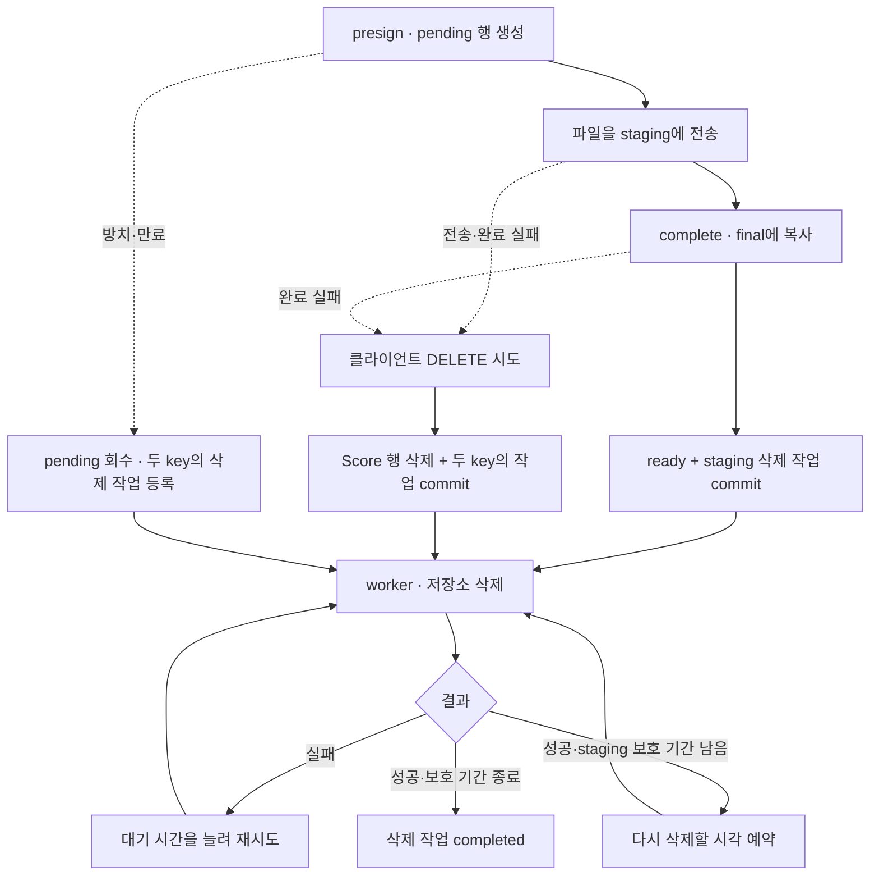

### 8단계. 프론트의 실패 처리가 악보 삭제와 파일 정리 작업을 요청한다

**원본** [scoreApi.ts](../apps/web/src/lib/scoreApi.ts)의 `uploadScore` 실패 분기

```ts
} catch (error) {
  await client.delete(`/scores/${segment(target.scoreId)}`).catch(() => undefined);
  throw error;
}
```

이 `catch`는 **파일 전송 또는 complete 요청의 실패**를 처리한다. 받은 `scoreId`로 DELETE를 시도한 뒤 원래 오류를 다시 던진다. DELETE 자체의 오류는 이 함수에서 무시하므로, 화면의 원래 업로드 오류만으로 정리 성공 여부를 알 수는 없다.

presign은 이 `try` 밖에 있다. presign 응답을 받기 전에 실패하면 프론트에는 삭제할 ID가 없어서 이 정리 분기가 실행되지 않는다. 서버에 이미 만들어진 pending이 있다면 9단계의 회수가 맡는다.

**삭제 API 원본** [routers/scores.py](../apps/server/app/routers/scores.py)의 `delete_score`

```python
require_score(db, user, score_id, "leader")
score = db.scalar(select(Score).where(Score.id == score_id).with_for_update())
assert score is not None
enqueue_score_cleanup(
    db,
    [score],
    request.app.state.settings,
    reason="score",
)
db.delete(score)
db.commit()
return Response(status_code=204)
```

서버는 권한을 확인하고 `Score` 행을 잠근 뒤, `enqueue_score_cleanup → enqueue_score_deletions`로 **final과 staging 두 key**의 삭제 작업을 등록한다. 복사 후 DB 확정이 실패한 경우에는 final도 이미 생겼을 수 있으므로 두 위치를 모두 대상으로 삼는다.

그다음 `db.delete(score)`와 작업 등록을 같은 transaction으로 commit한다. 204는 이 DB 작업의 완료를 뜻한다. 그 시점에 저장소 삭제가 모두 끝났다는 응답은 아니다. DB commit이 실패하면 행 삭제와 outbox 등록이 함께 확정되지 않으며, 이 API는 저장소 삭제를 먼저 수행하지 않는다.

**완료 응답이 유실되는 경우는 따로 읽는다.** 서버에서는 ready commit을 끝냈지만 프론트가 응답을 받지 못할 수 있다. 현재 `uploadScore`는 이 경우도 catch에서 DELETE를 시도한다. 삭제 API에는 “pending일 때만 삭제” 조건이 없으므로, DELETE가 성공하면 이미 ready인 악보도 제거될 수 있다.

따라서 **서버의 complete가 멱등이라는 사실과 프론트가 complete를 재시도한다는 주장은 다르다.** 이 함수에는 실패 후 상태를 재조회해 성공 여부를 판정하거나, 동일 complete를 명시적으로 재시도하는 로직이 없다. 이는 현재 코드에서 읽히는 실패 처리 경계이며, 이번 문서 작업에서 동작을 수정하지 않았다.

**확인할 질문:** 파일 전송 실패와 “완료는 됐지만 응답만 못 받음”을 현재 catch가 구분하는가? → 둘 다 같은 삭제 시도 경로로 들어간다.

### 9단계. 서버가 만료된 pending과 남은 임시 파일을 회수한다

**원본** [storage_lifecycle.py](../apps/server/app/storage_lifecycle.py)의 `run_once`, `reap_stale_pending_scores`

브라우저가 닫히거나 DELETE 요청도 실패하면 클라이언트 정리에만 의존할 수 없다. 서버의 `StorageLifecycleWorker`가 다음 작업을 반복한다.

```python
def run_once(self) -> int:
    self.reap_stale_pending_scores()
    if isinstance(self.storage, LocalObjectStorage):
        before = _as_utc(self.clock()) - timedelta(seconds=self.settings.local_upload_temp_ttl_seconds)
        self.storage.cleanup_temporary_uploads(before)
    claimed = self.claim_due_deletions()
    for job in claimed:
        self._process_claim(job)
    return len(claimed)
```

[main.py](../apps/server/app/main.py)는 저장소와 worker를 만들고 앱 시작 시 `start`, 종료 시 `stop`을 호출한다. worker는 기본 활성화돼 있고, 반복 작업 사이에 기본 30초를 기다린다. 실제 실행 시각은 작업 소요 시간과 설정에 따라 달라진다.

**만료된 pending 회수 조건**은 다음과 같다.

| pending의 형태                       | 회수 대상 조건                                                |
| ------------------------------------ | ------------------------------------------------------------- |
| `upload_expires_at`이 있는 새 업로드 | 만료 시각에 `pending_upload_grace_seconds`를 더한 시각에 도달 |
| 만료 시각이 없는 구형 업로드         | 생성 후 `legacy_pending_upload_ttl_seconds` 경과              |
| ready 또는 아직 유효한 pending       | 이 회수 쿼리의 대상이 아님                                    |

회수 함수는 배치 크기만큼 행을 조회하며 `with_for_update(skip_locked=True)`로 다른 작업이 잠근 행을 건너뛰도록 요청한다. 대상 행을 찾은 뒤의 처리다.

```python
for score in rows:
    enqueue_score_deletions(
        db,
        [score],
        self.settings,
        reason="stale-pending",
        now=now,
    )
    db.delete(score)
db.commit()
return len(rows)
```

두 key의 정리 작업과 pending 행 삭제를 같은 transaction으로 확정한다. 여기서도 파일을 바로 지우지는 않는다. `run_once`가 이어서 due 작업을 가져가 실제 저장소 삭제를 시도한다.

서버 로컬 저장소에는 `.uploading/*.part`도 따로 정리한다. 요청의 `finally`가 실행되기 전에 프로세스가 종료되면 이런 파일이 남을 수 있다. `cleanup_temporary_uploads`는 마지막 수정 시각이 설정된 기준보다 오래된 파일만 제거하며, 기본 TTL은 1시간이다. staging key의 outbox 정리와 다른 경로다.

**확인할 질문:** 만료된 pending만 지우면 파일도 자동으로 사라지는가? → DB 행과 저장소는 별개이므로, 행이 사라지기 전에 가능한 파일 key를 outbox에 남겨야 한다.

### 10단계. 삭제 worker가 작업을 맡아 재시도하고 늦은 파일도 정리한다

**원본** [storage_lifecycle.py](../apps/server/app/storage_lifecycle.py)의 `claim_due_deletions`, `_process_claim`, `_finalize_success`, `_finalize_failure`

`Score.upload_status = pending`과 `StorageDeletionJob.status = pending`은 다른 상태다. 전자는 미완료 악보, 후자는 아직 처리할 삭제 작업이다. 삭제 작업은 `pending → leased → completed`로 진행하며, 실패하거나 다시 삭제해야 하면 pending으로 돌아간다.

**lease**는 worker가 일정 시간 그 작업을 맡았다는 기록이다. 실행 시각이 된 pending과 lease가 만료된 작업을 잠가 조회한 뒤 다음 필드를 기록한다.

```python
claimed: list[ClaimedDeletion] = []
for row in rows:
    row.status = "leased"
    row.lease_owner = self.worker_id
    row.lease_expires_at = lease_expires_at
    claimed.append(ClaimedDeletion(id=row.id, storage_key=row.storage_key))
db.commit()
return claimed
```

기본 lease는 300초다. worker가 파일을 지운 직후 DB에 완료 기록을 남기기 전에 죽어도, lease가 만료되면 다른 실행이 작업을 다시 가져갈 수 있다.

실제 저장소 호출은 짧다.

```python
def _process_claim(self, claimed: ClaimedDeletion) -> None:
    try:
        self.storage.delete(claimed.storage_key)
    except Exception as exc:
        self._finalize_failure(claimed.id, exc)
        logger.warning(
            "Storage deletion retry scheduled for job %s (%s)",
            claimed.id,
            type(exc).__name__,
        )
        return
    self._finalize_success(claimed.id)
```

로컬 삭제는 `unlink(missing_ok=True)`, S3 삭제는 `delete_object`를 사용한다. 파일이 이미 없을 수 있다는 전제에서 같은 key의 삭제를 재시도한다. 실패한 파일 하나 때문에 나머지 배치 항목을 모두 포기하지 않고, 해당 작업의 재시도를 기록한 뒤 다음 항목으로 진행한다.

실패 처리의 핵심이다.

```python
row.attempt_count += 1
exponent = min(max(row.attempt_count - 1, 0), 30)
delay = min(
    self.settings.storage_delete_retry_base_seconds * (2**exponent),
    self.settings.storage_delete_retry_max_seconds,
)
row.status = "pending"
row.next_attempt_at = now + timedelta(seconds=delay)
row.lease_owner = None
row.lease_expires_at = None
row.last_error = type(error).__name__[:160]
db.commit()
```

기본 재시도 대기 시간은 `5초 → 10초 → 20초 → …`, 최대 3600초로 제한된다. 현재 코드에는 정해진 횟수 뒤 영구 실패로 버리는 분기가 없다. `last_error`에는 예외의 클래스 이름을 저장한다. 이 처리에는 worker가 계속 실행되고 DB·저장소에 다시 접근할 수 있다는 조건이 필요하다.

**성공했는데도 pending으로 돌아가는 staging 작업**도 있다.

```python
guard_until = _as_utc(row.guard_until) if row.guard_until is not None else None
row.lease_owner = None
row.lease_expires_at = None
row.last_error = None
if guard_until is not None and now < guard_until:
    row.status = "pending"
    row.next_attempt_at = min(
        now + timedelta(seconds=self.settings.staging_redelete_interval_seconds),
        guard_until,
    )
else:
    row.status = "completed"
    row.completed_at = now
db.commit()
```

staging 업로드 주소는 아직 유효하거나, 이미 시작한 전송이 늦게 끝날 수 있다. 특히 S3 직접 업로드는 앱의 pending 행 상태를 매번 조회하지 않는다. 임시 파일을 한 번 지운 뒤 같은 key가 늦게 다시 생길 가능성에 대비해, `guard_until` 전에는 성공한 삭제도 주기적으로 반복한다.

현재 새 업로드의 보호 종료 시각은 다음 식이다.

```text
guard_until
  = upload_expires_at
  + pending_upload_grace_seconds
  + late_upload_guard_seconds
```

기본 재삭제 간격은 900초다. `guard_until`은 “그때까지 삭제를 미룬다”는 뜻이 아니다. **지금도 삭제하고, 보호 기간 동안 다시 삭제하며, 기간이 끝난 뒤 성공한 작업을 completed로 확정**한다. 이 기간을 넘는 모든 늦은 전송을 무한히 추적한다는 뜻은 아니다.

**확인할 질문:** staging 삭제가 성공했는데 작업이 pending으로 남아 있으면 항상 실패인가? → 보호 기간 동안 다시 확인하기 위해 의도적으로 pending을 유지할 수 있다.

### 시간으로 따라가기. 업로드 만료와 정리 완료는 다르다

아래는 [config.py](../apps/server/app/config.py)의 **기본 설정**으로 계산한 예시다. 실제 운영 설정이나 실행 로그를 조회한 값은 아니다. 편의상 발급 시각과 만료 계산의 작은 차이는 생략한다.

| 설정                                | 기본값            | 어디에 적용되는가                         |
| ----------------------------------- | ----------------- | ----------------------------------------- |
| `upload_url_ttl_seconds`            | 900초 = 15분      | 새 업로드 주소의 유효 기간                |
| `pending_upload_grace_seconds`      | 900초 = 15분      | complete의 추가 유예, pending 회수 기준   |
| `late_upload_guard_seconds`         | 86,400초 = 24시간 | staging 재삭제의 추가 보호 기간           |
| `staging_redelete_interval_seconds` | 900초 = 15분      | 성공한 staging 삭제를 다시 시도하는 간격  |
| `local_upload_temp_ttl_seconds`     | 3600초 = 1시간    | 로컬 `.part` 파일의 마지막 수정 기준 정리 |
| `legacy_pending_upload_ttl_seconds` | 86,400초 = 24시간 | 만료 시각 없는 구형 pending의 회수 기준   |

10:00에 새 업로드 주소를 발급했다면 다음처럼 읽는다.

1. 업로드 주소의 만료는 약 **10:15**다. 로컬 업로드 API도 그 만료 이후에는 새 staging 게시를 거부한다.
2. complete는 추가 유예를 적용하므로 약 **10:30**까지 확정할 기회를 준다. 이 유예가 raw 업로드 주소의 기한까지 늘려주는 것은 아니다.
3. 계속 pending이면 약 **10:30부터** 회수 쿼리의 대상이 된다. 실제 회수는 worker가 실행되는 때다.
4. staging의 보호 종료는 **다음 날 10:30**이다. 그 전에도 파일을 삭제하고, 다시 나타날 가능성에 대비해 정리를 반복한다.
5. 10:01에 업로드와 complete를 마친 경우에도 staging 정리는 먼저 실행할 수 있다. ready 악보의 final 파일은 그대로 유지한다.

`complete`의 기한 검사는 `>`이고 reaper의 대상 비교는 `<=`이므로 정확한 경계에서는 행을 먼저 잠그고 처리한 작업의 결과도 중요하다. 이 표는 기한의 의미를 설명하며, 특정 밀리초의 성공을 약속하지 않는다.

### 악보 업로드의 실패를 위치별로 구분하기

| 실패 위치                                          | 남을 수 있는 상태                                | 현재 정리 경로                                                                                    |
| -------------------------------------------------- | ------------------------------------------------ | ------------------------------------------------------------------------------------------------- |
| 프론트 형식·빈 파일·권한 검사                      | 서버 파일·행 생성 전                             | 오류 알림, input 초기화                                                                           |
| 업로드 주소 발급 실패                              | 이 presign에서 pending을 아직 commit하지 않음    | 요청 실패로 종료                                                                                  |
| presign의 DB commit 후 응답 유실                   | pending 행, 파일은 아직 없을 수 있음             | 프론트는 ID를 못 받았으므로 만료 reaper가 회수                                                    |
| raw 파일 전송 실패                                 | pending, 일부 `.part` 또는 저장소의 staging 가능 | 로컬 요청 `finally`, 프론트 DELETE, 실패 시 pending 회수                                          |
| complete의 파일 검증·복사 실패                     | pending, staging 또는 일부 완료된 final 가능     | 프론트 DELETE로 가능한 두 key 등록, 미정리 pending은 회수                                         |
| promote 성공 후 ready commit 실패                  | pending과 final 파일이 함께 존재 가능            | 서버는 같은 complete로 복구 가능. 현재 프론트 함수는 DELETE를 시도함                              |
| ready commit 후 완료 응답 유실                     | 서버에는 ready지만 클라이언트는 실패로 판단 가능 | 현재 DELETE 시도가 성공하면 ready 악보도 삭제됨. 실패 시 ready는 stale-pending reaper 대상이 아님 |
| DELETE의 DB commit 실패                            | 악보 행과 outbox를 함께 확정하지 못함            | 삭제 완료로 보지 않음. pending이면 이후 회수 가능                                                 |
| 삭제 worker의 저장소 호출 실패                     | DB 악보는 이미 없고 파일이 남아 있을 수 있음     | 영속 outbox의 backoff 재시도                                                                      |
| 파일 삭제 후 완료 기록 전 worker 종료              | 파일은 없고 작업 lease가 남을 수 있음            | lease 만료 후 같은 key를 다시 삭제                                                                |
| 사용자에게 ready 악보를 여는 중 다운로드·캐시 오류 | 서버 ready 악보는 이미 존재                      | 조회·캐시 오류 처리. uploadScore의 삭제 catch와 별개                                              |

이 표에서 **실패 응답**, **서버에 저장되지 않음**, **정리가 끝남**은 같은 말이 아니다. 어느 요청의 어느 단계까지 확정됐는지와, outbox의 남은 작업을 나누어 읽는다.

### 악보 업로드의 리뷰 포인트와 테스트

아래 테스트를 소스와 함께 읽으면 정상 업로드뿐 아니라 중간 실패가 어떤 상태를 남기는지 볼 수 있다. **이번 문서 작업에서는 앱 테스트를 새로 실행하거나 실제 서버·S3에 업로드·삭제 요청을 보내지 않았다.** 테스트 코드 확인과 실제 저장소 검증은 구분한다.

| 읽을 테스트                                                                       | 찾아볼 테스트 이름 또는 내용                                                  | 확인할 계약                                         |
| --------------------------------------------------------------------------------- | ----------------------------------------------------------------------------- | --------------------------------------------------- |
| [scoreApi.test.ts](../apps/web/src/lib/scoreApi.test.ts)                          | `presigns, performs an unauthenticated raw PUT...`                            | 반환된 주소·headers로 파일 전송 후 complete 호출    |
| [같은 프론트 테스트](../apps/web/src/lib/scoreApi.test.ts)                        | `removes a pending score when its raw upload fails`                           | 전송 실패 시 DELETE 시도와 원래 오류 전달           |
| [test_scores_logs_musicxml.py](../apps/server/tests/test_scores_logs_musicxml.py) | `test_presign_failure_does_not_leave_a_pending_score`                         | 주소 발급 실패가 pending 행을 남기지 않음           |
| [같은 서버 테스트](../apps/server/tests/test_scores_logs_musicxml.py)             | live pending·정확한 크기·스트리밍 후 재검사                                   | 크기 불일치와 수신 도중 삭제된 대상의 게시 거부     |
| [같은 서버 테스트](../apps/server/tests/test_scores_logs_musicxml.py)             | `test_complete_recovers_when_promote_succeeds_before_database_commit_failure` | final 복사 후 DB 실패에서 complete 재호출로 복구    |
| [같은 서버 테스트](../apps/server/tests/test_scores_logs_musicxml.py)             | `test_repertoire_score_count_only_includes_ready_uploads`                     | pending을 완료된 악보 수에 포함하지 않음            |
| [test_storage_lifecycle.py](../apps/server/tests/test_storage_lifecycle.py)       | `test_database_commit_failure_never_calls_storage_or_persists_outbox`         | DB transaction 실패 시 저장소 삭제를 먼저 하지 않음 |
| [같은 생명주기 테스트](../apps/server/tests/test_storage_lifecycle.py)            | worker 실패 재시도, 만료 lease 복구, 작업 배치 분리                           | worker가 일부 실패·중단 후에도 작업을 다시 처리     |
| [같은 생명주기 테스트](../apps/server/tests/test_storage_lifecycle.py)            | staging guard·stale pending·로컬 임시 파일                                    | 늦은 파일 재삭제와 만료된 데이터의 회수             |

먼저 프론트 테스트에서 raw 요청과 complete의 본문을 확인한다.

```ts
expect(fetchMock).toHaveBeenNthCalledWith(2, 'https://uploads.example/score.pdf', {
  method: 'PUT',
  headers: { 'Content-Type': 'application/pdf', 'x-upload-token': 'signed' },
  body: file,
});
expect(fetchMock.mock.calls[2]?.[1]?.body).toBe(JSON.stringify({ sizeBytes: file.size }));
```

이는 실제로 S3 업로드를 한 테스트가 아니라 `fetch` mock에 전달한 값을 검사하는 코드다. 이 발췌는 PUT 분기의 근거이며, S3 POST 분기의 실제 저장소 동작을 검증했다고 확대하지 않는다.

다음은 **promote 성공 뒤 DB commit이 실패한 상황**을 만든 서버 테스트의 확인 부분이다.

```python
with client.app.state.database.session_factory() as db:
    pending = db.get(Score, presign["scoreId"])
    assert pending is not None
    assert pending.upload_status == "pending"
    assert client.app.state.storage.exists(pending.storage_key, len(payload))
    assert db.scalar(select(func.count()).select_from(StorageDeletionJob)) == 0

monkeypatch.setattr(Session, "commit", original_commit)
retried = client.post(
    f"/api/scores/{presign['scoreId']}/complete",
    headers=headers,
    json={"sizeBytes": len(payload)},
)
assert retried.status_code == 200, retried.text
assert retried.json()["uploadStatus"] == "ready"
```

DB가 pending이어도 최종 파일은 이미 존재할 수 있음을 직접 확인하고, commit 실패 주입을 해제한 뒤 같은 complete로 ready가 되는지 검사한다. 이 테스트는 서버 재호출의 성질을 검증하며, 현재 브라우저가 자동으로 이 재시도를 수행한다는 뜻은 아니다.

마지막으로 staging 재삭제 테스트의 끝부분을 읽는다.

```python
clock.advance(10)
assert worker.run_once() == 1
clock.advance(10)
assert worker.run_once() == 1
assert storage.deleted_keys == ["staging/scores/late/source.pdf"] * 3
with client.app.state.database.session_factory() as db:
    job = db.scalar(select(StorageDeletionJob))
    assert job is not None
    assert job.status == "completed"
```

테스트는 보호 기간을 20초, 재삭제 간격을 10초로 줄여 같은 key를 세 번 삭제한 뒤 completed로 끝나는지 확인한다. 위의 운영 기본값 24시간·15분과 테스트용 설정을 혼동하지 않는다.

직접 리뷰하며 다음 질문에 답을 적어본다.

- [ ] 브라우저 로컬 악보와 서버의 LocalObjectStorage는 각각 어디에 저장되는가?
- [ ] presign, raw 파일 전송, complete는 각각 무엇을 확정하는가?
- [ ] presign 응답의 `storageKey`는 DB의 어느 필드와 같은가?
- [ ] 왜 `.part`, staging, final 세 위치를 구분하는가?
- [ ] raw 업로드에 앱의 Bearer 헤더를 붙이는가? 로컬 PUT과 S3 POST의 권한은 어디에 있는가?
- [ ] 전송 시작 때 pending을 확인했는데 왜 스트리밍 완료 후 다시 확인하는가?
- [ ] ready 응답을 받았을 때 staging도 이미 사라졌다고 볼 수 있는가?
- [ ] final 복사 후 DB commit 실패와, ready commit 후 응답 유실은 어떻게 다른가?
- [ ] 서버의 멱등 complete와 프론트의 실패 시 DELETE를 각각 설명할 수 있는가?
- [ ] DELETE의 204가 보장하는 DB 상태와 아직 남아 있을 수 있는 파일은 무엇인가?
- [ ] 브라우저가 정리 요청을 못 보내도 서버가 회수할 수 있는 상태는 무엇인가?
- [ ] 삭제 성공 후에도 작업을 pending으로 두는 이유와 lease 만료의 역할은 무엇인가?

**다음으로 연결할 흐름:** [실습 06. 악보 정보와 마디 맵의 원자적 저장](#실습-06-악보-정보와-마디-맵의-원자적-저장)에서 업로드한 악보의 종류·악기·번호 보정을 함께 저장하고 revision 충돌을 처리하는 과정을 이어 읽는다.

---

## 실습 06. 악보 정보와 마디 맵의 원자적 저장

**이번 출발점** [ScoresPage.tsx](../apps/web/src/pages/ScoresPage.tsx)의 `saveMetadata`\
**따라갈 순서** 정보 저장 버튼 → 입력값 정리 → 로컬·원격 분기 → 하나의 설정 요청 → 권한·revision 검사 → 두 DB 행의 commit → 화면·사본 갱신 → 충돌 시 최신 설정 읽기

이번에는 업로드한 악보의 **종류·악기 이름과 마디 번호 보정**을 저장한다. `MeasureMap`은 악보의 어느 페이지·사각형이 어느 마디에 해당하는지 기록하는 **마디 위치 맵**이다. 메트로놈의 템포와 반복 순서를 담는 `TempoMap`과는 다른 데이터다.

이 경로의 핵심은 **악보 정보와 마디 맵을 함께 확정하는 서버 트랜잭션**이다. 트랜잭션은 여러 DB 변경을 한 묶음으로 성공시키거나 취소하는 단위다. 두 변경 중 한쪽만 확정하지 않는 성질을 **원자성**이라고 부른다.

| 저장 대상    | 이번 동작에서 바뀌는 내용                          | 저장 위치                                       |
| ------------ | -------------------------------------------------- | ----------------------------------------------- |
| `Score`      | `kind`와 `instrument`                              | 서버의 `scores` 행                              |
| `MeasureMap` | `regions`, `measureNumberOffset`, revision, 수정자 | 서버의 `measure_maps` 행                        |
| 악보 원본    | 기존 Blob과 저장소 파일을 계속 사용                | 업로드 때 확보한 브라우저 Blob·서버 파일 저장소 |

`saveMetadata`는 두 DB 데이터를 함께 저장하면서 파일을 다시 업로드하지 않는다. 아래에서 말하는 revision은 **선택한 악보의 MeasureMap revision**이며, 합주방에 고정된 TempoMap revision을 바꾸는 값이 아니다.

| 구간             | 단계별 바로가기                                                                                                                                                                                                                                                                                                                 |
| ---------------- | ------------------------------------------------------------------------------------------------------------------------------------------------------------------------------------------------------------------------------------------------------------------------------------------------------------------------------- |
| 화면과 저장 분기 | [1. 버튼과 입력](#1단계-정보-저장-버튼이-현재-입력과-편집-가능-상태를-확인한다) → [2. 저장 초안](#2단계-악보-정보와-마디-맵의-저장-초안을-함께-만든다) → [3. 로컬 저장](#3단계-로컬-저장은-두-indexeddb-작업으로-나뉜다)                                                                                                        |
| 서버 요청과 검사 | [4. 한 번의 PUT](#4단계-원격-설정을-하나의-put-요청으로-묶는다) → [5. 검증과 잠금](#5단계-서버가-입력과-권한을-검증하고-부모-악보-행을-잠근다) → [6. revision 비교](#6단계-현재-measuremap-revision을-비교한-뒤에만-값을-바꾼다)                                                                                                |
| 확정과 복귀      | [7. 한 번의 commit](#7단계-score와-measuremap-변경을-같은-db-commit으로-확정한다) → [8. 최초 생성 경합](#8단계-최초-생성-경합에서는-rollback-후-409로-되돌린다) → [9. 화면과 사본](#9단계-서버-응답으로-화면을-갱신하고-오프라인-사본을-저장한다) → [10. 충돌 복구](#10단계-409를-받으면-최신-설정을-읽어-입력란을-다시-채운다) |
| 직접 리뷰        | [두 편집자 예시](#두-편집자로-따라가기-r4에서-저장과-충돌이-갈리는-순간) · [실패와 보장 범위](#악보-설정-저장의-실패와-보장-범위) · [테스트와 질문](#악보-설정-저장의-리뷰-포인트와-테스트)                                                                                                                                     |

### 악보 설정 저장에서 읽을 파일

| 영역           | 원본                                                                                                                                          | 맡는 일                                                                         |
| -------------- | --------------------------------------------------------------------------------------------------------------------------------------------- | ------------------------------------------------------------------------------- |
| 화면           | [ScoresPage.tsx](../apps/web/src/pages/ScoresPage.tsx)                                                                                        | `saveMetadata`, 저장 상태, `refreshScoreSettingsAfterConflict`로 최신 입력 복원 |
| 프론트 API     | [scoreApi.ts](../apps/web/src/lib/scoreApi.ts)                                                                                                | `updateScoreSettings`, 요청 필드 정리, 마디 맵 응답 변환                        |
| HTTP와 오류    | [api.ts](../apps/web/src/lib/api.ts)                                                                                                          | 인증된 JSON PUT, HTTP 오류를 `ApiError`로 변환                                  |
| 브라우저 저장  | [localDb.ts](../apps/web/src/lib/localDb.ts)                                                                                                  | 로컬 악보·마디 맵 저장, 사용자별 원격 사본 저장                                 |
| 서버 라우트    | [routers/scores.py](../apps/server/app/routers/scores.py)                                                                                     | `update_score_settings`, 부모 행 잠금, revision 비교, commit·rollback           |
| 권한·요청·응답 | [access.py](../apps/server/app/access.py) · [schemas.py](../apps/server/app/schemas.py) · [serializers.py](../apps/server/app/serializers.py) | leader 권한, 입력 검증, camelCase 응답                                          |
| DB 작업 범위   | [dependencies.py](../apps/server/app/dependencies.py) · [db.py](../apps/server/app/db.py) · [models.py](../apps/server/app/models.py)         | 요청의 SQLAlchemy Session, 테이블·유일성 제약                                   |

먼저 **원격 저장의 정상 경로**를 한 장으로 본다.

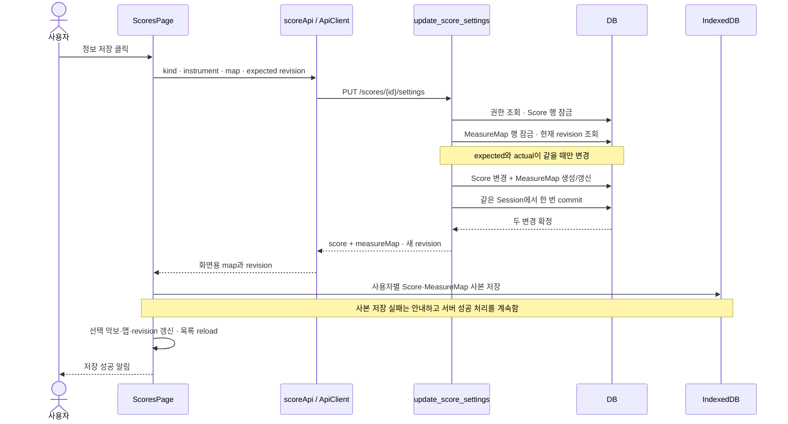

### 1단계. 정보 저장 버튼이 현재 입력과 편집 가능 상태를 확인한다

**원본** [ScoresPage.tsx](../apps/web/src/pages/ScoresPage.tsx) · 찾을 값: `score-metadata`, `saveMetadata`

`악보 정보 · 번호 보정`을 펼치면 종류, 악기, 공통 마디 번호 오프셋을 편집할 수 있다.

| 입력                  | React 상태            | 의미                                                 |
| --------------------- | --------------------- | ---------------------------------------------------- |
| 악보 종류             | `scoreKind`           | 총보 `full` 또는 파트보 `part`                       |
| 악기                  | `instrument`          | 예: `Violin 1`                                       |
| 공통 마디 번호 오프셋 | `measureNumberOffset` | 악보의 마디 번호를 곡의 공통 마디 번호로 보정하는 값 |

오프셋 입력의 실제 안내와 값 전달 코드를 읽는다.

```tsx
<Field
  label="공통 마디 번호 오프셋"
  hint="악보의 1마디가 곡의 11마디라면 10을 입력합니다."
  type="number"
  disabled={!canManageScores || usingOfflineCache}
  value={measureNumberOffset}
  onChange={(event) => setMeasureNumberOffset(Number(event.target.value))}
/>
```

오프셋이 10이면 악보에서 1로 기록한 마디는 공통 11마디에 대응한다. 아래 저장 코드는 `regions`의 `measureNumber`를 모두 10씩 늘려 쓰는 대신 **기존 영역 목록과 오프셋을 별도 필드로 저장**한다.

저장 버튼의 클릭이 함수로 연결된다.

```tsx
<Button
  disabled={savingMetadata || usingOfflineCache || !canManageScores}
  onClick={() => void saveMetadata()}
>
  <Save size={17} aria-hidden /> {savingMetadata ? '저장 중…' : '정보 저장'}
</Button>
```

저장 중이거나 오프라인 사본을 보고 있거나 편집 권한이 없으면 버튼을 비활성화한다. `saveMetadata`의 첫 줄도 선택 악보·오프라인 상태·권한을 검사한다. 원격 모드의 `canManageScores`는 access 응답의 owner 또는 leader 역할을 사용하며, 서버는 뒤에서 권한을 다시 확인한다.

**확인할 질문:** 마디 번호 오프셋을 10으로 저장하면 원본 PDF의 숫자나 마디 영역 번호 자체를 수정하는가? → 이 함수는 별도 보정값을 저장하고 원본 파일을 유지한다.

### 2단계. 악보 정보와 마디 맵의 저장 초안을 함께 만든다

**원본** [ScoresPage.tsx](../apps/web/src/pages/ScoresPage.tsx)의 `saveMetadata`

```ts
const saveMetadata = async () => {
  if (!selected || usingOfflineCache || !canManageScores) return;
  const targetScore = selected;
  const offset = Math.trunc(measureNumberOffset);
  const nextScore: LocalScore = {
    ...targetScore,
    kind: scoreKind,
    updatedAt: new Date().toISOString(),
  };
  if (instrument.trim()) nextScore.instrument = instrument.trim();
  else delete nextScore.instrument;
  const nextMap: LocalMeasureMap = {
    scoreId: targetScore.id,
    measureNumberOffset: offset,
    regions: measureMap?.regions ?? [],
    updatedAt: new Date().toISOString(),
  };
  setSavingMetadata(true);
```

코드를 세 묶음으로 읽는다.

1. `targetScore`는 클릭 당시 선택한 악보다. 나중에 다른 악보로 이동해도 저장 요청의 대상을 바꾸지 않는다.
2. `nextScore`는 기존 악보를 복사하고 종류·악기·갱신 시각을 바꾼 로컬 데이터다. `instrument.trim()`이 빈 문자열이면 로컬 객체의 optional `instrument` 필드를 제거한다.
3. `nextMap`은 기존 마디 영역을 보존하고 오프셋을 반영한다. 기존 맵이 없으면 `regions: []`로 시작한다.

`Math.trunc`는 소수 부분을 버린다. 예를 들어 `10.9 → 10`, `-2.9 → -2`다. 화면 입력을 이렇게 정리하더라도 서버의 타입·범위 검증은 별도로 남는다.

원격 저장에 사용할 `measureMapRevision`은 악보를 읽었을 때 서버 응답에서 가져온다.

```ts
setMeasureMap(remoteMap?.map);
setFirstMeasure(nextMeasureNumber(remoteMap?.map));
setMeasureMapRevision(remoteMap?.revision ?? 0);
setMeasureNumberOffset(remoteMap?.map.measureNumberOffset ?? 0);
```

| revision 값 | 읽는 방법                                            |
| ----------- | ---------------------------------------------------- |
| `0`         | 이 화면이 읽은 시점에 서버 마디 맵이 없었다는 기대값 |
| `1` 이상    | 이 화면이 편집의 기준으로 삼은 서버 마디 맵 버전     |

`0`은 서버에 revision 0인 맵을 저장한다는 뜻이 아니다. 최초 저장의 서버 행은 revision 1로 만들어진다. 맵 내용과 revision은 프론트에서도 별도로 관리하므로, `LocalMeasureMap` 객체 안에 revision이 있다고 가정하지 않는다.

**확인할 질문:** 악기 이름만 바꿔도 왜 마디 맵 revision이 필요한가? → 원격 설정 요청에는 기존 마디 영역과 오프셋도 함께 들어가므로, 그 사이 다른 사람이 갱신한 맵을 덮어쓰지 않아야 한다.

### 3단계. 로컬 저장은 두 IndexedDB 작업으로 나뉜다

**원본** [ScoresPage.tsx](../apps/web/src/pages/ScoresPage.tsx)의 로컬 분기 → [localDb.ts](../apps/web/src/lib/localDb.ts)

앞 실습과 같이 `remoteMode = Boolean(user && repertoireItemId)`다. 로그인 사용자와 대상 곡이 모두 있을 때 원격 분기를 선택한다. 로컬 분기의 실제 저장 부분은 다음과 같다.

```ts
await Promise.all([localDb.putScore(nextScore), localDb.putMeasureMap(nextMap)]);
if (activeScoreIdRef.current !== targetScore.id) return;
setSelected(nextScore);
setMeasureMap(nextMap);
setFirstMeasure(nextMeasureNumber(nextMap));
```

각 함수는 서로 다른 store에 쓴다.

```ts
async putScore(score: LocalScore, scope?: RemoteCacheScope): Promise<void> {
  if (scope) {
    await (await database()).put('remoteScores', { ...score, cacheOwnerId: cacheOwner(scope) });
    return;
  }
  await (await database()).put('scores', score);
},
```

```ts
async putMeasureMap(map: LocalMeasureMap, scope?: RemoteCacheScope): Promise<void> {
  if (scope) {
    await (
      await database()
    ).put('remoteMeasureMaps', { ...map, cacheOwnerId: cacheOwner(scope) });
    return;
  }
  await (await database()).put('measureMaps', map);
},
```

이 호출에는 사용자 scope가 없으므로 `scores`와 `measureMaps`를 사용한다. 원격 사본을 쓸 때는 scope를 넘겨 `remoteScores`와 `remoteMeasureMaps`를 사용한다.

> **`Promise.all`과 DB 트랜잭션을 구분한다.** `Promise.all`은 두 비동기 저장의 완료를 함께 기다린다. 이 로컬 코드는 두 store를 묶는 공통 IndexedDB transaction을 만들지 않는다. 한 저장이 실패했다고 다른 저장이 자동으로 취소되는 구조는 아니다.

따라서 이 실습의 **두 데이터가 함께 확정된다는 보장은 뒤의 서버 `/settings` 경로에 해당**한다. 로컬 분기는 서버 revision 검사나 409 응답 없이 두 저장을 수행한다. 둘 다 성공하고 여전히 같은 악보를 보고 있으면 화면의 선택 악보와 맵을 갱신한다.

**확인할 질문:** `await Promise.all([putScore(), putMeasureMap()])`만 보면 원자적 저장이라고 결론 내려도 되는가? → 각 함수가 어느 transaction에 참여하는지까지 봐야 한다.

### 4단계. 원격 설정을 하나의 PUT 요청으로 묶는다

**원본** [scoreApi.ts](../apps/web/src/lib/scoreApi.ts)의 `updateScoreSettings`

원격 분기는 `updateScoreSettings`에 정리한 입력, `nextMap`, `measureMapRevision`을 넘긴다. API 함수 전체를 읽는다.

```ts
export async function updateScoreSettings(
  client: ApiClient,
  scoreId: string,
  update: {
    kind: 'full' | 'part';
    instrument: string;
    measureMap: LocalMeasureMap;
    expectedMeasureMapRevision: number;
  },
): Promise<ScoreSettingsResult> {
  const record = await client.put<ScoreSettingsRecord>(`/scores/${segment(scoreId)}/settings`, {
    kind: update.kind,
    instrument: update.instrument,
    expectedMeasureMapRevision: update.expectedMeasureMapRevision,
    regions: update.measureMap.regions.map(({ page, measureNumber, rect }) => ({
      page,
      measureNumber,
      rect,
    })),
    measureNumberOffset: update.measureMap.measureNumberOffset,
  });
  return { score: record.score, measureMap: measureMapFromRecord(record.measureMap) };
}
```

요청에 들어가는 내용과 빠지는 내용을 비교한다.

| 화면의 값                     | HTTP 요청 필드                              | 이유                                                     |
| ----------------------------- | ------------------------------------------- | -------------------------------------------------------- |
| `scoreKind`, trim한 악기      | `kind`, `instrument`                        | 악보 정보 갱신                                           |
| `measureMapRevision`          | `expectedMeasureMapRevision`                | 내가 읽고 편집한 버전 전달                               |
| `nextMap.regions`             | `regions`의 `page`, `measureNumber`, `rect` | 기존 위치 정보를 포함한 전체 영역 목록 전송              |
| `nextMap.measureNumberOffset` | `measureNumberOffset`                       | 공통 번호 보정                                           |
| 로컬 영역의 `id`              | 제외                                        | 화면용 식별자이며 서버 영역 스키마의 필드가 아님         |
| 로컬 `updatedAt`, Blob        | 제외                                        | 갱신 시각은 서버 DB가 관리하고 파일은 다시 전송하지 않음 |

다음 JSON은 **설명용 예시**다. r4를 기준으로 악기와 오프셋을 저장한다고 가정한다.

```json
{
  "kind": "part",
  "instrument": "Violin 1",
  "expectedMeasureMapRevision": 4,
  "regions": [
    {
      "page": 1,
      "measureNumber": 1,
      "rect": { "x": 0.1, "y": 0.2, "w": 0.3, "h": 0.1 }
    }
  ],
  "measureNumberOffset": 10
}
```

[ApiClient.put](../apps/web/src/lib/api.ts)은 본문을 `JSON.stringify`하고 `PUT` 요청을 보낸다. 서버의 실제 라우트는 `PUT /api/scores/{score_id}/settings`다. JSON의 `expectedMeasureMapRevision`은 서버 모델에서 `expected_measure_map_revision`으로 읽힌다.

핵심은 프론트가 `PATCH /scores/{id}`와 `PUT /scores/{id}/measure-map`을 따로 호출하지 않는다는 점이다. 이 버튼은 악보 정보와 맵을 **하나의 요청에 담아 하나의 서버 저장 함수로 전달**한다.

**확인할 질문:** 오프셋만 바꿀 때 `regions`를 빈 배열로 보내도 되는가? → 이 API는 영역 전체를 받아 대체하므로, 유지하려는 기존 영역도 보내야 한다.

### 5단계. 서버가 입력과 권한을 검증하고 부모 악보 행을 잠근다

**원본** [schemas.py](../apps/server/app/schemas.py)의 `ScoreSettingsWrite` → [routers/scores.py](../apps/server/app/routers/scores.py)의 `_lock_score_for_measure_map`

요청 모델은 다음과 같다.

```python
class ScoreSettingsWrite(ApiModel):
    kind: ScoreKind
    instrument: str = ""
    expected_measure_map_revision: int = Field(ge=0)
    regions: list[MeasureRegion]
    measure_number_offset: int = 0
```

`ScoreKind`는 `full|part`이고 기대 revision은 0 이상이다. 각 영역은 1부터 시작하는 페이지·마디 번호와 페이지 내부의 정규화된 사각형을 가져야 한다.

```python
class MeasureRect(ApiModel):
    x: float = Field(ge=0, le=1)
    y: float = Field(ge=0, le=1)
    w: float = Field(gt=0, le=1)
    h: float = Field(gt=0, le=1)

    @model_validator(mode="after")
    def within_page(self) -> MeasureRect:
        if self.x + self.w > 1 or self.y + self.h > 1:
            raise ValueError("measure rectangle must remain within normalized page bounds")
        return self


class MeasureRegion(ApiModel):
    page: int = Field(ge=1)
    measure_number: int = Field(ge=1)
    rect: MeasureRect
```

`x`, `y`, `w`, `h`는 페이지 크기를 1로 본 비율이다. 가로·세로 크기는 0보다 커야 하고, 오른쪽·아래쪽 끝이 페이지 밖으로 나가면 검증 오류다. 잘못된 요청은 이 단계에서 422로 거부되며 저장 함수의 변경까지 진행하지 않는다.

`CurrentUser`는 인증된 사용자를, `DbSession`은 요청의 DB 작업 세션을 제공한다. 라우트가 가장 먼저 호출하는 잠금 함수다.

```python
def _lock_score_for_measure_map(db: DbSession, user: CurrentUser, score_id: str) -> Score:
    require_score(db, user, score_id, "leader")
    score = db.scalar(select(Score).where(Score.id == score_id).with_for_update())
    if score is None:
        raise HTTPException(status_code=404, detail="score not found")
    return score
```

`require_score(..., "leader")`는 악보 → 레퍼토리 → 프로젝트 → 그룹 멤버십을 따라 권한을 확인한다. 그다음 `Score` 행에 `with_for_update()`로 수정 잠금을 요청한다. 이어서 라우트는 같은 악보의 `MeasureMap` 행에도 잠금을 요청한다.

**맵이 아직 없는데 왜 Score를 먼저 잠그는가?** 최초 저장에는 잠글 `MeasureMap` 행이 없다. 먼저 존재하는 부모 `Score`를 잠가 같은 악보의 최초 맵 생성을 조정한다. `/measure-map`의 PUT 경로도 같은 부모 잠금 함수를 사용한다.

DB 모델에도 악보 하나당 마디 맵 하나라는 제약이 있다.

```python
class MeasureMap(TimestampMixin, Base):
    __tablename__ = "measure_maps"

    id: Mapped[str] = mapped_column(String(36), primary_key=True, default=new_id)
    score_id: Mapped[str] = mapped_column(
        ForeignKey("scores.id", ondelete="CASCADE"), unique=True, index=True
    )
    revision: Mapped[int] = mapped_column(Integer, default=1)
    regions: Mapped[list[dict[str, Any]]] = mapped_column(JSON, default=list)
    measure_number_offset: Mapped[int] = mapped_column(Integer, default=0)
    updated_by_id: Mapped[str] = mapped_column(ForeignKey("users.id", ondelete="RESTRICT"))
```

`score_id`의 `unique=True`가 중복 맵 행을 막는다. 이 모델은 현재 맵 행의 revision과 내용을 갱신하며, 저장 때마다 별도의 과거 revision 행을 추가하는 코드는 이 경로에 없다.

**확인할 질문:** 아직 존재하지 않는 맵에 `FOR UPDATE`만 걸면 최초 생성 두 건을 모두 조정할 수 있는가? → 이 코드는 부모 행 잠금과 `score_id` 유일성 제약을 함께 사용한다.

### 6단계. 현재 MeasureMap revision을 비교한 뒤에만 값을 바꾼다

**원본** [routers/scores.py](../apps/server/app/routers/scores.py)의 `update_score_settings`

```python
score = _lock_score_for_measure_map(db, user, score_id)
row = db.scalar(select(MeasureMap).where(MeasureMap.score_id == score_id).with_for_update())
actual = row.revision if row else 0
if body.expected_measure_map_revision != actual:
    raise HTTPException(
        status_code=409,
        detail={
            "message": "measure map revision conflict",
            "expectedRevision": body.expected_measure_map_revision,
            "actualRevision": actual,
        },
    )
```

`actual`은 요청이 말하는 버전이 아니라 **서버 DB에서 읽은 현재 버전**이다. 맵이 없으면 0으로 계산한다. `expectedMeasureMapRevision`과 다르면 409를 반환하며, 아직 `score.kind`나 `score.instrument`에 새 값을 대입하지 않은 상태다.

| 클라이언트 기대값 | DB의 현재 맵    | 결과                                                    |
| ----------------- | --------------- | ------------------------------------------------------- |
| `0`               | 없음 → actual 0 | 최초 생성 허용, 새 revision은 1                         |
| `4`               | r4              | 갱신 허용, 새 revision은 5                              |
| `4`               | r5              | 409, 이번 요청의 악보 정보와 맵 모두 변경하지 않음      |
| `0`               | r1              | 409, 다른 저장이 만든 첫 맵을 빈 초안으로 덮어쓰지 않음 |
| `4`               | 없음 → actual 0 | 409, 내가 읽었던 맵이 사라진 상태도 다시 확인하도록 함  |

충돌 응답의 구조는 다음과 같다. 값은 설명용 예시다.

```json
{
  "detail": {
    "message": "measure map revision conflict",
    "expectedRevision": 4,
    "actualRevision": 5
  }
}
```

요청 필드 이름은 `expectedMeasureMapRevision`이지만 오류 상세의 필드 이름은 `expectedRevision`이다. 화면이 임의로 새 revision 숫자만 맞춰 재전송하면 안 된다. 서버의 최신 영역·오프셋도 함께 읽어야 덮어쓰기의 기준이 맞는다.

**확인할 질문:** 다른 사용자가 마디 위치를 바꾼 동안 나는 악기 이름만 바꿨다면 저장해도 되는가? → 현재 요청은 맵 전체도 포함하므로, 이 API는 같은 기준의 revision일 때만 두 변경을 허용한다.

### 7단계. Score와 MeasureMap 변경을 같은 DB commit으로 확정한다

**원본** 같은 함수의 revision 검사 다음 부분 · [db.py](../apps/server/app/db.py)

검사를 통과한 뒤에야 두 객체를 수정한다.

```python
score.kind = body.kind
score.instrument = body.instrument
regions = [region.model_dump(by_alias=True) for region in body.regions]
if row is None:
    created = True
    row = MeasureMap(
        score_id=score_id,
        revision=1,
        regions=regions,
        measure_number_offset=body.measure_number_offset,
        updated_by_id=user.id,
    )
    db.add(row)
else:
    created = False
    row.revision += 1
    row.regions = regions
    row.measure_number_offset = body.measure_number_offset
    row.updated_by_id = user.id
```

| 대상         | 맵이 없을 때               | 맵이 있을 때                |
| ------------ | -------------------------- | --------------------------- |
| `Score`      | 종류·악기 변경             | 종류·악기 변경              |
| `MeasureMap` | revision 1인 행을 `db.add` | 현재 행의 revision을 1 증가 |
| 영역·보정값  | 요청 값으로 생성           | 요청 값으로 전체 대체       |
| 수정자       | 현재 `user.id`             | 현재 `user.id`로 갱신       |

이미 존재하는 맵에서는 값이 이전과 같아도 이 함수가 저장을 허용하면 `row.revision += 1`을 실행한다. 악기만 변경하는 저장도 맵의 revision을 증가시킨다.

두 ORM 객체는 **같은 `db` Session**에 속한다. ORM 객체는 DB 행을 Python 객체로 다루는 방식이다. `score.kind = ...` 같은 대입과 `db.add(row)`는 이 작업 세션에 변경을 쌓으며, 그 자체가 개별 commit은 아니다.

```python
self.session_factory = sessionmaker(
    bind=self.engine,
    class_=Session,
    autoflush=False,
    expire_on_commit=False,
)
```

이 프로젝트의 Session은 `autoflush=False`로 구성돼 있다. 저장 함수는 Score 변경 사이에 먼저 commit하는 코드를 두지 않고, 두 객체를 모두 준비한 다음 아래 도움 함수를 한 번 호출한다.

```python
_commit_measure_map_write(
    db,
    score_id,
    body.expected_measure_map_revision,
    created=created,
)
db.refresh(score)
db.refresh(row)
return ScoreSettingsOut(score=score_out(score), measure_map=measure_map_out(row))
```

`_commit_measure_map_write` 안의 `db.commit()`이 이 Session의 두 변경을 함께 확정한다. SQLAlchemy는 commit을 수행하며 필요한 SQL을 DB로 반영한다. `db.refresh`는 확정한 데이터를 다시 읽는 작업이며, 두 번째 저장이나 별도의 commit이 아니다.

```text
같은 DB 작업 세션
  ├─ scores: kind · instrument 변경
  └─ measure_maps: 생성 또는 revision · regions · offset 갱신
                         ↓
                  db.commit() 한 번
                         ↓
               두 변경을 함께 확정
```

이 원자성의 범위에는 서버 DB의 두 행이 들어간다. 브라우저 IndexedDB, 화면 상태, HTTP 응답 전달은 별도 단계다. 이 요청은 파일 저장소에 쓰지 않으므로 앞 업로드 실습처럼 저장소 복사와 DB commit 사이를 조정할 필요는 없다.

**확인할 질문:** `score.kind` 대입 뒤 마디 맵 저장이 실패하면 악보 종류만 저장되는가? → 그 사이 별도 commit이 없으며, 두 변경은 같은 DB 트랜잭션에 들어간다.

### 8단계. 최초 생성 경합에서는 rollback 후 409로 되돌린다

**원본** [routers/scores.py](../apps/server/app/routers/scores.py)의 `_commit_measure_map_write`

최초 생성은 revision 비교 외에 DB 제약 위반 경로도 다룬다. 함수 전체를 읽는다.

```python
def _commit_measure_map_write(
    db: DbSession,
    score_id: str,
    expected_revision: int,
    *,
    created: bool,
) -> None:
    try:
        db.commit()
    except IntegrityError as exc:
        db.rollback()
        if not created:
            raise
        actual = db.scalar(select(MeasureMap.revision).where(MeasureMap.score_id == score_id)) or 0
        raise HTTPException(
            status_code=409,
            detail={
                "message": "measure map was concurrently updated",
                "expectedRevision": expected_revision,
                "actualRevision": actual,
            },
        ) from exc
```

`IntegrityError`는 유일성·외래 키 같은 DB 제약을 만족하지 못했을 때의 예외다. 코드 순서는 다음과 같다.

1. `db.commit()`을 시도한다.
2. `IntegrityError`가 나면 먼저 `db.rollback()`으로 **같은 Session의 Score·MeasureMap 변경을 함께 취소**한다.
3. 기존 맵 갱신인 `created=False`이면 원래 예외를 다시 던진다.
4. 최초 맵 생성인 `created=True`이면 현재 revision을 다시 조회하고 409로 변환한다.

첫 저장 두 건이 같은 악보에 맵을 만들려는 경우, 부모 행 잠금이 요청을 조정하고 `score_id` 유일성 제약이 중복 행 생성을 막는다. 이 helper는 생성 중 제약 오류가 발생했을 때도 실패한 transaction을 정리하고 클라이언트가 최신 상태를 읽도록 만든다.

오류 메시지는 revision 사전 검사 때의 `measure map revision conflict`와 달리 `measure map was concurrently updated`다. 둘 다 HTTP 409이므로 프론트의 동일한 충돌 처리로 들어간다.

현재 코드는 `created=True`에서 잡은 `IntegrityError`의 세부 제약 이름을 더 구분하지 않는다. 따라서 이 메시지만으로 모든 경우에 실제 동시 INSERT가 있었다고 단정하지 않는다. 아래 테스트도 동시 요청을 실행하는 대신 예외를 주입해 rollback과 응답을 확인한다.

**확인할 질문:** 최초 맵 INSERT가 실패했을 때 그 전에 바꾼 악기 이름은 남는가? → 이 helper의 rollback은 같은 transaction의 악보 정보 변경도 취소한다.

### 9단계. 서버 응답으로 화면을 갱신하고 오프라인 사본을 저장한다

**원본** [scoreApi.ts](../apps/web/src/lib/scoreApi.ts)의 `measureMapFromRecord` → [ScoresPage.tsx](../apps/web/src/pages/ScoresPage.tsx)의 원격 성공 분기

서버는 `ScoreSettingsOut(score=..., measure_map=...)`으로 **저장된 악보와 새 revision의 맵을 함께** 응답한다. `score_out`과 `measure_map_out`이 DB 객체를 응답 모델로 바꾸고, 프론트는 아래 함수로 맵을 정리한다.

```ts
function measureMapFromRecord(record: MeasureMapRecord): VersionedMeasureMap {
  return {
    revision: record.revision,
    map: {
      scoreId: record.scoreId,
      measureNumberOffset: record.measureNumberOffset,
      regions: record.regions.map((region, index) => ({
        id: `${record.id}:${index}`,
        ...region,
      })),
      updatedAt: record.updatedAt,
    },
  };
}
```

서버의 revision은 `saved.measureMap.revision`에, 화면용 맵은 `saved.measureMap.map`에 들어간다. 영역의 `id`는 서버 맵 ID와 배열 인덱스로 다시 만든다. 앞 요청에서 이 화면용 ID를 제외했던 이유와 연결된다.

`saveMetadata`가 실제로 요청하고 응답을 적용하는 부분이다.

```ts
const saved = await updateScoreSettings(client, targetScore.id, {
  kind: scoreKind,
  instrument: instrument.trim(),
  measureMap: nextMap,
  expectedMeasureMapRevision: measureMapRevision,
});
const savedScore = mergeRemoteScoreMetadata(saved.score, targetScore);
await updateOfflineCopy(
  Promise.all([
    localDb.putScore(savedScore, remoteCacheScope),
    localDb.putMeasureMap(saved.measureMap.map, remoteCacheScope),
  ]).then(() => undefined),
  '악보 정보',
);
if (activeScoreIdRef.current !== targetScore.id) return;
setSelected(savedScore);
setMeasureMap(saved.measureMap.map);
setFirstMeasure(nextMeasureNumber(saved.measureMap.map));
setMeasureMapRevision(saved.measureMap.revision);
```

`mergeRemoteScoreMetadata`는 원본 파일을 다시 다운로드하거나 파싱하지 않고, 이미 화면에 있는 Blob·MIME 형식과 새 메타데이터를 합친다.

```ts
export function mergeRemoteScoreMetadata(record: ScoreRecord, score: LocalScore): LocalScore {
  return localScoreWithMetadata(record, score.blob, score.mimeType);
}
```

이 함수는 특히 MXL을 이미 XML Blob으로 정규화해 둔 상태를 유지한다. 메타데이터 저장 후 파일명이 `.mxl`이라는 이유로 정규화된 XML을 다시 압축 해제하려는 경로로 보내지 않는다.

캐시 저장을 감싼 도움 함수도 읽는다.

```ts
async function updateOfflineCopy(operation: Promise<void>, description: string): Promise<void> {
  try {
    await operation;
  } catch (error) {
    notify({
      title: '서버 저장은 완료됐지만 오프라인 사본을 갱신하지 못했습니다.',
      description: `${description}: ${error instanceof Error ? error.message : String(error)}`,
      tone: 'info',
    });
  }
}
```

`remoteCacheScope`는 현재 사용자 ID를 담는다. 서버가 저장을 끝낸 뒤 `remoteScores`와 `remoteMeasureMaps`의 사용자별 사본을 갱신하며, 이 사본 저장은 서버 트랜잭션의 일부가 아니다. 사본 저장 실패는 안내하고 함수가 반환하므로 서버 성공 결과를 화면에 적용하는 작업은 계속된다. 여기의 두 캐시 저장 역시 `Promise.all`만으로 하나의 IndexedDB transaction이 되지는 않는다.

여전히 같은 악보를 보고 있으면 `selected`, `measureMap`, 새 revision, 다음 매핑 마디 번호를 갱신한다. `nextMeasureNumber`는 기존 영역의 최대 마디 번호에 1을 더한 값이며, 재생 위치를 강제로 옮기는 명령이 아니다.

로컬·원격 성공 분기가 끝나면 공통으로 정수화한 오프셋을 입력에 반영하고 `scores.reload()`를 호출한 뒤 `악보 정보와 마디 번호 보정을 저장했습니다.`라고 알린다. `finally`는 같은 악보가 활성 상태일 때 `savingMetadata`를 해제한다. 저장 중 다른 악보로 이동하면 서버 요청 자체를 취소하지는 않지만, 이전 결과로 새 악보의 선택 상태를 덮어쓰는 것은 막는다.

**확인할 질문:** 서버 저장은 성공했는데 IndexedDB가 꽉 차면 서버도 rollback되는가? → 서버 commit은 이미 끝났다. 사본 저장 실패를 별도로 알리고 서버 응답을 사용한다.

### 10단계. 409를 받으면 최신 설정을 읽어 입력란을 다시 채운다

**원본** [api.ts](../apps/web/src/lib/api.ts)의 `ApiError` → [ScoresPage.tsx](../apps/web/src/pages/ScoresPage.tsx)의 catch와 `refreshScoreSettingsAfterConflict`

`ApiClient`는 성공하지 않은 HTTP 응답을 다음과 같이 처리한다.

```ts
if (!response.ok) {
  const payload = await response
    .json()
    .then((value: unknown) => value as ApiErrorPayload)
    .catch((): ApiErrorPayload => ({ detail: response.statusText }));
  throw new ApiError(response.status, payload);
}
```

`ApiError`는 HTTP status를 보관하고, `detail.message`를 오류 메시지로 사용한다. 중첩된 `actualRevision`과 `expectedRevision`도 payload로 옮긴다. 이 화면의 충돌 분기는 **`error instanceof ApiError && error.status === 409`**를 확인한다.

```ts
} catch (error) {
  if (activeScoreIdRef.current !== targetScore.id) return;
  if (remoteMode && error instanceof ApiError && error.status === 409) {
    try {
      await refreshScoreSettingsAfterConflict(targetScore);
    } catch (reloadError) {
      notify({
        title: '충돌 후 최신 악보 정보를 불러오지 못했습니다.',
        description: reloadError instanceof Error ? reloadError.message : String(reloadError),
        tone: 'danger',
      });
      return;
    }
  }
  notify({
    title: '악보 정보를 저장하지 못했습니다.',
    description: error instanceof Error ? error.message : String(error),
    tone: 'danger',
  });
```

409이면 먼저 최신 값을 읽는다. 이 재조회까지 실패하면 `충돌 후 최신 악보 정보를 불러오지 못했습니다.`라는 별도 알림으로 끝난다. 재조회가 성공해도 앞선 저장 요청이 성공한 것은 아니므로, 이후 `악보 정보를 저장하지 못했습니다.`와 원래 오류 메시지를 표시한다.

실제 복구 함수는 다음과 같다.

```ts
async function refreshScoreSettingsAfterConflict(targetScore: LocalScore): Promise<boolean> {
  const [latestRecord, latestMap] = await Promise.all([
    getRemoteScore(client, targetScore.id),
    getRemoteMeasureMap(client, targetScore.id),
  ]);
  const latestScore = mergeRemoteScoreMetadata(latestRecord, targetScore);
  await updateOfflineCopy(
    Promise.all([
      localDb.putScore(latestScore, remoteCacheScope),
      latestMap
        ? localDb.putMeasureMap(latestMap.map, remoteCacheScope)
        : localDb.deleteMeasureMap(targetScore.id, remoteCacheScope),
    ]).then(() => undefined),
    '최신 악보 정보',
  );
  if (activeScoreIdRef.current !== targetScore.id) return false;
  setSelected(latestScore);
  setScoreKind(latestRecord.kind);
  setInstrument(latestRecord.instrument);
  setMeasureMap(latestMap?.map);
  setMeasureMapRevision(latestMap?.revision ?? 0);
  setMeasureNumberOffset(latestMap?.map.measureNumberOffset ?? 0);
  setFirstMeasure(nextMeasureNumber(latestMap?.map));
  scores.reload();
  return true;
}
```

동작을 순서대로 나눈다.

1. `GET /scores/{id}`와 `GET /scores/{id}/measure-map`으로 악보 정보와 맵을 함께 요청한다.
2. 최신 메타데이터에 기존 Blob을 붙이고 사용자별 사본을 갱신한다. 최신 맵이 없으면 오래된 맵 사본을 삭제한다.
3. 여전히 같은 악보를 보고 있을 때만 종류·악기·맵·오프셋·revision을 **서버에서 다시 받은 값으로 교체**한다.
4. 목록을 다시 읽고 사용자가 최신 상태에서 편집하도록 한다.

`getRemoteMeasureMap`은 다음 함수의 import 별칭이다. 맵 조회의 404만 `undefined`로 바꾸고 그 밖의 실패는 던진다.

```ts
export async function getMeasureMap(
  client: ApiClient,
  scoreId: string,
): Promise<VersionedMeasureMap | undefined> {
  try {
    const record = await client.get<MeasureMapRecord>(`/scores/${segment(scoreId)}/measure-map`);
    return measureMapFromRecord(record);
  } catch (error) {
    if (error instanceof ApiError && error.status === 404) return undefined;
    throw error;
  }
}
```

따라서 최신 맵이 없으면 복구 함수가 revision과 오프셋을 0으로 돌리고 맵 상태를 비운다. 이 복구 함수는 네트워크 실패를 오래된 IndexedDB 맵으로 대체해 “최신 조회 성공”으로 처리하지 않는다.

> **충돌 복구는 자동 병합이 아니다.** 이 함수는 내가 입력했던 악기·오프셋을 따로 보관해 최신 맵에 합치거나, revision만 바꿔 자동 재저장하지 않는다. 재조회가 성공하면 입력란도 최신 서버 값으로 바뀌므로, 사용자는 최신 내용을 확인하고 필요한 변경을 다시 입력해 저장해야 한다.

두 GET을 `Promise.all`로 보낸다는 사실만으로 두 응답이 하나의 DB snapshot에서 읽혔다고 볼 수는 없다. 다른 편집이 그 사이에 일어날 수 있으며, 다음 저장에서도 revision 검사를 계속 수행한다. 또한 사본 갱신 helper는 충돌 복구에도 재사용되므로, 그 helper의 안내 문구만으로 앞선 409 요청이 저장됐다고 해석하지 않는다.

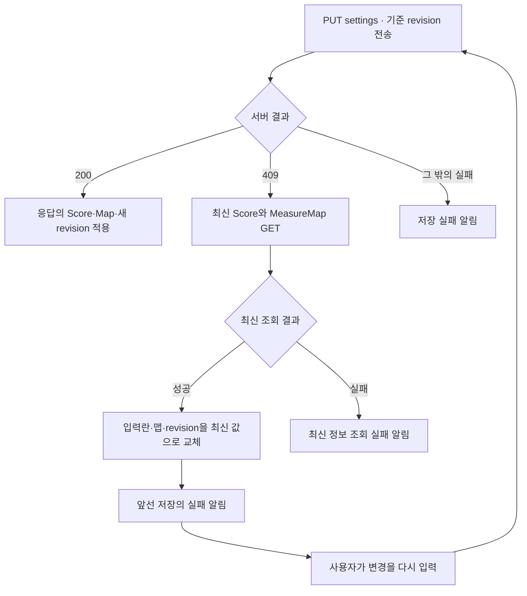

**확인할 질문:** 409 후 입력란이 최신값으로 바뀌었다면 내가 입력한 변경도 합쳐서 저장된 것인가? → 앞선 저장은 거부됐고, 화면이 다시 편집할 기준을 받아온 것이다.

### 두 편집자로 따라가기. r4에서 저장과 충돌이 갈리는 순간

다음은 **설명용 예시**다. PostgreSQL에서 같은 악보의 잠금·revision 검사 순서를 따라가며, 실제 동시 요청을 실행한 기록은 아니다. A와 B는 같은 악보의 r4를 열었고, 처음 값은 `kind=part`, `instrument=Violin`, `offset=0`이라고 가정한다.

| 순서 | A의 동작                                   | B의 동작                                                   | 서버의 확정된 상태                                     |
| ---- | ------------------------------------------ | ---------------------------------------------------------- | ------------------------------------------------------ |
| 1    | r4를 읽음                                  | r4를 읽음                                                  | `part / Violin / offset 0 / r4`                        |
| 2    | `full / Cello / offset 10`, 기대 r4로 저장 | `part / Bass / offset 20`을 입력 중                        | 아직 r4                                                |
| 3    | 잠금·revision 검사를 통과하고 commit       | 같은 악보 저장이 겹치면 잠금 순서에 따라 진행              | `full / Cello / offset 10 / r5`                        |
| 4    | 응답의 r5를 화면에 반영                    | 기대 r4로 요청했지만 actual은 r5 → 409                     | A가 확정한 두 데이터 모두 유지                         |
| 5    | —                                          | 최신 Score·Map을 읽음                                      | 서버는 여전히 r5                                       |
| 6    | —                                          | 입력란이 `full / Cello / offset 10`으로 바뀌고 기준은 r5   | B가 시도한 `Bass / offset 20`은 저장되지 않음          |
| 7    | —                                          | 최신값을 확인하고 원하는 변경을 다시 입력해 기대 r5로 저장 | 사이에 다른 변경이 없다면 두 데이터가 함께 r6으로 확정 |

서버가 악기 이름을 먼저 commit하고 나중에 맵 충돌을 검사했다면 `Bass`와 A의 맵이 섞여 남을 수 있다. 실제 코드는 **revision 검사 → 두 데이터 변경 → 한 번의 commit** 순서로 이 부분 저장을 막는다.

최초 저장도 같은 관점으로 읽는다. 맵이 없을 때 두 화면이 모두 기대값 0을 보냈다면, 먼저 확정한 요청이 r1을 만든다. 뒤 요청은 현재 r1을 확인해 409가 되며, 생성 중 제약 오류 경로로 들어가더라도 rollback 후 409로 처리한다.

### 악보 설정 저장의 실패와 보장 범위

| 실패·상황                             | 서버 DB에서의 의미                         | 화면과 다음 처리                                                                                       |
| ------------------------------------- | ------------------------------------------ | ------------------------------------------------------------------------------------------------------ |
| 선택 악보 없음·읽기 전용·권한 없는 UI | 함수 초입에서 저장을 진행하지 않음         | 버튼과 함수 guard로 편집 제한                                                                          |
| 요청 검증 422·권한 거부 403           | 이 저장 함수의 두 데이터 변경 전 거부      | 일반 저장 실패 알림, 409 복구 경로는 아님                                                              |
| expected와 actual revision 불일치     | Score·MeasureMap 변경 전 409               | 최신 두 데이터를 조회하고 입력란·기준 revision 교체                                                    |
| 최초 맵 commit 중 `IntegrityError`    | rollback으로 악보 정보와 맵 생성 모두 취소 | 409로 변환해 같은 최신 조회 경로 사용                                                                  |
| 그 밖의 DB 오류                       | 정상 commit을 완료한 것으로 다룰 수 없음   | 오류 종류에 따른 실패 응답, 모든 오류를 409로 바꾸지는 않음                                            |
| 서버 commit 후 HTTP 응답 유실         | DB에는 이미 두 변경이 반영됐을 수 있음     | 현재 함수는 자동 성공 판정·병합을 하지 않음. 예전 revision으로 재시도하면 409 후 최신값을 읽을 수 있음 |
| 서버 성공 후 원격 사본 저장 실패      | 서버의 확정은 유지                         | 사본 실패 안내 후 서버 응답을 화면에 적용                                                              |
| 409 후 최신 GET 실패                  | 거부된 저장을 다시 실행하지 않음           | 최신 정보 조회 실패 알림. 오래된 사본으로 성공을 가장하지 않음                                         |
| 로컬 두 저장 중 하나 실패             | 서버와 무관한 별도 IndexedDB 작업          | 다른 저장까지 자동 rollback하지 않음. 일반 저장 실패 알림                                              |

원자성은 **서버의 두 DB 변경 사이**의 계약이다. 응답을 못 받았다는 사실만으로 서버가 rollback됐다고 결론 내리거나, 브라우저 사본까지 함께 commit됐다고 확대하면 안 된다.

revision의 적용 범위도 확인한다. [Score 모델](../apps/server/app/models.py)에는 별도 메타데이터 revision이 없으며 이 버튼은 MeasureMap revision을 기준으로 묶음 저장한다. 별도로 남아 있는 `PATCH /scores/{id}`의 `update_score`는 메타데이터만 바꾸고 MeasureMap revision을 검사·증가시키지 않는다. 따라서 “이 프로젝트의 모든 악보 메타데이터 변경이 이 revision 계약을 거친다”는 주장과 **현재 `saveMetadata → /settings` 경로의 보장**은 구분한다.

### 악보 설정 저장의 리뷰 포인트와 테스트

이번 작업에서는 아래 **테스트 코드를 읽어 설명의 근거로 연결**했다. 앱 테스트, 실제 저장 요청, PostgreSQL 동시 쓰기 실험을 새로 실행한 것은 아니다.

| 읽을 테스트                                                                       | 찾아볼 이름·행동                                                                  | 확인할 범위                                                                |
| --------------------------------------------------------------------------------- | --------------------------------------------------------------------------------- | -------------------------------------------------------------------------- |
| [scoreApi.test.ts](../apps/web/src/lib/scoreApi.test.ts)                          | `updates score metadata and its measure map in one revision-checked request`      | 한 요청의 필드, 화면용 영역 ID 제외, 응답 revision 변환                    |
| [test_scores_logs_musicxml.py](../apps/server/tests/test_scores_logs_musicxml.py) | `test_score_settings_update_is_atomic_on_measure_map_conflict`                    | 정상 최초 저장 후, 오래된 revision 요청이 악보 정보와 오프셋을 바꾸지 않음 |
| [같은 서버 테스트](../apps/server/tests/test_scores_logs_musicxml.py)             | `test_first_measure_map_insert_integrity_error_rolls_back_as_conflict`            | 생성 시 commit 예외를 주입하고 rollback·409·기존 정보 보존 검사            |
| [ScoresPage.test.ts](../apps/web/src/pages/ScoresPage.test.ts)                    | `does not try to unzip an already-normalized MXL snapshot after metadata changes` | 메타데이터를 합칠 때 정규화된 Blob·MIME 보존                               |
| [e2e/scores.spec.ts](../e2e/scores.spec.ts)                                       | `maps a score, preserves canonical measure across parts...`                       | 로컬 정보 저장 뒤 악기 탭과 오프셋 10의 공통 11마디 조작                   |

프론트 API 테스트는 r4로 요청하고 응답 r5를 읽는지 검사한다.

```ts
expect(result.score).toEqual(updated);
expect(result.measureMap.revision).toBe(5);
expect(fetchMock.mock.calls[0]?.[1]?.body).toBe(
  JSON.stringify({
    kind: 'part',
    instrument: 'Violin',
    expectedMeasureMapRevision: 4,
    regions: mapRecord.regions,
    measureNumberOffset: 10,
  }),
);
```

서버의 원자성 테스트는 최초 `/settings` 요청으로 `full / Cello / offset 10 / r1`을 만든 다음, 기대값 0으로 `part / Bass / offset 20`을 요청한다. 실패 후 다시 GET한 결과를 확인하는 부분이다.

```python
assert stale.status_code == 409
persisted_score = client.get(f"/api/scores/{score['id']}", headers=leader_headers).json()
persisted_map = client.get(f"/api/scores/{score['id']}/measure-map", headers=leader_headers).json()
assert persisted_score["kind"] == "full"
assert persisted_score["instrument"] == "Cello"
assert persisted_map["measureNumberOffset"] == 10
```

이 테스트의 `stale`은 순차적으로 보낸 오래된 요청이다. 동시에 두 요청을 보내 잠금 대기 시간을 측정한 테스트는 아니다.

최초 생성 실패 테스트는 `Session.commit`에서 `IntegrityError`를 강제로 발생시킨다. 검사 부분을 읽는다.

```python
response = client.put(f"/api/scores/{score['id']}/{endpoint}", headers=leader_headers, json=payload)
assert response.status_code == 409, response.text
assert response.json()["detail"]["message"] == "measure map was concurrently updated"
assert len(rollback_calls) == 1
assert client.get(f"/api/scores/{score['id']}/measure-map", headers=leader_headers).status_code == 404
persisted_score = client.get(f"/api/scores/{score['id']}", headers=leader_headers).json()
assert persisted_score["kind"] == "part"
assert persisted_score["instrument"] == "violin"
```

맵은 여전히 404이고, 악보의 기존 `part / violin`도 보존되며 rollback 호출이 확인된다. 테스트는 `/measure-map`과 `/settings` 두 endpoint에 매개변수화돼 있다. 테스트 환경은 [conftest.py](../apps/server/tests/conftest.py)의 임시 SQLite DB이므로, 이 결과를 실제 PostgreSQL 동시 연결 검증으로 확대하지 않는다.

마지막으로 로컬 화면 테스트는 입력과 표시의 연결을 확인한다.

```ts
await page.getByText('악보 정보 · 번호 보정').click();
await page.getByLabel('악보 종류').selectOption('part');
await page.getByLabel('악기').fill('Violin 1');
await page.getByLabel('공통 마디 번호 오프셋').fill('10');
await page.getByRole('button', { name: '정보 저장' }).click();
await expect(page.getByRole('tab', { name: 'Violin 1' })).toBeVisible();

await page.getByRole('button', { name: '보기', exact: true }).click();
const firstMeasureButton = page.getByRole('button', { name: '11마디' });
await firstMeasureButton.focus();
await page.keyboard.press('Enter');
await expect(page.getByLabel('현재 마디')).toHaveValue('11');
```

오프셋 10을 저장한 뒤 `11마디` 버튼과 현재 마디 값이 연결된다. 이것은 로컬 화면의 사용 흐름에 대한 테스트이며 원격 409 후 입력 교체의 자동화 검증을 대신하지 않는다. 위의 충돌 화면 설명은 `saveMetadata`와 `refreshScoreSettingsAfterConflict`의 실제 분기에서 읽은 내용이다.

직접 리뷰하며 다음 질문에 답을 적어본다.

- [ ] `Score`, `MeasureMap`, `TempoMap`은 각각 무엇을 저장하는가?
- [ ] 오프셋을 바꿀 때 기존 `regions`를 그대로 보내는 이유는 무엇인가?
- [ ] 기대 revision 0과 서버에 저장된 첫 revision 1은 어떻게 다른가?
- [ ] 로컬 `Promise.all`과 서버 DB 트랜잭션은 어떤 보장이 다른가?
- [ ] 첫 마디 맵이 없을 때도 `Score` 부모 행을 먼저 잠그는 이유는 무엇인가?
- [ ] revision 비교보다 앞서 악보 메타데이터가 변경·commit되는 곳이 있는가?
- [ ] 악기만 수정해도 맵 revision이 증가하는가?
- [ ] 최초 INSERT 실패의 rollback에 Score 정보 변경도 포함되는가?
- [ ] 서버 저장 성공과 브라우저 사본 저장 성공은 같은 시점인가?
- [ ] 409 후 내 입력이 보존·병합·재저장되는가, 최신값으로 교체되는가?
- [ ] 최신 조회 실패와 저장 충돌 자체를 어떤 알림으로 구분하는가?
- [ ] 메타데이터 전용 PATCH에도 이 revision 계약이 적용되는가?

**다음으로 연결할 흐름:** [실습 07. 필기 저장과 실시간 동기화](#실습-07-필기-저장과-실시간-동기화)에서 필기를 REST로 저장한 뒤 다른 참가자 화면에 전파하고, 공개 범위와 재연결을 처리하는 과정을 이어 읽는다.

---

## 실습 07. 필기 저장과 실시간 동기화

**이번 출발점** [ScoresPage.tsx](../apps/web/src/pages/ScoresPage.tsx)의 `saveAnnotation`\
**따라갈 순서** 텍스트·기호 입력 → 새 필기 또는 기존 필기 수정 → REST 저장 → DB commit → WebSocket 알림 예약 → 공개 범위에 맞춰 전송 → 다른 화면의 목록·악보 갱신 → 재연결 시 전체 스냅샷으로 복구

이번에는 **저장하는 통로와 변경을 알리는 통로가 다른 기능**을 읽는다. REST는 HTTP 요청으로 필기를 DB에 저장하는 통로다. WebSocket은 연결된 화면에 저장 결과를 알려 주는 통로다. WebSocket 메시지만 보내서 필기를 생성·수정하는 구조는 아니다.

텍스트·기호는 `saveAnnotation`, 자유롭게 그리는 펜은 `savePenAnnotation`에서 출발한다. 두 함수의 원격 생성은 같은 REST API와 동기화 허브로 이어진다. 설명은 `saveAnnotation`을 중심으로 두고 펜의 차이도 표시한다.

| 먼저 구분할 값    | 의미                                                         |
| ----------------- | ------------------------------------------------------------ |
| `scoreId`         | 이 필기를 만든 원본 악보·파트                                |
| `repertoireId`    | 필기 실시간 연결이 구독하는 곡. 같은 곡의 여러 악보를 묶음   |
| `scope`           | `private`은 나만 보기, `project`는 공동 필기                 |
| `anchorType`      | `page`는 원본 페이지 좌표, `measure`는 공통 마디에 연결      |
| 필기의 `revision` | 필기 한 건의 수정 버전. 앞 실습의 MeasureMap revision과 다름 |

**누가 받을 수 있는가**는 scope와 서버 권한이 정한다. **받은 내용을 어느 악보 위치에 표시하는가**는 anchor와 현재 파트의 MeasureMap이 정한다. 두 판단을 나누어 읽는다.

| 구간               | 단계별 바로가기                                                                                                                                                                                                                                                     |
| ------------------ | ------------------------------------------------------------------------------------------------------------------------------------------------------------------------------------------------------------------------------------------------------------------- |
| 필기 생성          | [1. 입력·위치·범위](#1단계-필기-내용과-위치-공개-범위를-정한다) → [2. 생성·수정 분기](#2단계-saveannotation이-새-필기와-가까운-기존-필기를-구분한다) → [3. REST 요청](#3단계-필기-데이터를-rest-요청과-서버-응답으로-변환한다)                                      |
| 서버 저장과 연결   | [4. DB 확정](#4단계-서버가-필기를-commit한-뒤-변경-알림을-예약한다) → [5. WebSocket 가입](#5단계-화면이-곡의-websocket에-가입하고-서버가-권한을-확인한다) → [6. 첫 스냅샷](#6단계-서버가-이-사용자에게-보이는-필기-전체를-먼저-보낸다)                              |
| 다른 화면으로 전달 | [7. 이벤트 전송](#7단계-commit-이후-이벤트를-현재-멤버와-공개-범위에-맞춰-보낸다) → [8. 목록 갱신](#8단계-수신-화면이-id와-revision으로-필기-목록을-갱신한다) → [9. 악보 표시](#9단계-페이지-좌표와-마디-앵커에-따라-실제-악보에-그린다)                            |
| 끊김과 직접 리뷰   | [10. 재연결](#10단계-연결이-끊기면-다시-가입하고-최신-목록으로-교체한다) · [공개 범위 표](#개인-필기와-공동-필기의-공개-범위를-분리해서-읽기) · [복구 예시](#끊긴-사이에-추가수정삭제됐다면-무엇으로-복구하는가) · [실패와 테스트](#필기-동기화의-실패와-리뷰-경계) |

### 필기 저장과 동기화에서 읽을 파일

| 영역                 | 원본                                                                                                                                | 맡는 일                                                         |
| -------------------- | ----------------------------------------------------------------------------------------------------------------------------------- | --------------------------------------------------------------- |
| 화면                 | [ScoresPage.tsx](../apps/web/src/pages/ScoresPage.tsx)                                                                              | 필기 입력·REST 저장, snapshot/event 반영, 파트별 표시           |
| HTTP API             | [scoreApi.ts](../apps/web/src/lib/scoreApi.ts)                                                                                      | `createAnnotation`, `updateAnnotation`, 곡 전체 조회, 응답 변환 |
| WebSocket 클라이언트 | [annotationClient.ts](../apps/web/src/lib/annotationClient.ts)                                                                      | JOIN, 메시지 검사, 재연결·인증 갱신·PING                        |
| REST 서버            | [routers/scores.py](../apps/server/app/routers/scores.py)                                                                           | 필기 생성·수정·삭제와 공개 범위에 맞는 조회                     |
| WebSocket 서버       | [annotation_ws.py](../apps/server/app/annotation_ws.py)                                                                             | 첫 프레임·인증·곡 접근 권한 검증, JOIN/PING 처리                |
| 전파 허브            | [annotation_sync.py](../apps/server/app/annotation_sync.py)                                                                         | 연결 목록, 사용자별 snapshot, commit 이후 이벤트 전송           |
| 데이터와 권한        | [schemas.py](../apps/server/app/schemas.py) · [models.py](../apps/server/app/models.py) · [access.py](../apps/server/app/access.py) | 필기 형식, DB 행, 조회·수정 권한                                |
| 초기화·사본          | [main.py](../apps/server/app/main.py) · [localDb.ts](../apps/web/src/lib/localDb.ts)                                                | 허브 시작·종료, 사용자별 IndexedDB 필기 사본                    |

다음 그림은 **같은 곡을 연 두 화면에 실시간 연결이 준비된 정상 흐름**이다. JOIN은 저장 버튼을 누를 때마다 실행하는 것이 아니라 화면의 effect에서 미리 시작한다.

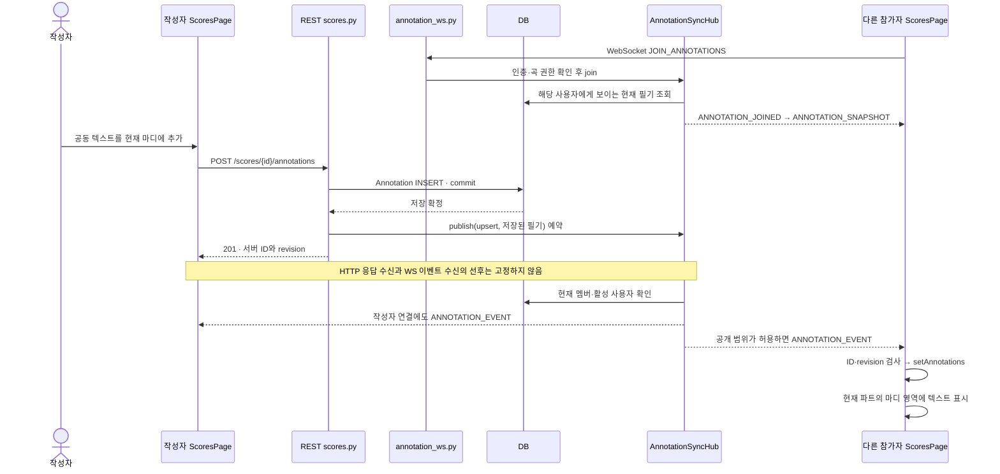

### 1단계. 필기 내용과 위치, 공개 범위를 정한다

**원본** [ScoresPage.tsx](../apps/web/src/pages/ScoresPage.tsx)의 필기 도구와 `pointerUp`

텍스트·기호 모드에서는 `annotationText`에 내용을 입력한다. `annotationScope`의 초기값은 `private`이며, 라디오 버튼의 `나만 보기`와 `프로젝트 공유`는 각각 `private`, `project`를 선택한다.

현재 마디에 붙이는 버튼이다.

```tsx
<Button
  disabled={!annotationText.trim() || usingOfflineCache}
  onClick={() => void saveAnnotation({ x: 0.5, y: 0.5 }, 'measure')}
>
  현재 마디 중앙에 추가
</Button>
```

위 호출은 `anchorType='measure'`를 명시한다. 반면 악보를 직접 누르는 경로는 아래와 같다.

```ts
if ((mode === 'text' || mode === 'stamp') && selected) {
  void saveAnnotation(point);
}
```

두 번째 인수를 생략하므로 기본 `anchorType='page'`가 적용된다. `pointerPosition`은 페이지 표면의 실제 사각형에서 좌표를 구한 뒤 0–1 범위로 정규화한다.

```ts
const pointerPosition = (event: ReactPointerEvent): { x: number; y: number } => {
  const bounds = event.currentTarget.getBoundingClientRect();
  return {
    x: Math.min(1, Math.max(0, (event.clientX - bounds.left) / bounds.width)),
    y: Math.min(1, Math.max(0, (event.clientY - bounds.top) / bounds.height)),
  };
};
```

| 동작                           | 저장할 위치 정보                            | 나중에 표시할 기준                           |
| ------------------------------ | ------------------------------------------- | -------------------------------------------- |
| 페이지를 눌러 텍스트·기호 추가 | `page`, x·y, `anchorType: page`             | 원본 악보의 해당 페이지 좌표                 |
| 현재 마디 중앙에 추가          | 공통 `measureNumber`, `anchorType: measure` | 보는 파트에서 그 마디가 차지하는 영역의 중앙 |
| 펜으로 선 그리기               | `payload.points`의 정규화된 점 목록         | 원본 악보의 해당 페이지                      |

펜은 포인터를 놓을 때 모은 점들을 `savePenAnnotation(points)`에 넘긴다. 이 경로는 `kind='pen'`으로 생성하며 `saveAnnotation`의 가까운 텍스트 수정 규칙을 사용하지 않는다.

**확인할 질문:** 공동 필기를 선택했다고 모든 파트의 같은 좌표에 나타나는가? → 공유 여부와 위치 연결 방식은 별개이며, 파트 간 마디 재투영은 measure 앵커에서 이뤄진다.

### 2단계. saveAnnotation이 새 필기와 가까운 기존 필기를 구분한다

**원본** [ScoresPage.tsx](../apps/web/src/pages/ScoresPage.tsx)의 `saveAnnotation`

```ts
async function saveAnnotation(
  point: { x: number; y: number },
  anchorType: 'page' | 'measure' = 'page',
): Promise<void> {
  if ((mode !== 'text' && mode !== 'stamp') || !selected || usingOfflineCache) return;
  const targetScore = selected;
  const editableNearby = annotations.find((annotation) => {
    if (
      annotation.scoreId !== targetScore.id ||
      annotation.kind !== mode ||
      annotation.page !== page ||
      annotation.scope !== annotationScope
    )
      return false;
    if ((annotation.payload.anchorType ?? 'page') !== anchorType) return false;
    if (anchorType === 'measure' && annotation.measureNumber !== currentMeasure) return false;
    if (remoteMode && annotation.authorId !== user?.id) return false;
    const x = Number(annotation.payload.x);
    const y = Number(annotation.payload.y);
    return (
      Number.isFinite(x) && Number.isFinite(y) && Math.hypot(x - point.x, y - point.y) < 0.035
    );
  });
```

텍스트·기호 모드가 아니거나 선택 악보가 없거나 오프라인 사본을 보고 있으면 반환한다. 그다음 `editableNearby`를 찾는다.

1. 같은 원본 악보, 같은 종류, 같은 페이지, 같은 공개 범위여야 한다.
2. page/measure 앵커 종류가 같아야 한다. measure 앵커는 공통 마디 번호도 같아야 한다.
3. 원격 모드에서는 **현재 사용자가 작성한 필기만** 자동 수정 대상으로 삼는다.
4. 기존 x·y와 입력 지점의 거리가 정규화 좌표 기준 `0.035`보다 작아야 한다.

조건에 맞는 필기가 있으면 기존 ID와 revision을 이어받고, 없으면 새 로컬 ID로 객체를 만든다.

```ts
const annotation: VersionedAnnotation = editableNearby
  ? {
      ...editableNearby,
      measureNumber: currentMeasure,
      payload: { x: point.x, y: point.y, text: annotationText, anchorType },
      updatedAt: new Date().toISOString(),
    }
  : {
      id: crypto.randomUUID(),
      scoreId: targetScore.id,
      scope: annotationScope,
      kind: mode,
      page,
      measureNumber: currentMeasure,
      payload: { x: point.x, y: point.y, text: annotationText, anchorType },
      updatedAt: new Date().toISOString(),
    };
```

`measureNumber`가 기록돼 있다는 사실만으로 마디 앵커인 것은 아니다. 실제 표시 방식은 `payload.anchorType`을 함께 확인한다. 공개 범위를 바꾸면 기존 필기의 scope와 조건이 맞지 않을 수 있으므로, 같은 위치를 눌러도 기존 private 필기의 scope를 변경하는 대신 새 공동 필기를 만들 수 있다.

로컬 모드에서는 이 객체를 `localDb.putAnnotation(annotation)`으로 IndexedDB에 저장하고 화면 목록을 갱신한다. 서버 요청이나 WebSocket 전송은 없다. 로컬 화면에서 `project`를 선택해도 그 자체로 다른 기기에 공유되지는 않는다.

**확인할 질문:** 리더가 다른 사람의 공동 필기 근처를 누르면 자동으로 그 필기를 고치는가? → 이 화면의 가까운 필기 선택은 원격 작성자 ID까지 확인한다. 서버의 수정 권한은 뒤에서 별도로 다룬다.

### 3단계. 필기 데이터를 REST 요청과 서버 응답으로 변환한다

**원본** [scoreApi.ts](../apps/web/src/lib/scoreApi.ts)의 `annotationData`, `createAnnotation`, `updateAnnotation`

공통 요청 내용을 만드는 함수다.

```ts
function annotationData(annotation: LocalAnnotation): Record<string, unknown> {
  return {
    kind: annotation.kind,
    page: annotation.page,
    ...(annotation.measureNumber === undefined ? {} : { measureNumber: annotation.measureNumber }),
    payload: annotation.payload,
  };
}
```

새 필기는 `POST /scores/{id}/annotations`, 수정은 `PUT /annotations/{id}`로 보낸다.

```ts
export async function createAnnotation(
  client: ApiClient,
  annotation: LocalAnnotation,
): Promise<VersionedAnnotation> {
  const record = await client.post<AnnotationRecord>(
    `/scores/${segment(annotation.scoreId)}/annotations`,
    { scope: annotation.scope, data: annotationData(annotation) },
  );
  return annotationFromRecord(record);
}
```

```ts
export async function updateAnnotation(
  client: ApiClient,
  annotation: VersionedAnnotation,
): Promise<VersionedAnnotation> {
  if (annotation.revision === undefined) {
    throw new Error('서버 필기 revision이 없어 수정할 수 없습니다. 목록을 새로고침해 주세요.');
  }
  const record = await client.put<AnnotationRecord>(`/annotations/${segment(annotation.id)}`, {
    expectedRevision: annotation.revision,
    data: annotationData(annotation),
  });
  return annotationFromRecord(record);
}
```

| 요청      | 보내는 내용                   | 서버에서 정하는 내용                           |
| --------- | ----------------------------- | ---------------------------------------------- |
| 생성 POST | `scope`, 필기 `data`          | ID, 인증된 작성자, 첫 revision, 생성·갱신 시각 |
| 수정 PUT  | `expectedRevision`, 새 `data` | 권한·버전 확인 후 새 revision                  |

생성 때 브라우저에서 만든 임시 ID·작성자 ID·revision을 본문에 보내지 않는다. 원격에서는 서버 응답의 ID를 이후 화면과 저장에 사용한다. 수정 API의 본문에는 scope가 없으므로 이 요청으로 공개 범위를 변경하지 않는다.

다음은 **설명용 생성 요청**이다. 실제 사용자 데이터나 실행 로그가 아니다.

```json
{
  "scope": "project",
  "data": {
    "kind": "text",
    "page": 1,
    "measureNumber": 11,
    "payload": {
      "x": 0.5,
      "y": 0.5,
      "text": "활 방향 맞추기",
      "anchorType": "measure"
    }
  }
}
```

서버 스키마는 `kind`별 텍스트·기호·펜 형식을 나누어 검사한다. 위치는 0–1, 페이지·마디는 1 이상이고, 텍스트는 비어 있으면 안 된다. measure 앵커에는 마디 번호가 필수이며 펜은 두 점 이상이어야 한다. 잘못된 내용은 422로 거부된다.

응답은 `annotationFromRecord`를 거쳐 화면의 `payload`, `authorId`, `revision`으로 변환된다. 반환값이 `VersionedAnnotation`이므로 다음 수정에서 서버 revision을 계속 사용할 수 있다.

**확인할 질문:** 새 필기 POST에 `authorId`를 넣으면 그 사람의 필기가 되는가? → 서버는 본문이 아니라 인증된 `user.id`를 작성자로 기록한다.

### 4단계. 서버가 필기를 commit한 뒤 변경 알림을 예약한다

**원본** [routers/scores.py](../apps/server/app/routers/scores.py)의 `create_annotation`, `update_annotation`, `delete_annotation`

생성 함수의 저장 부분을 읽는다.

```python
score, _ = require_score(db, user, score_id)
row = Annotation(
    score_id=score_id,
    author_id=user.id,
    scope=body.scope,
    data=body.data.model_dump(by_alias=True, exclude_none=True),
)
db.add(row)
db.commit()
db.refresh(row)
result = annotation_out(row)
request.app.state.annotation_sync.publish(score.repertoire_id, "upsert", result)
return result
```

`require_score`는 기본 member 권한으로 해당 악보에 접근할 수 있는지 확인한다. 따라서 필기 생성은 악보 업로드의 leader 전용 경로와 다르다. [Annotation 모델](../apps/server/app/models.py)의 기본 revision은 1이고, `data`는 JSON 컬럼이다.

**`db.commit()`이 `publish()`보다 먼저** 나온다. commit에서 실패하면 이 코드의 publish까지 진행하지 않는다. 성공한 행을 응답 모델로 만든 뒤 곡 ID와 `upsert`를 허브에 전달한다. upsert는 받는 화면에서 ID가 없으면 추가하고 있으면 교체하라는 뜻이다.

수정은 작성자 또는 leader 이상의 서버 권한과 기대 revision을 검사한다.

```python
row = db.get(Annotation, annotation_id)
if row is None:
    raise HTTPException(status_code=404, detail="annotation not found")
score, membership = require_score(db, user, row.score_id)
if not can_edit_annotation(row, user, membership):
    raise HTTPException(status_code=403, detail="annotation author or leader role required")
if body.expected_revision != row.revision:
    raise HTTPException(
        status_code=409,
        detail={
            "message": "annotation revision conflict",
            "expectedRevision": body.expected_revision,
            "actualRevision": row.revision,
        },
    )
row.revision += 1
row.data = body.data.model_dump(by_alias=True, exclude_none=True)
db.commit()
db.refresh(row)
result = annotation_out(row)
request.app.state.annotation_sync.publish(score.repertoire_id, "upsert", result)
return result
```

낡은 revision이면 409이고, 통과하면 필기 한 건의 revision을 증가시켜 commit한 뒤 `upsert`를 예약한다. 앞 실습의 Score·MeasureMap 두 객체를 함께 저장하는 경로와 달리, 여기서는 필기 행의 내용과 버전이 대상이다.

삭제는 삭제 전 필기 정보를 보관한 뒤 다음 순서로 처리한다.

```python
deleted = annotation_out(row)
db.delete(row)
db.commit()
request.app.state.annotation_sync.publish(score.repertoire_id, "delete", deleted)
return Response(status_code=204)
```

delete 이벤트는 삭제 전 revision을 사용한다. 삭제했다고 revision을 별도로 증가시키지 않으며, 수신 화면은 같은 revision의 늦은 upsert가 삭제를 되돌리지 않도록 별도 표시를 둔다.

`publish`는 발송 작업을 예약하는 함수다. REST 성공 응답이 모든 참가자의 수신·화면 반영 완료까지 보장하지는 않는다. HTTP 응답과 작성자 자신에게 오는 WebSocket 이벤트 중 어느 것을 먼저 받을지도 고정돼 있지 않다.

**확인할 질문:** WebSocket 전송이 늦어지면 DB 저장도 아직 안 된 상태인가? → 이 경로의 이벤트는 commit 이후에 예약되므로 두 완료 시점이 다르다.

### 5단계. 화면이 곡의 WebSocket에 가입하고 서버가 권한을 확인한다

**원본** [ScoresPage.tsx](../apps/web/src/pages/ScoresPage.tsx)의 `AnnotationSyncClient` effect → [annotationClient.ts](../apps/web/src/lib/annotationClient.ts) → [annotation_ws.py](../apps/server/app/annotation_ws.py)

페이지를 열 때 REST로 곡의 필기 목록을 먼저 읽는 경로도 있다. 이후 원격 모드·곡 ID·access token·선택 악보가 준비되고, 오프라인 사본 모드가 아닐 때 effect가 동기화 클라이언트를 만든다.

```ts
useEffect(() => {
  if (
    !remoteMode ||
    !repertoireItemId ||
    !tokens?.accessToken ||
    !selected ||
    selected.id !== scoreId ||
    usingOfflineCache
  ) {
    return;
  }
```

effect는 `onSnapshot`, `onEvent`, `onStatus`, `onUnauthorized`를 등록한 뒤 `sync.connect()`를 호출한다. 화면 문맥이 바뀌거나 effect가 정리되면 `active=false`와 `sync.disconnect()`로 이전 연결의 반영과 자동 재연결을 멈춘다.

클라이언트가 소켓을 여는 부분이다.

```ts
const socket = new WebSocket(
  websocketUrl(`/repertoires/${encodeURIComponent(this.repertoireId)}/annotations`),
);
this.socket = socket;

socket.addEventListener('open', () => {
  if (this.socket !== socket) return;
  this.send('JOIN_ANNOTATIONS', {
    repertoireId: this.repertoireId,
    accessToken: this.token,
  });
});
```

토큰은 URL query가 아니라 첫 JOIN 메시지의 payload로 전달한다. 실제 서버 경로는 `/ws/repertoires/{repertoire_id}/annotations`이며, 배포 prefix는 공용 `websocketUrl`이 처리한다.

서버는 첫 메시지가 `JOIN_ANNOTATIONS`이고 payload의 곡 ID가 URL의 곡 ID와 같은지 확인한다. 다른 메시지로 시작하면 오류를 보내고 4400으로 닫는다. 인증·접근 검사 부분은 다음과 같다.

```python
with websocket.app.state.database.session_factory() as db:
    user = authenticate_access_token(
        db,
        websocket.app.state.settings,
        first.payload.access_token,
    )
    request_subject = trusted_sso_subject(websocket, websocket.app.state.settings)
    require_matching_sso_subject(user.sso_subject, request_subject)
    require_repertoire(db, user, repertoire_id)
    user_id = user.id
subscriber = await websocket.app.state.annotation_sync.join(
    repertoire_id,
    user_id,
    websocket,
    first.request_id,
)
```

access token, SSO subject 일치, 해당 곡 접근 권한을 확인하고 허브의 `join`으로 넘긴다. 실패하면 `UNAUTHORIZED` 오류와 4401 close로 응답한다.

클라이언트가 보낼 수 있는 메시지 타입도 확인한다.

```python
AnnotationWsClientMessage = Annotated[
    JoinAnnotationsMessage | AnnotationPingMessage,
    Field(discriminator="type"),
]
```

JOIN과 PING만 있으며 필기를 쓰는 WS 명령은 없다. 이 소켓에 연결하려고 별도의 합주방을 만들 필요도 없다. 같은 곡의 악보 화면을 연 사용자가 구독하며, 세션에 포함된 악보 화면도 이 페이지의 연결 경로를 사용한다.

**확인할 질문:** WS 연결을 만들 수 있으면 바로 필기를 구독한 것인가? → 연결 뒤 첫 JOIN의 인증과 곡 접근 검사를 통과해야 한다.

### 6단계. 서버가 이 사용자에게 보이는 필기 전체를 먼저 보낸다

**원본** [annotation_sync.py](../apps/server/app/annotation_sync.py)의 `join`, `_visible_annotations`

[main.py](../apps/server/app/main.py)는 앱 시작 시 `AnnotationSyncHub(database)`를 만들고 `start()`로 실행 중인 이벤트 루프를 연결한다. 허브는 곡 ID별 구독자 목록과 잠금을 메모리에 보관한다.

가입할 때의 핵심 부분이다.

```python
lock = self._lock_for(repertoire_id)
async with lock:
    if not self._has_access(repertoire_id, user_id):
        raise AnnotationAccessError("repertoire membership required")
    annotations = self._visible_annotations(repertoire_id, user_id)
    repertoire_subscribers = self._subscribers.setdefault(repertoire_id, {})
    repertoire_subscribers[subscriber.connection_id] = subscriber
    try:
        await self.send(
            websocket,
            "ANNOTATION_JOINED",
            {"repertoireId": repertoire_id, "userId": user_id},
            request_id,
        )
        await self.send(
            websocket,
            "ANNOTATION_SNAPSHOT",
            {
                "repertoireId": repertoire_id,
                "annotations": [item.model_dump(by_alias=True, mode="json") for item in annotations],
            },
        )
    except Exception:
        repertoire_subscribers.pop(subscriber.connection_id, None)
        if not repertoire_subscribers:
            self._subscribers.pop(repertoire_id, None)
        raise
return subscriber
```

곡별 `asyncio.Lock` 안에서 현재 접근 권한을 다시 확인하고 필기 목록을 읽는다. 연결을 등록한 뒤 **`ANNOTATION_JOINED` → `ANNOTATION_SNAPSHOT`** 순서로 보낸다. snapshot은 그 사용자가 볼 수 있는 현재 상태 전체다.

실제 조회 조건을 본다.

```python
def _visible_annotations(self, repertoire_id: str, user_id: str) -> list[AnnotationOut]:
    with self.database.session_factory() as db:
        rows = db.scalars(
            select(Annotation)
            .join(Score, Score.id == Annotation.score_id)
            .where(
                Score.repertoire_id == repertoire_id,
                or_(Annotation.scope == "project", Annotation.author_id == user_id),
            )
            .order_by(Annotation.created_at, Annotation.id)
        ).all()
        return [annotation_out(row) for row in rows]
```

조건은 `해당 곡 AND (project 필기 OR 내가 작성한 필기)`다. 원본 악보 하나로 한정하지 않으므로 같은 곡의 여러 파트에 붙은 필기를 가져온다. 다만 다른 사용자의 private 필기는 이 조회에서 제외한다.

뒤의 `_broadcast`도 같은 곡의 잠금을 사용한다. 따라서 **이 허브의 새 연결에 대한 이벤트 전송이 첫 snapshot 전송 중간에 끼어들지 않도록** 순서를 조정한다. 이 잠금은 Python 프로세스 안의 전송 순서를 위한 것이며, 모든 REST DB 변경을 하나의 전역 잠금으로 묶는 것은 아니다. snapshot에 이미 들어간 변경이 이후 이벤트로 다시 도착할 수도 있다.

REST의 곡 전체 목록 조회도 같은 공개 범위 조건을 사용한다. 단건 `GET /annotations/{id}`는 다른 사람의 private 필기에 404를 반환한다. 권한이 없는 데이터를 클라이언트에 보내고 CSS로 숨기는 방식이 아니다.

**확인할 질문:** 리더가 JOIN하면 멤버의 private 필기까지 전체 snapshot에 들어오는가? → snapshot의 조회 조건에는 리더에게 타인의 private 필기를 공개하는 예외가 없다.

### 7단계. commit 이후 이벤트를 현재 멤버와 공개 범위에 맞춰 보낸다

**원본** [annotation_sync.py](../apps/server/app/annotation_sync.py)의 `publish`, `_broadcast`

REST 라우트가 부르는 `publish`의 구현이다.

```python
def publish(
    self,
    repertoire_id: str,
    operation: AnnotationOperation,
    annotation: AnnotationOut,
) -> None:
    """Schedule a post-commit event from either a sync FastAPI worker or the event loop."""

    loop = self._loop
    if loop is None or self._stopping:
        return

    def spawn() -> None:
        if self._stopping:
            return
        task = asyncio.create_task(self._broadcast(repertoire_id, operation, annotation))
        self._tasks.add(task)
        task.add_done_callback(self._task_done)

    loop.call_soon_threadsafe(spawn)
```

동기 FastAPI 작업에서 호출되더라도 `call_soon_threadsafe`로 허브의 이벤트 루프에 작업 생성을 예약한다. `_broadcast` task를 만들며, REST가 모든 WebSocket 전송을 직접 기다리는 구조는 아니다. 허브가 아직 시작하지 않았거나 종료 중이면 이 함수는 반환한다.

이벤트에 담기는 데이터다.

```python
event = AnnotationEventPayload(
    event_id=str(uuid.uuid4()),
    repertoire_id=repertoire_id,
    operation=operation,
    annotation_id=annotation.id,
    revision=annotation.revision,
    scope=annotation.scope,
    author_id=annotation.author_id,
    annotation=annotation if operation == "upsert" else None,
).model_dump(by_alias=True, mode="json")
```

upsert에는 저장된 필기 전체를, delete에는 `annotation=None`과 ID·revision·공개 범위를 담는다. `eventId`는 매번 만든 이벤트 식별자이며, 뒤의 페이지는 이 값을 영구 기록해 중복을 제거하는 대신 **필기 ID와 revision**으로 상태를 정리한다.

구독자별 전송 조건을 읽는다.

```python
for connection_id, subscriber in list(subscribers.items()):
    if subscriber.user_id not in active_user_ids:
        stale.append(connection_id)
        with contextlib.suppress(Exception):
            await subscriber.websocket.close(
                code=4401,
                reason="repertoire membership required",
            )
        continue
    if annotation.scope == "private" and subscriber.user_id != annotation.author_id:
        continue
    try:
        await self.send(subscriber.websocket, "ANNOTATION_EVENT", event)
    except Exception:
        stale.append(connection_id)
```

전송할 때마다 DB에서 현재 활성 멤버 ID를 읽는다. `_active_user_ids`는 해당 곡의 프로젝트·그룹 멤버십을 따라가고 `User.is_active`도 확인한다. 권한을 잃은 연결은 4401로 닫고 구독 목록에서 제거한다. private이면 작성자 ID가 같은 연결에만 전송한다.

같은 작성자가 두 기기에서 연결했다면 두 연결 모두 private 이벤트를 받을 수 있다. project 이벤트는 현재 접근 가능한 구독자에게 전송하며 작성자 자신의 연결도 제외하지 않는다. 다른 곡에 연결된 사용자는 이 곡의 구독자 목록에 없으므로 이 전송을 받지 않는다.

각 `send`에는 5초 제한이 있다. 전송 예외가 난 구독자는 이 broadcast의 정리 목록에 넣어 제거한다. 이를 모든 화면이 이벤트를 받았다는 확인으로 해석하면 안 된다. 서버의 DB에는 이미 저장된 상태가 남고, 재가입 시 snapshot으로 현재 상태를 다시 제공한다.

**확인할 질문:** private 필기를 다른 참가자에게 보낸 뒤 브라우저가 걸러 주는가? → 서버가 작성자 연결 이외에는 이벤트를 보내지 않는다.

### 8단계. 수신 화면이 ID와 revision으로 필기 목록을 갱신한다

**원본** [annotationClient.ts](../apps/web/src/lib/annotationClient.ts)의 `handle`, `parseEvent` → [ScoresPage.tsx](../apps/web/src/pages/ScoresPage.tsx)의 `onEvent`

`AnnotationSyncClient`는 JSON을 읽어 메시지를 분류한다. `ANNOTATION_EVENT`는 `parseEvent`에서 곡 ID, 작업 종류, 공개 범위, 1 이상의 정수 revision, upsert 본문 존재 등을 검사한 뒤 페이지의 `onEvent`로 전달한다.

페이지는 이전 effect가 끝났거나 곡을 이동했다면 이벤트를 반영하지 않는다. 이후의 실제 상태 갱신이다.

```ts
onEvent: (event) => {
  if (!active || activeRepertoireIdRef.current !== targetRepertoireId) return;
  const known = annotationVersionsRef.current.get(event.annotationId);
  if (
    known &&
    (known.revision > event.revision ||
      (known.revision === event.revision && known.deleted && event.operation === 'upsert'))
  ) {
    return;
  }
  if (event.operation === 'delete') {
    annotationVersionsRef.current.set(event.annotationId, {
      revision: event.revision,
      deleted: true,
    });
    setAnnotations((current) =>
      current.filter((annotation) => annotation.id !== event.annotationId),
    );
    void localDb
      .deleteAnnotation(event.annotationId, remoteCacheScope)
      .catch(() => undefined);
    return;
  }
  const annotation = event.annotation;
  if (!annotation) return;
  annotationVersionsRef.current.set(annotation.id, {
    revision: annotationRevision(annotation, event.revision),
    deleted: false,
  });
  setAnnotations((current) => {
    const index = current.findIndex((item) => item.id === annotation.id);
    if (index < 0) return [...current, annotation];
    return current.map((item) => (item.id === annotation.id ? annotation : item));
  });
  void localDb.putAnnotation(annotation, remoteCacheScope).catch(() => undefined);
},
```

`annotationVersionsRef`에는 필기별 마지막 revision과 삭제 여부를 보관한다. 처리 규칙을 예시로 읽는다.

| 이미 알고 있는 상태 | 도착한 이벤트         | 처리                                                  |
| ------------------- | --------------------- | ----------------------------------------------------- |
| 필기 없음           | upsert r1             | ID를 기준으로 목록에 추가                             |
| 살아 있는 r1        | upsert r2             | 같은 ID의 항목 교체                                   |
| r3                  | upsert 또는 delete r2 | 더 오래됐으므로 무시                                  |
| 살아 있는 r2        | upsert r2 재도착      | 같은 ID의 항목 교체, 중복 행을 추가하지 않음          |
| 살아 있는 r2        | delete r2             | 목록에서 제거하고 `{revision: 2, deleted: true}` 기록 |
| 삭제된 r2           | 늦은 upsert r2        | 무시하여 같은 버전의 필기를 되살리지 않음             |

이 삭제 기록은 **브라우저 메모리의 표시**다. 서버에서 필기 행을 tombstone으로 남긴다는 뜻은 아니다. REST DELETE는 실제 `db.delete(row)`를 수행한다. 다시 연결하면 DB snapshot으로 목록과 버전 기록을 다시 만든다.

작성자 화면에는 REST 응답도 반영된다.

```ts
if (remoteMode) {
  const saved = editableNearby
    ? await updateAnnotation(client, annotation)
    : await createAnnotation(client, annotation);
  await updateOfflineCopy(localDb.putAnnotation(saved, remoteCacheScope), '필기');
  if (activeScoreIdRef.current !== targetScore.id) return;
  annotationVersionsRef.current.set(saved.id, {
    revision: annotationRevision(saved),
    deleted: false,
  });
  setAnnotations((current) => {
    const exists = current.some((item) => item.id === saved.id);
    return exists
      ? current.map((item) => (item.id === saved.id ? saved : item))
      : [...current, saved];
  });
  return;
}
```

작성자는 서버 응답의 ID로 필기를 넣거나 교체하고 revision을 기록한다. WebSocket으로 자기 이벤트도 받을 수 있으므로 배열에 무조건 추가하지 않고 ID가 이미 있는지 확인한다. 이 REST 성공 callback과 위의 WS callback은 별도의 경로이며, revision 비교 guard가 있는 위치는 위 `onEvent`다.

수신 이벤트는 사용자별 IndexedDB 사본도 갱신한다. 현재 `onEvent`의 개별 put/delete 실패는 `.catch(() => undefined)`로 끝나므로 별도 사본 실패 알림을 띄우지 않는다. 반면 REST 저장 직후의 `updateOfflineCopy`와 snapshot 사본 갱신은 실패 안내가 있다. 메모리 화면 반영과 사본 저장의 성공은 구분해서 읽는다.

**확인할 질문:** 같은 upsert를 두 번 받으면 필기가 두 개가 되는가? → 현재 목록에서는 ID로 교체한다. `eventId`를 영속 저장해 정확히 한 번 실행하는 프로토콜은 아니다.

### 9단계. 페이지 좌표와 마디 앵커에 따라 실제 악보에 그린다

**원본** [ScoresPage.tsx](../apps/web/src/pages/ScoresPage.tsx)의 `visibleAnnotations`, `visibleMeasureAnnotations`, SVG 렌더링

`setAnnotations`로 상태가 바뀌면 React가 표시할 목록을 다시 계산한다. 원본 페이지에 붙은 필기는 다음 조건으로 거른다.

```ts
const visibleAnnotations = annotations.filter(
  (annotation) =>
    annotation.scoreId === selected?.id &&
    annotation.page === page &&
    annotation.payload.anchorType !== 'measure',
);
```

원본 scoreId와 현재 페이지가 같아야 하며 measure 앵커는 이 목록에서 제외한다. 펜도 별도의 measure 앵커를 저장하지 않으므로 이 경로로 그린다.

마디 앵커는 다른 파트에도 옮겨 표시할 수 있다.

```ts
const visibleMeasureAnnotations = annotations.flatMap((annotation) => {
  if (
    annotation.payload.anchorType !== 'measure' ||
    annotation.measureNumber === undefined ||
    (annotation.kind !== 'text' && annotation.kind !== 'stamp')
  ) {
    return [];
  }
  const scoreMeasure = scoreMeasureNumber(
    annotation.measureNumber,
    measureMap?.measureNumberOffset ?? 0,
  );
  const region = visibleRegions.find((candidate) => candidate.measureNumber === scoreMeasure);
  return region
    ? [
        {
          annotation,
          x: region.rect.x + region.rect.w / 2,
          y: region.rect.y + region.rect.h / 2,
        },
      ]
    : [];
});
```

공통 마디 번호에서 **현재 악보의 오프셋을 빼서** 해당 파트의 마디 번호를 구한다. 현재 페이지의 MeasureMap에서 그 영역을 찾고 사각형 중앙에 표시한다. 이 계산에는 원본 필기의 scoreId가 현재 악보와 같아야 한다는 조건이 없다.

예를 들어 공통 11마디 필기를 받았고 현재 파트의 오프셋이 10이면, 이 파트의 `11 − 10 = 1마디` 영역 중앙에 그린다. 해당 마디 영역이 없거나 다른 페이지에 있으면 현재 페이지에는 표시되지 않는다. **이벤트를 받았지만 지금 눈에 보이지 않는 것**과 **서버가 공개 범위 때문에 보내지 않은 것**은 다르다.

실제 화면에는 SVG의 `<text>` 또는 `<polyline>`으로 표시한다. 다음은 마디 앵커 텍스트·기호의 출력 부분이다.

```tsx
{visibleMeasureAnnotations.map(({ annotation, x, y }) => {
  const text = annotation.payload.text;
  const content =
    typeof text === 'string' || typeof text === 'number' ? String(text) : '';
  return (
    <text
      key={`transferred:${annotation.id}`}
      className={
        annotation.kind === 'stamp'
          ? 'annotation-stamp annotation-transferred'
          : 'annotation-text annotation-transferred'
      }
      x={x}
      y={y}
    >
      {content}
    </text>
  );
})}
```

private인 마디 필기도 작성자 자신의 다른 파트에서는 같은 규칙으로 옮겨 보일 수 있다. 다른 사용자에게 공개하는 것은 아니다. 먼저 서버가 수신 가능 대상을 걸렀고, 그 뒤 현재 사용자 화면이 파트 위치를 계산하기 때문이다.

**확인할 질문:** 바이올린 악보의 공동 펜 선을 첼로 파트에도 자동으로 옮기는가? → 현재 파트 간 재투영은 measure 앵커의 텍스트·기호에 해당하며 페이지 좌표와 펜 선은 원본 악보에 남는다.

### 10단계. 연결이 끊기면 다시 가입하고 최신 목록으로 교체한다

**원본** [annotationClient.ts](../apps/web/src/lib/annotationClient.ts)의 close 처리·`scheduleReconnect`, [ScoresPage.tsx](../apps/web/src/pages/ScoresPage.tsx)의 `onSnapshot`

일반적인 네트워크 close는 재연결 상태로 바꾸고 다음 일정을 잡는다.

```ts
private scheduleReconnect(): void {
  this.reconnectAttempt += 1;
  const delay = Math.min(10_000, 500 * 2 ** (this.reconnectAttempt - 1));
  this.reconnectTimer = setTimeout(() => {
    this.reconnectTimer = null;
    this.openSocket();
  }, delay);
}
```

연속 재연결 대기 시간은 `0.5초 → 1초 → 2초 → 4초 → 8초 → 10초`이며 이후 상한은 10초다. `ANNOTATION_JOINED`를 받으면 시도 횟수를 0으로 되돌린다. 브라우저의 `offline` 이벤트에서는 타이머와 소켓을 정리하고, `online`이 되면 다시 연결한다. 페이지가 명시적으로 `disconnect()`한 경우는 자동 재연결하지 않는다.

새 소켓이 열리면 다시 JOIN하고, 서버의 `join`이 다시 DB snapshot을 보낸다. **지난 eventId 이후의 변경 로그를 요청하는 방식이 아니다.** 페이지의 snapshot 처리다.

```ts
onSnapshot: (snapshot) => {
  if (!active || activeRepertoireIdRef.current !== targetRepertoireId) return;
  annotationVersionsRef.current = new Map(
    snapshot.map((annotation) => [
      annotation.id,
      { revision: annotationRevision(annotation), deleted: false },
    ]),
  );
  setAnnotations(snapshot);
  const scoreIds = new Set([
    ...snapshot.map((annotation) => annotation.scoreId),
    ...(scores.data ?? []).map((item) => item.id),
  ]);
  void Promise.all(
    [...scoreIds].map((id) =>
      localDb.replaceAnnotations(
        id,
        snapshot.filter((annotation) => annotation.scoreId === id),
        remoteCacheScope,
      ),
    ),
  ).catch((error: unknown) => {
    if (!active) return;
    notify({
      title: '실시간 필기의 오프라인 사본을 갱신하지 못했습니다.',
      description: error instanceof Error ? error.message : String(error),
      tone: 'info',
    });
  });
},
```

`setAnnotations(snapshot)`은 기존 배열 뒤에 붙이는 코드가 아니라 **현재 목록을 전체 교체**하는 코드다. version map도 snapshot 기준으로 다시 만든다. 끊긴 사이 추가된 필기는 들어오고 수정된 필기는 최신 내용이 되며, 삭제된 필기는 snapshot에 없으므로 화면에서 사라진다.

사본은 snapshot과 현재 악보 목록에서 얻은 scoreId별로 `replaceAnnotations`를 실행한다. 이 함수는 해당 사용자·악보의 기존 사본을 지우고 새 목록을 넣는다. 다음은 원격 사본 분기다.

```ts
if (scope) {
  const owner = cacheOwner(scope);
  const transaction = db.transaction('remoteAnnotations', 'readwrite');
  const existingKeys = await transaction.store.index('ownerScore').getAllKeys([owner, scoreId]);
  await Promise.all(existingKeys.map((key) => transaction.store.delete(key)));
  await Promise.all(
    annotations.map((annotation) =>
      transaction.store.put({ ...annotation, cacheOwnerId: owner }),
    ),
  );
  await transaction.done;
  return;
}
```

같은 악보의 삭제·삽입은 하나의 `remoteAnnotations` transaction으로 묶는다. 여러 악보의 사본 전체와 서버 snapshot 수신까지 하나의 분산 transaction으로 묶는 것은 아니다. snapshot 사본 갱신 실패 시 화면은 이미 새 목록을 받았으며 별도의 안내가 표시된다.

연결이 4401로 닫히면 인증 갱신을 시도한다.

```ts
private refreshAuthorization(): void {
  if (this.authRefreshAttempted || !this.options.onUnauthorized) {
    this.closeTerminal('공동 필기 인증이 만료되었거나 레퍼토리 권한이 없습니다.');
    return;
  }
  this.authRefreshAttempted = true;
  const rejected = this.token;
  this.patchStatus('connecting', '공동 필기 인증을 갱신하는 중입니다.');
  void this.options
    .onUnauthorized(rejected)
    .then((token) => {
      if (this.closedByUser) return;
      if (!token) {
        this.closeTerminal('공동 필기 인증을 갱신하지 못했습니다.');
        return;
      }
      this.token = token;
      this.openSocket();
    })
    .catch(() => {
      if (!this.closedByUser) this.closeTerminal('공동 필기 인증을 갱신하지 못했습니다.');
    });
}
```

페이지의 `onUnauthorized`는 `ApiClient.refreshAccessToken`을 호출한다. 새 토큰을 받으면 다시 JOIN한다. 가입 성공 전 거부가 반복되거나 새 토큰을 받지 못하면 `closed`로 끝내며 무한히 인증 재시도하지 않는다. 토큰이 갱신됐더라도 그룹에서 제외된 사용자의 곡 접근 권한까지 복구되는 것은 아니다.

연결 유지 중에는 15초마다 `ANNOTATION_PING`을 보낸다. 서버는 `ensure_access`로 현재 멤버십·활성 사용자를 다시 확인한 뒤 같은 nonce의 `ANNOTATION_PONG`을 돌려준다. 권한을 잃으면 연결을 닫는다.

이 PING은 전체 필기 재조회가 아니다. 현재 클라이언트는 PONG을 받았을 때 별도 작업을 하지 않으며 PONG 응답 시간초과 감시도 두지 않는다. 따라서 전체 복구의 기준점은 **재가입 때의 DB snapshot**이다. 또한 `live` 상태는 `ANNOTATION_JOINED`에서 설정되므로 그 표시만으로 snapshot 반영까지 끝났다고 단정하지 않는다.

**확인할 질문:** 끊긴 동안 delete 이벤트를 못 받았으면 삭제된 필기가 영구히 남는가? → 다시 가입해 받은 전체 snapshot으로 목록을 교체하면 제거된다.

### 개인 필기와 공동 필기의 공개 범위를 분리해서 읽기

다음 표는 **원격 필기의 조회와 이벤트 수신** 기준이다. 표의 사용자는 해당 곡에 현재 접근할 수 있다고 가정하며, WS 이벤트는 그 곡에 연결돼 있어야 받는다.

| 보는 사람                          | A가 만든 private                              | A가 만든 project                         |
| ---------------------------------- | --------------------------------------------- | ---------------------------------------- |
| 작성자 A의 현재 화면               | 조회·수신 가능                                | 조회·수신 가능                           |
| A로 로그인한 다른 기기             | 조회·수신 가능                                | 조회·수신 가능                           |
| 같은 그룹의 다른 멤버 B            | 목록·snapshot·이벤트에서 제외, 단건 GET은 404 | 조회·수신 가능                           |
| A가 아닌 leader 또는 owner         | 조회·수신에서 제외                            | 조회·수신 가능                           |
| 비회원·탈퇴한 사용자·비활성 사용자 | 접근 권한 검사 대상, 정상 구독·유지 불가      | 접근 권한 검사 대상, 정상 구독·유지 불가 |

`project`는 코드의 공개 범위 이름이다. 필기 한 건은 scoreId에 붙고 목록·WS 구독은 repertoireId로 묶인다. 다른 곡을 보고 있는 모든 프로젝트 사용자에게 무조건 전송한다는 뜻은 아니다.

**개인 필기와 로컬 필기도 다르다.** 원격 private는 DB에 저장하고 작성자 연결에 동기화한다. 비로그인·대상 곡 없는 로컬 모드의 필기는 scope와 관계없이 브라우저 IndexedDB에 남는다. 원격 저장이 실패한 요청을 로컬 쓰기 큐에 쌓았다가 나중에 자동 업로드하는 경로는 `saveAnnotation`에 없다.

수정·삭제 권한은 별도로 읽어야 한다. 실제 서버 helper는 다음과 같다.

```python
def can_edit_annotation(annotation: Annotation, user: User, membership: GroupMember) -> bool:
    return annotation.author_id == user.id or ROLE_LEVEL[membership.role] >= ROLE_LEVEL["leader"]
```

`update_annotation`과 `delete_annotation`은 곡 접근 권한 뒤 이 함수를 호출한다. 현재 helper에는 scope 조건이 없다. 따라서 **다른 사람의 private 필기를 조회할 수 없다는 규칙을, private 수정·삭제도 항상 작성자에게만 허용한다는 규칙으로 확대하면 안 된다.** 현재 서버 조건상 ID를 알고 해당 곡에 접근할 수 있는 leader 이상은 이 수정·삭제 권한 검사를 통과한다. 이는 공개 범위와 별도로 리뷰할 구현 경계이며 이번 문서 작업에서 동작을 변경하지 않았다.

프론트의 `saveAnnotation`은 다른 사람의 필기를 가까운 수정 대상으로 고르지 않는다. 화면의 제한과 서버가 직접 요청을 받았을 때의 허용 조건을 각각 확인한다.

### 끊긴 사이에 추가·수정·삭제됐다면 무엇으로 복구하는가

아래는 **설명용 예시**다. B가 A와 다른 사용자이고 두 사람 모두 같은 곡에 접근할 수 있다고 가정한다.

| 순서 | 서버 DB와 A의 동작                     | B의 화면                                |
| ---- | -------------------------------------- | --------------------------------------- |
| 1    | 공동 필기 X r1 존재                    | JOIN snapshot으로 X r1을 표시           |
| 2    | B의 연결이 끊김                        | 마지막 목록 X r1이 남아 있을 수 있음    |
| 3    | A가 X를 r2로 수정하고 공동 필기 Y 생성 | 이벤트를 못 받아 아직 예전 상태         |
| 4    | A가 X를 삭제하고 private 필기 Z 생성   | X의 delete도 못 받음                    |
| 5    | B가 다시 JOIN                          | 서버가 B에게 보이는 현재 DB 목록을 조회 |
| 6    | snapshot에는 Y가 있고 X·Z는 없음       | 목록 전체를 교체해 Y만 표시             |

X는 DB에서 삭제돼 없고, Z는 다른 사용자의 private라 조회 대상이 아니다. B는 중간의 `X r2` 이벤트나 X의 delete 이벤트를 재생하지 않아도 현재 상태로 돌아온다. 스냅샷은 변경 이력을 복원하는 자료가 아니라 **현재 볼 수 있는 상태를 다시 맞추는 자료**다.

작성자가 다른 기기로 재접속했다면 Z도 snapshot에 들어온다. 같은 저장소 상태에서 사용자에 따라 snapshot이 달라지는 이유가 공개 범위 조건이다.

수정 중 409가 난 경우에는 WebSocket 재접속을 기다리지 않고 REST로 곡의 최신 목록을 읽는다.

```ts
const latest = await listRepertoireAnnotations(client, targetScore.repertoireItemId);
const scoreIds = new Set([
  ...(scores.data ?? []).map((score) => score.id),
  ...latest.map((annotation) => annotation.scoreId),
]);
scoreIds.add(targetScore.id);
await updateOfflineCopy(
  Promise.all(
    [...scoreIds].map((id) =>
      localDb.replaceAnnotations(
        id,
        latest.filter((annotation) => annotation.scoreId === id),
        remoteCacheScope,
      ),
    ),
  ).then(() => undefined),
  '필기 목록',
);
```

최신 필기를 사용자별 사본에 반영한 뒤 화면과 버전 기록을 교체한다.

```ts
annotationVersionsRef.current = new Map(
  latest.map((item) => [item.id, { revision: annotationRevision(item), deleted: false }]),
);
setAnnotations(latest);
notify({
  title: '필기가 다른 곳에서 수정되었습니다.',
  description: `최신 목록을 불러왔습니다. 서버 revision ${error.payload.actualRevision ?? '확인 필요'}`,
  tone: 'danger',
});
```

이 catch는 최신 목록을 읽고 충돌을 알리며, 실패한 PUT을 새 revision으로 자동 재전송하지 않는다. 재조회까지 실패하면 `필기 충돌 후 최신 목록을 불러오지 못했습니다.`라는 별도 알림을 표시한다. 여기서 충돌의 기준은 마디 맵 버전이 아니라 **필기 한 건의 revision**이다.

### 필기 동기화의 실패와 리뷰 경계

| 상황                                      | 실제 코드의 처리·의미                                                                                         |
| ----------------------------------------- | ------------------------------------------------------------------------------------------------------------- |
| 생성·수정의 검증·권한·revision 검사 실패  | 정상 commit과 publish까지 진행하지 않음. 409는 최신 필기 목록 재조회 경로 사용                                |
| DB commit 성공 뒤 HTTP 응답 유실          | 서버에 필기가 이미 존재하고 WS 이벤트가 전달됐을 수도 있음. 실패 응답만으로 미저장을 단정하지 않음            |
| 새 필기 POST 재시도                       | 클라이언트 임시 ID를 생성 API에 보내지 않으므로 같은 요청의 중복 생성 방지 키로 사용하지 않음                 |
| WS만 끊기고 REST는 사용 가능              | 저장 함수는 WS의 `live` 상태를 필수 조건으로 검사하지 않음. 저장과 실시간 전파의 상태를 구분                  |
| 오프라인 사본을 보는 상태                 | `usingOfflineCache` guard가 필기 쓰기를 막고 실시간 연결 effect도 시작하지 않음                               |
| 원격 사본 갱신 실패                       | 서버 데이터와 메모리 화면이 이미 갱신됐을 수 있음. 이벤트별 캐시 실패와 snapshot 캐시 실패의 알림 처리도 다름 |
| 연결 종료·일반 네트워크 복구              | 다시 JOIN한 뒤 사용자별 DB snapshot으로 목록 교체                                                             |
| 멤버십 제거·사용자 비활성화               | broadcast 또는 PING의 현재 접근 검사에서 연결 제거·종료. 토큰 갱신으로 권한까지 회복되지는 않음               |
| 같은 revision의 upsert가 delete 뒤에 도착 | WS callback의 삭제 표시가 재등장을 막음                                                                       |

현재 보장의 범위를 다음 세 지점에서 확인한다.

1. **DB 저장과 WS 발송은 하나의 transaction이 아니다.** 허브는 메모리의 구독자·task를 사용하며, 발송 대기 이벤트를 DB outbox에 영속 저장하지 않는다. 재가입 snapshot이 누락 복구 수단이다. 연결이 유지된 채 이벤트가 누락됐을 때 주기적으로 전체 snapshot을 다시 받는 별도 경로는 없다.
2. **이 허브의 broadcast는 현재 프로세스의 구독자 목록을 대상으로 한다.** 여기에는 Redis 등으로 다른 서버 프로세스에 주석 이벤트를 전달하는 코드가 없다. 합주방의 다른 동기화 구현을 근거로 이 필기 경로도 여러 프로세스에 자동 전파된다고 가정하지 않는다.
3. **필기의 revision 검사와 동시 요청의 완전한 직렬화는 다른 주장이다.** `update_annotation`은 `db.get` 후 revision을 비교하고 증가시켜 commit한다. 앞 실습의 마디 맵 경로와 같은 `with_for_update` 또는 revision 조건을 SQL 갱신에 넣는 처리는 이 함수에 없다. 아래 테스트의 오래된 revision 거부를 모든 동시 쓰기 경쟁이 해결됐다는 근거로 확대하지 않는다.

또한 WS의 revision guard가 REST 성공 callback의 모든 순서 경합까지 감싼다고 설명하지 않는다. 읽을 때는 각 경로에서 `annotationVersionsRef`와 `setAnnotations`를 갱신하는 위치를 함께 확인한다.

### 필기 동기화의 리뷰 포인트와 테스트

이번 작업은 **소스를 따라가는 문서 작성**이다. 아래 테스트를 읽어 근거로 연결했으며 실제 필기 저장, WebSocket 접속, 앱 테스트나 DB 변경을 실행하지 않았다.

| 읽을 테스트                                                                       | 찾아볼 이름·행동                                                           | 확인할 범위                                                                    |
| --------------------------------------------------------------------------------- | -------------------------------------------------------------------------- | ------------------------------------------------------------------------------ |
| [test_annotation_websocket.py](../apps/server/tests/test_annotation_websocket.py) | `test_annotation_socket_snapshot_visibility_events_and_reconnect`          | 사용자별 snapshot, private/project 전송, upsert·delete, PING/PONG, 재가입 복구 |
| [같은 서버 테스트](../apps/server/tests/test_annotation_websocket.py)             | `test_annotation_socket_rejects_invalid_first_frame_and_nonmember`         | JOIN이 아닌 첫 메시지와 비회원 인증 거부                                       |
| [annotationClient.test.ts](../apps/web/src/lib/annotationClient.test.ts)          | `joins, validates snapshots, and delivers upsert and delete events`        | 메시지 변환과 callback 전달, 15초 PING                                         |
| [같은 클라이언트 테스트](../apps/web/src/lib/annotationClient.test.ts)            | `reconnects and accepts a replacement snapshot after a network close`      | close 후 재연결과 새 snapshot 수신                                             |
| [같은 클라이언트 테스트](../apps/web/src/lib/annotationClient.test.ts)            | `refreshes one rejected token and treats a repeated rejection as terminal` | 인증 갱신 뒤 반복 거부 시 재시도 종료                                          |
| [test_scores_logs_musicxml.py](../apps/server/tests/test_scores_logs_musicxml.py) | `test_repertoire_annotations_span_scores_and_preserve_private_visibility`  | 곡의 여러 악보를 조회하면서 사용자별 private 범위 유지                         |
| [scoreApi.test.ts](../apps/web/src/lib/scoreApi.test.ts)                          | `lists annotation revisions and sends expectedRevision on update`          | 필기 revision을 다음 PUT 본문에 전달                                           |
| [e2e/scores.spec.ts](../e2e/scores.spec.ts)                                       | 마디 필기와 다른 파트의 `annotation-transferred`                           | 로컬 파트 전환 시 공통 마디에 필기가 표시되는 흐름                             |

서버 테스트에서 리더와 작성자의 첫 snapshot을 비교하는 부분이다.

```python
with client.websocket_connect(path) as leader_ws:
    leader_snapshot = _join_annotations(leader_ws, repertoire_id, leader_token)
    assert [item["id"] for item in leader_snapshot] == [project_row["id"]]

    with client.websocket_connect(path) as member_ws:
        member_snapshot = _join_annotations(member_ws, repertoire_id, member_token)
        assert {item["id"] for item in member_snapshot} == {
            private_row["id"],
            project_row["id"],
        }
```

리더 snapshot에는 공동 필기만 있고 작성자에게는 개인 필기도 들어온다. 이어지는 같은 테스트는 새 private 이벤트가 작성자에게 전달된 뒤, 공동 이벤트는 두 연결에서 받는지 확인한다.

연결이 끊긴 동안의 추가와 삭제를 복구하는 확인 부분도 읽는다.

```python
missed = client.post(
    f"/api/scores/{score_id}/annotations",
    headers=member_headers,
    json={"scope": "project", "data": _text_annotation("created while disconnected")},
)
assert missed.status_code == 201
with client.websocket_connect(path) as reconnected:
    recovered = _join_annotations(reconnected, repertoire_id, leader_token)
    recovered_ids = {item["id"] for item in recovered}
    assert missed.json()["id"] in recovered_ids
    assert created_project.json()["id"] not in recovered_ids
```

재연결 snapshot에는 끊긴 동안 추가된 필기가 들어오고 이미 삭제된 필기는 들어오지 않는다. 이것이 DB의 현재 목록을 다시 읽는 이유다.

프론트 테스트는 가짜 WebSocket과 타이머를 사용해 첫 재시도 500ms 뒤 새 연결과 snapshot을 확인한다.

```ts
first.serverClose(1006);
expect(statuses.at(-1)?.state).toBe('reconnecting');

vi.advanceTimersByTime(500);
const second = FakeWebSocket.instances[1]!;
second.open();
joined(second);
second.message({
  type: 'ANNOTATION_SNAPSHOT',
  payload: { repertoireId: 'repertoire-1', annotations: [annotationRecord] },
});
expect(snapshots.at(-1)?.map((item) => item.id)).toEqual(['annotation-1']);
expect(statuses.at(-1)?.state).toBe('live');
client.disconnect();
```

이 테스트는 `AnnotationSyncClient`의 재연결과 callback을 검사한다. 실제 브라우저 간 통신, 여러 서버 프로세스의 전파, React 페이지의 모든 이벤트 순서 경합을 검증한 결과로 확대하지 않는다. 위 페이지의 revision·삭제 처리 설명은 해당 callback의 실제 코드에서 읽은 내용이다.

직접 리뷰하며 다음 질문에 답을 적어본다.

- [ ] 텍스트·기호와 펜은 어느 함수에서 출발하고 어디서 같은 저장 경로로 만나는가?
- [ ] `scope`, `anchorType`, `scoreId`, `repertoireId`는 각각 어떤 범위를 정하는가?
- [ ] 새 필기의 ID와 작성자·첫 revision은 누가 정하는가?
- [ ] REST commit 전에 publish하는 경로가 있는가? REST 성공이 다른 화면의 수신까지 뜻하는가?
- [ ] 작성자 자신도 WS 이벤트를 받는데 화면의 중복 추가를 어떻게 피하는가?
- [ ] private 필기의 REST 목록·단건 조회·snapshot·event 조건은 각각 어디에 있는가?
- [ ] private 조회 차단과 수정·삭제 권한은 같은 조건인가?
- [ ] 다른 파트에서 받은 필기가 보이지 않을 때 공개 범위와 마디 매핑을 구분할 수 있는가?
- [ ] delete와 같은 revision의 늦은 upsert는 어떤 순서로 처리되는가?
- [ ] 재연결 snapshot은 기존 배열에 추가되는가, 전체 목록을 교체하는가?
- [ ] PING이 하는 일과 전체 snapshot이 하는 일은 어떻게 다른가?
- [ ] 연결별 이벤트 누락, 서버 프로세스 분리, 동시에 같은 revision으로 쓰는 경우의 실제 보장 범위는 어디까지인가?

**다음으로 연결할 흐름:** [실습 08. OMR 초안 생성과 마디 맵 적용](#실습-08-omr-초안-생성과-마디-맵-적용)에서 비동기 분석 결과를 검토하고, 기준 revision을 확인해 확정 맵에 적용하는 과정을 읽는다.

---

## 실습 08. OMR 초안 생성과 마디 맵 적용

**이번 출발점** [ScoresPage.tsx](../apps/web/src/pages/ScoresPage.tsx)의 `requestOmrDraft`와 `applyOmrDraft`\
**따라갈 순서** 초안 요청 → 기준 revision 검사 → 작업 행 저장 → 백그라운드 실행 → 원본 파일 분석 → 결과 저장 → 상태 조회 → 초안 미리보기 → 사용자 적용 → MeasureMap revision 검사와 저장

OMR은 **Optical Music Recognition**, 즉 악보 이미지에서 음악 정보를 읽는 자동 인식이다. 이 구현은 서버의 Audiveris로 PDF·이미지를 분석하고, 내보낸 MusicXML에서 마디·단·페이지 구분을 읽어 **마디 위치 초안**을 만든다. `requestOmrDraft`가 곧바로 기존 마디 맵을 바꾸는 것은 아니다.

| 먼저 구분할 데이터      | 역할                                           | 변경 시점                                             |
| ----------------------- | ---------------------------------------------- | ----------------------------------------------------- |
| `Score`와 저장소의 원본 | 분석할 PDF·이미지                              | 앞 업로드 실습에서 준비됨                             |
| `OmrDraftJob`           | 분석 상태, 기준 revision, 결과 영역, 경고·오류 | 요청·worker 실행 때 갱신                              |
| `MeasureMap`            | 실제 화면 탐색·마디 연결에 사용할 확정 맵      | 사용자가 `초안을 마디 맵으로 저장`을 실행했을 때 갱신 |

`OmrDraftJob.status='succeeded'`는 **분석 결과가 준비됐다**는 뜻이다. 사용 중인 `MeasureMap`에 적용됐다는 뜻은 아니다. 기준 revision은 분석에 사용할 과거 마디 좌표를 보관하는 값도 아니다. worker는 악보 원본을 분석하고, revision은 그동안 다른 사람이 고친 맵을 적용 시점에 덮어쓰지 않기 위한 기준으로 사용한다.

| 구간             | 단계별 바로가기                                                                                                                                                                                                                                                                                                   |
| ---------------- | ----------------------------------------------------------------------------------------------------------------------------------------------------------------------------------------------------------------------------------------------------------------------------------------------------------------- |
| 요청과 작업 준비 | [1. 버튼·조건](#1단계-omr-사용-조건을-확인하고-현재-revision으로-초안을-요청한다) → [2. 작업 행 생성](#2단계-서버가-입력과-revision을-확인하고-pending-작업을-저장한다) → [3. 큐와 worker](#3단계-작업-id를-큐에-넣고-worker가-비동기로-처리한다)                                                                 |
| 서버 분석        | [4. 작업 확보·다운로드](#4단계-worker가-pending-작업을-확보하고-최종-악보-파일을-가져온다) → [5. Audiveris·영역 계산](#5단계-audiveris의-musicxml을-읽어-정규화된-마디-영역을-계산한다) → [6. 성공·실패 기록](#6단계-분석-결과를-작업-행에-저장하고-중단된-작업을-복구한다)                                       |
| 결과 확인과 적용 | [7. 상태 조회](#7단계-화면이-작업-상태를-반복-조회하고-조회-실패를-구분한다) → [8. 미리보기](#8단계-분석-결과를-초안-영역으로-겹쳐-보여-준다) → [9. 적용 준비](#9단계-applyomrdraft가-기준-revision과-교체-의사를-확인한다) → [10. 실제 저장](#10단계-서버가-현재-revision을-다시-검사하고-measuremap을-저장한다) |
| 직접 리뷰        | [좌표 계산 예시](#숫자로-따라가기-인식된-네-마디가-초안-사각형이-되는-과정) · [revision 검사](#세-번의-revision-확인으로-분석-중-편집을-구분하기) · [실패 처리](#omr의-실패를-요청분석조회적용으로-나누어-읽기) · [테스트와 질문](#omr-초안의-리뷰-포인트와-테스트)                                               |

### OMR 요청부터 적용까지 읽을 파일

| 영역           | 원본                                                                                             | 맡는 일                                                            |
| -------------- | ------------------------------------------------------------------------------------------------ | ------------------------------------------------------------------ |
| 화면           | [ScoresPage.tsx](../apps/web/src/pages/ScoresPage.tsx)                                           | 요청·상태 조회·미리보기·적용, revision과 화면 문맥 검사            |
| 프론트 API     | [scoreApi.ts](../apps/web/src/lib/scoreApi.ts)                                                   | 작업 생성·조회, 결과를 `LocalMeasureMap`으로 변환, 맵 PUT          |
| 사용 가능 조건 | [runtimeMode.ts](../apps/web/src/lib/runtimeMode.ts) · [config.py](../apps/server/app/config.py) | managed-local SSO UI 분기와 서버 OMR 활성화·동시 실행 수·timeout   |
| 서버 API       | [routers/scores.py](../apps/server/app/routers/scores.py)                                        | `create_omr_draft`, `get_omr_draft`, 최종 `put_measure_map`        |
| 작업 실행·분석 | [omr.py](../apps/server/app/omr.py)                                                              | `OmrDraftManager`, `AudiverisProcessor`, MusicXML 해석과 영역 계산 |
| 파일 저장소    | [storage.py](../apps/server/app/storage.py)                                                      | 확정된 원본을 worker의 임시 디렉터리로 내려받기                    |
| DB와 응답      | [models.py](../apps/server/app/models.py) · [schemas.py](../apps/server/app/schemas.py)          | 영속 작업 상태, 기준 revision, 영역·경고·오류                      |
| 실행 연결      | [main.py](../apps/server/app/main.py)                                                            | manager 생성, worker 시작·종료                                     |

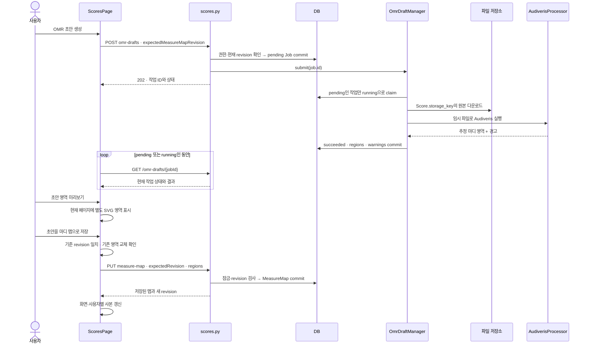

### 1단계. OMR 사용 조건을 확인하고 현재 revision으로 초안을 요청한다

**원본** [ScoresPage.tsx](../apps/web/src/pages/ScoresPage.tsx)의 OMR 패널과 `requestOmrDraft`

패널은 원격 악보가 선택돼 있고 MIME 형식이 PDF 또는 이미지일 때 표시한다. managed-local SSO 빌드에서는 다음 함수가 false여서 생성 UI 대신 수동 마디 매핑 안내를 표시한다.

```ts
export function omrDraftCreationAvailableInCurrentBuild(): boolean {
  return !managedLocalSsoModeEnabled();
}
```

이는 프론트의 빌드 모드 분기다. 별도로 서버의 `omr_enabled`도 켜져 있어야 한다. [환경변수 예시](../.env.example)의 `FMR_OMR_ENABLED`는 false이고, [운영 문서](OPERATIONS.md)도 OMR을 별도 활성화 조건으로 설명한다. 아래는 **OMR을 사용할 수 있도록 구성한 경우의 구현 경로**이며, 현재 운영 서버에서 Audiveris가 실행되는지 확인한 결과는 아니다.

생성 버튼은 요청 중·오프라인 사본·권한 없는 상태에서 비활성화한다. 클릭하면 다음 함수가 실행된다.

```ts
const requestOmrDraft = async () => {
  if (!selected || !remoteMode || usingOfflineCache || !canManageScores) return;
  const targetScore = selected;
  setOmrRequesting(true);
  setOmrPollingError(undefined);
  setShowOmrPreview(false);
  try {
    const created = await createOmrDraft(client, targetScore.id, measureMapRevision);
    if (activeScoreIdRef.current !== targetScore.id) return;
    setOmrDraft(created);
    notify({
      title: 'OMR 마디맵 초안 생성을 시작했습니다.',
      description: 'Audiveris가 악보를 분석하는 동안 이 화면을 계속 사용할 수 있습니다.',
      tone: 'info',
    });
```

`targetScore`는 요청 당시 악보이고 `measureMapRevision`은 현재 화면이 알고 있는 마디 맵 버전이다. 요청 중 표시를 켜고 이전 조회 오류와 미리보기를 정리한 뒤, 작업 응답을 `omrDraft` 상태에 넣는다. 기다리는 동안 다른 악보로 이동했다면 이전 응답으로 새 화면을 바꾸지 않는다.

API 함수는 파일을 다시 업로드하지 않는다.

```ts
export async function createOmrDraft(
  client: ApiClient,
  scoreId: string,
  expectedMeasureMapRevision: number,
): Promise<OmrDraft> {
  return client.post<OmrDraft>(`/scores/${segment(scoreId)}/omr-drafts`, {
    expectedMeasureMapRevision,
  });
}
```

이미 서버에 저장된 악보 ID와 `{ expectedMeasureMapRevision }`만 보낸다. 예를 들어 r4에서 시작하면 `{ "expectedMeasureMapRevision": 4 }`가 분석 초안의 기준이다. 실제 파일은 worker가 저장소에서 읽는다.

**확인할 질문:** OMR 버튼을 누를 때 브라우저가 PDF 전체를 다시 전송하는가? → 이 경로는 기존 scoreId와 기준 revision을 전송한다.

### 2단계. 서버가 입력과 revision을 확인하고 pending 작업을 저장한다

**원본** [routers/scores.py](../apps/server/app/routers/scores.py)의 `create_omr_draft`

`OmrDraftCreate`는 0 이상의 `expectedMeasureMapRevision`을 받는다. 서버는 다음 조건을 확인한다.

```python
score, _ = require_score(db, user, score_id, "leader")
if score.upload_status != "ready":
    raise HTTPException(status_code=409, detail="score upload is not complete")
if score.content_type != "application/pdf" and not score.content_type.startswith("image/"):
    raise HTTPException(status_code=415, detail="OMR supports PDF and image scores only")
if not request.app.state.settings.omr_enabled:
    raise HTTPException(status_code=503, detail="OMR is disabled on this server")

map_row = db.scalar(select(MeasureMap).where(MeasureMap.score_id == score_id))
actual_revision = map_row.revision if map_row else 0
if body.expected_measure_map_revision != actual_revision:
    raise HTTPException(
        status_code=409,
        detail={
            "message": "measure map revision changed before OMR started",
            "expectedRevision": body.expected_measure_map_revision,
            "actualRevision": actual_revision,
        },
    )
```

| 검사                                          | 실패 응답                      |
| --------------------------------------------- | ------------------------------ |
| leader 이상 권한                              | 권한 오류                      |
| 악보 업로드가 `ready`인지                     | 409                            |
| PDF 또는 이미지인지                           | 415                            |
| 서버 OMR 활성화 여부                          | 503                            |
| 요청 기준과 현재 MeasureMap revision이 같은지 | 409와 expected/actual revision |

맵이 없으면 현재 revision은 0이다. 조건이 맞으면 작업 행을 먼저 commit하고 ID를 큐에 넣는다.

```python
job = OmrDraftJob(
    score_id=score_id,
    requested_by_id=user.id,
    expected_measure_map_revision=actual_revision,
)
db.add(job)
db.commit()
db.refresh(job)
try:
    request.app.state.omr_drafts.submit(job.id)
except OmrProcessingError as exc:
    job.status = "failed"
    job.error = str(exc)[:500]
    db.commit()
    db.refresh(job)
return omr_draft_out(job)
```

`OmrDraftJob.status`의 모델 기본값은 `pending`이다. 기준 revision과 요청자도 DB에 남는다. 작업 ID를 큐에 넣기 전에 commit하므로 worker가 다른 DB Session에서 이 작업을 조회할 수 있다.

이 endpoint의 응답 코드는 **202 Accepted**다. 분석이 끝났다는 200 응답이 아니라 작업을 접수한 응답이다. `submit`에서 `OmrProcessingError`가 나면 이미 만든 작업을 `failed`로 기록하고 같은 작업 응답을 돌려주므로, 202만 보지 말고 응답의 `status`도 읽는다.

작업이 보관하는 필드다.

```python
class OmrDraftJob(TimestampMixin, Base):
    __tablename__ = "omr_draft_jobs"
    __table_args__ = (
        CheckConstraint(
            "status IN ('pending', 'running', 'succeeded', 'failed')",
            name="ck_omr_draft_jobs_status",
        ),
        Index("ix_omr_draft_jobs_score_created", "score_id", "created_at"),
    )

    id: Mapped[str] = mapped_column(String(36), primary_key=True, default=new_id)
    score_id: Mapped[str] = mapped_column(ForeignKey("scores.id", ondelete="CASCADE"), index=True)
    requested_by_id: Mapped[str] = mapped_column(ForeignKey("users.id", ondelete="RESTRICT"))
    expected_measure_map_revision: Mapped[int] = mapped_column(Integer)
    status: Mapped[str] = mapped_column(String(16), default="pending")
    regions: Mapped[list[dict[str, Any]]] = mapped_column(JSON, default=list)
    warnings: Mapped[list[str]] = mapped_column(JSON, default=list)
    error: Mapped[str | None] = mapped_column(String(500))
```

분석을 요청했다고 맵을 잠근 채 계속 기다리지 않는다. 다른 사용자는 그동안 맵을 수정할 수 있고, 결과가 준비됐을 때는 처음 기준이 이미 오래됐을 수 있다. 적용 단계의 검사가 필요한 이유다.

**확인할 질문:** Job에 기준 revision을 기록하면 다른 사람이 그동안 편집하지 못하는가? → 기준을 기록할 뿐 긴 분석 동안 MeasureMap을 잠그지 않는다.

### 3단계. 작업 ID를 큐에 넣고 worker가 비동기로 처리한다

**원본** [main.py](../apps/server/app/main.py) → [omr.py](../apps/server/app/omr.py)의 `OmrDraftManager`

앱은 `OmrDraftManager(database, storage, settings, processor)`를 만들고 시작 시 `start()`, 종료 시 `stop()`을 호출한다. manager 안에는 메모리 큐와 worker task 목록이 있다. **DB 작업 행이 남는 것과 메모리 큐가 유지되는 것은 별개**다.

`start()`는 DB에서 오래된 running 작업과 pending 작업을 먼저 확인한다.

```python
def start(self) -> None:
    if not self.settings.omr_enabled or self.tasks:
        return
    stale_before = datetime.now(UTC) - self._claim_duration()
    with self.database.session_factory() as db:
        db.execute(
            update(OmrDraftJob)
            .where(
                OmrDraftJob.status == "running",
                OmrDraftJob.updated_at <= stale_before,
            )
            .values(status="pending", error=None)
        )
        pending = db.scalars(
            select(OmrDraftJob.id).where(OmrDraftJob.status == "pending").order_by(OmrDraftJob.created_at)
        ).all()
        active = db.execute(
            select(OmrDraftJob.id, OmrDraftJob.updated_at).where(OmrDraftJob.status == "running")
        ).all()
        db.commit()
    for job_id in pending:
        self.queue.put_nowait(job_id)
    for job_id, updated_at in active:
        self._schedule_recovery(job_id, updated_at)
    self.tasks = [
        asyncio.create_task(self._worker(), name=f"omr-worker-{index + 1}")
        for index in range(self.settings.omr_worker_count)
    ]
```

기준 시간보다 오래된 running만 pending으로 되돌리고, pending ID를 큐에 넣는다. 아직 running인 작업은 즉시 되돌리지 않고 각 작업의 복구 시각을 예약한다. 재시작한 인스턴스가 다른 인스턴스에서 막 실행을 시작한 정상 작업을 곧바로 pending으로 바꾸지 않기 위한 순서다.

worker 수는 `omr_worker_count`이며 설정 기본값은 1, 허용 범위는 1–4다. 다음 함수가 실제 큐를 소비한다.

```python
async def _worker(self) -> None:
    while True:
        job_id = await self.queue.get()
        try:
            try:
                await asyncio.to_thread(self._process_job, job_id)
            except Exception:
                logger.exception("OMR worker could not update persistent job state")
                self._schedule_recovery(job_id, datetime.now(UTC))
                await asyncio.sleep(5)
                self.queue.put_nowait(job_id)
        finally:
            self.queue.task_done()
```

`asyncio.to_thread`가 동기 파일 처리·외부 프로그램 실행을 별도 스레드로 넘긴다. HTTP 요청을 처리하는 이벤트 루프에서 Audiveris가 끝날 때까지 직접 실행하는 구조가 아니다. 큐의 항목은 이미지 자체가 아니라 DB 작업 ID다.

동시 실행 수는 제한하지만 `asyncio.Queue()`에 `maxsize`를 지정하지 않는다. 따라서 이 코드를 “대기 작업 수까지 제한하는 큐”라고 설명하지 않는다. 정상 처리 결과와 예외 후 복구는 뒤의 6단계에서 나눈다.

**확인할 질문:** 서버가 재시작해 메모리 큐가 사라지면 모든 접수 작업도 사라지는가? → DB의 pending 작업을 시작 시 다시 읽어 큐에 넣는다.

### 4단계. worker가 pending 작업을 확보하고 최종 악보 파일을 가져온다

**원본** [omr.py](../apps/server/app/omr.py)의 `_process_job` → [storage.py](../apps/server/app/storage.py)의 `download_to`

먼저 해당 작업이 아직 pending일 때만 running으로 바꾸는 조건부 UPDATE를 수행한다. 이를 작업을 **claim한다**, 즉 자신이 처리할 대상으로 확보한다고 부른다.

```python
with self.database.session_factory() as db:
    claimed = db.execute(
        update(OmrDraftJob)
        .where(OmrDraftJob.id == job_id, OmrDraftJob.status == "pending")
        .values(status="running", error=None)
    )
    if getattr(claimed, "rowcount", 0) != 1:
        db.rollback()
        return
    job = db.get(OmrDraftJob, job_id)
    assert job is not None
    score = db.get(Score, job.score_id)
    if score is None or score.upload_status != "ready":
        job.status = "failed"
        job.error = "Score is missing or not ready"
        db.commit()
        return
    storage_key = score.storage_key
    filename = score.filename
    db.commit()
```

변경된 행 수가 1이 아니면 다른 worker가 이미 가져갔거나 작업이 더 이상 pending이 아니므로 반환한다. 같은 pending ID가 두 큐에 들어 있어도 그 pending 상태에서 한 번만 확보하도록 하는 조건이다.

악보가 사라졌거나 ready가 아니면 작업을 failed로 기록한다. 준비됐다면 `Score.storage_key`와 파일명을 읽고 running 상태를 commit한 뒤 DB Session을 닫는다. 분석 동안 같은 Session의 transaction을 열어 둔 채 기다리지 않는다.

이후 임시 디렉터리에서 파일을 처리한다.

```python
with tempfile.TemporaryDirectory(prefix="fmr-omr-") as temporary:
    root = Path(temporary)
    source = root / Path(filename).name
    output = root / "output"
    output.mkdir()
    self.storage.download_to(storage_key, source)
    result = self.processor.process(source, output)
```

여기의 `storage_key`는 업로드 실습에서 확정한 **final key**다. staging 파일이 아니다. 서버 로컬 저장소는 원본을 `shutil.copyfile`로 복사하고 S3 저장소는 `download_file`로 가져온다.

원본과 분석 출력은 `TemporaryDirectory` 안에 둔다. 코드 블록이 정상 종료하거나 예외로 빠져나갈 때 이 디렉터리도 정리된다. 결과의 마디 영역·경고는 Python 값으로 받아 다음 DB 저장에 사용한다. 원본 파일을 덮어쓰거나 분석 결과 MusicXML을 새 악보로 업로드하는 코드는 이 경로에 없다.

**확인할 질문:** 분석 worker는 브라우저가 아직 올리는 staging 파일을 읽는가? → API와 worker가 ready를 확인하고 final key의 원본을 사용한다.

### 5단계. Audiveris의 MusicXML을 읽어 정규화된 마디 영역을 계산한다

**원본** [omr.py](../apps/server/app/omr.py)의 `AudiverisProcessor.process`, `_measure_layouts`, `_regions_from_layouts`

외부 프로그램을 실행하는 부분이다.

```python
try:
    completed = subprocess.run(
        [*self.command, "-batch", "-export", "-output", str(output_dir), str(source)],
        check=False,
        capture_output=True,
        text=True,
        timeout=self.timeout_seconds,
    )
except FileNotFoundError as exc:
    raise OmrProcessingError("Audiveris executable is not installed on the server") from exc
except subprocess.TimeoutExpired as exc:
    raise OmrProcessingError("Audiveris recognition timed out") from exc
if completed.returncode != 0:
    raise OmrProcessingError(f"Audiveris recognition failed with exit code {completed.returncode}")
```

설정된 명령을 `shlex.split`으로 나누고 `-batch -export -output` 인수를 추가한다. shell 명령 문자열을 직접 실행하는 대신 인수 목록으로 넘긴다. timeout 기본값은 300초다. 실행 파일 없음·시간초과·0이 아닌 종료 코드는 각각 `OmrProcessingError`로 바꾼다.

출력 디렉터리에서 `.mxl`, `.musicxml`, 필요하면 `.xml` 후보를 찾아 첫 후보를 읽는다. 없으면 인식 실패다. MXL은 압축 안의 `META-INF/container.xml`을 따라 MusicXML을 읽고, 결과 XML에는 64MiB 크기 제한 검사가 있다.

마디의 페이지·단을 읽는 부분이다.

```python
page = 1
system = 0
layouts: list[tuple[int, int]] = []
for index, measure in enumerate(measures):
    print_node = next(
        (node for node in measure if _local_name(node.tag) == "print"),
        None,
    )
    if index > 0 and print_node is not None and print_node.attrib.get("new-page") == "yes":
        page += 1
        system = 0
    elif index > 0 and print_node is not None and print_node.attrib.get("new-system") == "yes":
        system += 1
    layouts.append((page, system))
return layouts
```

이 함수는 첫 번째 `<part>`의 마디를 문서 순서로 읽는다. `<print new-page="yes">`면 페이지를 증가시키고 단을 0으로 되돌린다. 새 단이면 같은 페이지의 단 번호를 증가시킨다. 결과는 `(페이지, 단)`의 목록이다.

그다음 영역 계산의 핵심이다.

```python
horizontal_margin = 0.05
horizontal_gap = 0.004
vertical_margin = 0.06
usable_width = 1 - horizontal_margin * 2
usable_height = 1 - vertical_margin * 2
for (page, system), measure_numbers in sorted(systems.items()):
    system_count = systems_per_page[page]
    system_slot = usable_height / system_count
    height = min(0.14, system_slot * 0.72)
    y = vertical_margin + system * system_slot + (system_slot - height) / 2
    width = (usable_width - horizontal_gap * (len(measure_numbers) - 1)) / len(measure_numbers)
    if width <= 0:
        raise OmrProcessingError("Audiveris system contains too many measures to map safely")
    for column, measure_number in enumerate(measure_numbers):
        x = horizontal_margin + column * (width + horizontal_gap)
```

가로 여백 0.05, 마디 간격 0.004, 세로 여백 0.06을 사용한다. 페이지의 단 수로 높이를 나누고, 같은 단에 있는 마디들은 같은 폭으로 나눈다. 최종 좌표는 소수점 여섯 자리로 반올림한다. 마디 번호는 MusicXML의 원래 `number` 문자열을 그대로 쓰지 않고, 읽은 순서대로 1부터 매긴다.

> **인식된 구분과 추정 좌표를 구분한다.** 페이지·단 구분은 Audiveris가 내보낸 MusicXML에서 가져오지만, 이 사각형은 원본 이미지에서 마디 테두리의 정확한 픽셀 좌표를 그대로 가져온 결과가 아니다. 이 코드가 여백·단 수·마디 수로 계산한 정규화 추정값이다.

processor는 그 점을 알리는 경고와 함께 결과를 반환한다.

```python
layouts = _measure_layouts(_read_musicxml(candidates[0]))
return OmrDraftResult(
    regions=_regions_from_layouts(layouts),
    warnings=[
        "OMR은 보조용 초안입니다. 저장하기 전에 모든 마디를 확인하세요.",
        "단·페이지 구분은 Audiveris 결과이며 마디 사각형 좌표는 정규화된 추정값입니다.",
    ],
)
```

**확인할 질문:** OMR이 성공했다면 모든 마디 사각형이 원본과 정확히 일치하는가? → 성공은 초안 생성 완료이며, 좌표 계산 방식 때문에 사용자의 확인·수정이 필요하다.

### 6단계. 분석 결과를 작업 행에 저장하고 중단된 작업을 복구한다

**원본** [omr.py](../apps/server/app/omr.py)의 `_process_job`, `_recover_running_job`

분석이 끝나면 새 DB Session에서 작업 행을 다시 조회한다.

```python
with self.database.session_factory() as db:
    job = db.get(OmrDraftJob, job_id)
    if job is None:
        return
    job.status = "succeeded"
    job.regions = result.regions
    job.warnings = result.warnings
    job.error = None
    db.commit()
```

`regions`, `warnings`와 succeeded를 commit한다. 이 함수에는 `MeasureMap`을 생성·갱신하는 코드가 없다. 파일 분석을 마치는 동안 악보가 삭제돼 작업 행도 없어졌다면 결과를 저장하지 않고 반환한다.

파일 다운로드나 processor 실행에서 예외가 발생하면 다음 경로다.

```python
except Exception as exc:
    message = (
        str(exc).strip()
        if isinstance(exc, OmrProcessingError)
        else "OMR processing failed while reading the score or object storage"
    )
    with self.database.session_factory() as db:
        job = db.get(OmrDraftJob, job_id)
        if job is not None:
            job.status = "failed"
            job.error = message[:500]
            db.commit()
    return
```

알려진 `OmrProcessingError`는 설명 가능한 메시지를, 그 밖의 예외는 원본·저장소 처리 실패라는 일반 메시지를 사용한다. 오류는 500자까지 저장하고 작업을 failed로 끝낸다. 이 failed 작업을 정상 worker 루프가 자동으로 무한 재분석하는 코드는 없다. 화면의 `다시 생성`은 뒤에서 새 POST를 보내 새 작업을 만든다.

DB 작업 상태 갱신 자체에서 예상하지 못한 예외가 빠져나오면 3단계의 worker가 로그를 남기고 복구를 예약한다. 5초 뒤 작업 ID도 다시 큐에 넣지만, 아직 running이면 즉시 재claim하지 않는다. 오래된 running을 pending으로 되돌리는 별도 조건이 필요하다.

복구 기준 시간은 다음과 같다.

```python
def _claim_duration(self) -> timedelta:
    # Audiveris is bounded by omr_timeout_seconds. The extra minute covers
    # object download and persistent result writes during rolling startup.
    return timedelta(seconds=self.settings.omr_timeout_seconds + 60)
```

기본 timeout 300초에 60초를 더한 **360초**다. 시작 시 남아 있던 running 작업과 worker 예외 후 예약한 작업은 그 기준 이후에 다음 조건으로 복구한다.

```python
async def _recover_running_job(self, job_id: str, delay_seconds: float) -> None:
    await asyncio.sleep(delay_seconds)
    stale_before = datetime.now(UTC) - self._claim_duration()
    with self.database.session_factory() as db:
        result = db.execute(
            update(OmrDraftJob)
            .where(
                OmrDraftJob.id == job_id,
                OmrDraftJob.status == "running",
                OmrDraftJob.updated_at <= stale_before,
            )
            .values(status="pending", error=None)
        )
        recovered = getattr(result, "rowcount", 0) == 1
        db.commit()
    if recovered:
        self.queue.put_nowait(job_id)
```

DB 행이 여전히 running이고 `updated_at`이 충분히 오래됐을 때만 pending으로 바꿔 다시 큐에 넣는다. 새 인스턴스가 시작됐다는 이유만으로 모든 running 작업을 즉시 되돌리지 않는다.

다만 이 기준은 `updated_at`과 경과 시간이다. 장시간 다운로드 중 주기적으로 갱신하는 heartbeat나 worker 소유 세대 번호를 사용하는 코드는 여기에 없다. `300초 timeout`도 Audiveris subprocess에 전달하는 값이지 파일 다운로드부터 DB 결과 저장까지 모두 합친 강제 제한은 아니다. 따라서 이 코드를 모든 장애에서 작업이 정확히 한 번만 실행되는 분산 작업 시스템으로 확대해 설명하지 않는다.

| Job 상태  | 뜻                                | 이번 작업이 MeasureMap을 바꾸는가 |
| --------- | --------------------------------- | --------------------------------- |
| pending   | DB에 접수됐고 worker 대기 중      | 아니오                            |
| running   | worker가 확보하고 분석 중         | 아니오                            |
| succeeded | 영역·경고가 DB에 준비됨           | 아니오                            |
| failed    | 분석 또는 작업 제출 실패가 기록됨 | 아니오                            |

**확인할 질문:** succeeded를 기록할 때 기존 수동 마디 맵도 함께 교체되는가? → worker는 Job 결과만 저장하며 실제 교체는 별도 사용자 요청이다.

### 7단계. 화면이 작업 상태를 반복 조회하고 조회 실패를 구분한다

**원본** [ScoresPage.tsx](../apps/web/src/pages/ScoresPage.tsx)의 OMR polling effect → [scoreApi.ts](../apps/web/src/lib/scoreApi.ts)의 `getOmrDraft`

polling은 일정 간격으로 서버에 현재 상태를 묻는 방식이다. 이 OMR 경로는 앞 필기 실습의 WebSocket 이벤트를 쓰지 않는다.

```ts
useEffect(() => {
  const jobId = omrDraft?.id;
  const scoreAtStart = omrDraft?.scoreId;
  if (!jobId || !scoreAtStart || !['pending', 'running'].includes(omrDraft.status)) return;
  let active = true;
  let timer: number | undefined;
  const poll = async () => {
    try {
      const next = await getOmrDraft(client, jobId);
      if (!active || activeScoreIdRef.current !== scoreAtStart) return;
      setOmrDraft(next);
      setOmrPollingError(undefined);
      if (next.status === 'pending' || next.status === 'running') {
        timer = window.setTimeout(() => void poll(), 1_000);
      }
    } catch (error) {
      if (!active || activeScoreIdRef.current !== scoreAtStart) return;
      setOmrPollingError(error instanceof Error ? error.message : String(error));
    }
  };
  timer = window.setTimeout(() => void poll(), 500);
  return () => {
    active = false;
    if (timer !== undefined) window.clearTimeout(timer);
  };
}, [client, omrDraft?.id, omrDraft?.scoreId, omrDraft?.status]);
```

effect가 시작되면 500ms 뒤 첫 GET을 예약한다. 응답이 여전히 pending/running이면 응답 처리 후 1초 뒤 다음 GET을 예약한다. 상태가 바뀌면 의존성에 따라 effect가 정리·재시작될 수 있으므로 정확한 고정 주기의 타이머로 해석하지 않는다. succeeded/failed에 도달하면 반복할 조건이 끝난다.

조회 API는 Job을 읽고 그 악보의 접근 권한을 검사한다.

```python
@router.get("/omr-drafts/{job_id}", response_model=OmrDraftOut)
def get_omr_draft(job_id: str, db: DbSession, user: CurrentUser) -> OmrDraftOut:
    job = db.get(OmrDraftJob, job_id)
    if job is None:
        raise HTTPException(status_code=404, detail="OMR draft not found")
    require_score(db, user, job.score_id)
    return omr_draft_out(job)
```

생성은 leader 이상이지만 조회는 해당 악보에 접근 가능한 member도 할 수 있다. Job이 없으면 404다. 서버 작업을 다시 실행하는 GET이 아니라 현재 DB 상태를 읽는 GET이다.

HTTP 조회가 실패하면 `omrPollingError`를 표시하고 그 catch에서는 다음 타이머를 예약하지 않는다. 이것을 Job의 failed 상태로 바꾸지는 않는다. 서버는 계속 분석 중이거나 이미 완료했을 수 있다. 화면은 `상태 다시 확인` 버튼을 제공한다.

```ts
const refreshOmrDraft = async () => {
  if (!omrDraft || activeScoreIdRef.current !== omrDraft.scoreId) return;
  try {
    const next = await getOmrDraft(client, omrDraft.id);
    if (activeScoreIdRef.current !== next.scoreId) return;
    setOmrDraft(next);
    setOmrPollingError(undefined);
  } catch (error) {
    setOmrPollingError(error instanceof Error ? error.message : String(error));
  }
};
```

이 버튼은 **GET 한 번**이다. 자동 조회가 오류로 멈춘 뒤 수동 조회 결과의 ID·scoreId·status가 이전과 같으면 effect의 의존성이 바뀌지 않으므로, 그 호출만으로 반복 polling이 반드시 재시작되는 것은 아니다. 다시 상태 확인이 필요할 수 있다. 상태가 바뀌면 effect 조건을 다시 평가한다.

악보 이동 시 effect는 타이머를 지우고 이전 응답을 반영하지 않는다. 이 동작이 서버 Job을 취소하지는 않는다. 또한 악보 로딩 경로는 `setOmrDraft(undefined)`로 화면 Job 상태를 초기화하므로, **Job의 DB 영속성과 새로 연 화면이 이전 Job ID를 자동 복원한다는 보장은 다르다.** 이 페이지에는 이전 작업 목록에서 마지막 Job을 자동 선택하는 경로가 없다.

**확인할 질문:** 상태 조회에서 네트워크 오류가 났다면 Audiveris도 실패한 것인가? → 조회 실패와 서버 작업 상태는 별개다.

### 8단계. 분석 결과를 초안 영역으로 겹쳐 보여 준다

**원본** [ScoresPage.tsx](../apps/web/src/pages/ScoresPage.tsx)의 성공 결과 패널, `visibleOmrRegions`

succeeded 결과에는 영역 수와 경고를 표시한다. 미리보기 버튼과 저장 버튼은 따로 있다.

```tsx
<Button
  aria-pressed={showOmrPreview}
  onClick={() => setShowOmrPreview((current) => !current)}
>
  {showOmrPreview ? '초안 미리보기 닫기' : '초안 영역 미리보기'}
</Button>
<Button
  variant="primary"
  disabled={usingOfflineCache || !canManageScores}
  onClick={() => void applyOmrDraft()}
>
  초안을 마디 맵으로 저장
</Button>
```

미리보기를 켜면 다음 조건으로 현재 페이지의 영역을 고른다.

```ts
const visibleOmrRegions =
  showOmrPreview && omrDraft?.status === 'succeeded' && omrDraft.scoreId === selected?.id
    ? omrDraft.regions.filter((region) => region.page === page)
    : [];
```

기존 마디 맵의 영역 목록과 별개의 `visibleOmrRegions`를 사용한다. 악보 위의 SVG에는 별도 클래스의 사각형을 그린다.

```tsx
{visibleOmrRegions.map((region, index) => (
  <rect
    key={`omr:${omrDraft?.id}:${index}`}
    className="measure-region measure-region--omr-draft"
    x={region.rect.x}
    y={region.rect.y}
    width={region.rect.w}
    height={region.rect.h}
  >
    <title>OMR 초안 {region.measureNumber}마디</title>
  </rect>
))}
```

이 시점에는 DB의 MeasureMap도, 화면의 확정 `measureMap` 상태도 교체하지 않는다. 같은 원본 위에서 현재 매핑과 초안을 대조할 수 있다. 다른 페이지의 결과는 그 페이지로 이동했을 때 표시한다.

미리보기는 확인을 돕는 조작이지만 코드가 `showOmrPreview=true`였음을 저장의 필수 조건으로 검사하지는 않는다. 실제 적용의 조건은 다음 단계의 작업 성공·대상 악보·기준 revision과 기존 영역 교체 확인이다.

**확인할 질문:** 초안 사각형이 보이면 이미 마디 이동에 사용하는 맵이 바뀐 것인가? → 미리보기는 별도 overlay이며 확정 맵 저장과 분리돼 있다.

### 9단계. applyOmrDraft가 기준 revision과 교체 의사를 확인한다

**원본** [ScoresPage.tsx](../apps/web/src/pages/ScoresPage.tsx)의 `applyOmrDraft`

먼저 결과와 적용 대상이 맞는지 확인한다.

```ts
const applyOmrDraft = async () => {
  if (!selected || !omrDraft || omrDraft.status !== 'succeeded') return;
  const targetScore = selected;
  if (omrDraft.scoreId !== targetScore.id) return;
  if (omrDraft.expectedMeasureMapRevision !== measureMapRevision) {
    notify({
      title: 'OMR 초안의 기준 revision이 오래되었습니다.',
      description: '현재 마디 맵에 맞춰 OMR 초안을 다시 생성해 주세요.',
      tone: 'danger',
    });
    return;
  }
```

처음 분석을 요청한 기준과 현재 화면의 맵 revision이 다르면 HTTP 저장 요청을 보내지 않고 초안을 다시 생성하라고 알린다. 이 확인은 브라우저가 알고 있는 revision끼리의 비교다. 서버가 더 최신일 수 있으므로 다음 단계의 서버 검사도 필요하다.

성공한 Job을 로컬 맵 모양으로 바꾸는 함수다.

```ts
export function measureMapFromOmrDraft(draft: OmrDraft): LocalMeasureMap {
  if (draft.status !== 'succeeded') {
    throw new Error('완료되지 않은 OMR 작업은 마디 맵으로 바꿀 수 없습니다.');
  }
  return {
    scoreId: draft.scoreId,
    measureNumberOffset: 0,
    regions: draft.regions.map((region, index) => ({
      id: `${draft.id}:${index}`,
      ...region,
    })),
    updatedAt: draft.updatedAt,
  };
}
```

영역에 화면용 `jobId:index` ID를 붙이고, 성공하지 않은 작업은 거부한다. 기본 오프셋은 0이지만 실제 적용 함수가 바로 다음 코드에서 기존 값을 반영한다.

```ts
const replacement = measureMapFromOmrDraft(omrDraft);
replacement.measureNumberOffset = measureMap?.measureNumberOffset ?? measureNumberOffset;
if (
  measureMap?.regions.length &&
  !window.confirm(
    `현재 ${measureMap.regions.length}개 마디 영역을 OMR 초안 ${replacement.regions.length}개로 교체할까요?`,
  )
) {
  return;
}
```

기존 맵이 있으면 그 맵의 오프셋을 유지하고, 없으면 화면의 오프셋 값을 사용한다. OMR이 1부터 매긴 영역 번호와 곡의 공통 번호를 연결하는 보정값이다.

기존 `measureMap.regions`가 비어 있지 않을 때만 교체 확인창을 띄운다. 취소하면 저장 요청을 보내지 않는다. 적용은 기존 영역에 새 영역을 추가하는 병합이 아니라 **영역 목록 전체를 초안으로 교체**하는 동작이다.

**확인할 질문:** OMR 초안의 오프셋 기본값 0 때문에 기존 곡의 번호 보정도 항상 0으로 바뀌는가? → 실제 적용에서 기존 맵의 오프셋을 다시 넣는다.

### 10단계. 서버가 현재 revision을 다시 검사하고 MeasureMap을 저장한다

**원본** [scoreApi.ts](../apps/web/src/lib/scoreApi.ts)의 `putMeasureMap` → [routers/scores.py](../apps/server/app/routers/scores.py)의 `put_measure_map`

`applyOmrDraft`는 `putRemoteMeasureMap(client, replacement, measureMapRevision)`을 호출한다. 여기서 `putRemoteMeasureMap`은 다음 함수의 import 별칭이다.

```ts
export async function putMeasureMap(
  client: ApiClient,
  map: LocalMeasureMap,
  expectedRevision: number,
): Promise<VersionedMeasureMap> {
  const record = await client.put<MeasureMapRecord>(`/scores/${segment(map.scoreId)}/measure-map`, {
    expectedRevision,
    regions: map.regions.map(({ page, measureNumber, rect }) => ({ page, measureNumber, rect })),
    measureNumberOffset: map.measureNumberOffset,
  });
  return measureMapFromRecord(record);
}
```

요청에 쓰는 값은 현재 `measureMapRevision`이다. 앞 단계에서 Job의 `expectedMeasureMapRevision`과 같음을 확인했으므로, 그 클릭의 요청은 Job이 시작한 기준 버전으로 저장을 시도한다. 화면용 영역 ID와 Job ID는 본문에 보내지 않는다.

서버는 실습 06에서 본 부모 Score 잠금 함수를 사용하고, 현재 맵을 잠가 revision을 다시 검사한다.

```python
_lock_score_for_measure_map(db, user, score_id)
row = db.scalar(select(MeasureMap).where(MeasureMap.score_id == score_id).with_for_update())
actual = row.revision if row else 0
if body.expected_revision != actual:
    raise HTTPException(
        status_code=409,
        detail={
            "message": "measure map revision conflict",
            "expectedRevision": body.expected_revision,
            "actualRevision": actual,
        },
    )
```

기대값과 다르면 409다. 같으면 처음 맵은 r1로 만들고 기존 맵은 revision을 증가시켜 영역·오프셋·수정자를 저장한다.

```python
regions = [region.model_dump(by_alias=True) for region in body.regions]
if row is None:
    created = True
    row = MeasureMap(
        score_id=score_id,
        revision=1,
        regions=regions,
        measure_number_offset=body.measure_number_offset,
        updated_by_id=user.id,
    )
    db.add(row)
else:
    created = False
    row.revision += 1
    row.regions = regions
    row.measure_number_offset = body.measure_number_offset
    row.updated_by_id = user.id
_commit_measure_map_write(db, score_id, body.expected_revision, created=created)
db.refresh(row)
return measure_map_out(row)
```

`_commit_measure_map_write`는 commit을 수행하고 최초 생성의 제약 오류에서는 rollback 후 409로 바꾼다. 이 부분의 원자적 저장·최초 생성 경합 처리는 [실습 06](#실습-06-악보-정보와-마디-맵의-원자적-저장)과 연결된다. 이번 PUT은 MeasureMap을 저장하며 Score의 종류·악기를 함께 수정하는 `/settings` 요청은 아니다.

성공 응답 뒤의 화면 처리다.

```ts
const saved = await putRemoteMeasureMap(client, replacement, measureMapRevision);
await updateOfflineCopy(localDb.putMeasureMap(saved.map, remoteCacheScope), 'OMR 마디 맵');
if (activeScoreIdRef.current !== targetScore.id) return;
setMeasureMap(saved.map);
setMeasureMapRevision(saved.revision);
setMeasureNumberOffset(saved.map.measureNumberOffset);
setFirstMeasure(nextMeasureNumber(saved.map));
setShowOmrPreview(false);
notify({
  title: 'OMR 초안을 마디 맵으로 저장했습니다.',
  description: '자동 인식 결과를 실제 악보와 대조해 각 영역을 확인해 주세요.',
  tone: 'success',
});
```

사용자별 IndexedDB 사본을 갱신한 뒤 확정 맵, 새 revision, 오프셋, 다음 매핑 번호를 반영하고 미리보기를 닫는다. 사본 실패는 `updateOfflineCopy`가 별도 안내하므로 이미 성공한 서버 저장을 rollback하지 않는다.

Job 행의 상태를 `applied`로 바꾸거나 삭제하는 호출은 없다. Job은 succeeded로 남고, 화면도 Job 자체를 지우지 않는다. 따라서 r4 초안을 r5 맵으로 저장한 뒤 같은 초안을 다시 적용하려 하면 그 초안의 기준 r4와 현재 r5가 달라 앞 단계에서 거부된다.

적용 중 409를 받으면 다음 catch로 들어간다.

```ts
} catch (error) {
    if (activeScoreIdRef.current !== targetScore.id) return;
    if (error instanceof ApiError && error.status === 409) {
      try {
        await refreshScoreSettingsAfterConflict(targetScore);
      } catch {
        // Keep the conflict message below even when refreshing also fails.
      }
    }
    notify({
      title: 'OMR 초안을 저장하지 못했습니다.',
      description: error instanceof Error ? error.message : String(error),
      tone: 'danger',
    });
  }
};
```

최신 악보·마디 맵을 다시 읽으려 시도하고 원래 저장 오류를 알린다. 여기서는 최신 조회마저 실패해도 그 예외를 별도로 알리기보다 원래 충돌 메시지를 유지한다. `requestOmrDraft`의 409 catch도 같은 방식을 사용한다. 자동으로 새 revision을 끼워 넣어 재저장하거나 OMR을 다시 실행하지 않는다.

이 저장 API는 일반적인 MeasureMap PUT이다. Job ID나 Job의 succeeded 상태를 서버에 보내 검증하는 전용 적용 API가 아니며, **Job의 기준과 화면 revision을 연결하는 검사는 프론트가, 현재 DB revision과의 충돌 검사는 서버가 담당**한다.

**확인할 질문:** 버튼을 누르기 직전까지 revision이 같았어도 서버가 거부할 수 있는가? → 브라우저 검사 뒤 다른 사용자가 저장했다면 서버 검사에서 409가 된다.

### 숫자로 따라가기. 인식된 네 마디가 초안 사각형이 되는 과정

아래는 [test_omr.py](../apps/server/tests/test_omr.py)의 페이지·단 구분 예시를 실제 계산식에 대입한 값이다. 실제 PDF를 Audiveris로 인식한 좌표가 아니라 **현재 알고리즘의 계산 예시**다.

```text
1마디: 첫 페이지·첫 단
2마디: 같은 단
3마디: new-system → 첫 페이지·둘째 단
4마디: new-page → 둘째 페이지·첫 단

layouts = [(1, 0), (1, 0), (1, 1), (2, 0)]
```

첫 페이지의 단 수는 2개다. 사용 가능한 세로 길이는 `1 − 0.06 × 2 = 0.88`이고, 단마다 `0.88 ÷ 2 = 0.44`를 배정한다. 사각형 높이는 `min(0.14, 0.44 × 0.72) = 0.14`다.

첫 단에는 두 마디가 있으므로 각 폭은 `(0.9 − 0.004) ÷ 2 = 0.448`이다. 두 번째 마디의 x는 `0.05 + 0.448 + 0.004 = 0.502`가 된다.

| 초안 마디 | 페이지 | x     | y     | w     | h     |
| --------- | ------ | ----- | ----- | ----- | ----- |
| 1         | 1      | 0.050 | 0.210 | 0.448 | 0.140 |
| 2         | 1      | 0.502 | 0.210 | 0.448 | 0.140 |
| 3         | 1      | 0.050 | 0.650 | 0.900 | 0.140 |
| 4         | 2      | 0.050 | 0.430 | 0.900 | 0.140 |

실제 악보에서 첫 마디가 훨씬 넓거나 단의 위아래 여백이 다르면 이 사각형과 어긋날 수 있다. 인식 성공과 정확한 마디 테두리 검출을 같은 뜻으로 쓰면 안 되는 이유가 숫자에서도 드러난다. 적용 후에는 기존 수동 마디 매핑 도구로 필요한 부분을 확인·수정한다.

### 세 번의 revision 확인으로 분석 중 편집을 구분하기

세 검사에서 비교하는 대상이 조금씩 다르다.

| 시점                | 비교하는 값                                               | 일치하지 않을 때          |
| ------------------- | --------------------------------------------------------- | ------------------------- |
| 작업 생성 POST      | 요청 `expectedMeasureMapRevision` ↔ DB의 현재 맵 revision | Job을 만들기 전 409       |
| 사용자가 적용 클릭  | Job의 기준 revision ↔ 화면의 `measureMapRevision`         | PUT 없이 초안 재생성 안내 |
| MeasureMap 저장 PUT | 요청 `expectedRevision` ↔ 잠근 DB 맵의 현재 revision      | 기존 맵을 바꾸기 전 409   |

다음은 r4에서 시작한 **설명용 시나리오**다.

| 순서 | 화면과 작업                                        | DB의 확정 맵 |
| ---- | -------------------------------------------------- | ------------ |
| 1    | 화면이 r4를 읽고 초안 요청                         | r4           |
| 2    | Job은 기준 r4를 기록하고 running                   | r4           |
| 3    | 다른 리더가 수동으로 마디 맵을 수정                | r5           |
| 4    | OMR이 끝나 Job은 succeeded, 기준은 여전히 r4       | r5           |
| 5-A  | 화면도 이미 r5를 읽었다면 적용 전 비교에서 거부    | r5 유지      |
| 5-B  | 화면은 아직 r4라면 PUT을 보낼 수 있지만 서버가 409 | r5 유지      |
| 6    | 최신 상태를 확인하고 새 초안을 기준 r5로 요청      | r5           |
| 7    | 사이에 추가 수정이 없고 사용자가 적용              | r6으로 저장  |

worker는 분석 완료 시 현재 MeasureMap revision이 바뀌었다는 이유로 Job을 자동 failed로 만들지 않는다. 그래서 **succeeded이면서 적용에는 오래된 초안**이 될 수 있다.

처음 맵을 만드는 경우에는 기준 0으로 Job을 만들고 적용이 성공하면 맵 r1이 된다. 이미 적용한 Job의 기준은 자동으로 r1로 갱신되지 않는다.

### OMR의 실패를 요청·분석·조회·적용으로 나누어 읽기

| 실패 위치·상황                                   | 남는 상태                                          | 실제 처리와 다시 할 동작                                             |
| ------------------------------------------------ | -------------------------------------------------- | -------------------------------------------------------------------- |
| UI의 사용 조건 불충족                            | Job 생성 요청 전                                   | 해당 빌드·형식·권한·오프라인 조건에 따라 생성 제한                   |
| 생성 API에서 권한·형식·활성화·revision 검사 실패 | 새 Job commit 전                                   | 생성 실패 알림. 409는 최신 악보 설정 조회도 시도                     |
| Job commit 뒤 submit의 `OmrProcessingError`      | failed Job                                         | 202 응답 본문의 status·error로 실패 확인                             |
| 실행 파일 없음·timeout·실패 exit code·출력 없음  | failed Job                                         | worker가 오류를 기록. 화면의 `다시 생성`은 새 POST·새 Job            |
| 저장소 다운로드·분석 데이터 처리 예외            | failed Job                                         | 알려진 OMR 메시지 또는 일반 저장소 처리 오류 저장                    |
| DB 상태 갱신 중 예외가 worker 밖으로 전파        | pending/running 등이 남을 수 있음                  | worker가 복구 예약·재queue. DB가 계속 불가하면 완료를 보장할 수 없음 |
| 서버 재시작 때 오래된 running 발견               | 조건부로 pending 복구                              | timeout+60초 기준을 충족한 작업만 재queue                            |
| 상태 GET 실패                                    | 화면은 마지막으로 받은 상태, DB는 별도로 진행 가능 | polling 오류 표시, `상태 다시 확인`으로 기존 Job GET                 |
| 현재 Job의 분석 실패                             | status failed와 error                              | `다시 생성`으로 새 분석 요청. 상태 GET 재시도와 다름                 |
| 기존 영역 교체 확인 취소                         | Job 결과와 기존 맵 유지                            | PUT 없음                                                             |
| 적용 전 Job 기준과 화면 revision 불일치          | succeeded 초안, 기존 맵 유지                       | 요청 없이 재생성 안내                                                |
| 적용 PUT에서 DB revision 불일치                  | 기존 맵 유지                                       | 409, 최신 설정 조회 시도 후 저장 실패 알림                           |
| 적용 성공 뒤 사본 갱신 실패                      | 서버 맵은 새 revision으로 확정                     | 사본 실패 안내, 서버 응답으로 화면 갱신                              |
| 다른 악보로 이동·화면 재로딩                     | DB Job은 남고 실행이 계속될 수 있음                | 이전 응답의 화면 반영을 중단. 이전 Job ID 자동 복원·취소와는 다름    |

`분석 다시 생성`, `작업 상태 다시 확인`, `초안 적용`은 각각 **새 Job POST**, **기존 Job GET**, **MeasureMap PUT**이다. 실패 안내를 읽을 때 어느 요청이 실패했는지 먼저 구분한다.

현재의 운영·복구 경계도 함께 본다. worker 수 제한은 큐 길이 제한이 아니고, Job 영속성은 브라우저의 작업 선택 복원과 다르다. `stop()`은 asyncio task를 취소하는 코드이므로 이를 이미 실행 중인 `to_thread` 작업이나 외부 프로세스를 즉시 강제 종료하는 별도 취소 API로 설명하지 않는다. 이번 문서에서는 그런 장애 상황의 실험이나 실제 서버 설정 변경을 수행하지 않았다.

### OMR 초안의 리뷰 포인트와 테스트

아래는 **현재 테스트 코드에서 확인할 수 있는 범위**다. 이번 작업에서 테스트 suite, 실제 Audiveris, PDF 인식, 서버 DB 작업은 실행하지 않았다. 문서의 좌표 예시 계산과 소스 대조를 별도로 검증한다.

| 읽을 테스트                                                                       | 찾아볼 이름·행동                                                                      | 확인할 범위                                                                      |
| --------------------------------------------------------------------------------- | ------------------------------------------------------------------------------------- | -------------------------------------------------------------------------------- |
| [scoreApi.test.ts](../apps/web/src/lib/scoreApi.test.ts)                          | `starts an OMR job with the current map revision and converts only a completed draft` | 요청의 기준 revision, succeeded 결과 변환, 미완료 결과 거부                      |
| [test_omr.py](../apps/server/tests/test_omr.py)                                   | `test_omr_job_is_persistent_permission_checked_and_revision_guarded`                  | 작업 생성 권한, DB 상태 조회, 기준 revision 유지, 맵 적용 뒤 오래된 새 요청 거부 |
| [같은 서버 테스트](../apps/server/tests/test_omr.py)                              | `test_musicxml_system_breaks_become_normalized_page_regions`                          | 페이지·단 구분과 0–1 영역 계산                                                   |
| [e2e/scores.spec.ts](../e2e/scores.spec.ts)                                       | `previews a persistent Audiveris draft and saves it with its pinned map revision`     | HTTP 응답을 모의한 UI에서 요청·미리보기·기준 revision으로 저장                   |
| [ScoresPage.test.ts](../apps/web/src/pages/ScoresPage.test.ts)                    | `OMR build availability`                                                              | managed-local SSO 빌드의 생성 UI 제한                                            |
| [test_scores_logs_musicxml.py](../apps/server/tests/test_scores_logs_musicxml.py) | 최초 맵 INSERT 제약 오류와 rollback 검사                                              | 최종 MeasureMap PUT이 사용하는 공통 commit helper의 실패 처리                    |

프론트 테스트는 r4를 요청에 넣고, 완료된 결과에 화면용 ID를 붙이는지 검사한다.

```ts
await expect(createOmrDraft(client(), score.id, 4)).resolves.toEqual(draft);
expect(fetchMock.mock.calls[0]?.[1]?.body).toBe(
  JSON.stringify({ expectedMeasureMapRevision: 4 }),
);
expect(measureMapFromOmrDraft(draft)).toEqual({
  scoreId: score.id,
  measureNumberOffset: 0,
  regions: [{ id: 'omr-1:0', ...draft.regions[0]! }],
  updatedAt: draft.updatedAt,
```

서버 테스트는 실제 Audiveris 대신 `FakeOmrProcessor`를 주입한다. 정상 생성 응답을 받은 뒤 조회한 결과를 확인하는 부분이다.

```python
assert created.status_code == 202, created.text
finished = _wait_for_job(client, created.json()["id"], member_token)
assert finished["status"] == "succeeded"
assert finished["expectedMeasureMapRevision"] == 0
assert [region["measureNumber"] for region in finished["regions"]] == [1, 2]
assert finished["warnings"] == ["best effort"]
```

이 테스트는 member의 생성 요청은 403이지만 Job 조회는 가능한 것도 확인한다. 이어서 결과를 MeasureMap으로 저장해 r1을 만들고, 다시 기준 0으로 OMR을 요청하면 409와 actualRevision 1인지 확인한다. 실제 악보 인식 정확도·외부 실행 파일 설치·timeout·재시작 복구를 검증한 테스트로 확대하지 않는다.

브라우저 테스트는 생성·조회·저장 API를 `route.fulfill`로 대체한다. UI의 마지막 조작과 요청 확인 부분이다.

```ts
await page.getByRole('button', { name: 'OMR 초안 생성' }).click();
await expect(page.getByText('2개 마디 영역을 인식했습니다.')).toBeVisible();
await page.getByRole('button', { name: '초안 영역 미리보기' }).click();
await expect(page.locator('.measure-region--omr-draft')).toHaveCount(2);
await page.getByRole('button', { name: '초안을 마디 맵으로 저장' }).click();
await expect(page.getByText(/2마디 매핑됨/)).toBeVisible();
expect(savedBody).toMatchObject({ expectedRevision: 0, regions });
```

별도 초안 사각형이 두 개 표시되고 저장 본문에 `expectedRevision: 0`과 결과 영역이 들어가는지 확인한다. 이 예시에서 서버가 실제 Audiveris를 실행했다는 뜻은 아니다.

직접 리뷰하며 다음 질문에 답을 적어본다.

- [ ] 이 빌드와 서버에서 OMR 버튼을 사용할 수 있는 조건은 각각 무엇인가?
- [ ] 202와 Job의 succeeded, MeasureMap 저장 성공은 어떻게 다른가?
- [ ] 작업의 기준 revision은 실제 분석 입력인가, 적용 시 충돌 검사 기준인가?
- [ ] Job ID를 큐에 넣기 전에 DB commit을 하는 이유는 무엇인가?
- [ ] 여러 worker가 같은 pending ID를 가져왔을 때 어느 SQL 조건으로 확보를 구분하는가?
- [ ] 서버는 staging과 final 중 어느 원본을 읽고 임시 출력은 어디에 두는가?
- [ ] Audiveris에서 가져온 정보와 앱이 추정하는 사각형 좌표는 무엇이 다른가?
- [ ] 분석 실패와 상태 GET 실패에서 누르는 재시도 버튼은 각각 어떤 요청을 보내는가?
- [ ] 미리보기만 켰을 때 기존 맵이 바뀌는가? 미리보기 버튼 클릭이 저장의 필수 조건인가?
- [ ] 적용할 때 기존 영역·오프셋은 각각 어떻게 처리되는가?
- [ ] 분석 중 다른 사용자가 맵을 바꾸면 어느 검사에서 적용이 거부되는가?
- [ ] 서버 Job이 남아 있다는 사실과 화면 재로딩 후 자동 추적 복원은 같은 보장인가?

**연결해서 읽기:** [실습 09](#실습-09-수동-마디-매핑과-편집-초안-연결)에서 `finishSystem`과 수동 마디 영역 추가를 따라간다. OMR 초안과 같은 정규화 좌표·MeasureMap revision 계약을 사용한다.

---

## 실습 09. 수동 마디 매핑과 편집 초안 연결

> **읽기 목표:** 화면에서 그은 사각형이 어떻게 `MeasureMap`이 되는지, MusicXML·JSON에서 가져온 초안이 언제 실제 저장으로 이어지는지 구분한다.

| 먼저 구분할 데이터                      | 담는 내용                                 | 만들어지는 경로                           |
| --------------------------------------- | ----------------------------------------- | ----------------------------------------- |
| `MeasureMap`                            | 악보 페이지에서 각 마디가 차지하는 사각형 | 수동 매핑 또는 실습 08의 OMR 초안 적용    |
| `TempoMap`                              | 마디·박자·템포·반복·표현과 연주 순서      | Editor 편집, MusicXML 초안, JSON 가져오기 |
| `Score.tempoMapId`에 대응하는 로컬 연결 | 이 악보를 어떤 로컬 템포맵으로 재생할지   | `linkLocalTempoMap`, `openTempoEditor`    |

두 종류의 맵은 이름이 비슷하지만 저장 대상과 revision이 다르다. **마디의 화면 위치를 바꿔도 음악의 BPM이 바뀌지 않고, 템포를 바꿔도 악보의 사각형이 자동 재인식되지 않는다.**

### 매핑 1단계. 화면 좌표를 페이지 안의 비율로 바꾼다

**원본** [ScoresPage.tsx](../apps/web/src/pages/ScoresPage.tsx) · 발췌 시점 1306–1312행

```tsx
const pointerPosition = (event: ReactPointerEvent): { x: number; y: number } => {
  const bounds = event.currentTarget.getBoundingClientRect();
  return {
    x: Math.min(1, Math.max(0, (event.clientX - bounds.left) / bounds.width)),
    y: Math.min(1, Math.max(0, (event.clientY - bounds.top) / bounds.height)),
  };
};
```

`clientX/clientY`는 브라우저 화면 좌표다. 여기에 악보 표면의 왼쪽·위쪽 위치를 빼고 표면 크기로 나누면 0–1 범위의 좌표가 된다. 가로 800px인 표면의 왼쪽에서 200px 지점은 `x=0.25`다. 확대해서 표면이 1,200px이 되면 같은 위치는 300px이지만 저장값은 여전히 0.25다.

`pointerDown`은 현재 포인터를 capture하고 ID를 기록한다. `pointerMove`·`pointerUp`·`pointerCancel`은 같은 ID인지 확인하므로 펜으로 그리는 중 다른 손가락이 닿았다고 드래그 기준을 바꾸지 않는다. 원본에서 이 함수들을 먼저 읽고, 마지막에 악보 surface의 `onPointer*` 연결을 찾는다.

### 매핑 2단계. 악보 한 줄을 잡은 뒤 내부 경계선을 정렬한다

**원본** [ScoresPage.tsx](../apps/web/src/pages/ScoresPage.tsx) · 발췌 시점 1679–1704행

```tsx
if (mode === 'system' && dragStart) {
  const rect = {
    x: Math.min(point.x, dragStart.x),
    y: Math.min(point.y, dragStart.y),
    w: Math.abs(point.x - dragStart.x),
    h: Math.abs(point.y - dragStart.y),
  };
  if (rect.w > 0.03 && rect.h > 0.02) {
    setSystemRect(rect);
    setBoundaries([]);
    setMode('boundaries');
  }
  setDragStart(undefined);
  return;
}
if (mode === 'boundaries' && systemRect) {
  const relative = (point.x - systemRect.x) / systemRect.w;
  if (relative > 0.02 && relative < 0.98) {
    setBoundaries((current) => {
      const nearby = current.findIndex((boundary) => Math.abs(boundary - relative) < 0.015);
      if (nearby >= 0) return current.filter((_, index) => index !== nearby);
      return [...current, relative].sort((a, b) => a - b);
    });
  }
  return;
}
```

가로·세로 방향을 뒤집어 드래그해도 `min`과 `abs`로 같은 사각형이 된다. 너무 작은 영역은 받지 않는다. 줄을 정하면 모드는 `system`에서 `boundaries`로 바뀐다.

경계선의 `relative`는 **페이지 전체가 아니라 선택한 줄 내부의 비율**이다. 줄의 가장자리에 너무 가까운 클릭은 무시하고, 기존 선에서 0.015 이내를 누르면 그 선을 지운다. 새 선은 오름차순으로 정렬한다.

### 매핑 3단계. finishSystem이 줄을 마디 사각형들로 나눈다

**원본** [ScoresPage.tsx](../apps/web/src/pages/ScoresPage.tsx) · 발췌 시점 1819–1843행

```tsx
const finishSystem = async () => {
  if (!selected || !systemRect || usingOfflineCache || !canManageScores) return;
  const targetScore = selected;
  const normalizedFirstMeasure = Math.max(1, Math.trunc(firstMeasure));
  const cuts = [0, ...boundaries, 1];
  const regions = cuts.slice(0, -1).map((start, index) => {
    const end = cuts[index + 1] ?? 1;
    return {
      id: crypto.randomUUID(),
      page,
      measureNumber: normalizedFirstMeasure + index,
      rect: {
        x: systemRect.x + systemRect.w * start,
        y: systemRect.y,
        w: systemRect.w * (end - start),
        h: systemRect.h,
      },
    };
  });
  const next: LocalMeasureMap = {
    scoreId: targetScore.id,
    measureNumberOffset: measureMap?.measureNumberOffset ?? 0,
    regions: [...(measureMap?.regions ?? []), ...regions],
    updatedAt: new Date().toISOString(),
  };
```

예를 들어 줄이 `{x:0.1, y:0.2, w:0.8, h:0.1}`이고 경계가 `[0.25, 0.75]`, 첫 마디가 5라면 `cuts`는 `[0, 0.25, 0.75, 1]`이다.

| 마디 | 줄 내부 시작–끝 | 페이지 x | 페이지 w |
| ---- | --------------- | -------- | -------- |
| 5    | 0–0.25          | 0.1      | 0.2      |
| 6    | 0.25–0.75       | 0.3      | 0.4      |
| 7    | 0.75–1          | 0.7      | 0.2      |

세 영역은 모두 `y=0.2`, `h=0.1`이다. 기존 `regions` 뒤에 붙이므로 이 함수는 선택한 줄을 **추가**한다. OMR 적용에서 전체 초안으로 교체하는 동작과 구분해서 읽는다.

### 매핑 4단계. 원격은 revision을 검사하고 로컬은 IndexedDB에 쓴다

**원본** [ScoresPage.tsx](../apps/web/src/pages/ScoresPage.tsx) · 발췌 시점 1845–1860행

```tsx
if (remoteMode) {
  const saved = await putRemoteMeasureMap(client, next, measureMapRevision);
  await updateOfflineCopy(localDb.putMeasureMap(saved.map, remoteCacheScope), '마디 맵');
  if (activeScoreIdRef.current !== targetScore.id) return;
  setMeasureMap(saved.map);
  setMeasureMapRevision(saved.revision);
} else {
  await localDb.putMeasureMap(next);
  if (activeScoreIdRef.current !== targetScore.id) return;
  setMeasureMap(next);
}
setFirstMeasure(nextMeasureNumber(next));
setSystemRect(undefined);
setBoundaries([]);
setMode('system');
notify({ title: `${regions.length}개 마디를 매핑했습니다.`, tone: 'success' });
```

원격의 `putRemoteMeasureMap`은 실습 08 마지막 단계와 같은 `PUT /scores/{id}/measure-map`을 부른다. 서버는 Score와 기존 map을 잠그고 `expectedRevision`을 비교한 뒤 map을 저장한다. 응답의 새 revision을 받은 후에 화면의 revision도 바꾼다. 로컬 분기에는 서버 revision 경합이 없다.

이어지는 `catch`에서 원격 409이면 `refreshScoreSettingsAfterConflict`로 최신 설정을 다시 읽고 알린다. 자동 병합하지 않는다. 갱신 중 다른 악보로 이동했으면 `activeScoreIdRef` 검사로 이전 악보의 결과를 현재 화면에 넣지 않는다.

`addKeyboardRegion`은 같은 저장 흐름에 들어가는 다른 입력 방식이다. 입력한 백분율을 100으로 나누고, 음수·0 이하 크기·페이지 밖 영역을 거부한 뒤 한 마디를 추가한다. 마우스 드래그와 키보드 입력이 같은 서버 계약을 쓰는지 확인한다.

### 초안 5단계. MusicXML은 원격 분석과 로컬 분석을 나누어 읽는다

**원본** [repertoire.py](../apps/server/app/routers/repertoire.py) · 발췌 시점 225–243행

```python
@router.post("/repertoire/{repertoire_id}/musicxml/draft", response_model=MusicXmlDraftOut)
async def musicxml_draft(
    repertoire_id: str,
    request: Request,
    db: DbSession,
    user: CurrentUser,
    file: UploadFile = File(...),
) -> MusicXmlDraftOut:
    require_repertoire(db, user, repertoire_id, "leader")
    content = await file.read(request.app.state.settings.max_upload_bytes + 1)
    try:
        draft = parse_musicxml_draft(
            content,
            file.filename or "score.musicxml",
            request.app.state.settings.max_upload_bytes,
        )
    except ValueError as exc:
        raise HTTPException(status_code=422, detail=str(exc)) from exc
    return MusicXmlDraftOut.model_validate(draft)
```

원격 악보 업로드 중 MusicXML이면 `ScoresPage.upload`가 `createMusicXmlDraft`를 먼저 호출한다. 이 엔드포인트는 leader 권한과 입력 크기를 확인하고 `parse_musicxml_draft` 결과를 반환한다. **여기서는 템포맵을 DB에 저장하지 않는다.** PDF·이미지를 처리하는 비동기 OMR job과 달리, 이미 구조화된 MusicXML을 해석해 요청 응답으로 초안을 받는 경로다.

서버 파서는 [musicxml.py](../apps/server/app/musicxml.py)의 `_extract_xml → parse_musicxml_draft`에서 시작한다. 압축 `.mxl` 해제, 안전한 XML 파싱, 첫 파트의 마디·박자·템포·반복·이동 기호 해석과 경고 수집을 연결해서 읽는다. 지원이 불확실한 기호를 무조건 정확한 연주로 간주하지 않고 반환된 `warnings`까지 확인한다.

로컬은 [웹 musicxml.ts](../apps/web/src/lib/musicxml.ts)의 `readMusicXml → musicXmlToTempoMap`을 사용한다. 그 초안을 IndexedDB에 저장하고 악보에 `tempoMapId`를 연결한다. 화면 표시는 같은 파일의 `renderMusicXml`로 이어진다. MXL은 전체 ZIP을 풀지 않고 container와 선택한 악보만 비동기로 해제하며 크기·항목 제한을 적용한다. `renderMusicXml`은 AbortSignal과 오류 callback을 받아 OSMD의 자동 resize 대신 앱 소유 observer·예약 frame·sheet 수명을 관리한다. PDF는 별도 [PdfPage](../apps/web/src/components/PdfPage.tsx)에서 문서 로드와 취소 가능한 페이지 렌더를 분리한다. 서버 파서와 브라우저 파서는 별도 구현이므로 지원 범위가 같다고 가정하지 않는다.

### 초안 6단계. 검토한 MusicXML 초안을 저장할 때 현재 템포맵 revision을 읽는다

**원본** [ScoresPage.tsx](../apps/web/src/pages/ScoresPage.tsx) · 발췌 시점 2048–2074행

```tsx
let current: ServerTempoMap | undefined;
try {
  current = await client.get<ServerTempoMap>(
    `/repertoire/${encodeURIComponent(targetRepertoireId)}/tempomap`,
  );
} catch (error) {
  if (!(error instanceof ApiError && error.status === 404)) throw error;
}
const map = tempoMapFromMusicXmlDraft(
  targetDraft.draft,
  targetRepertoireId,
  current?.revision ?? 0,
  current?.data.id ?? crypto.randomUUID(),
);
const response = await client.put<ServerTempoMap>(
  `/repertoire/${encodeURIComponent(targetRepertoireId)}/tempomap`,
  { expectedRevision: current?.revision ?? 0, data: map },
);
const data: unknown = response.data;
assertValidTempoMap(data);
const saved = { ...data, repertoireItemId: targetRepertoireId, revision: response.revision };
await localDb.putTempoMap(saved, remoteCacheScope);
if (activeRepertoireIdRef.current !== targetRepertoireId) return;
setPlaybackMap(saved);
setPlaybackReady(true);
setPendingTempoDraft((current) => (current === targetDraft ? undefined : current));
notify({ title: 'MusicXML 초안을 템포맵으로 저장했습니다.', tone: 'success' });
```

`savePendingTempoDraft`는 최신 템포맵을 조회한다. 404만 첫 저장으로 취급하고, 기존 맵이 있으면 그 ID와 revision을 유지해 요청한다. `PUT /repertoire/{id}/tempomap` 이후는 실습 02의 서버 저장 경로다. 반환 데이터의 유효성을 검사하고 현재 사용자 범위의 IndexedDB 사본과 재생용 상태를 갱신한다.

조회와 저장 사이에 다른 사용자가 먼저 저장하면 PUT에서 409가 난다. 초안을 다시 검토하라는 알림을 띄우며 성공한 것처럼 초안을 지우지 않는다. MusicXML 분석 완료와 템포맵 저장 완료를 별도 단계로 봐야 하는 이유다.

### 연결 7단계. 로컬 악보의 구간 편집은 정확한 맵 ID를 넘긴다

**원본** [ScoresPage.tsx](../apps/web/src/pages/ScoresPage.tsx) · 발췌 시점 2127–2143행

```tsx
let map: TempoMap | undefined;
if (targetScore.tempoMapId) {
  map = await localDb.getTempoMap(targetScore.tempoMapId);
  if (!map) throw new Error('연결된 템포맵을 찾지 못했습니다. 다른 템포맵을 연결해 주세요.');
} else {
  map = createDefaultTempoMap(targetScore.repertoireItemId);
  await localDb.putTempoMap(map);
  await localDb.putScore({
    ...targetScore,
    tempoMapId: map.id,
    updatedAt: new Date().toISOString(),
  });
}
if (activeScoreIdRef.current !== targetScore.id) return;
void navigate(
  `/editor/${encodeURIComponent(map.id)}?source=local&score=${encodeURIComponent(targetScore.id)}`,
);
```

연결된 맵이 있으면 그 맵만 읽는다. 참조한 맵이 사라졌을 때 다른 로컬 맵으로 대체하지 않고 오류를 낸다. 연결이 없으면 기본 맵을 만들고 악보에 ID를 기록한다. 이동 URL의 `source=local`은 로그인 여부와 무관하게 이 맵을 로컬 Editor로 열게 하며, `score`는 저장 후 돌아갈 악보 문맥이다. 원격 악보에서는 대신 레퍼토리 ID로 Editor를 연다.

단독 악보에서 `togglePlayback`은 로컬 재생 컨트롤러를 쓰지만, SessionPage 안의 embedded 악보는 세션이 전달한 맵·위치·frame source를 쓴다. `selectCanonicalMeasure`의 embedded 분기는 페이지 탐색만 바꾼다. 악보를 눌러 탐색하는 것과 방 전체의 재생 위치를 바꾸는 명령을 섞지 않는다.

### 가져오기 8단계. JSON은 내용을 가져오되 편집 대상의 정체성을 유지한다

**원본** [EditorPage.tsx](../apps/web/src/pages/EditorPage.tsx) · 발췌 시점 1642–1652행

```tsx
const imported: unknown = JSON.parse(await file.text());
assertValidTempoMap(imported);
expandTimeline(imported);
editMap({
  ...imported,
  id: map.id,
  repertoireItemId: map.repertoireItemId,
  revision: map.revision,
});
setSelectedId(imported.sections[0]?.id ?? '');
notify({ title: '템포맵을 가져왔습니다.', tone: 'success' });
```

`assertValidTempoMap`은 구조·값의 제약을 검사하고 `expandTimeline`은 실제 연주 순서로 전개 가능한지 확인한다. 그 뒤 `id`, `repertoireItemId`, `revision`은 현재 편집 대상의 값을 덮어쓴다. 다른 곡의 JSON을 가져왔다고 다른 곡의 ID로 저장하거나 revision 검사를 우회하지 않는다. `editMap`은 편집 상태를 바꾸는 단계이고, 실제 저장은 실습 02의 `save`다.

마디별 표현과 반복을 더 읽을 때는 다음 순서를 쓰면 된다.

| 편집 내용                   | 화면에서 찾을 곳                                 | 계산·검증에서 이어갈 곳                                                                                     |
| --------------------------- | ------------------------------------------------ | ----------------------------------------------------------------------------------------------------------- |
| 구간과 박자·BPM             | `EditorPage`의 구간 편집과 `editMap`             | [types.ts](../packages/core/src/types.ts), [validation.ts](../packages/core/src/validation.ts)              |
| rit./accel./a tempo         | `addMeasureExpression`, `MeasureExpression` 편집 | [measure-tempo.ts](../packages/core/src/measure-tempo.ts) → [timeline.ts](../packages/core/src/timeline.ts) |
| 페르마타·쉼표·재진입 예비박 | 마디 표현의 `fermata`, `breath`                  | `expandTimeline`과 [실습 03](#실습-03-재생-버튼에서-실제-소리까지)                                          |
| 반복·volta·D.S./D.C.        | map의 반복·이동 설정                             | [timeline.ts](../packages/core/src/timeline.ts)의 반복·이동 경로 구성 → `expandTimeline`의 박별 시간 계산   |

**리뷰할 질문:** 화면의 사각형과 연주 마디 번호는 어느 offset을 통해 연결되는가? 초안을 읽는 것과 저장하는 것이 분리되어 있는가? 입력 검증이 통과해도 반복 전개가 실패할 수 있는가?

관련 테스트는 [ScoresPage.test.ts](../apps/web/src/pages/ScoresPage.test.ts), [EditorPage.test.tsx](../apps/web/src/pages/EditorPage.test.tsx), [웹 MusicXML 테스트](../apps/web/src/test/musicxml.test.ts), [서버 MusicXML 파서 테스트](../apps/server/tests/test_musicxml_parser.py), [마디별 표현 테스트](../packages/core/test/measure-expressions.test.ts)를 순서대로 읽는다. 테스트 파일은 기대 동작의 근거이며 이 문서 작성 중 실행한 결과는 아니다.

---

## 실습 10. 프로젝트·멤버·권한과 하위 데이터 삭제

> **읽기 목표:** `Group → Project → RepertoireItem → Score`의 소속 관계와 권한이 요청마다 어떻게 이어지는지 확인한다. 그룹 생성 자체는 실습 01을 먼저 읽는다.

### 작업 공간 1단계. 관리 창의 종류가 REST 주소를 선택한다

**원본** [DashboardPage.tsx](../apps/web/src/pages/DashboardPage.tsx) · 발췌 시점 117–156행

```tsx
switch (manageTarget.kind) {
  case 'group-edit':
    await client.patch(`/groups/${manageTarget.group.id}`, {
      name: manageName,
      description: manageDescription,
    });
    break;
  case 'project-create':
    await client.post(`/groups/${manageTarget.groupId}/projects`, {
      name: manageName,
      description: manageDescription,
    });
    break;
  case 'project-edit':
    await client.patch(`/projects/${manageTarget.project.id}`, {
      name: manageName,
      description: manageDescription,
    });
    break;
  case 'repertoire-create':
    await client.post(`/projects/${manageTarget.projectId}/repertoire`, {
      title: manageName,
      composer: manageComposer,
      notes: manageDescription,
    });
    break;
  case 'repertoire-edit':
    await client.patch(`/repertoire/${manageTarget.repertoire.id}`, {
      title: manageName,
      composer: manageComposer,
      notes: manageDescription,
    });
    break;
  case 'member-add':
    await client.post(`/groups/${manageTarget.groupId}/members`, {
      email: manageName,
      role: memberRole,
    });
    break;
}
```

`submitManage`의 `manageTarget.kind`가 새 프로젝트, 곡 추가, 기존 정보 수정, 멤버 추가를 나눈다. 입력 상태를 재사용하더라도 서버 엔드포인트는 서로 다르다. 제출 시작의 ref 잠금은 React의 다음 렌더 전에 중복 요청이 들어오는 것을 막는다. 성공하면 창을 닫고 `groups.reload()`로 다시 읽는다. 401/403에서도 창을 닫고 재조회하므로 오래된 권한으로 관리 창을 계속 쓰지 않게 한다.

### 작업 공간 2단계. 서버는 데이터의 부모를 따라 그룹 권한을 찾는다

**원본** [access.py](../apps/server/app/access.py) · 발췌 시점 31–54행

```python
def require_group(
    db: Session, user: User, group_id: str, minimum_role: str = "member"
) -> tuple[Group, GroupMember]:
    group = db.get(Group, group_id)
    if group is None:
        raise HTTPException(status_code=404, detail="group not found")
    membership = group_membership(db, user.id, group_id)
    if membership is None:
        raise HTTPException(status_code=403, detail="group membership required")
    if ROLE_LEVEL[membership.role] < ROLE_LEVEL[minimum_role]:
        raise HTTPException(status_code=403, detail=f"{minimum_role} role required")
    return group, membership


def require_project(
    db: Session, user: User, project_id: str, minimum_role: str = "member"
) -> tuple[Project, GroupMember]:
    project = db.get(Project, project_id)
    if project is None:
        raise HTTPException(status_code=404, detail="project not found")
    _, membership = require_group(db, user, project.group_id, minimum_role)
    return project, membership
```

`ROLE_LEVEL`은 `member=1`, `leader=2`, `owner=3`이다. `require_repertoire`는 곡→프로젝트, `require_project`는 프로젝트→그룹을 따라간다. 악보는 `require_score`에서 곡으로 올라간다. 따라서 URL의 곡 ID를 안다는 사실만으로 접근이 허용되지 않는다.

| 작업                                     | 서버의 최소 조건   | 원본                                                                                                         |
| ---------------------------------------- | ------------------ | ------------------------------------------------------------------------------------------------------------ |
| 그룹·프로젝트·곡·멤버 목록 조회          | 해당 그룹의 member | [groups.py](../apps/server/app/routers/groups.py), [repertoire.py](../apps/server/app/routers/repertoire.py) |
| 프로젝트·곡 생성/수정/삭제               | leader 이상        | `create_project`, `update_project`, `delete_project`, 곡 CRUD                                                |
| 그룹 수정/삭제, 멤버 추가·역할 변경·제거 | owner              | `update_group`, `delete_group`, 멤버 CRUD                                                                    |
| 악보 업로드·설정·마디 매핑·OMR 생성      | leader 이상        | [scores.py](../apps/server/app/routers/scores.py)                                                            |
| 공동 데이터 읽기·연습일지 작성           | member             | 각 기능의 라우터                                                                                             |

여기서 `owner`는 앱의 그룹 역할이다. 중앙 SSO의 `admin`·`chief-admin`과 별개의 권한 체계다. SSO 관리 권한이 자동으로 모든 그룹의 owner가 되는 것으로 해석하면 안 된다.

### 작업 공간 3단계. 멤버 추가는 가입된 계정을 연결하는 동작이다

**원본** [groups.py](../apps/server/app/routers/groups.py) · 발췌 시점 114–131행

```python
@router.post("/groups/{group_id}/members", response_model=GroupMemberOut, status_code=status.HTTP_201_CREATED)
def add_member(group_id: str, body: GroupMemberCreate, db: DbSession, user: CurrentUser) -> GroupMemberOut:
    require_group(db, user, group_id, "owner")
    target = db.scalar(select(User).where(User.email == normalize_email(str(body.email))))
    if target is None:
        raise HTTPException(status_code=404, detail="registered user not found")
    if not target.is_active or target.email_verified_at is None:
        raise HTTPException(status_code=409, detail="user must verify their email before joining a group")
    if group_membership(db, target.id, group_id):
        raise HTTPException(status_code=409, detail="user is already a member")
    row = GroupMember(group_id=group_id, user_id=target.id, role=body.role)
    db.add(row)
    db.commit()
    loaded_row = db.scalar(
        select(GroupMember).options(selectinload(GroupMember.user)).where(GroupMember.id == row.id)
    )
    assert loaded_row is not None
    return member_out(loaded_row)
```

이메일을 정규화한 뒤 User를 찾는다. 없는 계정은 404, 비활성·미인증 계정이나 이미 가입한 멤버는 409다. 통과하면 `GroupMember`를 만들고 commit한다. **이 경로는 초대 메일을 보내거나 미가입자를 예약 등록하는 기능이 아니다.** 합주 방 URL 공유 역시 그룹 가입을 대신하지 않는다.

`update_member`와 `remove_member`도 먼저 owner 권한을 확인한다. 경로의 `member_id`는 조회에서 `GroupMember.user_id`와 비교한다. owner 역할을 낮추거나 owner 멤버십을 지우려는 요청은 409다. 화면의 `changeMemberRole`·`removeMember`는 `groupId:userId`별 진행 중 요청을 잠그고, 완료 후 성공·실패 모두 목록을 재조회한다.

### 작업 공간 4단계. 일부 목록 요청이 실패해도 성공한 영역은 유지한다

**원본** [workspace.ts](../apps/web/src/lib/workspace.ts) · 발췌 시점 83–91행

```ts
const groups = await client.get<GroupResponse[]>('/groups');
const limit = createRequestLimiter(WORKSPACE_REQUEST_CONCURRENCY);

const groupLeafResults = await Promise.allSettled(
  groups.flatMap((group) => [
    limit(() => client.get<GroupMemberSummary[]>(`/groups/${group.id}/members`)),
    limit(() => client.get<ProjectResponse[]>(`/groups/${group.id}/projects`)),
  ]),
);
```

루트 `/groups` 요청은 실패하면 전체 로드를 실패시킨다. 내 그룹을 확인하지 못했는데 임의의 오래된 그룹 목록을 권위 있는 결과로 쓰지 않는다. 그다음 멤버·프로젝트·곡 요청은 최대 6개씩 실행한다.

`Promise.allSettled`는 개별 성공/실패를 모두 반환한다. 성공한 데이터는 화면에 남기고 실패는 `WorkspaceLoadFailure`에 group/project 이름과 영역을 기록한다. 실제 요청 제한은 같은 파일의 `createRequestLimiter`에서 `active` 수를 올리고, 요청이 끝나는 `finally`에서 내린다. 단순히 Promise를 여섯 개씩 선언한 정도가 아니라 전체 하위 요청이 공유하는 제한기다.

### 작업 공간 5단계. 삭제는 DB와 파일의 완료 시점이 다르다

**원본** [repertoire.py](../apps/server/app/routers/repertoire.py) · 발췌 시점 109–132행

```python
def delete_repertoire(
    repertoire_id: str,
    request: Request,
    db: DbSession,
    user: CurrentUser,
) -> Response:
    require_repertoire(db, user, repertoire_id, "leader")
    item = db.scalar(select(RepertoireItem).where(RepertoireItem.id == repertoire_id).with_for_update())
    assert item is not None
    scores = db.scalars(
        select(Score)
        .where(Score.repertoire_id == repertoire_id)
        .order_by(Score.storage_key)
        .with_for_update()
    ).all()
    enqueue_score_cleanup(
        db,
        scores,
        request.app.state.settings,
        reason="repertoire",
    )
    db.delete(item)
    db.commit()
    return Response(status_code=204)
```

화면의 `remove`는 확인창 뒤 DELETE를 보낸다. 서버는 권한을 확인하고 부모와 하위 Score 행을 잠근 다음, `enqueue_score_cleanup`으로 삭제할 파일 키를 같은 DB 트랜잭션의 outbox에 넣는다. 그 후 부모를 삭제하고 commit한다. 프로젝트·그룹 삭제도 하위 곡과 악보를 모아 같은 방식으로 연결된다.

204는 **부모/하위 데이터 삭제와 삭제 작업 기록이 DB에 확정됐다는 뜻**이다. 저장소의 파일이 그 순간 모두 사라졌다는 뜻은 아니다. 파일 제거·lease·실패 재시도는 [실습 05](#실습-05-악보-업로드와-파일-정리)의 `StorageLifecycleWorker`로 이어진다. DB의 외래키·cascade는 [models.py](../apps/server/app/models.py)에서 확인한다. 트랜잭션 실패 시 롤백할 DB 변경과, 이미 외부에서 일어난 파일 작업을 같은 것으로 취급하지 않는다.

**리뷰할 질문:** 프론트 버튼 조건과 서버의 최소 역할이 일치하는가? 403 뒤 오래된 관리 화면을 닫는가? 목록 일부 실패가 빈 프로젝트로 오인되지 않는가? 삭제 응답의 의미를 파일 완전 삭제로 과장하지 않는가?

관련 근거는 [DashboardPage 테스트](../apps/web/src/pages/DashboardPage.test.tsx), [workspace 테스트](../apps/web/src/lib/workspace.test.ts), [권한·revision 테스트](../apps/server/tests/test_permissions_revision.py), [파일 생명주기 테스트](../apps/server/tests/test_storage_lifecycle.py)다. 실시간 합주·필기에서 멤버십 변경이 반영되는 경로는 실습 04·07을 함께 본다.

---

## 실습 11. 연습일지·할 일과 악보의 마디 앵커

> **읽기 목표:** 사람이 작성한 기록의 저장, 담당자 권한, 악보 위에 표시할 위치를 연결한다. 메트로놈 재생과 이 일지 저장은 별도의 사용자 동작이다.

### 연습 기록 1단계. createLog가 로그인 여부로 저장소를 고른다

**원본** [PracticePage.tsx](../apps/web/src/pages/PracticePage.tsx) · 발췌 시점 190–239행

```tsx
async function createLog(event: FormEvent) {
  event.preventDefault();
  if (editingDisabled || submittingLogRef.current) return;
  const content = body.trim();
  if (!content) {
    notify({ title: '연습 메모를 입력해 주세요.', tone: 'danger' });
    setPreviewing(false);
    return;
  }
  submittingLogRef.current = true;
  setSubmittingLog(true);
  const localPayload = {
    bodyMarkdown: content,
    ...(measure ? { measureNumber: Number(measure) } : {}),
  };
  try {
    if (user) {
      await client.post(`/repertoire/${repertoireItemId}/logs`, {
        content,
        anchors: measure ? [{ measureNumber: Number(measure) }] : [],
      });
    } else {
      const next: PracticeLog[] = [
        {
          id: crypto.randomUUID(),
          ...localPayload,
          createdAt: new Date().toISOString(),
          authorDisplayName: '나',
          todos: [],
        },
        ...(logs.data?.items ?? []),
      ];
      localStorage.setItem(`fmr.practice.${repertoireItemId}`, JSON.stringify(next));
    }
    setBody('');
    setMeasure('');
    setPreviewing(false);
    logs.reload();
    notify({ title: '연습일지를 저장했습니다.', tone: 'success' });
  } catch (error) {
    notify({
      title: '연습일지를 저장하지 못했습니다.',
      description: error instanceof Error ? error.message : String(error),
      tone: 'danger',
    });
  } finally {
    submittingLogRef.current = false;
    setSubmittingLog(false);
  }
}
```

빈 메모를 거부하고 `submittingLogRef`로 중복 제출을 막는다. 로그인 사용자는 서버에 `{content, anchors}`를 보낸다. 마디가 입력되면 `anchors`에 `measureNumber` 하나를 넣는다. 비로그인 사용자는 브라우저의 `fmr.practice.{repertoireItemId}`에 전체 일지 배열을 JSON으로 저장한다.

성공 뒤 입력을 비우고 `logs.reload()`를 호출한다. 실패하면 입력을 성공한 것처럼 지우지 않고 오류를 알린다. 이 로컬 일지는 악보 Blob·템포맵을 저장하는 IndexedDB와도 별개다.

### 연습 기록 2단계. 서버가 곡의 멤버십과 앵커 소속을 검사한다

**원본** [repertoire.py](../apps/server/app/routers/repertoire.py) · 발췌 시점 251–265행

```python
def create_log(
    repertoire_id: str, body: PracticeLogCreate, db: DbSession, user: CurrentUser
) -> PracticeLogOut:
    require_repertoire(db, user, repertoire_id)
    _validate_log_anchor_scores(db, repertoire_id, body.anchors)
    row = PracticeLog(
        repertoire_id=repertoire_id,
        author_id=user.id,
        content=body.content,
        anchors=[anchor.model_dump(by_alias=True, exclude_none=True) for anchor in body.anchors],
    )
    db.add(row)
    db.commit()
    db.refresh(row)
    return log_out(row, user)
```

작성자는 요청의 `authorId`를 믿지 않고 인증된 `user.id`로 정한다. `_validate_log_anchor_scores`는 score가 지정된 앵커가 같은 곡에 속하는지 확인한다. 단순 마디 번호 앵커와 특정 악보·페이지 좌표 앵커는 서로 다른 범위의 위치 정보다.

`PracticeLog`는 내용과 앵커 JSON을 저장한다. 이후 응답의 `content`를 화면용 `bodyMarkdown`, `authorName`을 `authorDisplayName`으로 바꾸는 곳은 `PracticePage`의 목록 변환이다. Markdown 렌더링은 [MarkdownContent.tsx](../apps/web/src/components/MarkdownContent.tsx)의 `ReactMarkdown`과 `safeHref`를 읽는다.

### 연습 기록 3단계. 할 일은 별도 행이며 곡·담당자·일지의 소속을 맞춘다

**원본** [repertoire.py](../apps/server/app/routers/repertoire.py) · 발췌 시점 315–340행

```python
def _validate_assignee(db: DbSession, repertoire: RepertoireItem, assignee_id: str | None) -> None:
    if assignee_id is None:
        return
    project = db.get(Project, repertoire.project_id)
    assert project is not None
    if group_membership(db, assignee_id, project.group_id) is None:
        raise HTTPException(status_code=422, detail="assignee must be a project group member")


@router.post("/repertoire/{repertoire_id}/todos", response_model=TodoOut, status_code=status.HTTP_201_CREATED)
def create_todo(repertoire_id: str, body: TodoCreate, db: DbSession, user: CurrentUser) -> TodoOut:
    repertoire, _ = require_repertoire(db, user, repertoire_id)
    _validate_assignee(db, repertoire, body.assignee_id)
    if body.practice_log_id:
        log, _ = require_log(db, user, body.practice_log_id)
        if log.repertoire_id != repertoire_id:
            raise HTTPException(status_code=422, detail="practice log belongs to another repertoire")
    row = Todo(
        repertoire_id=repertoire_id,
        created_by_id=user.id,
        **body.model_dump(),
    )
    db.add(row)
    db.commit()
    db.refresh(row)
    return todo_out(row)
```

담당자는 같은 프로젝트 그룹의 멤버여야 한다. 일지 ID를 넣었다면 그 일지가 같은 곡인지도 확인한다. 서로 접근 가능한 두 곡이라고 해도 A곡의 할 일을 B곡 일지에 붙일 수는 없다. 프론트 `addTodo`는 내용·일지 ID와 선택한 담당자·기한만 전송하고, 작성자는 서버가 넣는다.

로컬에서는 일지 배열 안의 `todos`를 갱신해 같은 localStorage 키에 다시 저장한다. 이 구조 차이 때문에 원격 목록은 일지와 할 일을 따로 조회한 뒤 `practiceLogId`로 합쳐야 한다.

### 연습 기록 4단계. 완료 처리와 삭제의 권한은 같지 않다

**원본** [repertoire.py](../apps/server/app/routers/repertoire.py) · 발췌 시점 359–376행

```python
def update_todo(todo_id: str, body: TodoUpdate, db: DbSession, user: CurrentUser) -> TodoOut:
    row, membership = require_todo(db, user, todo_id)
    if (
        row.created_by_id != user.id
        and row.assignee_id != user.id
        and ROLE_LEVEL[membership.role] < ROLE_LEVEL["leader"]
    ):
        raise HTTPException(status_code=403, detail="todo owner, assignee, or leader role required")
    repertoire = db.get(RepertoireItem, row.repertoire_id)
    assert repertoire is not None
    if "assignee_id" in body.model_fields_set:
        _validate_assignee(db, repertoire, body.assignee_id)
    for field, value in body.model_dump(exclude_unset=True).items():
        setattr(row, field, value)
    db.commit()
    db.refresh(row)
    return todo_out(row)
```

할 일 수정은 작성자·담당자·leader 이상에게 허용된다. 수정 payload에서 담당자가 명시된 경우에만 새 담당자 소속을 검사한다. 할 일 삭제는 `delete_todo`의 **작성자 또는 leader 이상** 조건이다. 담당자라는 이유만으로 삭제까지 허용된다고 읽으면 안 된다.

일지 수정/삭제는 일지 작성자 또는 leader 이상이다. 곡의 일반 멤버도 일지와 할 일을 만들 수 있지만 다른 사람의 기록을 마음대로 바꾸지는 못한다. 이 API에는 템포맵과 같은 `expectedRevision` 비교가 없다. 따라서 이 장의 저장을 409 기반 동시 편집 병합 기능으로 설명하지 않는다.

### 연습 기록 5단계. 두 목록을 합쳐 표시하고 성공 응답을 사용자별로 보관한다

**원본** [PracticePage.tsx](../apps/web/src/pages/PracticePage.tsx) · 발췌 시점 116–139행

```tsx
const [serverLogs, serverTodos] = await Promise.all([
  client.get<ServerPracticeLog[]>(`/repertoire/${repertoireItemId}/logs`),
  client.get<ServerTodo[]>(`/repertoire/${repertoireItemId}/todos`),
]);
const items = serverLogs.map((log): PracticeLog => ({
  id: log.id,
  authorId: log.authorId,
  bodyMarkdown: log.content,
  ...(log.anchors[0]?.measureNumber == null
    ? {}
    : { measureNumber: log.anchors[0].measureNumber }),
  createdAt: log.createdAt,
  authorDisplayName: log.authorName,
  todos: serverTodos
    .filter((todo) => todo.practiceLogId === log.id)
    .map((todo) => ({
      id: todo.id,
      content: todo.content,
      createdById: todo.createdById,
      ...(todo.assigneeId ? { assigneeId: todo.assigneeId } : {}),
      ...(todo.dueDate ? { dueDate: todo.dueDate } : {}),
      completed: todo.done,
    })),
}));
```

서버 로그와 todo를 병렬 조회하고 `practiceLogId`로 묶는다. 성공 응답은 현재 `user.id` 범위의 `putPracticeLogs`로 snapshot한다. snapshot 저장 실패는 서버가 반환한 정상 목록까지 버리지 않는다.

바깥 `catch`는 `isNetworkFailure`일 때만 그 사용자의 snapshot을 읽는다. 이때 `offline: true`를 붙이고 `editingDisabled`가 입력·저장을 막는다. 401·403·404·422·500처럼 서버가 응답한 오류는 캐시로 숨기지 않는다. 원격 수정사항을 오프라인 큐에 쌓았다가 자동 재전송하는 구조가 아니다.

### 연습 기록 6단계. 마디 앵커는 파트를 바꿔도 다시 투영할 수 있다

**원본** [practiceApi.ts](../apps/web/src/lib/practiceApi.ts) · 발췌 시점 42–65행

```ts
export function practiceAnchorMarkers(
  logs: PracticeLogRecord[],
  scoreId: string,
): PracticeAnchorMarker[] {
  return logs.flatMap((log) =>
    log.anchors
      .filter((anchor) => {
        if (anchor.scoreId && anchor.scoreId !== scoreId) return false;
        const hasMeasure = anchor.measureNumber !== undefined;
        const hasPagePosition =
          anchor.scoreId === scoreId &&
          anchor.page !== undefined &&
          anchor.x !== undefined &&
          anchor.y !== undefined;
        return hasMeasure || hasPagePosition;
      })
      .map((anchor) => ({
        ...anchor,
        logId: log.id,
        authorName: log.authorName,
        content: anchor.note?.trim() || log.content,
      })),
  );
}
```

`scoreId`가 있으면 해당 악보만 대상으로 남긴다. score가 없는 마디 번호 앵커는 같은 곡의 여러 파트에 표시할 수 있다. 페이지 좌표만 있는 앵커는 정확한 score·page·x·y가 있어야 한다. `note`가 있으면 그것을 짧은 설명으로, 없으면 일지 본문을 사용한다.

이 결과를 `ScoresPage`에서 `practiceAnchorMarkers`와 대상 악보의 `MeasureMap`에 연결한다. 마디 번호가 같아도 바이올린과 첼로 악보에서 페이지·위치가 다를 수 있으므로, 저장된 음악적 위치와 현재 화면의 좌표를 분리해서 읽는다. 주석과 비슷한 개념이지만 연습일지의 저장 API·목록과는 별도이며, 필기 WebSocket이 일지를 실시간 동기화한다고 가정하지 않는다.

### 연습 기록 7단계. 합주 방의 자동 기록은 PracticeSession에 따로 남는다

`PracticeLog`는 사용자가 작성하는 메모이고, `PracticeSession`은 방의 상태·고정 revision·시작 anchor를 보존하는 서버 기록이다. 화면 이름이 모두 연습과 관련되어도 같은 DB 행이 아니다.

**원본** [rooms.py](../apps/server/app/rooms.py) · 발췌 시점 178–189행

```python
room_id = str(uuid.uuid4())
session = PracticeSession(
    room_id=room_id,
    repertoire_id=repertoire_id,
    leader_id=leader_id,
    tempo_map_revision=tempo_map_revision,
)
with self.database.session_factory() as db:
    db.add(session)
    db.commit()
    db.refresh(session)
room = Room(
```

방 생성 시 `RoomManager.create`가 고정한 템포맵 revision으로 PracticeSession을 저장하고 `session.id`를 Room에 연결한다. 이후 시작·정지·이동은 같은 session 행을 갱신한다.

**원본** [rooms.py](../apps/server/app/rooms.py) · 발췌 시점 675–687행

```python
def _persist(self, room: Room, *, ended: bool = False) -> None:
    with self.database.session_factory() as db:
        row = db.get(PracticeSession, room.session_id)
        if row is None:
            return
        row.status = "stopped" if ended else room.status
        row.anchor_measure = room.anchor_measure
        row.anchor_pass = room.anchor_pass
        row.server_start_time_ns = room.server_start_time_ns
        row.tempo_map_revision = room.tempo_map_revision
        if ended:
            row.ended_at = utcnow()
        db.commit()
```

`_persist`는 상태·마디·pass·서버 시작 시각·revision을 저장한다. 방 종료·만료 정리에서는 `ended_at`을 기록한다. 곡의 구성원은 [routers/rooms.py](../apps/server/app/routers/rooms.py)의 `list_practice_sessions`와 `get_practice_session`으로 조회할 수 있다.

이 모델에는 자동 작성한 메모 본문이나 음정 정확도, 각 사용자의 박별 연습 통계가 없다. 웹의 PracticePage 역시 이 API 대신 logs/todos를 사용한다. 서버에 세션 이력 API가 있다는 사실과 완성된 분석 대시보드가 있다는 주장을 구분한다. 방의 상태 저장·재연결 검증은 [test_websocket.py](../apps/server/tests/test_websocket.py)·[test_redis_rooms.py](../apps/server/tests/test_redis_rooms.py)로 이어진다.

**리뷰할 질문:** 로그 POST의 마디 번호는 어떤 앵커가 되는가? 담당자에게 수정과 삭제가 각각 허용되는가? 일지와 할 일 중 한 조회가 실패하면 두 결과를 어떻게 취급하는가? 사용자 전환 뒤 누구의 snapshot을 읽는가?

대응 테스트는 [practiceApi.test.ts](../apps/web/src/lib/practiceApi.test.ts)의 앵커 투영, [test_scores_logs_musicxml.py](../apps/server/tests/test_scores_logs_musicxml.py)의 일지·할 일 API, [test_permissions_revision.py](../apps/server/tests/test_permissions_revision.py)의 권한 경계를 읽는다.

---

## 실습 12. 로그인·토큰 갱신·SSO와 계정 삭제

> **읽기 목표:** 로그인 화면의 성공과 서버에서 요청을 허용하는 조건을 연결한다. 이어서 로그아웃, 비밀번호 재설정, 계정 삭제가 각각 무엇을 무효화하는지 확인한다.

`accessToken`은 API 요청에 붙이는 로그인 증명이고, `refreshToken`은 만료된 access token을 갱신할 때 쓰는 별도 증명이다. JWT는 서버가 서명한 토큰 형식이다. 서명이 유효한지만 보는 것이 아니라 현재 User 상태와 인증 세대(`auth_generation`)도 확인한다.

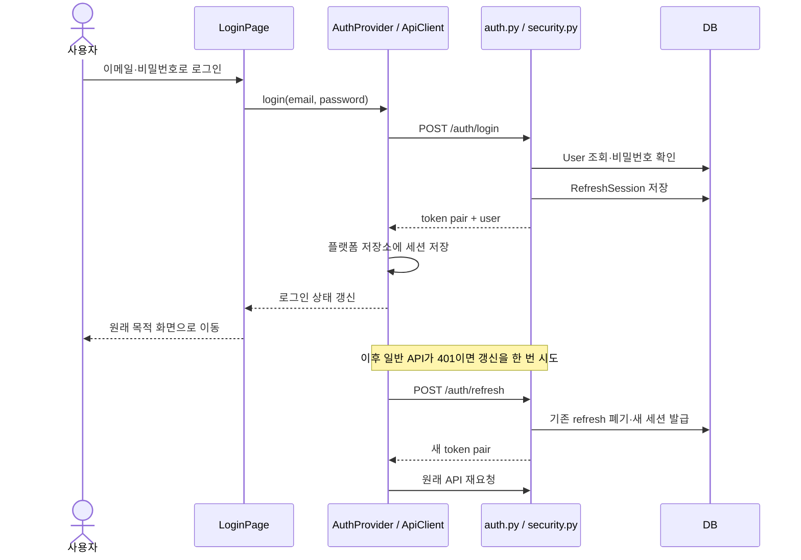

### 인증 1단계. LoginPage는 검증 후 AuthProvider에 로그인을 맡긴다

**원본** [auth.tsx](../apps/web/src/lib/auth.tsx) · 발췌 시점 426–436행

```tsx
const login = useCallback(
  async (email: string, password: string) => {
    const payload = await client.request<AuthResponse>(
      '/auth/login',
      { method: 'POST', body: JSON.stringify({ email, password }) },
      { authenticated: false },
    );
    await finishLogin(payload);
  },
  [client, finishLogin],
);
```

화면의 `submit`은 입력 검증을 하고 잘못된 첫 필드로 focus를 옮긴다. 로그인 모드이면 위 `login`을 호출하고, 완료 뒤 안전하게 정한 `returnTo`로 이동한다. 회원가입 모드에서는 바로 로그인하지 않고 이메일 인증 안내를 보여 준다. 서버가 `EMAIL_VERIFICATION_REQUIRED`를 담은 403을 주면 인증 메일 안내로 연결한다.

`authenticated:false`는 로그인 요청에 이전 access token을 붙이지 않기 위한 옵션이다. 요청 주소·JSON 직렬화·오류 해석은 공용 `ApiClient`에 있다.

### 인증 2단계. 서버는 활성·인증된 계정과 비밀번호를 확인한다

**원본** [auth.py](../apps/server/app/routers/auth.py) · 발췌 시점 416–438행

```python
_require_local_account_authentication(settings)
user = db.scalar(select(User).where(User.email == normalize_email(str(body.email))))
password_verifier: PasswordVerifier = request.app.state.password_verifier
comparable_hash = (
    user.password_hash
    if user is not None and user.is_active and user.email_verified_at is not None
    else None
)
try:
    credentials_valid = password_verifier.verify(body.password, comparable_hash)
except PasswordVerificationBusy as exc:
    raise HTTPException(
        status_code=429,
        detail="login is temporarily busy",
        headers={"Retry-After": "1"},
    ) from exc
if user is None or not user.is_active:
    raise HTTPException(status_code=401, detail="invalid email or password")
if user.email_verified_at is None:
    raise HTTPException(status_code=403, detail=VERIFICATION_REQUIRED_DETAIL)
if not credentials_valid:
    raise HTTPException(status_code=401, detail="invalid email or password")
return _token_response(db, settings, user)
```

서버는 먼저 실행 모드가 로컬 계정 인증을 허용하는지 검사한다. 그 뒤 정규화한 이메일로 User를 찾고 `PasswordVerifier`로 검증한다. 검증 동시 실행량이 가득 차면 429와 재시도 안내를 반환한다. 미인증 계정은 403, 잘못된 자격증명은 401이다.

[security.py](../apps/server/app/security.py)의 `hash_password`·`verify_password`는 비밀번호를 SHA-256으로 처리한 후 bcrypt를 사용한다. `create_token_pair`는 현재 `auth_generation`을 토큰의 `gen`에 넣고, refresh의 무작위 식별자 `jti`는 hash로 `RefreshSession`에 보관한다. 토큰 원문 전체를 DB에 넣는 구조가 아니다.

### 인증 3단계. 세션 저장이 끝난 뒤 로그인 상태를 공개한다

**원본** [auth.tsx](../apps/web/src/lib/auth.tsx) · 발췌 시점 409–424행

```tsx
const finishLogin = useCallback(
  async (payload: AuthResponse) => {
    const nextTokens = tokenPairFromResponse(payload);
    await enqueueStorage(() =>
      platformStorage.setItem(SESSION_KEY, storedSession(nextTokens, payload.user)),
    );
    authRuntime.setTokens(nextTokens);
    authRuntime.setUser(payload.user);
    setTokensState(nextTokens);
    setUser(payload.user);
    void enqueueStorage(async () => {
      await Promise.all(LEGACY_AUTH_KEYS.map((key) => platformStorage.removeItem(key)));
    }).catch(() => undefined);
  },
  [enqueueStorage],
);
```

`finishLogin`은 tokens와 user를 하나의 `SESSION_KEY` JSON으로 저장한 뒤 메모리 상태를 갱신한다. 웹의 실제 저장소는 localStorage, 네이티브 앱에서는 secure storage다. `AuthRuntime`의 저장 큐는 갱신·로그아웃 등 비동기 저장 작업의 순서를 맞춘다.

앱 시작 때 `initializeLocalSession`은 기존 세션을 읽고 필요한 경우 구형 저장 형식을 이행한다. 현재 형식의 로컬 세션을 복원했다고 매번 `/users/me`를 호출하는 것은 아니다. 이후 각 API 요청의 서버 인증은 별도로 수행된다. SSO bootstrap은 이와 다른 검증 흐름을 사용한다.

### 인증 4단계. 모든 보호 요청은 현재 User와 토큰 세대를 대조한다

**원본** [security.py](../apps/server/app/security.py) · 발췌 시점 146–156행

```python
def authenticate_access_token(db: Session, settings: Settings, token: str) -> User:
    try:
        payload = decode_token(settings, token, "access")
    except TokenError as exc:
        raise HTTPException(status_code=status.HTTP_401_UNAUTHORIZED, detail=str(exc)) from exc
    user = db.get(User, str(payload["sub"]))
    if user is None or not user.is_active or user.email_verified_at is None:
        raise HTTPException(status_code=status.HTTP_401_UNAUTHORIZED, detail="inactive or missing user")
    if payload.get("gen") != user.auth_generation:
        raise HTTPException(status_code=status.HTTP_401_UNAUTHORIZED, detail="token generation is stale")
    return user
```

`decode_token`은 서명·만료·issuer·토큰 종류를 검증한다. 그 다음 User가 활성 상태이고 이메일이 인증되었는지, 토큰의 `gen`이 현재 세대인지 확인한다. 비밀번호 재설정이나 계정 삭제가 세대를 올리면 아직 만료 시간이 남은 토큰도 여기서 거부된다.

[dependencies.py](../apps/server/app/dependencies.py)의 `get_current_user`는 Bearer 추출 → 이 함수 호출 → SSO subject 일치 검사를 이어 붙인다. 그 결과가 `CurrentUser`다. `CurrentUser`가 통과한 뒤에도 곡·악보 접근은 `require_group` 계열로 다시 검사한다. 로그인과 데이터 권한은 별도 단계다.

### 인증 5단계. 401 갱신은 한 번만 재요청하고 같은 세대의 갱신을 공유한다

**원본** [api.ts](../apps/web/src/lib/api.ts) · 발췌 시점 88–102행

```ts
if (response.status === 401 && authenticated && tokens && options.retryAuth !== false) {
  const currentTokens = this.readTokens();
  if (currentTokens) {
    const retryTokens = sameTokenGeneration(currentTokens, tokens)
      ? await this.refresh(currentTokens)
      : currentTokens;
    const retryHeaders = new Headers(headers);
    retryHeaders.set('Authorization', `Bearer ${retryTokens.accessToken}`);
    return this.request<T>(
      path,
      { ...init, headers: retryHeaders },
      { authenticated, retryAuth: false },
    );
  }
}
```

여러 API가 동시에 401을 받아도 `refreshFlight`가 같은 token pair의 갱신 Promise를 공유한다. 이미 다른 요청이 토큰을 바꿨다면 새 토큰을 사용한다. 원래 요청을 다시 보낼 때는 `retryAuth:false`이므로 무한 갱신하지 않는다.

**원본** [security.py](../apps/server/app/security.py) · 발췌 시점 171–192행

```python
record = db.scalar(
    select(RefreshSession).where(RefreshSession.token_hash == token_hash).with_for_update()
)
if record is None or record.revoked_at is not None:
    raise HTTPException(status_code=status.HTTP_401_UNAUTHORIZED, detail="refresh token was revoked")
expires_at = record.expires_at
if expires_at.tzinfo is None:
    expires_at = expires_at.replace(tzinfo=UTC)
if expires_at <= utcnow():
    raise HTTPException(status_code=status.HTTP_401_UNAUTHORIZED, detail="refresh token expired")
user = db.get(User, record.user_id)
if user is None or not user.is_active or user.email_verified_at is None:
    raise HTTPException(status_code=status.HTTP_401_UNAUTHORIZED, detail="inactive or missing user")
require_matching_sso_subject(user.sso_subject, expected_sso_subject)
if payload.get("gen") != user.auth_generation:
    record.revoked_at = utcnow()
    db.commit()
    raise HTTPException(status_code=status.HTTP_401_UNAUTHORIZED, detail="token generation is stale")
record.revoked_at = utcnow()
db.commit()
access, refresh, expires_in = create_token_pair(db, settings, user)
return user, access, refresh, expires_in
```

서버는 refresh 식별자의 hash로 행을 잠그고 폐기·만료·사용자·세대를 확인한다. 기존 refresh를 폐기한 후 새 pair를 발급한다. 클라이언트는 갱신 중 계정이 바뀌거나 로그아웃한 경우 오래된 응답으로 이전 세션을 되살리지 않도록 세대를 비교한다.

갱신 실패 중 **401만 권위 있는 인증 거부**로 처리해 토큰을 지운다. 네트워크 오류나 5xx를 곧바로 로그아웃으로 바꾸지 않는다. 단, 실패한 원래 API는 오류로 끝나며 성공한 것으로 처리하지 않는다. WS에서 토큰 갱신 후 재연결하는 경로는 `SessionPage.refreshRoomAuthorization`과 실습 07의 annotation 인증 갱신으로 이어진다.

### 인증 6단계. 가입·비밀번호 재설정·Google은 각자의 증명을 거친다

**원본** [auth.py](../apps/server/app/routers/auth.py) · 발췌 시점 307–318행

```python
if user.email_verified_at is not None:
    raise HTTPException(status_code=409, detail="email is already verified")
# Always replace a legacy pre-verification credential. Mailbox ownership, not
# whoever first submitted the address, chooses the account password.
user.password_hash = hash_password(body.password)
user.email_verified_at = utcnow()
user.email_verification_sent_at = None
user.auth_generation += 1
db.execute(delete(RefreshSession).where(RefreshSession.user_id == user.id))
db.commit()
db.refresh(user)
return _token_response(db, settings, user)
```

회원가입의 순서는 `register → 인증 메일 → verifyEmail → finishLogin`이다. 최초 등록은 비밀번호 없는 미인증 User를 만들 수 있고, **메일함 소유를 확인하는 완료 단계에서 비밀번호를 정한다.** 위 코드는 인증 완료 때 기존 자격증명과 refresh 세션을 교체하는 부분이다. 이미 인증된 링크를 다시 사용하면 409다.

| 동작                 | 실제 읽기 순서                                                                                               | 실패·무효화에서 볼 점                                                                    |
| -------------------- | ------------------------------------------------------------------------------------------------------------ | ---------------------------------------------------------------------------------------- |
| 인증 메일 재전송     | `LoginPage.resend` → `auth.tsx.resendVerification` → `resend_verification`                                   | 재전송 간격, 이미 인증된 계정 처리, 메일 공급자 오류                                     |
| 비밀번호 재설정 요청 | `LoginPage.requestReset` → `requestPasswordReset` → `request_password_reset`                                 | 공개 응답과 메일 발송 조건을 구분                                                        |
| 재설정 완료          | `completePassword` → `resetPassword` → `reset_password`                                                      | token의 사용자·email·generation 확인 후 password 변경, generation 증가와 refresh 삭제    |
| Google 로그인        | [GoogleSignInButton](../apps/web/src/components/GoogleSignInButton.tsx) → `loginWithGoogle` → `google_login` | 서버 verifier가 audience·identity·인증된 email을 확인하고 기존 계정과의 연결 조건을 판단 |

프론트 경로는 [LoginPage.tsx](../apps/web/src/pages/LoginPage.tsx), 서버 경로는 [routers/auth.py](../apps/server/app/routers/auth.py)에 모여 있다. 실제 메일 전송은 `_deliver_*_attempt` → [mailer.py](../apps/server/app/mailer.py)의 `MailDeliveryManager`와 mail sender를 연결한다. 발송 요청을 받았다는 응답을 사용자의 받은편지함에 도착했다는 보장으로 읽지 않는다.

### 인증 7단계. SSO에서는 중앙의 신원과 앱 세션이 모두 맞아야 한다

**원본** [sso.py](../apps/server/app/sso.py) · 발췌 시점 150–172행

```python
if not settings.sso_enabled:
    return None
presented_secret = request.headers.get("X-Portfolio-Edge-Secret", "")
if not secrets.compare_digest(
    presented_secret,
    settings.resolved_sso_edge_secret,
):
    raise HTTPException(
        status_code=status.HTTP_401_UNAUTHORIZED,
        detail=SSO_EDGE_IDENTITY_INVALID,
    )
subject = normalize_sso_subject(request.headers.get("Remote-User", ""))
parsed_groups = parse_sso_groups(request.headers.get("Remote-Groups", ""))
if not parsed_groups.application_access:
    raise HTTPException(
        status_code=status.HTTP_403_FORBIDDEN,
        detail=SSO_APP_FORBIDDEN,
    )
return TrustedSsoIdentity(
    subject=subject,
    groups=parsed_groups.groups,
    role=parsed_groups.role,
)
```

SSO는 중앙 로그인 시스템이 확인한 신원을 앱이 받아 사용하는 모드다. 브라우저가 입력한 `Remote-User` 문자열만 믿는 구조가 아니다. 서버는 edge secret을 확인하고, 중앙 그룹 정보에서 이 앱에 접근할 수 있는지도 매 요청 평가한다. secret 값은 문서나 클라이언트 코드에 넣지 않는다.

`AuthProvider.initializeSsoSession`은 저장된 앱 세션을 `/users/me`로 확인한다. 세션이 없거나 확정적인 401로 거부되면 `POST /auth/sso`로 교환한다. 네트워크·서버 장애를 이유로 임의의 로컬 로그인으로 내려가지 않는다.

서버 `sso_login`은 안정된 `sso_subject`와 email 소유를 함께 검사한다. 다른 User와 충돌하면 409다. 기존 계정 연결 또는 새 provision 후 앱 token pair를 반환한다. 연결된 계정의 로컬 비밀번호·Google credential을 제거하고 필요하면 인증 세대를 올린다.

실행 조건은 [portfolio-auth-mode.sh](../scripts/portfolio-auth-mode.sh) → [runtimeMode.ts](../apps/web/src/lib/runtimeMode.ts)·[config.py](../apps/server/app/config.py)를 읽는다. `main/dev`는 SSO, tool branch는 local이라는 계약을 확인한다. `managed_local_sso`에서 공개 가입·앱 메일·로컬 로그인·앱 탈퇴 경로가 닫힌 것은 이 모드의 동작이며 설정 없이 우회하는 경로로 이해하지 않는다.

### 인증 8단계. 로그아웃과 계정 삭제를 구분한다

일반 로그아웃은 `AuthProvider.logout`이 먼저 현재 메모리와 저장된 인증 세션을 비우고 `/auth/logout`으로 해당 refresh를 폐기 요청한다. 로컬 모드의 폐기 요청 실패는 화면 로그아웃을 되돌리지 않는다. SSO는 폐기·저장소 정리를 최대 3초 기다린 뒤 중앙 로그아웃 경로로 이동한다.

여기서 `revoke_refresh_token`은 해당 refresh 세션의 폐기다. **일반 로그아웃이 모든 access token의 generation까지 올리는 것으로 읽으면 안 된다.** 모든 기기의 오래된 증명을 거부하는 계정 삭제·비밀번호 재설정과 보장 범위가 다르다. 일반 로그아웃은 `deleteRemoteCache`를 호출하지 않으며, 남은 원격 snapshot은 다음 장의 사용자 키 격리로 다룬다.

### 탈퇴 9단계. 설정 화면에서 다시 본인임을 증명한다

**원본** [SettingsPage.tsx](../apps/web/src/pages/SettingsPage.tsx) · 발췌 시점 263–293행

```tsx
const removeAccount = async () => {
  if (!user || !deleteEmailMatches || deletePasswordMissing || deleteIdentityProofMissing) return;
  const proof = user.hasPassword
    ? { currentPassword: deletePassword }
    : deleteGoogleIdToken
      ? { googleIdToken: deleteGoogleIdToken }
      : deleteAccountToken
        ? { accountDeleteToken: deleteAccountToken }
        : undefined;
  if (!proof) return;
  setDeletingAccount(true);
  setDeleteError(undefined);
  try {
    const result = await deleteAccount(deleteEmail.trim(), proof);
    notify({
      title: '계정을 삭제했습니다.',
      description: result.localCacheCleared
        ? '이 기기의 로그인 전용 오프라인 사본도 삭제했습니다.'
        : '서버 계정은 삭제됐지만 이 기기의 사이트 데이터를 수동으로 지워 주세요.',
      tone: result.localCacheCleared ? 'success' : 'info',
    });
    clearAccountDeletionChallenge();
    processedAccountDeleteTokenRef.current = null;
    setDeleteOpen(false);
    void navigate('/login', { replace: true });
  } catch (error) {
    setDeleteError(error instanceof Error ? error.message : String(error));
  } finally {
    setDeletingAccount(false);
  }
};
```

`AccountDeletionPage`는 설명과 진입 경로를 제공하고, 실제 작업은 SettingsPage의 `removeAccount`다. 이메일 확인에 더해 비밀번호 계정은 현재 비밀번호, Google-only 계정은 새 Google ID 증명 또는 탈퇴 확인 메일 token을 요구한다. 메일 token은 URL fragment에서 읽은 뒤 주소에서 제거하고 일회성 문맥으로 다룬다.

`AuthProvider.deleteAccount`는 `DELETE /users/me`에 증명을 보낸다. 서버 `delete_me`는 현재 계정을 잠그고 email과 password 또는 Google subject·email·token generation을 다시 검증한다. 로그인한 상태라는 사실만으로 민감한 삭제를 실행하지 않는다.

### 탈퇴 10단계. 공유 이력을 보존하면서 DB와 파일 정리 작업을 확정한다

**원본** [auth.py](../apps/server/app/routers/auth.py) · 발췌 시점 745–773행

```python
owned_groups, owned_scores = _lock_owned_groups_and_scores(db, account.id)
enqueue_score_cleanup(
    db,
    owned_scores,
    settings,
    reason="account",
)

for group in owned_groups:
    db.delete(group)
db.execute(delete(GroupMember).where(GroupMember.user_id == account.id))
db.execute(delete(Annotation).where(Annotation.author_id == account.id))
db.execute(delete(PracticeLog).where(PracticeLog.author_id == account.id))
db.execute(delete(DeviceCalibration).where(DeviceCalibration.user_id == account.id))
db.execute(delete(RefreshSession).where(RefreshSession.user_id == account.id))
db.execute(update(Todo).where(Todo.assignee_id == account.id).values(assignee_id=None))

account.email = f"deleted-{account.id}@deleted.invalid"
account.display_name = "Deleted user"
account.password_hash = None
account.google_subject = None
account.email_verified_at = None
account.email_verification_sent_at = None
account.password_reset_sent_at = None
account.account_delete_sent_at = None
account.auth_generation += 1
account.is_active = False
db.commit()
return Response(status_code=status.HTTP_204_NO_CONTENT)
```

소유 그룹의 악보 파일 키를 durable outbox에 기록하고 그룹을 삭제한다. 다른 그룹의 멤버십, 본인이 작성한 annotation과 일지, 기기 보정, refresh 세션을 삭제하고 본인에게 배정된 todo의 담당자를 해제한다. 삭제되는 annotation 조건은 `author_id`이며 private만으로 제한되지 않는다.

User 행은 이메일·이름·자격증명을 지우고 비활성화한 표지 행으로 남긴다. 이를 tombstone이라고 한다. 다른 구성원이 계속 쓰는 감사 참조를 끊지 않으면서 실제 사용자로 인증되지 않게 하는 방식이다. 한 DB commit 후 204를 반환하고, 실제 파일 삭제는 실습 05의 worker가 처리한다.

그 다음 클라이언트는 **삭제된 현재 사용자의 원격 cache**와 인증 저장소를 정리한다. 서버 삭제는 성공했지만 로컬 정리가 실패했다면 `localCacheCleared:false`를 반환하여 사이트 데이터를 수동으로 지우라는 안내를 띄운다. 서버 삭제를 실패로 되돌리거나 비로그인 솔로 데이터를 함께 지웠다고 표시하지 않는다.

**리뷰할 질문:** 서버가 반환한 토큰을 저장하기 전에 로그인 완료 화면을 보여 주는가? refresh 응답이 늦게 도착해 다른 계정을 덮어쓸 수 있는가? 비밀번호 재설정·일반 로그아웃·탈퇴의 무효화 범위는 각각 무엇인가? 탈퇴 성공 뒤 로컬 정리 실패를 구별하는가?

테스트 탐색은 [auth.test.tsx](../apps/web/src/lib/auth.test.tsx), [api.test.ts](../apps/web/src/lib/api.test.ts), [test_auth.py](../apps/server/tests/test_auth.py), [test_sso_roles_cleanup.py](../apps/server/tests/test_sso_roles_cleanup.py), [test_account_deletion.py](../apps/server/tests/test_account_deletion.py), [SettingsPage.test.tsx](../apps/web/src/pages/SettingsPage.test.tsx) 순서가 좋다. 이 장은 코드 해설이며 실제 계정 생성·메일 발송·탈퇴를 수행한 기록이 아니다.

---

## 실습 13. 오프라인 사본과 PWA 시작 경계

> **읽기 목표:** 로컬 원본, 서버의 마지막 성공 사본, Service Worker 캐시를 서로 구분한다. “오프라인 지원”을 모든 서버 작업의 오프라인 편집으로 해석하지 않는다.

### 오프라인 1단계. 데이터별 주 저장소를 먼저 정한다

| 데이터                            | 주 저장소                        | 브라우저에 남는 것                        | 오프라인에서의 의미                                |
| --------------------------------- | -------------------------------- | ----------------------------------------- | -------------------------------------------------- |
| 비로그인 템포맵·악보·마디 맵·필기 | IndexedDB의 local store          | 원본 데이터                               | 해당 로컬 기능에서 읽기·쓰기                       |
| 비로그인 연습일지                 | localStorage                     | 일지·todo JSON                            | 로컬 원본                                          |
| 로그인한 곡·악보·맵·필기·일지     | 서버 DB와 파일 저장소            | userId별 IndexedDB snapshot               | 네트워크 실패 때 마지막 성공 사본을 읽기 전용 사용 |
| 인증 세션                         | `platformStorage`                | 웹 localStorage / 네이티브 secure storage | 원격 snapshot과 별도 생명주기                      |
| JS·CSS·공개 이미지·폰트 등        | 배포 자산                        | Service Worker의 자산 캐시                | 앱 로드와 렌더러 재사용                            |
| 볼륨·테마·개인 보정값             | 이 기기의 localStorage·IndexedDB | 기기 설정                                 | 서버의 곡 metadata와 분리                          |

### 오프라인 2단계. 원격 snapshot의 키에 사용자 ID를 넣는다

**원본** [localDb.ts](../apps/web/src/lib/localDb.ts) · 발췌 시점 180–199행

```ts
const remoteTempoMaps = db.createObjectStore('remoteTempoMaps', {
  keyPath: ['cacheOwnerId', 'id'],
});
remoteTempoMaps.createIndex('cacheOwnerId', 'cacheOwnerId');
remoteTempoMaps.createIndex('ownerRepertoire', ['cacheOwnerId', 'repertoireItemId']);

const remoteScores = db.createObjectStore('remoteScores', {
  keyPath: ['cacheOwnerId', 'id'],
});
remoteScores.createIndex('ownerRepertoire', ['cacheOwnerId', 'repertoireItemId']);
db.createObjectStore('remoteMeasureMaps', {
  keyPath: ['cacheOwnerId', 'scoreId'],
});
const remoteAnnotations = db.createObjectStore('remoteAnnotations', {
  keyPath: ['cacheOwnerId', 'id'],
});
remoteAnnotations.createIndex('ownerScore', ['cacheOwnerId', 'scoreId']);
db.createObjectStore('remotePracticeLogs', {
  keyPath: ['cacheOwnerId', 'repertoireItemId'],
});
```

원격 store의 key는 `[cacheOwnerId, id]`, `[cacheOwnerId, scoreId]`처럼 복합 키다. 같은 score ID라도 A와 B의 저장 사본이 분리된다. `cacheOwner(scope)`는 빈 사용자 ID를 거부한다.

**원본** [localDb.ts](../apps/web/src/lib/localDb.ts) · 발췌 시점 311–317행

```ts
async getTempoMap(id: string, scope?: RemoteCacheScope): Promise<TempoMap | undefined> {
  if (scope) {
    const row = await (await database()).get('remoteTempoMaps', [cacheOwner(scope), id]);
    return row ? withoutCacheOwner<TempoMap & { updatedAt?: string }>(row) : undefined;
  }
  return (await database()).get('tempoMaps', id);
},
```

scope가 있으면 원격 store, 없으면 local store를 읽는다. 호출부가 `{userId:user.id}`를 빠뜨리지 않는지가 핵심이다. 로그인했다는 이유만으로 기존 비로그인 맵을 서버 맵으로 자동 옮기는 구조는 아니다. Editor의 `source=local`은 의도적으로 로컬 경로를 유지한다.

버전 3 이행 코드는 소유자를 알 수 없는 구형 원격 행을 현재 로그인 사용자에게 임의로 귀속시키지 않는다. `repertoireItemId === 'local'`로 확인한 로컬 악보·맵과 그에 딸린 좌표·필기를 보존하고, 범위를 증명할 수 없는 구형 원격 snapshot을 버린다. 이행 실패는 transaction을 abort하여 불완전하게 섞인 store를 정상 상태로 취급하지 않는다.

### 오프라인 3단계. 서버 오류와 네트워크 단절을 구분한다

**원본** [ScoresPage.tsx](../apps/web/src/pages/ScoresPage.tsx) · 발췌 시점 186–188행

```tsx
function isNetworkFailure(error: unknown): boolean {
  return error instanceof TypeError && /fetch|network|load/i.test(error.message);
}
```

이 판별은 `TypeError`이면서 fetch/network/load 관련 메시지인 경우다. HTTP 403이나 500은 `ApiError`이므로 이 분기를 통과하지 않는다. `navigator.onLine`만으로 서버 성공 여부를 정하지 않는다는 것도 함께 본다.

대표적인 화면 처리는 실습 02의 Editor 로드, 실습 05의 Scores 로드, 실습 11의 Practice 로드에 있다. 네트워크 실패이며 현재 사용자 사본이 있으면 오프라인 상태로 열고 편집·가져오기·저장을 잠근다. 사본이 없으면 실패를 알린다. 권한 거부나 삭제된 데이터의 404를 오래된 성공 화면으로 바꾸지 않는다.

### 오프라인 4단계. 계정 정리는 해당 사용자의 원격 store만 순회한다

**원본** [localDb.ts](../apps/web/src/lib/localDb.ts) · 발췌 시점 279–292행

```ts
async function deleteRemoteStoreRows(
  db: IDBPDatabase<FmrDb>,
  storeName: RemoteCacheStoreName,
  ownerId: string,
): Promise<void> {
  const transaction = db.transaction(storeName, 'readwrite');
  let cursor = await transaction.store.openCursor();
  while (cursor) {
    const row = cursor.value as { cacheOwnerId: string };
    if (row.cacheOwnerId === ownerId) await cursor.delete();
    cursor = await cursor.continue();
  }
  await transaction.done;
}
```

각 store 안에서 `cacheOwnerId`가 같은 행만 삭제한다. 여러 store 삭제는 각각의 transaction이므로 전부가 하나의 IndexedDB transaction인 것으로 설명하지 않는다. 앞 장의 탈퇴 후 `localCacheCleared`가 필요한 이유가 이 부분에서도 드러난다.

일반 로그아웃, 계정 삭제, 브라우저의 사이트 데이터 삭제는 서로 다른 작업이다. “로그아웃하면 로컬 솔로 악보도 지워진다”거나 “서버에서 계정을 지우면 모든 기기의 캐시 파일까지 즉시 제거된다”는 동작은 코드에 없다.

### PWA 5단계. App을 불러오기 전에 구형 인증 API 캐시를 정리한다

**원본** [main.tsx](../apps/web/src/main.tsx) · 발췌 시점 71–97행

```tsx
export async function bootstrap(dependencies: BootstrapDependencies = {}): Promise<void> {
  applyStoredTheme();

  const rootElement = document.getElementById('root');
  if (!rootElement) throw new Error('Root element was not found');
  const root = createRoot(rootElement);
  const reload = dependencies.reload ?? (() => window.location.reload());
  root.render(<SecurityStartup failed={false} onRetry={reload} />);

  try {
    const establishPwaRuntime = dependencies.establishPwaRuntime ?? establishSafePwaRuntime;
    await establishPwaRuntime({
      enableServiceWorker: dependencies.pwaEnabled ?? (import.meta.env.PROD && __FMR_PWA_ENABLED__),
    });

    const loadApp = dependencies.loadApp ?? (() => import('./App'));
    const { App } = await loadApp();
    root.render(
      <StrictMode>
        <App />
      </StrictMode>,
    );
  } catch (error) {
    console.error('PWA security transition failed', error);
    root.render(<SecurityStartup failed onRetry={reload} />);
  }
}
```

먼저 안전성 확인 화면을 렌더링하고 `establishSafePwaRuntime`을 기다린다. 통과한 다음에야 App을 동적 import하고 mount한다. 실패하면 재시도 안내를 보여 준다. 이 순서 덕분에 구형 Service Worker가 인증 API 응답을 돌려줄 가능성을 확인하지 못한 상태에서 일반 페이지가 API를 요청하지 않는다.

**원본** [pwaCache.ts](../apps/web/src/lib/pwaCache.ts) · 발췌 시점 52–76행

```ts
async function purgeSensitiveRuntimeCaches(cacheStorage: CacheStoragePort): Promise<void> {
  const names = await readCacheNames(cacheStorage);

  for (const name of SENSITIVE_RUNTIME_CACHES) {
    if (!names.includes(name)) continue;

    let deleted: boolean;
    try {
      deleted = await cacheStorage.delete(name);
    } catch (cause) {
      throw new PwaSecurityTransitionError(`민감한 레거시 캐시(${name})를 삭제하지 못했습니다.`, {
        cause,
      });
    }
    if (!deleted) {
      throw new PwaSecurityTransitionError(`민감한 레거시 캐시(${name}) 삭제가 거부되었습니다.`);
    }
  }

  const remaining = await readCacheNames(cacheStorage);
  const residual = SENSITIVE_RUNTIME_CACHES.find((name) => remaining.includes(name));
  if (residual) {
    throw new PwaSecurityTransitionError(`민감한 레거시 캐시(${residual})가 남아 있습니다.`);
  }
}
```

`purgeSensitiveRuntimeCaches`는 삭제 호출만 하고 끝내지 않는다. 캐시 목록을 다시 확인하고 민감 캐시가 남으면 오류를 낸다. 캐시 API 자체를 읽거나 삭제하지 못해도 실패다. 이는 실패를 무시하고 앱을 여는 방식이 아니다.

### PWA 6단계. 새 worker의 제어권을 확인한 후 한 번 더 정리한다

`establishSafePwaRuntime`의 전체 순서는 다음과 같다.

1. 구형 민감 캐시를 먼저 지운다.
2. Service Worker가 없는 환경이면 다시 확인하고 worker 없이 진행한다. worker 비활성 빌드인데 기존 제어권이 남아 있으면 차단한다.
3. 안전 generation이 붙은 `sw.js?fmr-safety=v1`을 등록한다.
4. 필요한 경우 안전한 controller와 기존 동일 scope worker의 종료를 기다린다. 첫 설치의 아직 제어되지 않는 페이지는 검증된 등록 상태를 별도로 처리한다.
5. 최종 등록·제어권을 검증하고 민감 캐시를 다시 삭제한다. 교체가 진행되는 동안 구형 worker가 캐시를 다시 만들었을 수 있기 때문이다.

**원본** [pwaCache.ts](../apps/web/src/lib/pwaCache.ts) · 발췌 시점 316–327행

```ts
const registrationsAfter = await readRegistrations(serviceWorker);
if (
  !isSafeWorker(serviceWorker.controller, locationHref) ||
  !hasSafeRegistration(registrationsAfter, locationHref)
) {
  throw new PwaSecurityTransitionError('서비스 워커의 안전한 제어권을 검증하지 못했습니다.');
}

// A legacy worker may have recreated fmr-api while its replacement installed. Purge and
// verify again only after the safe controller owns fetches and the same-scope worker retired.
await purgeLegacyRuntimeCaches(cacheStorage);
return 'controlled';
```

현재 worker의 생성 규칙은 [vite.config.ts](../apps/web/vite.config.ts)의 `VitePWA.workbox`다. 악보 렌더러 코드와 공개 이미지·폰트는 캐시하지만 `/feelmyrythm/api`를 자산 캐시와 navigation fallback에서 제외한다. PDF renderer의 JS를 캐시하는 것과 사용자의 PDF 원본을 공개 캐시에 넣는 것은 다른 일이다. 인증 데이터의 오프라인 사본은 앞 단계의 사용자별 IndexedDB에서 관리한다.

**리뷰할 질문:** 캐시의 소유자를 어떤 key로 구분하는가? 서버가 403을 반환해도 과거 사본을 보여 주는가? App mount 전에 안전성 검사가 끝나는가? 교체 중 재생성된 구형 캐시를 마지막에 다시 확인하는가?

관련 테스트는 [localDb.test.ts](../apps/web/src/test/localDb.test.ts), [pwaCache.test.ts](../apps/web/src/lib/pwaCache.test.ts), [main.test.tsx](../apps/web/src/main.test.tsx), [pwa-upgrade.pwa.ts](../e2e/pwa-upgrade.pwa.ts)다. 일반 브라우저 테스트와 구형 worker 교체 테스트는 설정이 다르며 실제 실행 명령은 마지막 장에 모았다.

---

## 실습 14. 튜너·출력 지연 보정과 기기 설정

> **읽기 목표:** 마이크에서 들어온 소리가 음이름으로 바뀌는 경로와, 테스트 클릭에 맞춰 누른 탭이 동기 재생의 보정값이 되는 경로를 구분한다.

### 튜너 1단계. 사용자의 시작 버튼으로 마이크를 연다

**원본** [TunerPage.tsx](../apps/web/src/pages/TunerPage.tsx) · 발췌 시점 37–70행

```tsx
async function start() {
  const engine = engineRef.current;
  if (!engine || startPendingRef.current) return;
  const request = ++startRequestRef.current;
  startPendingRef.current = true;
  setStarting(true);
  engine.setA4(a4);
  setStartError(undefined);
  try {
    await engine.start();
    if (request !== startRequestRef.current || engineRef.current !== engine) {
      engine.stop();
      return;
    }
    setRunning(true);
  } catch (error) {
    if (request !== startRequestRef.current || engineRef.current !== engine) {
      engine.stop();
      return;
    }
    const description = error instanceof Error ? error.message : String(error);
    setStartError(description);
    notify({
      title: '마이크를 시작하지 못했습니다.',
      description,
      tone: 'danger',
    });
  } finally {
    if (request === startRequestRef.current && engineRef.current === engine) {
      startPendingRef.current = false;
      setStarting(false);
    }
  }
}
```

페이지 mount 때 `TunerEngine({windowSize:4096})`를 만들고 `onReading`을 React 상태에 연결한다. 시작 버튼은 A4 기준음을 설정한 뒤 `engine.start()`를 기다린다. 중복 시작은 ref로 막고, 기다리는 사이 사용자가 정지하거나 페이지를 떠났다면 요청 번호와 engine 참조를 비교해 늦은 결과를 버린다.

**원본** [tuner.ts](../packages/audio/src/tuner.ts) · 발췌 시점 304–316행

```ts
const stream = await this.mediaDevices.getUserMedia({
  audio: {
    autoGainControl: false,
    echoCancellation: false,
    noiseSuppression: false,
  },
  video: false,
});
if (generation !== this.lifecycleGeneration) {
  stopStream(stream);
  return;
}
this.stream = stream;
```

마이크 권한을 요청할 때 자동 음량 조절·에코 제거·노이즈 제거를 끈다. 브라우저의 실제 지원 여부와 권한은 이 요청 결과로 판단한다. 실패하면 `AudioEnvironmentError`가 페이지의 오류 안내로 전달된다. 이 기능은 마이크 샘플을 서버로 보내는 REST 흐름이 아니라 브라우저 안의 분석이다.

### 튜너 2단계. AudioWorklet은 샘플을 모으고 TypeScript가 분석한다

**원본** [tuner.ts](../packages/audio/src/tuner.ts) · 발췌 시점 331–350행

```ts
const source = context.createMediaStreamSource(stream);
const worklet = new AudioWorkletNode(context, processorName, {
  numberOfInputs: 1,
  numberOfOutputs: 1,
  outputChannelCount: [1],
});
const silentGain = context.createGain();
silentGain.gain.value = 0;
worklet.port.onmessage = (event: MessageEvent<Float32Array | ArrayBuffer>) => {
  const frame =
    event.data instanceof Float32Array ? event.data : new Float32Array(event.data);
  this.processFrame(frame, context.sampleRate);
};
source.connect(worklet);
worklet.connect(silentGain);
silentGain.connect(context.destination);
this.source = source;
this.worklet = worklet;
this.silentGain = silentGain;
this.running = true;
```

`workletSource`가 입력을 window 크기만큼 모아 메시지로 보낸다. 메인 쪽의 `port.onmessage`는 받은 프레임을 `processFrame`에 전달한다. 이 구현에서 YIN 계산 전체를 Worklet 안에서 실행하는 것은 아니다.

`silentGain.gain.value=0`으로 출력에 연결하므로 마이크 소리를 스피커로 그대로 재생하지 않는다. 프레임 수집을 위한 오디오 그래프와 사용자가 듣는 메트로놈 출력 그래프를 구별한다.

### 튜너 3단계. 반복 주기를 찾아 주파수와 음이름을 계산한다

[tuner.ts](../packages/audio/src/tuner.ts)의 `detectPitch`를 다음 순서로 읽는다.

1. 샘플 크기·sample rate·주파수 범위를 검증한다. RMS, 즉 신호 세기의 평균적인 크기가 너무 작으면 무음으로 처리한다.
2. 샘플을 `tau`만큼 밀었을 때 차이의 제곱합을 계산한다. 파형이 한 주기만큼 반복되는 지점에서 차이가 작아진다.
3. 차이를 누적 평균으로 정규화하고 임계값 아래의 최소점을 찾는다. 충분히 뚜렷한 최소점이 없으면 결과를 내지 않는다.
4. 최소점 주변을 보간한 `periodSamples`로 `sampleRate / periodSamples`를 계산한다.
5. `processFrame`이 기본 5개 주파수의 중앙값으로 흔들림을 줄인 뒤 아래 음이름 변환을 호출한다.

**원본** [tuner.ts](../packages/audio/src/tuner.ts) · 발췌 시점 119–132행

```ts
export function frequencyToNote(frequency: number, a4 = 440): NoteReading {
  const validFrequency = positive(frequency, 'frequency');
  const validA4 = validateA4(a4);
  const midiFloat = 69 + 12 * Math.log2(validFrequency / validA4);
  const midi = Math.round(midiFloat);
  const cents = 1_200 * Math.log2(validFrequency / (validA4 * 2 ** ((midi - 69) / 12)));
  const noteNames = ['C', 'C♯', 'D', 'D♯', 'E', 'F', 'F♯', 'G', 'G♯', 'A', 'A♯', 'B'];
  return {
    midi,
    name: noteNames[((midi % 12) + 12) % 12]!,
    octave: Math.floor(midi / 12) - 1,
    cents: Math.abs(cents) < 1e-10 ? 0 : cents,
  };
}
```

`midiFloat`는 기준 A4를 중심으로 반음 위치를 계산하고, 가장 가까운 정수 음과의 차이가 cents다. 100 cents가 반음이다. A4=440Hz일 때 440Hz는 A4·0 cents, 442Hz는 약 +7.85 cents다. 기준을 442Hz로 바꾸면 같은 442Hz가 0 cents가 된다. 화면의 `inTune`은 편차의 절댓값이 3 cents 이하인지로 정한다.

`processFrame`은 검출 실패 시 null을 보내고, 연속 세 번 실패하면 중앙값 버퍼도 비운다. `stop`·unmount에서는 media track을 멈추고 node를 disconnect하며 소유한 AudioContext를 닫는다. 마이크 사용 표시만 끄고 실제 입력을 계속 유지하지 않는지 여기서 확인한다.

### 보정 4단계. 테스트 클릭의 예정 시각과 사용자의 탭을 같은 시계로 잰다

**원본** [CalibrationPage.tsx](../apps/web/src/pages/CalibrationPage.tsx) · 발췌 시점 251–258행

```tsx
const startAudio = engine.now() + 0.8;
const audioNow = engine.now();
const performanceNow = performance.now();
expectedRef.current = Array.from({ length: 9 }, (_, index) => {
  const at = startAudio + index;
  engine.scheduleClick(at, 'countIn');
  return performanceNow + (at - audioNow + engine.outputLatency()) * 1000;
});
```

오디오 엔진을 시작한 후 0.8초 뒤부터 1초 간격으로 9번 클릭을 예약한다. 오디오 시각 `at`을 `performance.now()` 기준의 예정 청취 시각으로 바꾸고, 엔진이 보고한 출력 지연도 포함한다.

**원본** [CalibrationPage.tsx](../apps/web/src/pages/CalibrationPage.tsx) · 발췌 시점 276–290행

```tsx
function tap() {
  if (phase !== 'running') return;
  const index = samples.length;
  const expected = expectedRef.current[index];
  if (expected === undefined) return;
  const residual = performance.now() - expected;
  const next = [...samples, residual];
  setSamples(next);
  if (next.length >= expectedRef.current.length) {
    engineGenerationRef.current += 1;
    engineRef.current?.stop();
    engineRef.current = undefined;
    setPhase('complete');
  }
}
```

탭은 순서대로 예정 클릭과 짝을 이룬다. 잔차는 `실제 탭 시각 − 예정 청취 시각`이다. 9번을 모으면 엔진을 정지하고 완료 상태로 바꾼다. 페이지의 offset 계산은 `median(samples.slice(1))`이므로 첫 탭은 저장은 하되 대표값 계산에서 제외한다.

예를 들어 잔차가 `[140, 28, 31, 29, 30, 400, 32, 27, 28]ms`이면 첫 140ms를 빼고 정렬한 가운데 두 값은 29와 30, 중앙값은 **29.5ms**다. 이 방식은 큰 한 번의 오차 영향을 줄이지만 사람의 반응 시간도 섞인다. 실제 장비만의 지연을 실험실 수준으로 분리 측정했다고 해석하지 않는다.

### 보정 5단계. 로컬 저장을 먼저 끝내고 서버 동기화 실패를 따로 알린다

**원본** [CalibrationPage.tsx](../apps/web/src/pages/CalibrationPage.tsx) · 발췌 시점 306–337행

```tsx
const deviceFingerprint = await fingerprint();
const calibration: DeviceCalibration = {
  id: `${deviceFingerprint}:${outputLabel.trim().toLowerCase()}`,
  deviceFingerprint,
  outputLabel: outputLabel.trim(),
  offsetMs: offset,
  samples,
  updatedAt: new Date().toISOString(),
};
await localDb.putCalibration(calibration);
let serverCalibrationId: string | null = null;
if (user) {
  try {
    const remote = await client.put<ServerCalibration>('/calibrations', {
      deviceFingerprint,
      outputLabel: calibration.outputLabel,
      offsetMs: offset,
    });
    serverCalibrationId = remote.id;
    localStorage.setItem('fmr.serverCalibrationId', remote.id);
  } catch (error) {
    if (mountedRef.current) {
      notify({
        title: '이 기기에는 저장했지만 서버와 동기하지 못했습니다.',
        description: errorMessage(error),
        tone: 'info',
      });
    }
  }
}
localStorage.setItem('fmr.hasCalibration', 'true');
localStorage.setItem('fmr.calibrationOffsetMs', String(offset));
```

기기 fingerprint와 출력 장치 라벨로 로컬 calibration을 저장한다. 로그인 상태면 `/calibrations`에도 PUT한다. 서버 오류는 내부 catch에서 “기기에는 저장했지만 동기하지 못했다”고 알린다. 원격 업로드가 실패했다고 이미 저장한 로컬 보정이 사라지는 구조가 아니다.

[calibrations.py](../apps/server/app/routers/calibrations.py)의 `upsert_calibration`은 `user_id + device_fingerprint + output_label`로 행을 찾아 새로 만들거나 offset만 바꾼다. 조회·삭제도 현재 사용자 범위로 제한한다. 템포맵처럼 `expectedRevision`을 보내는 경로는 아니다.

`fmr.calibrationOffsetMs`는 현재 기기에서 적용할 숫자이고, `fmr.serverCalibrationId`는 서버에 저장된 보정 레코드 ID다. 같은 값이라고 취급하거나 다른 사용자의 보정 ID를 신뢰하지 않는다. 세션에서 calibration ID를 받는 서버 경로도 소유자 확인까지 연결해서 읽는다.

### 보정 6단계. 동기 재생의 청취 시각을 앞당겨 예약한다

**원본** [useMetronome.ts](../apps/web/src/lib/useMetronome.ts) · 발췌 시점 668–676행

```ts
const mapper = new ServerAudioMapper(
  new OffsetServerPerformanceMapper(serverOffsetMs),
  audioClockRef.current,
  () => engine.outputLatency(),
);
const manualOffsetSec =
  Number(localStorage.getItem('fmr.calibrationOffsetMs') ?? 0) / 1_000;
let anchorAudioTime =
  mapper.serverToScheduledAudio(serverStartTimeMs, manualOffsetSec) - firstRelative;
```

합주의 `startSynchronized`는 서버 시작 시각을 로컬 오디오 시계로 옮기면서 자동 출력 지연과 수동 offset을 반영한다. 양수 29.5ms는 예약을 그만큼 앞당긴다. 공용 계산의 의미는 [core/calibration.ts](../packages/core/src/calibration.ts)의 `calibratedAudioScheduleTime`, 실제 합주 경로는 [실습 04](#실습-04-합주-시작과-시계-동기화)의 `ServerAudioMapper`에서 확인한다.

**현재 `useMetronome.start`의 개인 재생은 `engine.now()+0.12` 기반의 별도 시작 경로이며, 위 수동 offset 조회는 `startSynchronized`에 있다.** 보정 저장이 개인 재생의 시작 지연까지 같은 방식으로 바꾼다고 확대해 설명하지 않는다. 개인 재생과 합주는 기준 시각을 정하는 목적부터 다르다.

시각 보정은 또 다른 값 `fmr.visualOffsetMs`다. `visualFrameAudioTimeSec`는 표시를 일찍 하려는 양수 offset만큼 오디오 시각을 앞서 평가한다. 소리를 예약하는 수동 offset과 화면을 그리는 offset을 두 번 합산하지 않는지 확인한다.

### 설정 7단계. 테마는 즉시 적용하고 연습 기본값은 저장 버튼으로 기록한다

**원본** [SettingsPage.tsx](../apps/web/src/pages/SettingsPage.tsx) · 발췌 시점 206–212행

```tsx
const save = () => {
  if (visualOffsetMs === null) return;
  localStorage.setItem('fmr.countInMeasures', String(countIn));
  localStorage.setItem('fmr.volume', String(volume));
  localStorage.setItem(VISUAL_OFFSET_STORAGE_KEY, String(visualOffsetMs));
  notify({ title: '연습 설정을 저장했습니다.', tone: 'success' });
};
```

예비박 수·볼륨·시각 offset은 이 기기의 localStorage에 저장한다. `useMetronome`가 재생 시작 및 엔진 생성 시 읽는 위치를 같이 봐야 “저장 버튼을 눌렀다”와 “현재 재생에 즉시 반영된다”를 혼동하지 않는다. 개인 재생의 예비박 기본값은 저장된 1/2마디 설정을 우선하고, 합주는 방의 맵·transport를 따른다.

**원본** [theme.ts](../apps/web/src/lib/theme.ts) · 발췌 시점 50–75행

```ts
export function applyTheme(theme: AppTheme, options: ThemeApplyOptions = {}): AppTheme {
  const root = options.root === undefined ? defaultRoot() : options.root;
  const themeColorMeta =
    options.themeColorMeta === undefined ? defaultThemeColorMeta() : options.themeColorMeta;
  const storage = options.storage === undefined ? defaultStorage() : options.storage;
  const systemBars = options.systemBars === undefined ? nativeBridge : options.systemBars;

  if (root) root.dataset.theme = theme;
  if (themeColorMeta) themeColorMeta.content = THEME_COLORS[theme];
  try {
    storage?.setItem?.(THEME_STORAGE_KEY, theme);
  } catch {
    // Theme changes remain active for this page even when persistence is blocked.
  }

  const setSystemBarsTheme = systemBars?.setSystemBarsTheme;
  if (typeof setSystemBarsTheme === 'function') {
    try {
      void Promise.resolve(setSystemBarsTheme.call(systemBars, theme)).catch(() => undefined);
    } catch {
      // Native presentation is best-effort and must never block the web UI.
    }
  }

  return theme;
}
```

테마는 document의 `data-theme`, 브라우저 `theme-color`, localStorage를 갱신하고 이어서 native system bar에 전달한다. 저장소나 네이티브 표시 변경에 실패해도 현재 페이지의 색 변경을 되돌리지는 않는다. AppShell과 Settings가 같은 `applyTheme`를 호출하는지 읽는다.

저장 공간 카드는 `storageEstimate → navigator.storage.estimate` 결과를 표시한다. 이 화면에 전체 악보를 삭제하는 자동 정리 기능이 있다고 추정하지 않는다. `unsupported`, 조회 실패, 정상 용량을 구분하는 상태와 재시도 UI를 확인한다.

**리뷰할 질문:** 튜너를 나가면 마이크 track이 종료되는가? 기준 A4를 바꾸면 음이름·cents가 일관되게 바뀌는가? 보정값의 양수 방향과 ms/sec 변환이 맞는가? 로컬 저장 성공과 서버 동기화 실패를 따로 알리는가?

관련 테스트: [tuner.test.ts](../packages/audio/test/tuner.test.ts), [TunerPage.test.tsx](../apps/web/src/pages/TunerPage.test.tsx), [calibration.test.ts](../packages/core/test/calibration.test.ts), [CalibrationPage.test.tsx](../apps/web/src/pages/CalibrationPage.test.tsx), [SettingsPage.test.tsx](../apps/web/src/pages/SettingsPage.test.tsx), [useMetronome.test.ts](../apps/web/src/lib/useMetronome.test.ts). 계산 테스트 통과와 실제 기기의 출력 지연 측정은 서로 다른 검증이다.

---

## 실습 15. 모바일 오디오·보안 저장소와 딥링크

> **읽기 목표:** React 화면은 재사용하면서 실제 오디오 큐·토큰 저장·앱 열기 처리를 어느 플랫폼 코드에 맡기는지 본다.

### 모바일 1단계. 같은 인터페이스 뒤에서 오디오 엔진을 고른다

**원본** [audioEngine.ts](../apps/web/src/lib/audioEngine.ts) · 발췌 시점 11–14행

```ts
export function createPlatformAudioEngine(volume = 0.8): ManagedAudioEngine {
  const nativeEngine = nativeBridge.createAudioEngine?.({ volume });
  return nativeEngine ?? new WebAudioEngine({ volume });
}
```

페이지는 플랫폼을 직접 나누기보다 `createPlatformAudioEngine`을 호출한다. 네이티브 플랫폼이고 NativeAudio plugin을 사용할 수 있으면 네이티브 엔진, 아니면 WebAudioEngine이다. 모바일용 React 페이지가 별도로 모든 타임라인을 계산하는 구조는 아니다.

### 모바일 2단계. JavaScript와 네이티브 시계를 한 번 연결한다

**원본** [nativeAudio.ts](../apps/mobile/src/nativeAudio.ts) · 발췌 시점 63–76행

```ts
async start(): Promise<void> {
  await this.operations;
  this.throwAsynchronousError();
  const beforeMs = this.performanceNow();
  const result = await this.plugin.start({ volume: this.volume });
  const afterMs = this.performanceNow();
  if (!Number.isFinite(result.nativeTimeSec) || !Number.isFinite(result.outputLatencySec)) {
    throw new Error('Native audio returned an invalid clock sample.');
  }
  this.anchorNativeTimeSec = result.nativeTimeSec;
  this.anchorPerformanceTimeMs = (beforeMs + afterMs) / 2;
  this.latencySec = Math.max(0, result.outputLatencySec);
  this.started = true;
}
```

브리지 호출 전후의 performance 시각 중간과 plugin이 반환한 native 시각을 짝짓는다. `now()`는 이후 performance 경과 시간을 이 기준점에 더해 native audio 시각을 추정한다. 브리지 호출 지연을 0으로 가정하지 않기 위한 중간값이다. 출력 지연은 별도 값으로 유지한다.

### 모바일 3단계. 결정된 타임라인을 네이티브 큐로 넘긴다

**원본** [scheduler.ts](../packages/audio/src/scheduler.ts) · 발췌 시점 235–255행

```ts
const now = this.engine.now();
const horizon =
  this.engine.schedulingStrategy === 'entireTimeline'
    ? Number.POSITIVE_INFINITY
    : now + this.lookaheadSec;
let consumed = 0;
const due: ScheduledBeat[] = [];
for (const pending of this.pending) {
  const beat = pending.scheduled;
  if (beat.audioTime > horizon + Number.EPSILON) break;
  consumed += 1;
  if (beat.audioTime < now - this.lateToleranceSec) continue;
  due.push(beat);
}
if (canScheduleAudioBatch(this.engine) && due.length > 0) {
  this.engine.scheduleClicks(
    due.map((beat) => ({ atAudioTime: beat.audioTime, kind: beat.kind })),
  );
} else {
  for (const beat of due) this.engine.scheduleClick(beat.audioTime, beat.kind);
}
```

NativeAudioEngine의 `schedulingStrategy`는 `entireTimeline`이다. 따라서 scheduler의 horizon이 무한대가 되어 남은 클릭들을 batch로 넘긴다. 웹 오디오는 기존 lookahead 범위만 예약한다.

`NativeAudioEngine.scheduleClicks`는 `{atAudioTime,kind}`를 plugin의 `{atTimeSec,kind}`로 바꾼다. `enqueue`는 schedule·cancel·volume·stop 브리지 호출의 순서를 유지하고, 비동기 오류를 저장해 다음 확인 지점에서 드러낸다. 이 브리지 Promise가 끝나기 전 성공했다고 가정하는 코드와 실제 출력 완료를 구분한다.

### 모바일 4단계. iOS는 AVAudioPlayerNode에 절대 시각으로 버퍼를 예약한다

**원본** [NativeAudioPlugin.swift](../apps/mobile/ios/App/App/NativeAudioPlugin.swift) · 발췌 시점 186–197행

```swift
let horizon = now + 0.75
for index in clicks.indices where !clicks[index].scheduled {
    guard clicks[index].atTimeSec <= horizon else { break }
    let click = clicks[index]
    guard click.atTimeSec >= now - 0.02, let buffer = buffers[click.kind] else {
        clicks[index].scheduled = true
        continue
    }
    let hostTime = AVAudioTime.hostTime(forSeconds: click.atTimeSec)
    player.scheduleBuffer(buffer, at: AVAudioTime(hostTime: hostTime), options: [])
    clicks[index].scheduled = true
}
```

네이티브 큐의 `pump`는 앞의 0.75초에 들어오는 클릭을 `AVAudioTime(hostTime:)`으로 예약한다. 이 pump를 깨우는 native timer는 큐를 보충하는 역할이며 클릭 소리를 JS 타이머 순간에 직접 내는 구조가 아니다. AVAudioEngine/AVAudioPlayerNode가 오디오 시각으로 출력한다.

같은 파일에서 `start`, `cancelScheduledFrom`, `rebuildPlayerSchedule`, 오디오 session interruption 처리까지 읽는다. 운영체제의 인터럽트·오디오 route와 웹 화면의 일시 중지는 별개다. 기기 검증 없이 모든 백그라운드·Bluetooth 상태에서 정확히 같은 지연을 보장한다고 읽지 않는다.

### 모바일 5단계. Android는 오디오 callback의 샘플 위치에 클릭을 섞는다

**원본** [native-audio.cpp](../apps/mobile/android/app/src/main/cpp/native-audio.cpp) · 발췌 시점 203–217행

```cpp
const float volume = volume_.load(std::memory_order_acquire);
for (auto event = first; event != snapshot->end() && event->atTimeSec < presentationEnd; ++event) {
    const double duration = durationFor(event->kind);
    for (int32_t frame = 0; frame < numFrames; ++frame) {
        const double eventTime = presentationStart
            + static_cast<double>(frame) / static_cast<double>(sampleRate_)
            - event->atTimeSec;
        if (eventTime < 0 || eventTime >= duration) continue;
        const float sample = volume * clickSample(event->kind, eventTime);
        for (int32_t channel = 0; channel < channels; ++channel) {
            output[frame * channels + channel] += sample;
        }
    }
}
return oboe::DataCallbackResult::Continue;
```

Oboe의 `onAudioReady`가 출력 버퍼를 채운다. 누적 프레임 수와 sample rate로 각 frame의 시각을 구하고, 이벤트 시작 시각을 뺀 `eventTime`이 클릭 길이 안에 있으면 파형 값을 더한다. 여러 채널에 같은 클릭 샘플을 기록한다. React 렌더나 WebView의 `setTimeout`이 샘플별 출력 시각을 결정하지 않는다.

[Android native-audio.cpp](../apps/mobile/android/app/src/main/cpp/native-audio.cpp)의 stream 생성·atomic event snapshot·취소를 이어서 읽고, 플랫폼 plugin이 이 함수를 호출하는 지점은 [Android 소스 폴더](../apps/mobile/android/app/src/main)에서 확인한다. 타임라인 정확성과 실제 출력 장치의 지연·오디오 focus 반응은 다른 층의 검증이다.

### 모바일 6단계. 토큰은 platformStorage를 통해 플랫폼 저장소에 둔다

**원본** [secureStorage.ts](../apps/mobile/src/secureStorage.ts) · 발췌 시점 38–58행

```ts
return {
  secure: native,
  async getItem(key) {
    if (native) return (await plugin.get({ key })).value;
    return requireWebStorage().getItem(key);
  },
  async setItem(key, value) {
    if (native) {
      await plugin.set({ key, value });
      return;
    }
    requireWebStorage().setItem(key, value);
  },
  async removeItem(key) {
    if (native) {
      await plugin.remove({ key });
      return;
    }
    requireWebStorage().removeItem(key);
  },
};
```

웹은 localStorage, 네이티브는 SecureStorage plugin을 호출한다. native 저장이 실패했을 때 평문 web storage로 몰래 fallback하는 분기는 없다. 구체적인 구현은 [iOS SecureStoragePlugin.swift](../apps/mobile/ios/App/App/SecureStoragePlugin.swift)와 [Android plugin 소스](../apps/mobile/android/app/src/main)를 연결한다.

실습 12의 AuthProvider는 이 공통 인터페이스를 통해 인증 정보를 읽고 쓴다. 악보 snapshot을 보관하는 IndexedDB까지 이 secure storage로 옮기는 것은 아니다.

### 모바일 7단계. 외부 링크를 허용한 앱 경로로 바꿔 Router에 전달한다

**원본** [deepLink.ts](../apps/mobile/src/deepLink.ts) · 발췌 시점 24–52행

```ts
export function parseDeepLink(url: string): string | null {
  try {
    const parsed = new URL(url);
    if (parsed.protocol === 'feelmyrythm:') {
      if (parsed.host === 'login' && (parsed.pathname === '' || parsed.pathname === '/')) {
        return parseCredentialRoute(parsed, '/login', ['verificationToken', 'passwordResetToken']);
      }
      if (parsed.host === 'settings' && (parsed.pathname === '' || parsed.pathname === '/')) {
        return parseCredentialRoute(parsed, '/settings', ['accountDeleteToken']);
      }
      if (parsed.host !== 'session' || parsed.pathname === '/') return null;
      return `/session${parsed.pathname}${parsed.search}${parsed.hash}`;
    }
    if (parsed.protocol !== 'https:' || parsed.host !== 'bonifacio.work') return null;

    if (parsed.pathname === '/feelmyrythm/login') {
      return parseCredentialRoute(parsed, '/login', ['verificationToken', 'passwordResetToken']);
    }
    if (parsed.pathname === '/feelmyrythm/settings') {
      return parseCredentialRoute(parsed, '/settings', ['accountDeleteToken']);
    }

    const marker = '/feelmyrythm/session/';
    if (!parsed.pathname.startsWith(marker) || parsed.pathname === marker) return null;
    return `/session/${parsed.pathname.slice(marker.length)}${parsed.search}${parsed.hash}`;
  } catch {
    return null;
  }
}
```

custom scheme과 허용한 HTTPS host/path만 앱 경로로 바꾼다. 로그인·탈퇴의 credential 경로는 `parseCredentialRoute`에서 query를 거부하고 허용된 fragment key 하나만 받는다. 세션 링크는 room 경로로 이어진다.

`subscribeToDeepLinks`는 실행 중 `appUrlOpen` listener를 먼저 등록한 뒤 최초 launch URL을 확인한다. 같은 링크가 1초 내 중복 전달되면 한 번만 보내며, launch URL 조회가 실패해도 실시간 listener는 유지한다. App의 `NativeLifecycle`은 받은 path로 `navigate`하고 unmount 시 listener를 제거한다.

마지막으로 [paths.ts](../apps/web/src/lib/paths.ts)를 읽는다. 웹 Router basename은 `/feelmyrythm/`, 모바일 로컬 자산 Router는 `/`다. 모바일 REST/WS는 주입한 서버 origin에 `/feelmyrythm/api`·`/feelmyrythm/ws`를 붙인다. WebView의 localhost를 운영 서버로 간주하지 않는다. 배포된 앱 링크 연결·서명은 [모바일 README](../apps/mobile/README.md)의 별도 출시 조건이다.

**리뷰할 질문:** 모바일 engine이 `entireTimeline`을 선언했을 때 실제 네이티브 큐로 모든 클릭이 넘어가는가? 정지 뒤 예약된 소리가 남는가? secure storage 오류가 평문 저장으로 우회되는가? 허용하지 않은 URL도 Router에 전달되는가?

관련 테스트: [nativeAudio.test.ts](../apps/mobile/src/nativeAudio.test.ts), [secureStorage.test.ts](../apps/mobile/src/secureStorage.test.ts), [deepLink.test.ts](../apps/mobile/src/deepLink.test.ts), [scheduler.test.ts](../packages/audio/test/scheduler.test.ts), [paths.test.ts](../apps/web/src/lib/paths.test.ts). TypeScript adapter 테스트, native 빌드, 실제 iOS/Android 기기 오디오 검증의 범위를 구분한다.

---

## 실습 16. 앱 시작·공용 UI·API 계약과 검증 순서

> **읽기 목표:** 앞의 기능이 어디에 등록되어 실행되는지 연결하고, 리뷰한 동작을 어떤 테스트로 확인할지 고른다. 이 장의 명령은 실행 안내이며 이번 문서 작성 중 실행한 기록이 아니다.

### 실행 구조 1단계. 브라우저 시작과 경로 선택을 연결한다

시작 순서는 `index.html → main.tsx.bootstrap → PWA 안전성 확인 → App → AuthProvider → AppShell → 현재 페이지`다. 안전성 확인은 실습 13, 인증 복원은 실습 12에 있다. 처음부터 모든 페이지의 JSX를 읽기보다 App의 Router 표로 진입점을 찾는다.

**원본** [App.tsx](../apps/web/src/App.tsx) · 발췌 시점 109–133행

```tsx
export function createAppRouter(basename = ROUTER_BASENAME) {
  return createBrowserRouter(
    createRoutesFromElements(
      <Route element={<AppProviders />}>
        <Route element={<AppShell />}>
          <Route index element={<MetronomePage />} />
          <Route path="editor/:tempoMapId?" element={<EditorPage />} />
          <Route path="session/:roomId?" element={<SessionPage />} />
          <Route path="scores/:scoreId?" element={<ScoresPage />} />
          <Route path="repertoire/:repertoireItemId/scores/:scoreId?" element={<ScoresPage />} />
          <Route path="practice/:repertoireItemId?" element={<PracticeRoute />} />
          <Route path="tuner" element={<TunerPage />} />
          <Route path="calibration" element={<CalibrationPage />} />
          <Route path="dashboard" element={<DashboardPage />} />
          <Route path="settings" element={<SettingsPage />} />
          <Route path="login" element={<LoginPage />} />
          <Route path="privacy" element={<PrivacyPage />} />
          <Route path="delete-account" element={<AccountDeletionPage />} />
          <Route path="*" element={<Navigate to="/" replace />} />
        </Route>
      </Route>,
    ),
    { basename },
  );
}
```

메트로놈은 index 페이지다. 나머지 주요 페이지는 파일 위쪽의 `lazy`로 필요할 때 읽고, AppShell의 `Suspense`가 로딩 상태를 맡는다. `PracticeRoute`는 로그인 사용자가 곡 없이 로컬 연습 화면에 들어오면 dashboard로 보낸다. 악보의 `/scores`와 `/repertoire/{id}/scores`는 같은 컴포넌트지만 local/remote 문맥이 다르다.

### 실행 구조 2단계. 페이지 내용과 공용 화면 동작의 책임을 나눈다

| 위치                                                                  | 책임                                                      | 리뷰할 때 먼저 찾을 이름                            |
| --------------------------------------------------------------------- | --------------------------------------------------------- | --------------------------------------------------- |
| [AppShell.tsx](../apps/web/src/components/AppShell.tsx)               | 내비게이션, 페이지 로딩, 본문 scroll/focus, 모바일 더보기 | `focusReadyRoute`, `useLayoutEffect`, `RouteOutlet` |
| [PageHeader.tsx](../apps/web/src/components/PageHeader.tsx)           | 페이지 제목·설명·상단 action의 공통 틀                    | props와 `h1`                                        |
| [MarkdownContent.tsx](../apps/web/src/components/MarkdownContent.tsx) | 연습일지 Markdown과 허용 링크 표시                        | `safeHref`, `ReactMarkdown`                         |
| [packages/ui/src](../packages/ui/src)                                 | Button·Field·Modal·Toast·BeatVisualizer 등의 재사용 UI    | 각 export와 props, 접근성 속성                      |
| [index.css](../apps/web/src/index.css)                                | 앱 레이아웃·화면별 반응형 규칙                            | 해당 페이지 class와 media query                     |
| [primitives.css](../packages/ui/src/primitives.css)                   | 공용 UI의 크기·상태·색 규칙                               | 버튼·입력·modal·focus 스타일                        |

**원본** [AppShell.tsx](../apps/web/src/components/AppShell.tsx) · 발췌 시점 149–180행

```tsx
useLayoutEffect(() => {
  const mainContent = document.getElementById('main-content');
  const scrollPositions = scrollPositionsRef.current;
  const previousLocationKey = activeLocationKeyRef.current;
  const isEntryChange = previousLocationKey !== null && previousLocationKey !== location.key;
  activeLocationKeyRef.current = location.key;
  const restored =
    navigationType === NavigationType.Pop && isEntryChange
      ? scrollPositions.get(location.key)
      : undefined;
  focusHeadingWhenReadyRef.current = !restored;
  if (mainContent) {
    mainContent.scrollTop = restored?.top ?? 0;
    mainContent.scrollLeft = restored?.left ?? 0;
  }
  const frame = window.requestAnimationFrame(() => {
    if (restored) {
      mainContent?.focus({ preventScroll: true });
      return;
    }
    focusReadyRoute();
  });
  return () => {
    window.cancelAnimationFrame(frame);
    if (mainContent) {
      scrollPositions.set(location.key, {
        left: mainContent.scrollLeft,
        top: mainContent.scrollTop,
      });
    }
  };
}, [focusReadyRoute, location.key, navigationType]);
```

본문 scroller의 위치는 history entry key마다 보관한다. 뒤로 가기/앞으로 가기(POP)이면 해당 위치를 복원하고, 새 경로는 위에서 시작한다. 복원과 새 페이지 제목 focus를 구분해 focus 때문에 다시 위로 튀지 않게 한다. 실제 레이아웃에서는 페이지의 window 스크롤이 아니라 `main-content`를 따라간다.

모바일 하단 내비게이션, 키보드 focus, 터치 타깃, 글자 확대 기준은 [RESPONSIVE_UX.md](RESPONSIVE_UX.md)에 있다. 구현을 볼 때는 `컴포넌트의 DOM → 적용 class → media query → 브라우저 회귀 테스트` 순서로 연결한다. CSS만 보고 오디오나 데이터 동작까지 바뀌었다고 추론하지 않는다.

### 실행 구조 3단계. 서버는 startup에서 DB·저장소·worker를 준비한다

**원본** [main.py](../apps/server/app/main.py) · 발췌 시점 95–117행

```python
storage = make_storage(resolved)
storage_lifecycle = StorageLifecycleWorker(database, storage, resolved)
omr_drafts = OmrDraftManager(database, storage, resolved, omr_processor)
app.state.settings = resolved
app.state.database = database
app.state.storage = storage
app.state.storage_lifecycle = storage_lifecycle
app.state.omr_drafts = omr_drafts
app.state.google_verifier = google_verifier or GoogleAuthVerifier()
app.state.password_verifier = PasswordVerifier(resolved.password_verify_concurrency)
app.state.mail_sender = sender
app.state.mail_delivery_manager = mail_delivery_manager
app.state.rooms = RoomManager(database, resolved)
app.state.annotation_sync = AnnotationSyncHub(database)
rooms_started = False
mail_delivery_manager.start()
try:
    storage_lifecycle.start()
    omr_drafts.start()
    app.state.annotation_sync.start()
    rooms_started = True
    await app.state.rooms.start()
    yield
```

`create_app`은 설정을 해석하고 FastAPI 앱을 만든다. `lifespan`은 실제 실행 시 DB, 저장소, OMR, 삭제 worker, 방 manager, 필기 hub, 메일 manager를 생성해 `app.state`에 둔다. 라우터는 요청마다 이 자원을 꺼내 쓴다. `finally`는 각 manager를 닫고 DB engine을 정리한다.

이 코드로 기능의 생명주기를 구분할 수 있다. 단발 REST 함수가 끝나도 OMR·파일 삭제는 manager가 계속 처리한다. 반면 메트로놈의 매 박은 서버 worker가 방송하는 것이 아니라 클라이언트의 같은 타임라인으로 계산한다.

`/api/health`는 DB `SELECT 1`과 rooms의 health를 확인한다. health 성공만으로 Audiveris 인식 정확도, SMTP 도착, 모든 실제 장치의 오디오 품질을 검증했다고 보지 않는다.

### 실행 구조 4단계. DB 모델·요청 세션·migration의 역할을 구분한다

**원본** [db.py](../apps/server/app/db.py) · 발췌 시점 40–46행

```python
def sessions(self) -> Iterator[Session]:
    session = self.session_factory()
    try:
        yield session
    finally:
        session.close()
```

`Database.sessions`는 요청용 SQLAlchemy Session을 만들고 마지막에 닫는다. 모든 요청이 자동 commit되는 코드는 아니다. 앞 실습에서 본 라우터·서비스의 `db.commit()`이 저장 확정 위치다. 실패 시 어떤 값까지 같은 transaction에 있는지 그 위치에서 읽는다.

| DB 영역     | 모델에서 확인할 관계                        | 이미 읽은 흐름 |
| ----------- | ------------------------------------------- | -------------- |
| 사용자·인증 | User, RefreshSession, 인증 세대             | 실습 12        |
| 작업 공간   | Group, GroupMember, Project, RepertoireItem | 실습 01·10     |
| 음악        | TempoMapRevision의 곡·revision·JSON         | 실습 02·04     |
| 악보        | Score, MeasureMap, Annotation               | 실습 05–07·09  |
| 비동기 작업 | OmrDraftJob, StorageDeletionJob             | 실습 05·08     |
| 연습        | PracticeLog, Todo, PracticeSession          | 실습 11        |
| 기기        | DeviceCalibration                           | 실습 14        |

모델 원본은 [models.py](../apps/server/app/models.py)다. 필드만 보지 말고 unique constraint, foreign key의 `ondelete`, nullable, 기본값을 함께 읽는다. 예를 들어 원격 revision 경합은 Python의 if문뿐 아니라 DB 제약과 부모 행 잠금까지 연결해야 한다.

로컬 자동 schema 생성과 운영 schema 이행은 다르다. [alembic/versions](../apps/server/alembic/versions)는 DB 변경 순서이고 [production_preflight.py](../apps/server/scripts/production_preflight.py)는 대상 revision과 실행 설정을 검사한다. 현재 모델과 기존 DB가 일치하는지는 소스 선언만으로 증명되지 않는다.

### 실행 구조 5단계. REST 타입은 서버 schema에서 생성된다

**원본** [export_openapi.py](../apps/server/scripts/export_openapi.py) · 발췌 시점 18–21행

```python
def main() -> None:
    target = SERVER_ROOT / "openapi.json"
    payload = json.dumps(create_app().openapi(), ensure_ascii=False, indent=2, sort_keys=True) + "\n"
    target.write_text(payload, encoding="utf-8")
```

흐름은 [schemas.py](../apps/server/app/schemas.py)의 Pydantic 모델 → [openapi.json](../apps/server/openapi.json) → [protocol/src/openapi.ts](../packages/protocol/src/openapi.ts) → 프론트의 `components['schemas'][...]`다. `protocol:generate`가 Python export와 `openapi-typescript`를 이어 실행한다.

Python 내부의 snake_case와 JSON의 camelCase 변환은 schema alias 설정에서, DB 객체를 응답 모델로 바꾸는 작업은 [serializers.py](../apps/server/app/serializers.py)에서 확인한다. 타입 파일만 고쳐 서버 계약을 바꾼 것처럼 처리하면 안 된다. 또한 TypeScript 타입이 존재한다는 이유로 네트워크 JSON의 런타임 유효성 검사가 자동 실행되는 것은 아니다. Editor와 OMR 적용 등에서 실제로 어떤 validator를 부르는지 별도로 본다.

### 실행 구조 6단계. 웹 prefix·모바일 origin·인증 모드를 맞춘다

브라우저는 `/feelmyrythm/api`·`/feelmyrythm/ws`를 사용하고, [nginx.conf](../nginx/nginx.conf)는 prefix를 제거해 서버의 `/api`·`/ws`로 보낸다. 개발 중에는 [vite.config.ts](../apps/web/vite.config.ts)의 proxy가 대응한다. 모바일 origin은 실습 15의 `paths.ts`에서 결정한다.

**원본** [portfolio-auth-mode.sh](../scripts/portfolio-auth-mode.sh) · 발췌 시점 28–36행

```sh
case "$resolved_branch" in
  main|dev) resolved_mode=sso ;;
  *) resolved_mode=local ;;
esac

if [ "${PORTFOLIO_AUTH_MODE+x}" = x ] && [ "$PORTFOLIO_AUTH_MODE" != "$resolved_mode" ]; then
  fail "branch '$resolved_branch' requires '$resolved_mode', not '$PORTFOLIO_AUTH_MODE'"
fi
```

로컬 시작·빌드 명령은 이 resolver를 거친다. branch에서 정한 인증 모드와 명시한 환경변수가 다르면 실패한다. `main/dev`에서 local 인증을 억지로 켜서 문제를 우회하는 것이 아니라 해당 모드의 실행 환경을 준비해야 한다.

설정 이름과 기본값은 [.env.example](../.env.example)·[config.py](../apps/server/app/config.py), 로컬 서비스 연결은 [docker-compose.yml](../docker-compose.yml), 운영 연결은 [docker-compose.prod.yml](../docker-compose.prod.yml)에서 읽는다. 비밀값이 들어 있는 실제 `.env`를 코드 리뷰 문서에 복사하지 않는다.

### 검증 7단계. 바꾼 경계에 맞는 테스트부터 읽는다

| 확인할 질문                                                | 먼저 읽을 테스트                                                              | 검증하는 층                     |
| ---------------------------------------------------------- | ----------------------------------------------------------------------------- | ------------------------------- |
| 같은 맵이 같은 박·시간을 만드는가                          | [core/test](../packages/core/test)                                            | 순수 계산·반복·표현·시계 매핑   |
| 클릭을 너무 늦게 예약하거나 정지 후 남기지 않는가          | [audio/test](../packages/audio/test)                                          | scheduler·transport·engine 계약 |
| 사용자가 저장을 두 번 눌렀거나 화면을 옮기면 어떻게 되는가 | [웹 pages의 테스트](../apps/web/src/pages)·[lib 테스트](../apps/web/src/lib)  | React 상태·API 분기·요청 수명   |
| 권한·revision·DB 원자성이 지켜지는가                       | [server/tests](../apps/server/tests)                                          | HTTP/WS·DB·worker 통합          |
| 실제 버튼·주소·반응형 배치가 연결되는가                    | [e2e](../e2e)                                                                 | 브라우저 사용자 흐름            |
| 구형 worker가 남은 설치형 앱도 전환되는가                  | [pwa-upgrade.pwa.ts](../e2e/pwa-upgrade.pwa.ts)                               | 실제 Service Worker 교체        |
| 플랫폼 브리지가 값을 올바르게 변환하는가                   | [mobile/src 테스트](../apps/mobile/src)                                       | TS adapter와 플랫폼 경계        |
| DB migration이 운영 DB 방언에서 유효한가                   | [test_postgres_migration.py](../apps/server/tests/test_postgres_migration.py) | PostgreSQL migration            |

실행 스크립트의 단일 기준은 [루트 package.json](../package.json)이다.

| 명령                                | 목적·주의할 범위                                                                         |
| ----------------------------------- | ---------------------------------------------------------------------------------------- |
| `corepack pnpm test`                | workspace JavaScript/TypeScript 테스트                                                   |
| `corepack pnpm server:test`         | Python 서버 pytest                                                                       |
| `corepack pnpm typecheck`           | workspace 타입 검사와 필요한 library build                                               |
| `corepack pnpm protocol:check`      | 계약을 다시 생성한 뒤 Git diff로 일치 확인. 생성 파일을 실제로 쓴다는 점을 고려          |
| `corepack pnpm test:e2e`            | 일반 Playwright 브라우저 시나리오                                                        |
| `corepack pnpm test:e2e:pwa`        | 별도 PWA 테스트 설정                                                                     |
| `corepack pnpm audio-quality:check` | 오디오 품질 측정 도구 자체의 테스트·lint·타입 검사. 실제 장치 측정을 대신하지 않음       |
| `corepack pnpm check`               | 인증 계약·format·lint·타입·테스트·서버 검사·오디오 도구 검사·build를 묶은 전체 로컬 gate |

`check`에 모든 e2e와 `protocol:check`가 자동 포함된다고 가정하지 않는다. 스크립트의 연결을 실제로 확인한다. 문서만 바꾸는 작업과 데이터·동시성 코드를 바꾸는 작업에 같은 전체 실행을 기계적으로 요구할 필요는 없다. 실패한 테스트를 보게 되면 해당 환경·mock·fixture와 검증하려던 계약부터 확인한다.

### 검증 8단계. 배포와 관리 경로는 앱 사용 흐름과 별도로 리뷰한다

[ci.yml](../.github/workflows/ci.yml)은 JS·서버·native 등 검증 job을, [deploy.yml](../.github/workflows/deploy.yml)은 검증된 commit의 ARM64 image build와 제한된 배포 요청을 정의한다. commit SHA가 build 대상과 deploy 대상에서 일치하는지 먼저 본다. 현재 릴리스는 승인된 tool branch에서 main으로 직접 통합하며 dev는 갱신하지 않는다. workflow에 남아 있는 dev 검증 조건을 필수 운영 단계로 읽지 않는다.

운영 절차는 [OPERATIONS.md](OPERATIONS.md)와 preflight 코드를 연결한다. target schema 검증·backup·canary migration·migration 이후 재검증의 순서를 보며, DB migration 뒤 server image만 과거로 돌리는 것을 일반적인 안전 복구로 가정하지 않는다. 공용 DB·외부 upload volume·삭제 outbox의 데이터 보존 경계도 실습 05와 이어진다. 이 문서의 작성이나 리뷰가 운영 배포·DB 변경을 실행한다는 뜻은 아니다.

UI에 직접 드러나지 않는 관리 API도 있다. [operations.py](../apps/server/app/routers/operations.py)의 `auth_inventory`는 로그인한 사용자와 중앙 SSO admin을 모두 요구하고, `auth_cleanup`은 별도 요청 body로 정리 범위를 받는다. 일반 그룹 owner 권한과 같은 것으로 읽지 않는다. [auth_cleanup.py](../apps/server/app/auth_cleanup.py)에서 무엇을 비활성화·삭제하는지 확인하고 실제 운영 작업과 단순 읽기를 구분한다.

**리뷰할 질문:** App이 뜨기 전에 무엇이 완료되어야 하는가? 공유 component와 페이지별 로직의 책임은 어디서 나뉘는가? commit을 누가 수행하는가? API 타입의 원본은 어디인가? 확인하려는 실패를 unit·통합·브라우저·기기 중 어느 검증이 실제로 다루는가?

이 지점까지 읽으면 기능별 요청을 하나씩 다시 고르지 않고도 화면 진입, 데이터 저장, 음악 계산, 실시간 동기화, 오프라인·모바일·실행 구조를 연결할 수 있다. 아래 지도는 원본 파일을 빠르게 다시 찾기 위한 색인이다.

---

## 참고 1. 전체 구성

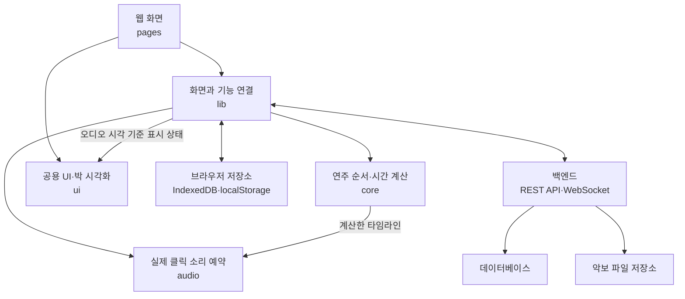

중요한 전제는 **서버가 매 박마다 “지금 소리를 내라”는 메시지를 보내는 구조가 아니라는 것**이다. 서버는 사용할 템포맵 버전과 시작 위치·시각을 정하고, 각 기기가 같은 계산으로 자기 소리를 재생한다.

| 폴더                                              | 구성요소와 책임                                                                                           |
| ------------------------------------------------- | --------------------------------------------------------------------------------------------------------- |
| [apps/web/src](../apps/web/src)                   | React 웹 앱. 화면, 사용자 입력, 인증 상태, 서버 통신, 로컬 저장과 재생 기능을 연결한다.                   |
| [apps/server/app](../apps/server/app)             | FastAPI 백엔드. 인증·권한, 공유 데이터 저장, 버전 충돌, 합주 방과 실시간 메시지를 관리한다.               |
| [packages/core/src](../packages/core/src)         | 플랫폼에 의존하지 않는 연주 규칙. 템포맵 검증, 반복·이동 전개, 박별 시간 계산, 시계 차이 추정을 담당한다. |
| [packages/audio/src](../packages/audio/src)       | 계산된 타임라인을 실제 소리로 만든다. 재생·정지, 클릭 선예약, 오디오 시계 변환, 튜너를 담당한다.          |
| [packages/ui/src](../packages/ui/src)             | 여러 화면이 함께 쓰는 버튼·대화상자·알림·박 시각화와 공통 스타일이다.                                     |
| [packages/protocol/src](../packages/protocol/src) | 서버의 API 명세에서 생성한 TypeScript 타입이다. 프론트와 서버가 주고받는 데이터 형식을 연결한다.          |
| [apps/mobile](../apps/mobile)                     | 같은 웹 앱을 Capacitor로 감싸고 네이티브 오디오·보안 저장소·딥링크·햅틱 등을 연결한다.                    |

---

## 참고 2. 프론트엔드 지도

처음에는 내부 구현을 전부 읽기보다, **무엇을 생성하고 어떤 파일을 호출하는지**부터 확인한다.

| 순서 | 파일·폴더                                                                                                         | 읽을 내용                                                                                                          |
| ---: | ----------------------------------------------------------------------------------------------------------------- | ------------------------------------------------------------------------------------------------------------------ |
|    1 | [main.tsx — bootstrap](../apps/web/src/main.tsx)                                                                  | 브라우저에서 앱이 시작하는 지점이다. 테마를 적용하고 PWA 캐시 안전성을 확인한 후 React 앱을 표시한다.              |
|    2 | [App.tsx — createAppRouter](../apps/web/src/App.tsx)                                                              | URL과 페이지의 연결이다. 인증 상태를 제공하는 `AuthProvider`, 알림, 모바일 딥링크도 여기서 조립한다.               |
|    3 | [AppShell.tsx](../apps/web/src/components/AppShell.tsx)                                                           | 공통 화면 틀이다. 상단·하단 메뉴, 본문 영역, 페이지 이동 시 포커스와 스크롤을 처리한다.                            |
|    4 | [pages](../apps/web/src/pages)                                                                                    | URL 하나에 대응하는 화면이다. 입력값, 로딩·오류 상태, 저장 버튼 등의 동작이 들어 있다.                             |
|    5 | [lib/api.ts — ApiClient](../apps/web/src/lib/api.ts), [lib/auth.tsx — AuthProvider](../apps/web/src/lib/auth.tsx) | 공통 서버 통신과 로그인 상태다. 토큰 첨부, 인증 만료 후 갱신, 세션 복원 등을 읽는다.                               |
|    6 | [lib/localDb.ts](../apps/web/src/lib/localDb.ts)                                                                  | IndexedDB, 즉 브라우저 안의 데이터베이스다. 로컬 데이터와 로그인 사용자별 원격 데이터 사본을 저장한다.             |
|    7 | [index.css](../apps/web/src/index.css), [공용 UI](../packages/ui/src)                                             | 화면 배치·반응형 스타일과 재사용 UI다. 기능의 상태 흐름을 이해한 뒤 해당 화면의 클래스와 컴포넌트를 찾아보면 된다. |

프론트에서 알아둘 구분은 세 가지다.

- **`pages`는 화면 전체**, **웹의 `components`는 앱 공통 화면 조각**, **공용 `ui` 패키지는 여러 곳에서 재사용하는 기본 UI**다.
- **`lib`가 전부 단순 보조 함수는 아니다.** 재생을 연결하는 `useMetronome`, 합주 연결을 관리하는 `RoomClient`처럼 핵심 동작도 들어 있다.
- **페이지가 직접 `ApiClient`를 호출하는 곳과, 기능별 API 함수를 거치는 곳이 섞여 있다.** 모든 기능에 별도 `xxxService` 파일이 있다고 가정하지 말고 실제 호출을 따라간다.

---

## 참고 3. 백엔드 지도

백엔드도 먼저 다음 순서로 뼈대를 잡는다.

| 순서 | 파일·폴더                                                                                        | 읽을 내용                                                                                                      |
| ---: | ------------------------------------------------------------------------------------------------ | -------------------------------------------------------------------------------------------------------------- |
|    1 | [main.py — create_app](../apps/server/app/main.py)                                               | 서버 조립 지점이다. API 등록과 서버 시작·종료 시 DB, 합주 관리자, 백그라운드 작업을 생성·정리하는 흐름을 본다. |
|    2 | [config.py](../apps/server/app/config.py)                                                        | 환경변수와 실행 조건이다. 로컬·운영, 인증 모드, DB·파일 저장소 설정이 여기서 결정된다.                         |
|    3 | [models.py](../apps/server/app/models.py)                                                        | 실제 DB 테이블과 관계다. 어떤 데이터가 어디에 영구 저장되는지 본다.                                            |
|    4 | [schemas.py](../apps/server/app/schemas.py)                                                      | API 요청·응답 형식과 입력 검증이다. DB 모델과 역할이 다르다.                                                   |
|    5 | [dependencies.py](../apps/server/app/dependencies.py), [access.py](../apps/server/app/access.py) | 요청한 사용자가 누구인지 확인하고, 해당 그룹·프로젝트·곡을 읽거나 수정할 권한이 있는지 검사한다.               |
|    6 | [routers](../apps/server/app/routers)                                                            | URL별 요청 처리 함수다. 이 프로젝트는 여기서 권한 확인과 DB 조회·저장을 직접 수행하는 경우가 많다.             |
|    7 | [db.py](../apps/server/app/db.py), [serializers.py](../apps/server/app/serializers.py)           | DB 연결·요청별 작업 세션과, DB 객체를 API 응답으로 바꾸는 코드를 본다.                                         |
|    8 | [alembic/versions](../apps/server/alembic/versions)                                              | 기존 DB 구조를 변경해 온 이력이다. 모델을 이해한 다음 데이터 보존·업그레이드를 리뷰할 때 본다.                 |

데이터 이름은 다음과 같이 구분하면 읽기가 편하다.

- `Group → Project → RepertoireItem`: **그룹 → 프로젝트 → 그 안에서 연습할 곡**이다. `GroupMember`가 사용자의 소속과 역할을 연결한다.
- `TempoMapRevision`: 곡의 **템포·박자·반복·표현 설정을 특정 버전으로 저장한 것**이다. `revision`은 저장 버전 번호다.
- `Score`: PDF·이미지·MusicXML 같은 **악보 원본의 정보와 저장 위치**다.
- `MeasureMap`: 악보 페이지의 어느 영역이 몇 번째 마디인지 나타내는 **좌표 지도**다.
- `Annotation`, `PracticeLog`, `Todo`: 각각 필기·주석, 연습일지, 할 일이다.

---

## 참고 4. 화면별 시작점과 전체 읽기 순서

모든 URL은 웹의 `/feelmyrythm/` basename을 제외하고 적었다. `:id`는 실제 ID, `?`는 생략 가능한 route parameter다. 이 표는 앞으로 작성할 후보 목록이 아니라 위 실습을 다시 찾는 색인이다.

| 화면·경로                                                                  | 첫 파일·함수                                                                                                                                      | 이어서 볼 구성요소                                    | 본문                                                                                                                                            |
| -------------------------------------------------------------------------- | ------------------------------------------------------------------------------------------------------------------------------------------------- | ----------------------------------------------------- | ----------------------------------------------------------------------------------------------------------------------------------------------- |
| 메트로놈 `/`                                                               | [MetronomePage](../apps/web/src/pages/MetronomePage.tsx) `play`                                                                                   | useMetronome → core timeline → audio → BeatVisualizer | [03](#실습-03-재생-버튼에서-실제-소리까지)                                                                                                      |
| 템포 편집 `/editor/:tempoMapId?`                                           | [EditorPage](../apps/web/src/pages/EditorPage.tsx) `save`, `importJson`                                                                           | validation·tempoMapMerge → REST 또는 localDb          | [02](#실습-02-템포맵-저장과-revision-충돌)·[09](#실습-09-수동-마디-매핑과-편집-초안-연결)                                                       |
| 합주 `/session/:roomId?`                                                   | [SessionPage](../apps/web/src/pages/SessionPage.tsx) `sendStart`                                                                                  | RoomClient → ws.py → RoomManager → startSynchronized  | [04](#실습-04-합주-시작과-시계-동기화)                                                                                                          |
| 악보 `/scores/:scoreId?`, `/repertoire/:repertoireItemId/scores/:scoreId?` | [ScoresPage](../apps/web/src/pages/ScoresPage.tsx) `upload`, `saveMetadata`, `saveAnnotation`, `requestOmrDraft`, `applyOmrDraft`, `finishSystem` | scoreApi → scores.py → DB·storage·OMR·annotation hub  | [05](#실습-05-악보-업로드와-파일-정리)–[09](#실습-09-수동-마디-매핑과-편집-초안-연결)                                                           |
| 작업 공간 `/dashboard`                                                     | [DashboardPage](../apps/web/src/pages/DashboardPage.tsx) `createGroup`, `submitManage`                                                            | workspace → groups/repertoire → access·DB             | [01](#실습-01-그룹-만들기)·[10](#실습-10-프로젝트멤버권한과-하위-데이터-삭제)                                                                   |
| 연습일지 `/practice/:repertoireItemId?`                                    | [PracticePage](../apps/web/src/pages/PracticePage.tsx) `createLog`, `addTodo`, `toggleTodo`                                                       | repertoire.py → PracticeLog·Todo → 마디 앵커          | [11](#실습-11-연습일지할-일과-악보의-마디-앵커)                                                                                                 |
| 튜너 `/tuner`                                                              | [TunerPage](../apps/web/src/pages/TunerPage.tsx) `start`                                                                                          | TunerEngine → Worklet → detectPitch → frequencyToNote | [14](#실습-14-튜너출력-지연-보정과-기기-설정)                                                                                                   |
| 출력 보정 `/calibration`                                                   | [CalibrationPage](../apps/web/src/pages/CalibrationPage.tsx) `begin`, `tap`, `save`                                                               | platform audio → median → localDb·calibrations API    | [14](#실습-14-튜너출력-지연-보정과-기기-설정)                                                                                                   |
| 설정 `/settings`                                                           | [SettingsPage](../apps/web/src/pages/SettingsPage.tsx) `save`, `removeAccount`                                                                    | theme·localStorage·storageEstimate·auth               | [12](#실습-12-로그인토큰-갱신sso와-계정-삭제)·[14](#실습-14-튜너출력-지연-보정과-기기-설정)                                                     |
| 로그인 `/login`                                                            | [LoginPage](../apps/web/src/pages/LoginPage.tsx) `submit`, `completePassword`                                                                     | AuthProvider → auth.py → security·sso·mailer          | [12](#실습-12-로그인토큰-갱신sso와-계정-삭제)                                                                                                   |
| 탈퇴 안내 `/delete-account`                                                | [AccountDeletionPage](../apps/web/src/pages/AccountDeletionPage.tsx)                                                                              | 로그인 또는 설정의 삭제 창으로 이동                   | [12](#실습-12-로그인토큰-갱신sso와-계정-삭제)                                                                                                   |
| 개인정보 안내 `/privacy`                                                   | [PrivacyPage](../apps/web/src/pages/PrivacyPage.tsx)                                                                                              | 저장·마이크·계정 안내 문구와 구현 대조                | [12](#실습-12-로그인토큰-갱신sso와-계정-삭제)–[14](#실습-14-튜너출력-지연-보정과-기기-설정)                                                     |
| 앱 시작·모바일 진입                                                        | [main.tsx](../apps/web/src/main.tsx), [App.tsx](../apps/web/src/App.tsx)                                                                          | PWA → auth → AppShell · nativeBridge → Router         | [13](#실습-13-오프라인-사본과-pwa-시작-경계)·[15](#실습-15-모바일-오디오보안-저장소와-딥링크)·[16](#실습-16-앱-시작공용-uiapi-계약과-검증-순서) |

공통 동작이 궁금할 때는 다음 보조 경로를 사용한다.

| 읽을 경계                        | 순서와 확인할 내용                                                                                                                                                                                           |
| -------------------------------- | ------------------------------------------------------------------------------------------------------------------------------------------------------------------------------------------------------------ |
| 비동기 조회와 화면 이동          | [useAsync.ts](../apps/web/src/lib/useAsync.ts)의 `requestKey`, `reload`, effect cleanup → 호출 페이지. 이전 요청의 늦은 결과가 현재 화면을 바꾸지 않는지 확인                                                |
| 편집 내용과 원격 revision 재기준 | [tempoMapMerge.ts](../apps/web/src/lib/tempoMapMerge.ts) → Editor의 conflict/rebase 상태 → [실습 02](#실습-02-템포맵-저장과-revision-충돌)                                                                   |
| 서버가 여러 개일 때의 합주       | [rooms.py](../apps/server/app/rooms.py)의 `_shared_room_lock`, `_handle_redis_event` → [redis_rooms.py](../apps/server/app/redis_rooms.py) → [test_redis_rooms.py](../apps/server/tests/test_redis_rooms.py) |
| 실시간 필기와 합주 구현 차이     | [annotation_sync.py](../apps/server/app/annotation_sync.py)와 RoomManager 비교. 필기 hub의 process 내 전파를 합주의 Redis 전파와 동일하게 설명하지 않기                                                      |
| 구조화된 오류 응답               | [api.ts](../apps/web/src/lib/api.ts)의 `ApiError` → 서버 HTTPException의 detail → 각 페이지의 401/403/409 분기                                                                                               |
| DB row와 외부 객체의 일관성      | [storage_lifecycle.py](../apps/server/app/storage_lifecycle.py) → [routers/storage_cleanup.py](../apps/server/app/routers/storage_cleanup.py) → 삭제 호출부                                                  |
| 관리자 전용 계정 정리            | [operations.py](../apps/server/app/routers/operations.py) → [dependencies.py](../apps/server/app/dependencies.py)의 SsoAdmin → [auth_cleanup.py](../apps/server/app/auth_cleanup.py)                         |

---

## 참고 5. 오류별 확인 경로와 리뷰 상황

오류 문구만 찾기보다 **어디까지 성공했고 어느 단계가 실패했는지** 구분한다. 아래 표의 “확인”은 코드를 리뷰할 때 추적할 조건이며 이번 문서 작업에서 실제로 발생시킨 장애 목록이 아니다.

| 상황                                   | 먼저 찾을 코드                                               | 구분해야 할 결과                                                  |
| -------------------------------------- | ------------------------------------------------------------ | ----------------------------------------------------------------- |
| 인증 API 401                           | `ApiClient.request/refresh`, `get_current_user`              | 갱신 후 한 번 재요청 / refresh 401에 의한 인증 해제               |
| 권한 변경 후 403                       | `require_*`, 페이지의 access role, WS 멤버십 확인            | 버튼 숨김과 서버의 실제 거부는 별개                               |
| 템포맵 저장 409                        | Editor `save`·conflict/rebase, `put_tempo_map`               | 로컬 편집 보존·최신 기준 재검토 / 무조건 덮어쓰기 아님            |
| 악보 설정·수동 맵·OMR 적용 409         | `refreshScoreSettingsAfterConflict`, map 저장 라우트         | 최신 map/revision 복구 / OMR 기준 revision은 오래된 채일 수 있음  |
| OMR 요청 503·분석 failed               | `create_omr_draft`, `OmrDraftManager`, processor             | 기능 비활성 / 프로세스·저장소·출력 파싱 실패                      |
| OMR polling만 실패                     | ScoresPage의 polling effect·수동 refresh                     | 작업 자체 failed와 조회 통신 오류를 구분                          |
| 파일 PUT 또는 complete 실패            | `uploadScore`, pending Score, outbox·reaper                  | 파일 전송 여부 / DB ready 확정 여부 / 나중 정리 여부              |
| 삭제 API 204 뒤 파일이 남음            | `enqueue_score_cleanup`, lifecycle worker                    | DB 삭제·outbox commit / 외부 파일 삭제 완료 시점                  |
| 네트워크 단절                          | 각 페이지 `isNetworkFailure`, localDb scope                  | 사용자별 snapshot이 있으면 읽기 전용 / HTTP 오류는 fallback 안 함 |
| 필기 연결 끊김                         | `AnnotationClient`, JOIN snapshot                            | 마지막 이벤트 재생이 아니라 현재 보이는 전체 DB snapshot으로 복구 |
| 합주 참가자가 늦게 입장                | RoomManager snapshot → `startSynchronized`                   | 정확한 pinned revision / 이미 지난 클릭을 몰아서 재생하지 않기    |
| 재생 중 페이지 이동·정지               | useMetronome·TunerEngine·NativeAudioEngine cleanup           | 화면 상태만 종료 / 실제 예약·track·listener까지 종료              |
| 비밀번호 재설정·탈퇴 뒤 예전 토큰 사용 | security의 `auth_generation` 비교                            | 단순 만료 시간 검사와 세대 무효화 차이                            |
| 서버 저장 성공 뒤 로컬 cache 저장 실패 | `updateOfflineCopy`, Practice snapshot catch, 탈퇴 정리 결과 | 서버의 성공을 실패로 덮지 않되 로컬 사본 상태를 과장하지 않기     |

혼자 리뷰할 때는 한 번에 아래 중 하나를 골라 끝까지 추적한다.

1. A와 B가 같은 revision을 열고 A가 저장한 뒤 B가 저장한다. 최신값을 누가 읽고 어떤 입력이 남는지 확인한다.
2. OMR을 시작한 후 다른 창에서 수동 마디 맵을 저장한다. Job의 succeeded와 적용 가능 여부가 어떻게 달라지는지 본다.
3. REST 필기 저장 응답과 WebSocket 이벤트가 서로 다른 순서로 도착한다. 같은 ID·revision이 화면 배열에 어떻게 반영되는지 본다.
4. 악보 업로드 준비 직후 탭을 닫는다. pending이 목록에 보이는지, 만료 후 누가 객체를 정리하는지 본다.
5. A로 로그인해 사본을 만든 다음 B로 전환하고 네트워크를 끊는다. 조회 key에 어느 userId가 들어가는지 본다.
6. 합주 시작 예약 뒤에 입장한다. 같은 revision을 받은 뒤 어느 마디 경계부터 예약하는지 본다.
7. 튜너 시작 권한창이 열린 동안 화면을 떠난다. 늦게 반환된 stream이 정리되는지 본다.
8. 계정 삭제는 성공했지만 IndexedDB 삭제가 실패한다. 사용자에게 어떤 성공·추가 조치 문구를 보여 주는지 본다.

이 상황들은 코드의 의도와 테스트 범위를 읽기 위한 출발점이다. 자동 테스트에 없는 실제 장치·다중 서버·운영 데이터 조건까지 검증됐다고 확대하지 않는다.

---

## 참고 6. 혼자 리뷰할 때의 순서

파일 하나를 끝까지 읽는 것보다, **“그룹 생성 버튼을 눌렀다”, “버전 3의 템포맵을 저장했다”, “합주 중 새 참가자가 들어왔다”**처럼 구체적인 상황 하나를 정하고 따라가는 편이 좋다.

1. 화면에서 그 동작을 시작하는 이벤트 처리 함수를 찾는다.
2. 함수의 입력값과 읽는 상태를 확인한다.
3. 로컬 저장인지 서버 요청인지 구분하고 실제 호출을 따라간다.
4. 서버가 요청자를 어떻게 확인하고 해당 데이터의 권한을 어떻게 검사하는지 본다.
5. 바뀌는 상태와 DB 저장 범위, 응답 형식을 확인한다.
6. 실패했을 때 돌아가는 경로와 사용자에게 보이는 상태를 확인한다.
7. 대응 테스트가 그 상황과 실패 조건을 어떻게 표현하는지 읽는다.

특히 큰 페이지 파일은 **이벤트 처리 함수 → 호출하는 함수 → 결과를 화면에 반영하는 코드**부터 읽는다. 화면을 그리는 JSX와 세부 CSS는 그다음에 연결하면 된다.

API 타입이 궁금할 때는 생성된 타입 전체를 처음부터 읽기보다, 원본인 서버 스키마에서 해당 요청·응답 모델을 찾는 편이 빠르다. `core`의 타입은 연주 데이터를 표현하고, `protocol`의 타입은 서버와 주고받는 API 데이터를 표현한다는 차이도 구분한다.

---

**문서 안내**\
이 문서는 소스 읽기를 위한 해설이다. SQL 실행이나 DB 변경, 실제 기기의 오디오 지연 측정은 하지 않았다. JSON·ID·시간 계산 예시는 실제 실행 기록이 아니며, 코드 발췌와 연결 경로를 원본에 대조해 작성했다.

소스 링크는 저장소의 `docs/` 폴더를 기준으로 한 상대 경로다. Markdown 파일을 내려받았다면 같은 위치에 두면 소스 링크를 사용할 수 있다. 도식은 Mermaid를 지원하는 Markdown 뷰어에서 렌더링된다.

더 자세한 실행·운영 배경은 [아키텍처와 코드 읽기 가이드](ARCHITECTURE_AND_CODE_GUIDE.md)를 참고한다.
